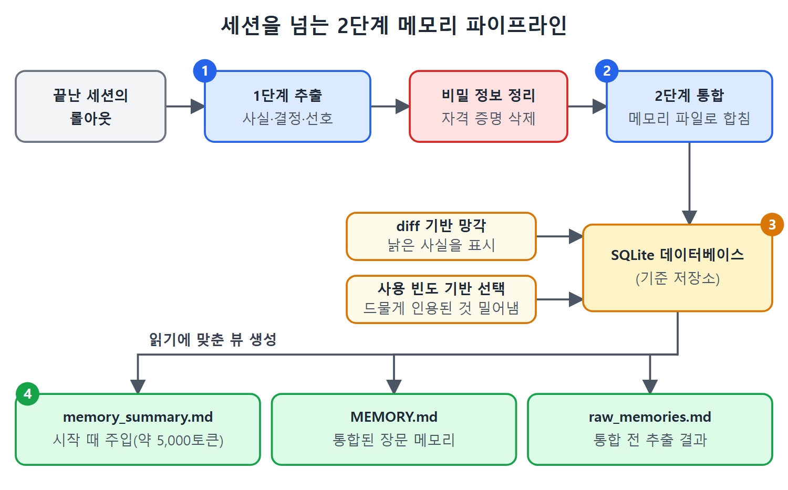

# 세션을 넘는 메모리

지금까지는 한 대화 안에서 쌓였다가 세션이 끝나면 사라지는 토큰을 이야기했다. 하지만 Codex CLI에는 세션을 넘어 지식을 이어 주는 영속 메모리 계층도 있다. 매일 아침 관례, 선호, 프로젝트 사실을 다시 설명하지 않아도 되게 해 준다. 세션 시작 때 주입되는 메모리도 다른 프롬프트 내용과 같은 토큰 공간을 쓰기 때문에, 이 파이프라인을 이해하는 것은 컨텍스트 예산에도 중요하다. 이 문서는 내장 2단계 메모리 파이프라인, 설정 키, MCP 메모리 서버, 팀 메모리의 한계, 지난 세션 검색을 정리한다.

---

## 1. 2단계 메모리 파이프라인

파이프라인은 두 단계로 동작한다.

- 1단계, 추출(Extraction): 세션이 충분히 오래 유휴 상태가 된 뒤, 가벼운 에이전트들이 끝난 세션의 롤아웃(rollout, 세션 기록)을 처리한다. 사실, 결정, 선호를 구조화된 Markdown과 간결한 세션 요약으로 뽑는다.
- 2단계, 통합(Consolidation): 주기적으로 1단계 결과를 `~/.codex/memories/` 아래의 전역 메모리 파일로 합친다. `codex_home`마다 통합 프로세스는 한 번에 하나만 돌고, 전체를 다시 만들지 않도록 증분 워터마크를 쓴다.

저장 구조는 두 계층을 반영한다.

| 파일 | 역할 |
|---|---|
| `memory_summary.md` | 시작 때 주입되는 주된 요약. 약 5,000토큰으로 제한 |
| `MEMORY.md` | 통합된 장문 메모리. grep으로 검색 가능 |
| `raw_memories.md` | 통합 전 추출 결과 |

이 Markdown 파일들 옆에 있는 SQLite 데이터베이스가 기준 저장소(system of record)이고, Markdown은 프롬프트 주입용으로 읽기에 맞게 생성한 뷰다.

### 그림 7.2 2단계 메모리 파이프라인

위 그림은 원서의 그림 7.2다. 영어 라벨을 풀면 다음과 같다.

1. 비밀 정보 정리가 1단계(추출)의 경계에서 자격 증명을 지운다.
2. 1단계는 사실과 요약을 뽑아 2단계(통합)로 넘기고, 2단계는 그것을 메모리 파일로 합친다.
3. 합친 결과는 SQLite 데이터베이스(기준 저장소)에 담긴다. diff 기반 망각은 낡은 사실을 표시하고, 사용 빈도 기반 선택은 드물게 인용된 것을 밀어낸다.
4. 데이터베이스는 읽기에 맞춘 뷰 세 개를 만든다. `memory_summary.md`(시작 때 주입), `MEMORY.md`(통합된 장문 메모리), `raw_memories.md`(통합 전 추출 결과)다.



이 그림은 끝난 세션의 롤아웃이 추출, 비밀 정보 정리, 통합을 지나 SQLite 데이터베이스에 쌓이고, 거기서 읽기용 Markdown 파일 세 개가 만들어지는 흐름을 보여 준다.

## 2. 메모리를 깨끗하게 유지하는 세 가지 동작

1. 비밀 정보 정리(secret sanitisation): 1단계 경계에서 실행되어, 세션 중 입력된 자격 증명을 추출 결과가 디스크에 닿기 전에 지운다. 이것은 심층 방어의 하나로 보고 유일한 방어선으로 믿으면 안 된다. 가능하면 비밀 값을 세션에 붙여 넣지 않는다.
2. diff 기반 망각(diff-based forgetting): 메모리가 추가만 되는 구조가 되지 않게 한다. 새 추출이 기존 사실과 모순되면(프로젝트가 Jest에서 Vitest로 바꾼 경우 등) 통합 에이전트가 옛 사실을 낡은 것으로 표시하고, 유예 기간이 지나면 SQLite에서 지운다.
3. 사용 빈도 기반 선택(usage-aware selection): 자주 인용되는 메모리는 보존하고 드물게 인용되는 것은 밀어낸다. LRU 캐시 축출에 대응되는 의미 수준의 방식이다.

## 3. 파이프라인 설정

`[memories]` 표의 키 세 개로 파이프라인이 얼마나 자주 도는지 조절한다.

```toml
[memories]
min_rollout_idle_hours = 6      # 스레드가 대상이 되기까지 유휴 시간 (기본 6, 범위 1~48)
max_rollout_age_days = 30       # 고려할 스레드의 최대 나이 (기본 30, 범위 0~90)
max_rollouts_per_startup = 16   # 시작할 때 처리할 후보 수 (기본 16, 최대 128)
```

파이프라인은 세션 시작 때 돈다. 늘 켜져 있는 영속 에이전트는 변경을 적용하려면 Codex CLI를 재시작해야 할 수 있다. 유휴 시간을 낮추면 메모리가 더 빨리 반영되고, 나이 창을 늘리면 더 오래된 스레드를 다시 살펴보고, 배치를 작게 하면 시작할 때의 작업량이 줄지만 대기열은 길어진다.

`/memories`는 TUI를 떠나지 않고 메모리 주입과 생성을 켜고 끈다. 때때로 `~/.codex/memories/MEMORY.md`를 직접 열어 보는 것도 가치가 있다. 통합 에이전트의 요약이 정확한지 확인하고, 어긋난 부분은 고친다. 평범한 Markdown 파일이다.

## 4. MCP 메모리 서버

내장 메모리는 사실을 저장해 세션 시작 때 불러오지만, 의미 기반 검색이 아니라 단순한 파일 로딩 방식이다. 프로젝트가 몇 달에 걸쳐 수천 가지 결정을 쌓으면 이 평면적 로딩은 한계에 부딪힌다. MCP 메모리 서버는 Model Context Protocol로 검색 가능하고 의미 색인이 된 영속 메모리를 제공해 이 틈을 메운다.

알아 둘 두 부류가 있다.

- 에피소드 메모리 서버(예: Basic Memory): 결정, 인수인계, 자유 형식 메모를 검색 가능한 Markdown으로 저장한다. 클라이언트 간 상호운용이 되는 경우가 많아서 Codex CLI에서 쓴 노트를 다른 MCP 지원 도구에서도 쓸 수 있다.
- 구조 메모리 서버(예: codebase-memory-mcp): 정적 분석으로 코드 자체를 색인해서, 세션을 다시 시작해도 남는 구조적 이해를 필요할 때 에이전트에게 준다. 원서는 이 서버가 66개 언어에 대한 Tree-Sitter AST 지식 그래프를 쓴다고 소개한다.

두 부류는 서로 대체하지 않고 보완한다.

메모리 서버도 MCP 도구 스키마를 시스템 프롬프트에 더하므로 토큰을 쓴다. 일반적인 에피소드 서버는 스키마에 수백에서 2천 토큰 남짓이 드는데, 이것이 아껴 주는 파일 읽기와 재탐색에 비하면 작다. 위에 든 이름은 예시일 뿐 추천이 아니며, 현재 상태는 각 서버 문서로 확인해야 한다.

## 5. 팀 메모리의 빈틈

여러 개발자와 그들의 에이전트가 같은 코드베이스에서 일하면 각 에이전트는 아키텍처 결정, 디버깅 통찰, API의 특이점 같은 지식을 쌓는다. 이 지식은 세션이 끝나면 사라지거나 한 개발자의 `~/.codex/memories/`에 갇힌다. 다음 개발자는 맨손으로 시작한다.

개발자 간 팀 메모리는 Codex CLI 내장 메모리에서 여전히 빈틈이다. 내장 2단계 파이프라인은 설계상 한 사람용이다. `~/.codex/memories/`는 하나의 홈 디렉터리에 한정되고, 통합 에이전트에는 개발자 간 지식을 합치는 장치가 없다. 네이티브 팀 메모리가 나오기 전까지 가장 현실적인 우회책은 훅으로 연결한 git 기반 공유 지식 저장소다. SessionStart 훅이 최신 팀 지식을 받아와 최근 결정을 `additionalContext`로 주입하고, Stop 훅이 구조화된 세션 요약을 공유 저장소에 되써 넣는다. 훅의 자세한 내용은 9장에서 다룬다.

## 6. 지난 세션 찾기

Codex CLI는 대화 기록 검색을 제공한다. 로컬의 모든 세션을 대상으로 대소문자를 구분하지 않고 내용을 맞춰 보고 결과 미리보기를 보여 준다. 대화가 대략 언제였는지 기억하려 하거나 날짜순 목록을 넘겨 보는 대신, 무엇을 논의했는지로 찾을 수 있다.

검색은 세션 내용(프롬프트, 응답, 도구 출력)을 색인하고, 일치한 세션을 매칭 위치를 보여 주는 맥락 조각과 함께 돌려준다. 지난주에 문제를 풀었다는 건 아는데 어느 세션인지 기억나지 않는 여러 날짜의 작업에 특히 유용하다.

메모리의 런타임 상태는 전용 SQLite 데이터베이스에 보관된다. 이것이 대화 기록 검색의 쿼리 성능을 뒷받침하고, 앞서 본 메모리 파이프라인의 견고한 기반이 된다.

<br>
<br>
<br>

[Agentic Coding with OpenAI Codex CLI](../)
