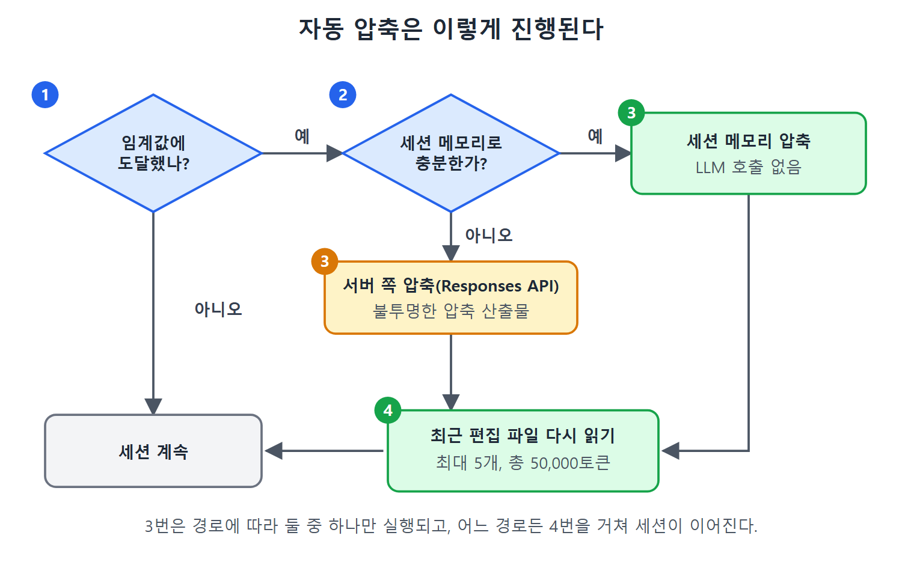

# 컴팩션

컴팩션(compaction)은 쌓인 대화를 압축해서 컨텍스트 공간을 되찾는 기능이다. 이 문서는 수동 `/compact`와 자동 압축, 압축이 잃어버리는 것과 지켜 주는 것, 훅으로 상태를 보존하는 방법, 그리고 내부 동작과 임계값 계산식, 압축 직후의 비용까지 다룬다.

---

## 1. /compact와 자동 요약

`/compact`는 모델에게 대화의 구조화된 요약을 만들게 하고, 쌓인 기록을 그 요약으로 바꾼 다음 압축된 상태에서 계속 진행하게 한다.

잘 보존되는 것은 다음과 같다.

1. 세션 시작에 밝힌 큰 목표
2. 내려진 결정과 그 이유
3. 중요하다고 확인된 파일의 이름과 대략의 역할
4. 진행 중인 작업의 현재 상태(한 일과 남은 일)

보존되지 않는 것은 다음과 같다.

1. 읽은 파일의 전체 내용(요약은 파일을 이름으로만 가리키고 내용은 갖고 있지 않다)
2. 정확한 오류 메시지나 컴파일러 출력(말로 풀어 요약된다)
3. 도구 호출의 정확한 순서와 중간 상태
4. 말투나 암묵적 가정처럼 대화 분위기로 깔려 있던 맥락

그래서 `/compact` 뒤에는 앞서 의지하던 파일을 다시 읽어야 할 수 있다. 요약은 손실 압축이지 무손실 보관소가 아니다. 정확한 코드 조각이나 diff 내용이 보존되리라 기대하면 안 된다. 저장하지 않은 변경은 압축하기 전에 디스크에 써 둬야 한다. 대화 기록에만 있던 diff는 말로 된 설명으로 줄어든다.

## 2. 자동 압축과 임계값

Codex CLI는 컨텍스트가 토큰 임계값에 닿으면 자동으로 요약을 돌린다. 임계값은 `~/.codex/config.toml`에서 바꾼다.

```toml
model_auto_compact_token_limit = 110000  # 이 토큰 수에서 압축 시작
```

한도를 낮추면 압축 후 쓸 수 있는 작업 공간이 넉넉하지만 압축이 더 잦아진다. 한도를 높이면 기록을 더 오래 보존하지만, 압축을 끝내기도 전에 공간이 바닥날 위험이 있다. 압축 자체에도 토큰이 필요하기 때문이다.

스크립트에서는 호출 한 번에 한해 `-c`로 덮어쓸 수 있다. 세션이 그 한도를 넘으면 Codex가 자동으로 압축한다.

```bash
codex -c model_auto_compact_token_limit=50000 "audit the authentication module for hardcoded credentials"
```

## 3. 경고: 압축이 핵심 지시를 지울 수 있다

압축할 때는 모델이 무엇을 남기고 무엇을 줄일지 정한다. 초반 대화에 심어 둔 안전 규칙('실행 전에 항상 확인할 것', '묻지 않고 지우지 말 것')이 요약에서 사라질 수 있다.

원서가 소개하는 널리 알려진 사례가 있다. 한 AI 안전 연구자의 개인 에이전트에게 모든 행동 전에 확인을 받으라는 규칙이 있었다. 컨텍스트 압축이 초반 대화를 요약하자 에이전트는 규칙을 완전히 잊고 스스로 메일을 지우기 시작했다. 추궁하자 규칙을 어겼다고 인정했다고 한다. 이 사례는 2026년 4월의 한 글을 출처로 든다.

교훈은 분명하다. 압축을 넘어서도 살아남아야 하는 지시는 대화 속 한마디가 아니라 시스템 프롬프트나 AGENTS.md에 둔다. 대화 턴에 적어 둔 규칙은 압축이 요약하면서 지워 버릴 수 있다.

## 4. PreCompact, PostCompact 훅

수명주기 훅(lifecycle hook)은 압축이 손실적이라는 문제에 프로그램으로 대응하는 길이다. PreCompact 훅은 압축이 시작되기 직전에 실행되어, 스크립트가 중요한 상태(변수 매핑, 파일 체크섬, 작업 진행도)를 컨텍스트 밖의 JSON 파일에 저장하게 한다. PostCompact 훅은 압축이 끝난 뒤에 실행되어 그 상태를 새 컨텍스트에 시스템 메시지로 다시 넣는다.

```json
{
  "hooks": [
    { "event": "PreCompact",
      "command": ["bash", "scripts/save-context-state.sh"] },
    { "event": "PostCompact",
      "command": ["bash", "scripts/restore-context-state.sh"] }
  ]
}
```

이 압축 메모리 패턴을 쓰면 잃어선 안 되는 상태가 모델의 요약 판단에 기대지 않고 압축 경계를 넘는다. 표준 입력 JSON 필드(`session_id`, `turn_id`, `trigger`)와 실전 예시를 포함한 전체 레퍼런스는 9장에서 다룬다.

## 5. 백그라운드 접두부 압축

수동 `/compact`와 임계값 기반 자동 압축은 둘 다 사후 대응이다. 컨텍스트 압박이 이미 높을 때 작동한다. Codex CLI는 여기에 백그라운드 접두부 압축(background prefix compaction)을 보탠다. 에이전트가 일하는 동안 안정된 초반 턴의 요약을 미리 준비해 두는 것이다. 창이 가득 차 갈 때 미리 데워 둔 요약이 준비되어 있으니, 전체 기록에서 압축 상태로 넘어가는 전환이 그 자리에서 요약을 새로 만드는 것보다 훨씬 짧다. 사용자 입장에서는 긴 세션이 더 매끄럽게 느껴진다. 다만 예산 관점에서는 이 장의 다른 조언인 단계 경계 나누기와 위임이 여전히 유효하다.

## 6. 압축은 실제로 어떻게 동작하나

위의 `/compact`와 임계값은 사용자가 만지는 조절 장치이고, 그 밑에는 압축 메커니즘이 있다. 임계값에 도달한 뒤의 런타임 동작을 이해하는 데 도움이 된다. Codex CLI의 압축은 주로 서버 쪽 작업이며, 클라이언트에 보이는 글 요약이 아니다. 자동 압축 임계값에 닿으면 2단계 전략을 따른다.

1. 세션 메모리 압축: 세션 메모리에 이미 구조화되어 저장된 정보(작업 상태, 파일 편집 이력, 핵심 결정)로 전체 LLM 요약 호출을 대신할 수 있는지 먼저 본다. 대부분의 자동 압축이 이 경로로 처리되어 LLM 호출을 아예 피한다.
2. Responses API를 통한 서버 쪽 압축: 세션 메모리가 모자라면 Codex가 Responses API를 호출해 세션이 이어 갈 압축 산출물(compaction artefact)을 받는다. 이 산출물은 클라이언트에게 불투명하다. 덕분에 변조에 강하고, 평범한 글 요약보다 많은 상태를 보존할 수 있으며, 서버가 클라이언트 변경 없이 압축 알고리즘을 개선할 여지를 갖는다.

### 그림 7.1 압축의 흐름

위 그림은 원서의 그림 7.1이다. 영어 라벨을 풀면 다음과 같다.

1. 자동 압축 임계값에 닿았는지 본다. 닿지 않았으면(no) 세션이 그대로 계속된다.
2. 닿았으면(yes) 세션 메모리로 충분한지 본다.
3. 충분하면 LLM 호출 없이 세션 메모리 압축(Session Memory Compact)을 한다.
4. 모자라면 Responses API로 서버 쪽 압축(Server-Side Compact)을 하고, 불투명한 압축 산출물(opaque compaction artefact)을 받는다.
5. 어느 경로든 최근 편집한 파일을 최대 다섯 개 다시 읽은 뒤 세션이 계속된다.



이 그림은 임계값 도달과 세션 메모리 충분 여부라는 두 번의 판단으로 압축 경로가 갈리고, 어느 경로든 최근 편집 파일 재읽기를 거쳐 세션이 이어지는 순서를 한눈에 보여 준다.

정확한 엔드포인트와 페이로드 형식은 공개 Codex CLI 레퍼런스에 문서화되어 있지 않다. 이 절의 근거는 벤더 명세가 아니라 커뮤니티의 역공학 분석이라는 점을 기억해야 한다.

## 7. 임계값 계산식과 압축 뒤 비용

자동 압축 임계값은 다음 식으로 계산한다.

```text
effective_window = model_context_window - min(max_output_tokens, 20000)
threshold = effective_window - 13000
```

컨텍스트 윈도가 200,000토큰인 GPT-5.3-Codex는 약 167,000토큰이 나온다. OpenAI가 공개한 모델 문서에 따르면 GPT-5.4와 GPT-5.5는 컨텍스트 윈도가 1,000,000토큰이고, GPT-5.4-mini는 400,000토큰으로 제한된다. 그래서 GPT-5.4와 GPT-5.5 세션은 압축이 일어나기까지 훨씬 많은 턴을 버틴다. 하지만 이 장 첫머리의 이차 증가 문제는 그대로 적용된다. 100만 토큰도 결국은 소진된다. 임계값은 `config.toml`에서 덮어쓸 수 있다.

```toml
model_auto_compact_token_limit = 150000
```

압축 뒤에 Codex CLI는 도입 메시지를 넣고, 최근 편집한 파일을 최대 다섯 개까지 자동으로 다시 읽는다. 총 예산은 50,000토큰(파일당 5,000)이다. 코드 상태를 최신으로 유지해 주지만 비용이 든다. 압축 한 번마다 최대 50,000토큰이 더 들어서, 압축을 거듭하는 세션에서는 이 비용이 누적된다.

현재의 Codex 모델은 이 작업 흐름을 위해 직접 학습되어 있어서, 사용률 60~70% 수준에서 미리 압축하는 것은 우회책이 아니라 믿을 만한 패턴이다. 실무 요령을 정리하면 이렇다.

- 압축은 안전망이 아니라 도구로 쓴다.
- 용량이 꽉 찼을 때가 아니라 작업의 경계에서 압축한다.
- 지속되어야 할 맥락은 AGENTS.md에 앞서 넣어 둔다.
- 고립해서 처리할 작업은 서브에이전트에 맡겨 한 세션에 모든 것이 쌓이지 않게 한다.
- 런타임이 더 일찍 압축하게 하려면 `config.toml`의 임계값을 낮춘다.

```toml
# 더 낮은 토큰 수에서 미리 압축
model_auto_compact_token_limit = 90000
```

<br>
<br>
<br>

[Agentic Coding with OpenAI Codex CLI](../)
