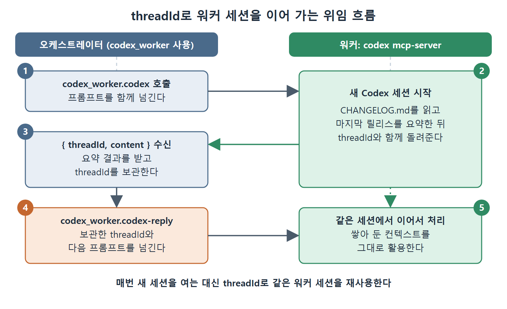

# Codex CLI를 MCP 서버로 쓰기

MCP 프로토콜은 대칭이다. 지금까지 Codex CLI는 서버를 가져다 쓰는 클라이언트였지만, 스스로 서버가 되어 자기 도구(파일 작업, 셸 실행, 코드 분석)를 연결해 온 다른 에이전트에게 내줄 수도 있다. 이 문서는 `codex mcp-server`가 노출하는 두 도구, 오케스트레이터에서 이를 쓰는 설정, 그리고 여기서 파생되는 세 가지 활용 패턴을 설명한다.

---

## 1. codex mcp-server

```bash
codex mcp-server
```

이 서버는 MCP 프로토콜로 도구 두 개를 내놓는다.

| 도구 | 역할 | 비고 |
|---|---|---|
| codex | 새 Codex 세션을 시작한다 | 필수 매개변수는 prompt. 선택 매개변수로 model, approval-policy, sandbox, cwd, base-instructions, developer-instructions를 덮어쓸 수 있다. 반환값은 { threadId, content } |
| codex-reply | 기존 세션을 이어 간다 | codex가 돌려준 threadId와 다음 사용자 프롬프트를 넘긴다 |

threadId가 핵심이다. 첫 호출로 세션을 열고 받은 threadId를 들고 있다가 후속 작업은 codex-reply로 이어 가면, 매번 새 세션을 여는 대신 워커가 쌓은 컨텍스트를 이어서 쓴다.

## 2. 다른 Codex CLI에서 이 서버를 가져다 쓰기

두 번째 Codex CLI 인스턴스는 첫 번째를 평범한 MCP 서버로 쓸 수 있다. 일을 나누어 주는 쪽(오케스트레이터)의 ~/.codex/config.toml에 다음을 넣는다.

```toml
[mcp_servers.codex_worker]
command = "codex"
args = ["mcp-server"]
enabled_tools = ["codex", "codex-reply"]
```

오케스트레이터를 재시작한 뒤 위임을 시킨다.

```bash
codex "Use the codex_worker MCP server to read CHANGELOG.md and summarise the last release. Return only the summary."
```

흐름은 이렇다. 오케스트레이터가 codex_worker.codex를 프롬프트와 함께 호출한다. 자식 Codex 세션이 CHANGELOG.md를 읽고 요약해서 결과를 thread ID와 함께 돌려준다. 후속 요청은 codex_worker.codex-reply에 그 thread ID를 넘겨서 하며, 이렇게 하면 워커가 쌓은 컨텍스트가 유지된다.



그림은 오케스트레이터가 codex로 워커 세션을 열고 받은 threadId를 codex-reply에 넘겨 같은 세션을 이어 가는 순서를 보여 준다.

## 3. 세 가지 활용 패턴

1. **에이전트 간 위임.** 여러 에이전트를 나누어 맡기고 조율하는 일(오케스트레이션)을 맡은 에이전트가 계획과 조정은 직접 하고, 코딩 작업은 Codex CLI에 위임한다.
2. **도구 조합.** 파이프라인 에이전트가 Codex CLI를 다른 MCP 서버(데이터베이스, 배포, 모니터링)와 엮어 여러 단계의 워크플로를 실행한다.
3. **IDE 연동.** IDE 확장이 Codex CLI에 MCP 서버로 접속해 에디터 안에서 에이전트 기능을 제공한다.

## 4. 클라이언트가 꼭 Codex일 필요는 없다

클라이언트가 다른 Codex CLI일 필요는 없다. Claude Code, 직접 만든 Python 오케스트레이터, IDE 확장 모두 같은 MCP 프로토콜로 같은 `codex mcp-server` stdio 프로세스에 말을 건다. 이후의 운영 문제는 서드파티 서버를 가져다 쓸 때와 다르지 않고, 다음 문서에서 다룬다.

## 5. 쓸 때 주의할 점

- 서버로 뜬 Codex도 승인 정책과 샌드박스를 가진 하나의 세션이다. codex 도구로 approval-policy와 sandbox를 덮어쓸 수 있으므로, 위임하는 쪽이 어떤 값을 넘기는지가 안전 범위를 정한다.
- enabled_tools로 필요한 도구만 열어 컨텍스트 비용을 아낀다. 위 예시는 두 도구를 모두 명시했다.

<br>
<br>
<br>

[Agentic Coding with OpenAI Codex CLI](../)
