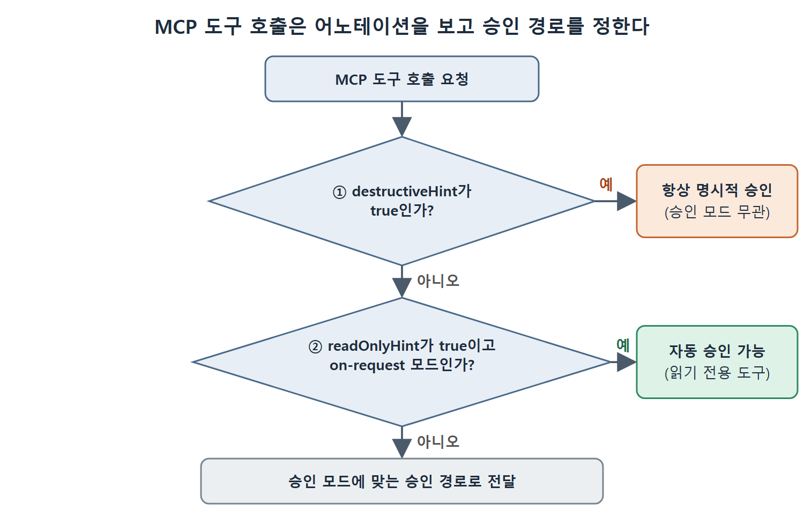

# MCP 기본 개념

MCP(Model Context Protocol, 모델 컨텍스트 프로토콜)는 에이전트가 외부 세계와 대화하는 방법을 하나로 맞춘 표준이다. 서비스마다 연동 코드를 따로 짤 필요 없이, 서비스당 설정 블록 하나와 모두에게 공통인 통신 규약 하나만 있으면 된다. 이 문서는 MCP가 무엇이고 무엇이 아닌지, 호스트·클라이언트·서버가 어떻게 나뉘는지, 도구마다 붙는 위험 표시(annotation)가 승인 흐름에서 어떤 역할을 하는지 정리한다.

이 장 전체를 관통하는 관점이 하나 있다. 서버를 하나 연결할 때마다 쓸 수 있는 능력이 늘지만, 그만큼 컨텍스트 윈도도 줄어든다. 그래서 어떤 서버를 켤지 고르는 일 자체가 컨텍스트 관리의 한 부분이다. 원서는 일반적인 데스크톱 설치 환경에서 MCP와 커넥터의 스키마(도구 정의)만으로 사용자의 첫 프롬프트를 읽기도 전에 10만 토큰 넘게 쓰일 수 있다고 짚는다.

---

## 1. 장의 학습 목표

이 장을 마치면 다음을 할 수 있어야 한다.

- 전역 범위와 프로젝트 범위의 config.toml에 MCP 서버를 설정한다.
- Codex CLI를 GitHub, 브라우저, 데이터베이스 같은 흔한 MCP 서버에 연결한다.
- Python으로 최소한의 MCP 서버를 만들어 Codex CLI에 붙인다.
- Codex CLI 자신을 다른 에이전트가 쓰는 MCP 서버로 설정한다.
- 안전 경계를 갖춘 쓰기 가능(write-enabled) MCP 연동을 설계한다.
- 도구 어노테이션, 병렬 호출, 컨텍스트 비용 관리를 이해한다.

Codex CLI는 외부 도구의 소비자(클라이언트)일 뿐 아니라, 스스로 MCP 서버가 되어 다른 에이전트가 부를 수 있는 능력이 되기도 한다. 이렇게 하면 사람이 매 단계 끼어들지 않아도 결과를 되써 넣는(write-back) 파이프라인을 만들 수 있다.

## 2. 60초 만에 보는 MCP

MCP는 어떤 AI 에이전트든 어떤 외부 도구와도 하나의 공용 인터페이스로 대화하게 해 주는 열린 표준이다. GitHub용 코드, 데이터베이스용 코드, 문서 서버용 코드를 각각 짜는 대신 서비스마다 MCP 서버로 한 번만 설정하면 에이전트는 모두 같은 규약으로 쓴다. 원서는 이를 "에이전트 기능을 위한 USB-C"에 비유한다. 커넥터 하나로 여러 기기를 꽂는다는 뜻이다.

GitHub MCP 서버를 Codex CLI에 연결하는 과정은 세 단계다.

**1단계. 토큰을 환경 변수로 내보낸다.** GitHub MCP 서버가 읽는 환경 변수를 셸에 설정한다.

```bash
export GITHUB_PERSONAL_ACCESS_TOKEN="ghp_your_token_here"
```

Codex CLI는 같은 셸에서 띄우거나, 이 환경 변수를 넘겨 주는 런처로 띄워야 한다. 토큰을 config.toml에 직접 적는 것은 피한다. MCP 서버 프로세스가 시작할 때 환경 변수를 물려받게 하는 것이 원칙이다.

**2단계. ~/.codex/config.toml에 서버를 추가한다.**

```toml
[mcp_servers.github]
enabled = true
command = "npx"
args = ["-y", "@modelcontextprotocol/server-github"]
enabled_tools = ["create_issue", "list_issues", "get_file_contents",
"search_code"]
```

**3단계. Codex CLI를 다시 시작하고 GitHub 작업을 시킨다.**

```bash
codex "List the open issues labelled 'bug' in our main repo and summarise them"
```

에이전트는 GitHub MCP 서버의 list_issues 도구를 호출하고, 구조화된 데이터를 돌려받아 그 위에서 추론한다. 데이터베이스, 브라우저 자동화, 문서 서비스 등 MCP 서버 구현이 있는 시스템이면 같은 방식이 그대로 통한다.

## 3. MCP인 것과 아닌 것

MCP는 에이전트와 도구 사이의 통신 표준 인터페이스를 정의하는 열린 프로토콜이다. MCP 서버는 도구(tools), 리소스(resources), 프롬프트(prompts)를 공통 통신 규약으로 노출하고, 규약을 지키는 클라이언트(Codex CLI, Claude Code, Cursor 등)는 별도 연동 코드 없이 이를 가져다 쓴다. 특정 회사의 것이 아니라 중립적인 표준이며, 리눅스 재단 산하 Agentic AI Foundation(AAIF)에 기증되어 공개 명세 절차로 관리된다.

MCP가 제공하는 것은 다음과 같다.

1. 언어와 플랫폼의 경계를 넘어 도구를 찾고 호출하는 표준 방법
2. 도구의 입력과 출력에 대한 타입이 있는 인터페이스
3. 도구와 나란히 쓰는 리소스(파일, 데이터)와 프롬프트(템플릿)를 다루는 규약
4. 도구 어노테이션과 기능 범위 제한에 기반한 보안 모델

MCP가 아닌 것도 분명히 구분해야 한다.

- 에이전트끼리 대화하는 프로토콜이 아니다. 에이전트 간 조율은 Google의 A2A(Agent-to-Agent) 프로토콜이 맡는다. MCP는 에이전트와 도구를 잇고, A2A는 에이전트와 에이전트를 잇는다.
- 모델 서빙 프로토콜이 아니다. MCP 서버는 도구와 데이터 같은 기능을 제공할 뿐 모델 추론을 제공하지 않는다.

## 4. 구조: 호스트, 클라이언트, 서버

MCP는 3단 구조다.

| 구성 요소 | 하는 일 | Codex CLI에서의 모습 |
|---|---|---|
| 호스트(Host) | 사용자가 직접 쓰는 애플리케이션. 클라이언트를 하나 이상 관리한다 | Codex CLI 자체, IDE, 웹 앱 |
| 클라이언트(Client) | 호스트 안에서 정확히 서버 하나와 세션을 유지하는 프로토콜 수준의 연결 부품 | 설정한 서버 하나당 클라이언트 하나가 생긴다 |
| 서버(Server) | 도구·리소스·프롬프트를 MCP로 노출하는 프로세스 | 자식 프로세스(stdio 전송) 또는 네트워크 서비스(HTTP 전송) |

그림 8-1의 읽는 법은 이렇다. 왼쪽 호스트 안에 Codex CLI가 있고, 그 아래에 클라이언트가 둘 있다. 한 클라이언트는 자식 프로세스로 띄운 stdio 전송 서버와, 다른 클라이언트는 네트워크 서비스로 떠 있는 HTTP 전송 서버와 각각 1대1로 세션을 맺는다.

역할 분담도 중요하다. 어떤 서버에 연결할지, 모델에게 어떤 도구를 보여 줄지, 도구 호출을 어떻게 승인할지는 모두 호스트가 정한다. 반대로 서버는 다른 서버나 모델의 추론 과정을 전혀 볼 수 없다.

## 5. 도구 어노테이션: 위험을 알리는 어휘

MCP 도구에는 기계가 읽을 수 있는 위험 정보(어노테이션)를 붙일 수 있고, 호스트는 이를 보고 승인 여부를 판단한다.

```json
{
  "name": "delete_file",
  "annotations": {
    "readOnlyHint": false,
    "destructiveHint": true,
    "idempotentHint": false,
    "openWorldHint": true
  }
}
```

| 어노테이션 | 뜻 |
|---|---|
| readOnlyHint | 데이터를 읽기만 하고 부작용이 없는 도구 |
| destructiveHint | 데이터를 지우거나 덮어쓸 수 있는 도구 |
| idempotentHint | 같은 호출을 반복해도 결과가 같은 도구 |
| openWorldHint | 에이전트의 샌드박스 바깥 시스템과 상호작용하는 도구 |

Codex CLI는 이 값을 보고 도구 호출을 알맞은 승인 경로로 보낸다. on-request 모드에서 readOnlyHint가 true인 도구는 자동 승인될 수 있다. destructiveHint가 true인 도구는 승인 모드와 상관없이 항상 명시적 승인을 요구한다.



그림은 도구 호출이 들어왔을 때 destructiveHint와 readOnlyHint를 차례로 확인해 항상 명시적 승인, 자동 승인 가능, 승인 모드에 따른 일반 경로 중 하나로 나뉘는 과정을 보여 준다.

직접 MCP 서버를 만들 때는 모든 도구에 정직하게 어노테이션을 달아야 한다. 단순히 쓰기가 가능한 정도의 도구라도 파괴적이라고 표시하는 보수적인 쪽이 안전하다. 운영자는 승인 요구를 나중에 느슨하게 풀 수 있지만, 읽기 전용이라고 거짓 신고한 도구 때문에 자동 승인되어 버린 파괴적 작업은 되돌릴 수 없기 때문이다.

<br>
<br>
<br>

[Agentic Coding with OpenAI Codex CLI](../)
