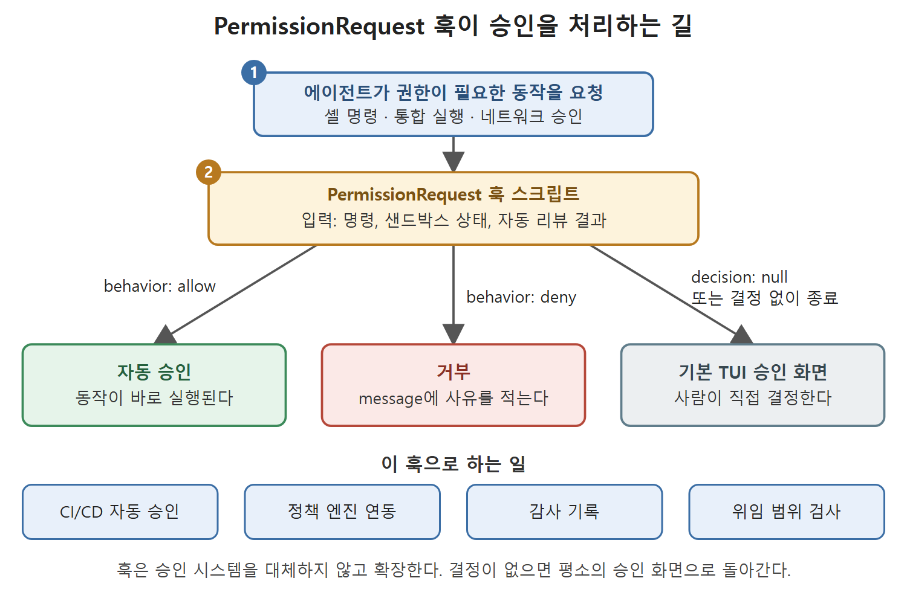

# 도구 호출과 권한 훅

에이전트가 하는 실제 행동은 결국 도구 호출이다. 셸 명령을 실행하고, 파일을 패치하고, MCP 서버의 도구를 부른다. 이 문서는 도구 호출 전에 끼어드는 PreToolUse, 권한 요청을 스크립트로 처리하는 PermissionRequest, 도구 호출이 끝난 뒤 결과를 살피는 PostToolUse를 다룬다.

---

## 1. PreToolUse: 셸 명령 가로채기

PreToolUse는 각 도구 호출이 실행되기 직전에 발생하며, 도구 호출이 실행되지 못하게 막을 수 있는 유일한 훅이다. Bash 도구 호출, MCP 도구 호출(`mcp__<server>__<tool>`), `apply_patch`에서 모두 발생한다. 어떤 도구를 대상으로 할지는 matcher로 정한다.

```json
{
  "hooks": {
    "PreToolUse": [
      {
        "matcher": "Bash",
        "hooks": [ {
          "type": "command",
          "command": "bash ~/.codex/scripts/pre-tool-policy.sh",
          "statusMessage": "Checking command policy…",
          "timeout": 5
        } ]
      }
    ]
  }
}
```

exit 2는 도구 호출을 거부하고, exit 0은 통과시킨다.

특정 경로에 파일을 쓰지 못하게 막고 싶다면 PreToolUse가 아니라 Codex CLI의 `sandbox_mode`나 AGENTS.md 지시를 쓰라는 것이 원서의 조언이다. 쓰기 제한은 샌드박스가 맡는 편이 더 단단하다.

## 2. PermissionRequest: 프로그래밍 가능한 승인

PermissionRequest는 외부 스크립트가 권한 요청을 코드로 승인하거나 거부하게 해 준다. 훅이 결정을 내리지 않으면 평소의 TUI 승인 화면으로 되돌아간다(fallback). 셸 명령, 통합 실행(unified execution), 네트워크 승인 프롬프트가 모두 이 이벤트를 일으킨다.

훅은 요청의 전체 맥락(명령, 샌드박스 상태, 자동 리뷰 결과)을 받아 세 가지 판정 중 하나를 돌려준다.

```json
{"hookSpecificOutput": {"decision": {"behavior": "allow"}}}
{"hookSpecificOutput": {"decision": {"behavior": "deny", "message": "Write to /etc not permitted for this agent role"}}}
{"hookSpecificOutput": {"decision": null}}
```



위 그림은 권한 요청이 훅 스크립트에 전달된 뒤 allow, deny, 무결정의 세 갈래로 나뉘고, 무결정이면 기본 승인 화면으로 돌아가는 과정을 보여 준다.

`decision`이 `null`이거나 훅이 결정을 쓰지 않고 끝나면 기본 TUI 프롬프트가 뜬다. PermissionRequest 훅은 승인 시스템을 대체하지 않고 확장한다.

자주 쓰는 패턴은 네 가지다.

1. CI/CD 자동 승인. 알려진 안전 목록(`npm test`, `make lint` 같은 것)에 맞는 명령은 훅이 자동 승인하고, 모르는 명령은 사람에게 올린다.
2. 정책을 코드로 관리하기(policy-as-code). 훅이 OPA나 Cedar 같은 정책 엔진을 불러 프로젝트, 브랜치, 역할 제약에 맞는지 평가한다.
3. 감사 기록. 판정과 관계없이 모든 승인 결정을 맥락과 함께 SIEM이나 관측 플랫폼으로 보낸다.
4. 다중 에이전트 위임 범위. 조율을 맡은 에이전트의 훅이 서브에이전트의 행동을 부모 에이전트가 위임한 권한 안에 있을 때만 승인한다.

이렇게 되면 승인 시스템은 사용자 화면의 기능이 아니라 프로그래밍 가능한 보안 계층이 된다. 승인 모드 구조 안에서 PermissionRequest를 다루는 내용은 5장에 있다.

## 3. PostToolUse: 막지 않고 관찰하기

PostToolUse는 도구 호출이 끝난 뒤에 발생한다. 도구는 이미 실행됐으므로 행동을 막는 문지기가 아니라 결과를 살피는 관찰자 역할을 한다. 흔한 용도는 다음과 같다.

1. 파일을 쓸 때마다 테스트 스위트를 돌리고 결과를 컨텍스트로 되돌려 주기
2. 방금 쓴 파일에 비밀 값이나 자격 증명이 있는지 즉시 검사하기
3. 실행된 모든 셸 명령에 대해 감사 기록 한 줄 남기기
4. 에이전트가 민감한 작업을 할 때 알림 보내기

원서는 "저장할 때마다 테스트" 패턴이 지속적 테스트(continuous testing) 워크플로에서 온 것이라며 pytest 문서를 참고로 든다.

### 3.1 저장 시 테스트 실행 훅 (Python)

```python
#!/usr/bin/env python3
# ~/.codex/scripts/post-tool-test-runner.py
import subprocess, sys, json
tool_info = {}
try:
    tool_info = json.load(sys.stdin)
except Exception:
    pass
tool_name = tool_info.get("tool_name", "")
if tool_name not in ("apply_patch", ""):
    sys.exit(0)
```

이어지는 부분은 `python -m pytest --tb=short -q --no-header`를 `timeout=60`으로 실행하고, 반환 코드가 0이 아니면 "### Post-write test results" 제목과 함께 `result.stdout[-2000:]`만 출력한 뒤 `sys.exit(0)`으로 끝낸다.

스크립트의 설계 의도를 풀면 이렇다.

- stdin으로 도구 호출 정보를 읽는다. 읽지 못해도 훅은 죽지 않는다.
- Codex에서 파일을 쓰는 표준 도구는 `apply_patch`다. 다른 도구 호출이면 바로 빠져나간다. 도구 이름이 빈 값일 때는 통과시켜 테스트를 돌린다.
- 테스트가 실패했을 때만 출력한다. exit 0으로 끝내면서 stdout에 결과를 쓰기 때문에 그 결과가 컨텍스트로 들어간다.
- 출력 끝 2,000자만 자른다. 긴 로그가 컨텍스트를 가득 채우는 것을 막기 위해서다.

PostToolUse의 stdout 처리는 다른 훅과 같은 규칙을 따른다. exit 0으로 끝내면서 구조화된 출력을 stdout에 쓰면 된다.

## 4. 세 훅 비교

| 항목 | PreToolUse | PermissionRequest | PostToolUse |
|---|---|---|---|
| 시점 | 도구 실행 직전 | 권한 요청 시 | 도구 실행 직후 |
| 대상 | Bash, MCP, apply_patch | 셸 명령, 통합 실행, 네트워크 승인 | Bash, MCP, apply_patch |
| 막을 수 있나 | 예 (exit 2) | 예 (deny 판정, exit 2) | 아니오 |
| 결과 전달 | 종료 코드, stderr | 결정 JSON | stdout (컨텍스트 주입 가능) |
| 대표 용도 | 위험 명령 차단 | 자동 승인, 정책 엔진 연동 | 테스트, 비밀 값 검사, 로그 |

<br>
<br>
<br>

[Agentic Coding with OpenAI Codex CLI](../)
