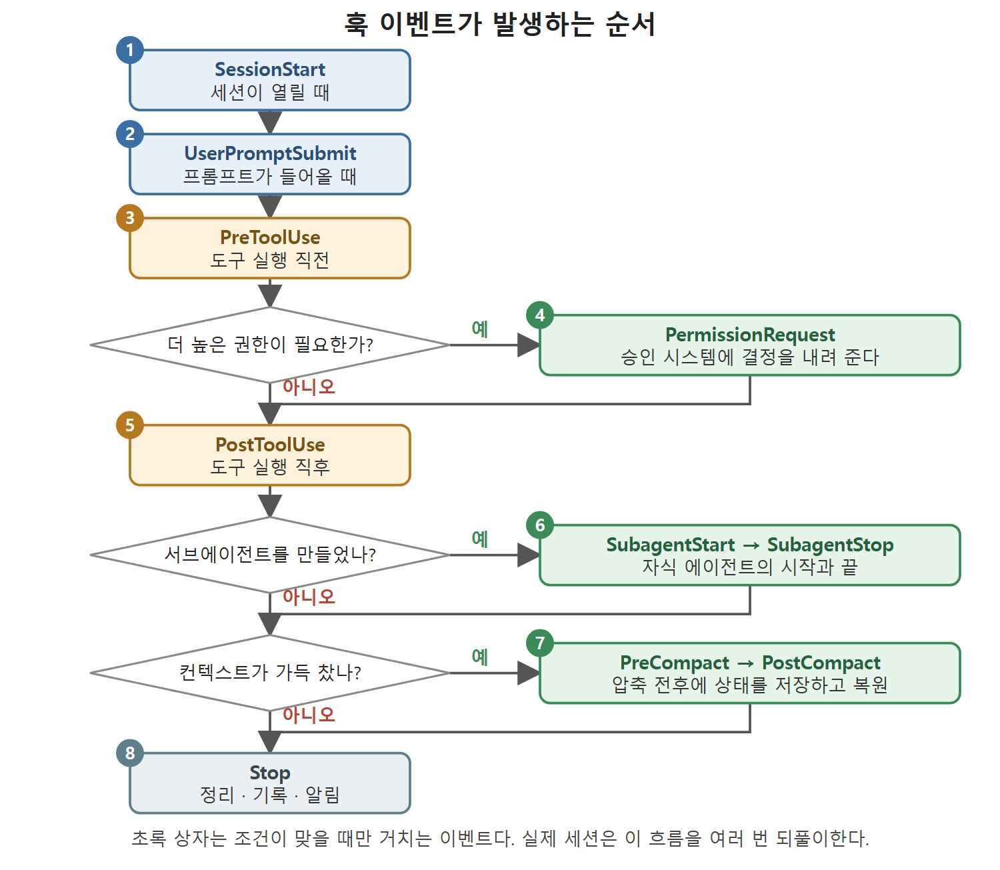

# 훅 생명주기 흐름

열 개의 훅 이벤트는 에이전트 세션이 지나가는 순서와 대체로 같은 차례로 발생한다. 세션이 열리고, 프롬프트가 들어오고, 도구가 실행되고, 컨텍스트가 압축되고, 서브에이전트가 만들어졌다 돌아오고, 세션이 닫힌다. 이 문서는 그 전체 흐름을 그림으로 보고, 이벤트 사이의 관계를 정리한다.

---

## 1. 그림으로 보는 훅 생명주기

위 그림은 원서의 Figure 9.1에 해당하는 흐름도다. 그림을 말로 풀면 다음과 같다.

1. 맨 위에서 SessionStart가 발생하고, 이어서 UserPromptSubmit, PreToolUse가 차례로 발생한다.
2. PreToolUse 다음에는 권한 확인 분기가 있다. 더 높은 권한이 필요하면 PermissionRequest를 거치고, 필요 없으면 곧바로 PostToolUse로 간다. 두 경로는 PostToolUse에서 다시 합쳐진다.
3. PostToolUse 다음에는 서브에이전트 분기가 있다. 서브에이전트가 만들어졌다면 SubagentStart와 SubagentStop이 차례로 실행되고, 아니면 이 단계를 건너뛴다.
4. 그다음은 컨텍스트가 가득 찼는지 보는 분기다. 압축이 일어나면 PreCompact와 PostCompact가 실행되고, 아니면 건너뛴다.
5. 어떤 경로를 타든 마지막에는 모두 Stop으로 모인다.

위 그림은 같은 흐름을 번호 순서와 분기 질문으로 다시 정리한 것이다. 초록 상자는 권한, 서브에이전트, 압축 조건이 맞을 때만 거치는 이벤트이고, 어느 경로든 마지막에는 Stop으로 모인다.

## 2. 그림을 읽을 때 주의할 점

그림은 하나의 직선 흐름처럼 보이지만 실제 세션은 이 흐름을 여러 번 되풀이한다. 한 세션 안에서 프롬프트는 여러 번 들어오고, 한 프롬프트 처리 중에도 도구 호출이 여러 번 일어난다. 그림은 "어떤 이벤트가 어떤 이벤트 근처에서 발생하는가"를 보여 주는 지도로 읽는 것이 맞다. 이 장은 이벤트를 그림의 순서대로 하나씩 훑는다.

## 3. 이벤트를 성격별로 묶어 보기

열 이벤트를 하는 일에 따라 묶으면 기억하기 쉽다.

| 묶음 | 이벤트 | 하는 일 |
|---|---|---|
| 컨텍스트 주입 | SessionStart, UserPromptSubmit, PostCompact, SubagentStart | stdout이 모델 컨텍스트나 프롬프트에 들어간다 |
| 도구 호출 감시 | PreToolUse, PostToolUse | 도구 실행 전후에 끼어든다 |
| 승인 연동 | PermissionRequest | 승인 시스템에 결정을 내려 준다 |
| 압축 감시 | PreCompact, PostCompact | 압축 전후에 상태를 저장하고 복원한다 |
| 서브에이전트 경계 | SubagentStart, SubagentStop | 자식 에이전트의 시작과 끝을 잡는다 |
| 마무리 | Stop | 정리, 기록, 알림 |

## 4. 공통 계약

열 이벤트는 모두 같은 종료 코드 규칙을 따른다.

- exit 0이면 정상이다. 이벤트에 따라 stdout이 컨텍스트에 들어간다.
- exit 2는 막으라는 신호다. 막을 수 있는 이벤트에서는 stderr 메시지와 함께 해당 동작을 차단하고, 막을 수 없는 이벤트에서는 오류만 기록하고 계속 진행한다.
- 그 밖의 종료 코드는 조용히 실패한 것으로 처리된다.

같은 exit 2라도 이벤트마다 의미가 다르다는 점이 가장 흔한 함정이다. 예를 들어 SessionStart에서 exit 2는 세션을 막지 못하고 오류만 남기지만, UserPromptSubmit에서 exit 2는 프롬프트를 통째로 거부한다.

## 5. 다른 장과의 연결

- SessionStart가 주입하는 출력은 컨텍스트 윈도를 차지하므로 짧게 유지해야 한다(7장).
- PermissionRequest는 승인 모드 구조와 함께 5장에서 자세히 다룬다.
- 서브에이전트 구조는 11장에서 다룬다.

 
 
 

[Agentic Coding with OpenAI Codex CLI](../)
