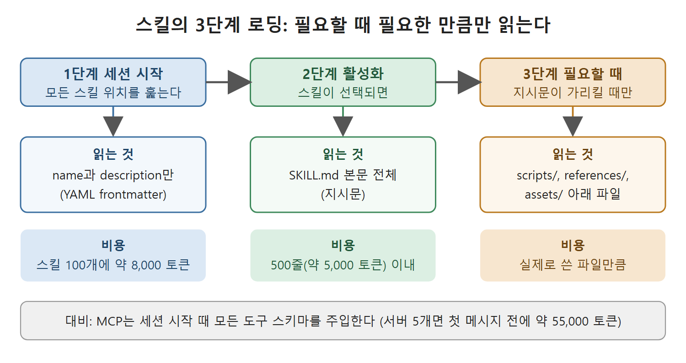

# SKILL.md 작성 규칙

이제 만드는 쪽으로 넘어간다. 이 문서는 스킬 디렉터리의 구조, SKILL.md의 frontmatter 필드와 제약, 이름 규칙의 함정, 3단계 로딩 모델, 그리고 가장 중요한 description 쓰는 법을 설명한다. description은 스킬이 제때 켜지느냐를 가르는 라우팅 규칙이라서 따로 공을 들여야 한다.

---

## 1. 디렉터리 구조와 파일 구성

스킬은 파일 하나가 아니라 디렉터리다. SKILL.md 하나는 반드시 있어야 하고, 그 외에는 전부 선택이다.

```
my-skill/
├── SKILL.md         # 필수: frontmatter 메타데이터 + 지시문
├── agents/
│   └── openai.yaml  # Codex 전용: 호출 정책, MCP 의존성
├── scripts/         # 선택: 실행 가능한 도우미
├── references/      # 선택: 필요할 때 읽는 참고 문서
└── assets/          # 선택: 템플릿, 데이터 파일
```

SKILL.md는 YAML frontmatter 구분자로 두 부분으로 나뉜다. 맨 위 `---`와 닫는 `---` 사이는 구조화된 메타데이터이고, 그 뒤는 스킬이 활성화됐을 때 에이전트가 지시문으로 읽는 Markdown 본문이다.

## 2. 완성된 예시

원서는 staging 배포 스킬을 예로 든다. frontmatter 부분은 다음과 같다.

```yaml
---
name: deploy-to-staging
description: |
  Deploy the current service to the staging environment. Use when
  asked to deploy, push to staging, cut a release candidate, or
  update a running staging service. Do NOT use for production
  deployments or local test environments.
license: Apache-2.0
compatibility: Requires Docker, AWS CLI ≥ 2.x
allowed-tools: Bash Read
metadata:
  author: platform-team
  version: "2.1"
---
```

본문(지시문)은 다섯 단계로 구성된다. 먼저 `scripts/preflight.sh`로 환경 변수와 Docker 데몬 접근 가능 여부를 확인한다. 다음으로 `docker build -t $SERVICE:$SHA .`로 이미지를 빌드하고 태그를 붙인다. 이어 `scripts/push-ecr.sh`로 ECR에 푸시하고, ECS 작업 정의(task definition)를 갱신해 새 리비전을 등록한 뒤, 서비스가 안정될 때까지 기다렸다가 성공이나 실패를 보고한다.

## 3. frontmatter 필드

frontmatter는 Agent Skills 사양이 관리한다. 필수는 `name`과 `description` 두 개, 나머지 네 개는 선택이다. 이 제약을 벗어나면 참조 검증기가 스킬을 거부한다.

| 필드 | 필수 | 제약 |
| --- | --- | --- |
| name | 예 | 1~64자. 소문자 영숫자와 하이픈만 허용. 상위 디렉터리 이름과 정확히 같아야 한다. 맨 앞이나 맨 뒤 하이픈, 연속 하이픈은 안 된다. |
| description | 예 | 1~1,024자. 세션을 시작할 때마다 읽힌다. 라우팅 규칙으로 작동하므로 스킬이 무엇을 하는지와 언제 쓰는지를 함께 적고, 에이전트가 관련 작업을 알아보도록 돕는 키워드를 넣는다. |
| license | 아니오 | 라이선스 이름 또는 같이 넣은 라이선스 파일의 경로. |
| compatibility | 아니오 | 최대 500자. Python 버전, 필요한 바이너리, 네트워크 접근처럼 진짜 요구 사항만 적는다. |
| metadata | 아니오 | 문자열 키와 문자열 값의 임의 쌍. 버전, 작성자, 팀, 변경 기록 링크 등에 쓴다. |
| allowed-tools | 아니오 | 책 집필 시점에는 실험적 기능. 공백으로 구분한 사전 승인 도구 이름들로, 에이전트가 작업마다 권한 프롬프트를 띄우지 않고 넘어가게 한다. |

## 4. name 필드의 함정

처음 쓰는 사람이 가장 많이 걸리는 곳이 name 제약이다. 검증기는 한 줄짜리 오류로 알려 주지만, 패턴을 미리 알아 두면 더 빠르다.

| name | 유효 여부 | 이유 |
| --- | --- | --- |
| deploy-to-staging | 유효 | 해당 없음 |
| pr-review | 유효 | 해당 없음 |
| CodeReview | 무효 | 대문자 |
| pr_summarizer | 무효 | 밑줄 |
| -deploy | 무효 | 맨 앞 하이픈 |
| deploy--v2 | 무효 | 연속 하이픈 |

## 5. 3단계 로딩 모델

Codex는 점진적 공개를 세 단계 로딩으로 구현한다.

1. 세션 시작: 설정된 모든 스킬 위치를 훑고 YAML frontmatter만 읽는다. 스킬 100개를 깔아 놓아도 탐색 비용은 약 8,000 토큰으로, 장황한 MCP 서버 하나의 도구 목록과 비슷하다.
2. 활성화: 스킬이 선택되면 SKILL.md 본문을 읽는다. 본문은 500줄(약 5,000 토큰) 이내로 유지한다.
3. 필요할 때: 지시문이 가리키는 파일만 읽는다.



그림은 세션 시작, 활성화, 필요할 때의 세 단계에서 각각 무엇을 읽고 토큰이 얼마나 드는지를 보여 준다. 아래쪽 대비 상자처럼 MCP는 시작할 때 모든 도구 스키마를 한꺼번에 주입하므로, 실제로 쓴 만큼만 비용을 내는 스킬과 구조가 다르다.

지시문이 500줄을 넘어가면 내용을 나눈다. 주제별 Markdown 파일(`REFERENCE.md`, `FORMS.md`, 또는 `legal.md` 같은 분야별 파일)은 `references/`에, 실행 스크립트(Python, Bash, JavaScript)는 `scripts/`에 둔다.

이것이 스킬과 MCP의 근본적인 구조 차이다. MCP는 세션 시작 때 모든 도구 스키마를 주입하며, 서버 다섯 개로 구성한 운영 환경은 사용자의 첫 메시지가 오기도 전에 55,000 토큰을 쓸 수 있다. 점진적 공개 모델은 이 방식을 뒤집어서, 실제로 쓴 만큼만 비용을 낸다.

## 6. description 잘 쓰기

description은 두 가지 일을 한다. 사람이 읽는 문서이면서, 암묵적 호출의 라우팅 규칙이다. 너무 모호하면 호출을 놓치고, 너무 넓으면 엉뚱한 곳에서 켜진다(오탐).

```yaml
# 너무 모호함: 호출을 놓친다
description: Manages deployments.
# 너무 넓음: 상관없는 작업에서도 켜진다
description: Handles any infrastructure or cloud task.
```

잘 쓴 예시는 위 staging 배포 스킬의 description이다. 원서의 이 버전은 마지막에 "production 배포나 로컬 Docker Compose 테스트 환경에는 쓰지 말 것"이라고 적었다. 좋은 description에는 구조적 요소가 세 가지 있다.

1. 분명한 핵심 동작: 스킬의 목적을 흔들림 없이 못 박는다.
2. 트리거 동의어: 같은 의도를 사람들이 흔히 표현하는 말을 다 덮는다.
3. 명시적 제외: 위험한 오탐을 막는다.

필드 한도는 1,024자라서 동의어와 제외 조건을 넣기에 충분하되 에세이를 쓸 정도는 아니다. 요령은 제외 조건부터 쓰는 것이다. 스킬이 하지 말아야 할 일을 말로 적는 순간, 포함 기준은 거의 저절로 따라 나온다.

<br>
<br>
<br>

[Agentic Coding with OpenAI Codex CLI](../)
