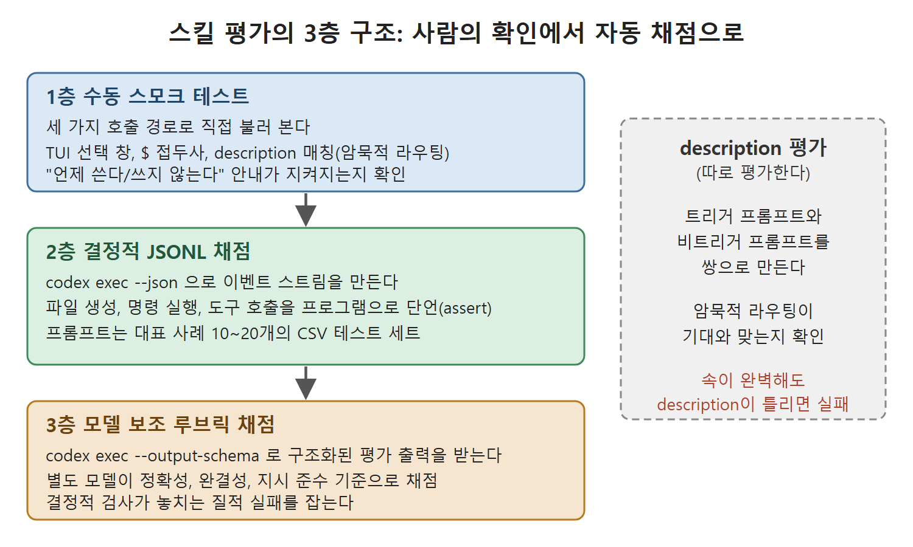

# 스킬 평가하기

`skills-ref`는 문법 오류를 잡아 주지만 행동상의 실패는 잡지 못한다. "이 스킬이 실제로 되는가"에 답하려면 기대한 결과와 비교해 스킬의 동작을 재는, 구조적이고 반복 가능한 평가 파이프라인이 필요하다. 이 문서는 OpenAI 문서가 설명하는 3층 평가 구조, description 단독 평가, 커뮤니티 도구, CI 연결, 관리형 플랫폼을 정리한다.

---

## 1. 3층 평가 구조

1층, 수동 스모크 테스트: 스킬을 세 가지 호출 경로로 모두 불러 본다. TUI 선택 창, `$` 접두사, 그리고 description 매칭에 의한 암묵적 라우팅이다. "언제 쓴다"와 "언제 쓰지 않는다"는 안내가 실제로 지켜지는지 확인한다.

2층, 결정적 JSONL 채점: `codex exec --json`을 돌려 구조화된 이벤트 스트림을 만든다. 이벤트에는 `thread.started`, `turn.started` / `turn.completed`, 그리고 `command_execution`, `file_change`, `mcp_tool_call` 같은 타입을 가진 `item.started` / `item.completed`가 있다. 이 이벤트를 프로그램으로 파싱해 특정 행동을 단언(assert)한다. 파일이 만들어졌는지, 명령이 실행됐는지, 맞는 도구가 호출됐는지 같은 것이다. 프롬프트는 대표적인 사례 10~20개를 담은 CSV 테스트 세트에서 가져온다.

3층, 모델 보조 루브릭 채점: `codex exec --output-schema`에 Zod나 JSON Schema 정의를 붙여 구조화된 평가 출력을 받는다. 별도의 모델 인스턴스가 정확성, 완결성, 지시 준수 같은 루브릭에 따라 각 응답을 채점한다. 결정적 검사가 놓치는 질적 실패를 잡아낸다.



그림은 사람이 직접 확인하는 1층에서 시작해 자동 단언을 하는 2층, 모델이 채점하는 3층으로 올라가는 순서를 보여 준다. 오른쪽 상자의 description 평가는 이 세 층과 별도로 트리거와 비트리거 프롬프트 쌍으로 수행한다.

## 2. description도 평가 대상

description은 평가의 일부다. description이 틀리면 스킬이 켜지면 안 될 때 켜지거나, 켜져야 할 때 켜지지 않는다. 그래서 description은 따로 평가한다. 트리거 프롬프트와 비트리거 프롬프트를 쌍으로 만들어, 암묵적 라우팅이 기대와 맞는지 확인한다. 속은 완벽해도 description이 잘못됐다면 스킬은 현실에서 여전히 실패한다.

## 3. 커뮤니티 평가 도구

공식 도구가 성숙하기 전까지 빈자리를 커뮤니티 도구가 채우고 있다. 알아 둘 만한 것이 둘이다.

1. Skillgrade: 위 3층을 명령 하나로 묶는다. CSV 테스트 케이스를 돌리고, 결정적 단언을 실행하고, 선택적으로 모델 보조 채점을 호출한 뒤, 케이스별 통과/실패 보고서를 기계가 읽을 수 있는 형태로 쓴다.
2. Skill Creator V2(Nathan Onn): 접근이 다르다. 고정된 테스트 케이스 세트에 대해 변형(variant)들을 병렬로 벤치마크하고, 각각을 출력 품질, 일관성, 지시 준수 기준으로 채점한다. "이쪽이 더 나은 것 같다"는 느낌을 정량 비교로 바꿔 준다. 벤치마크는 토큰을 많이 쓰므로 비용 영향은 14장을 참고한다. 4~5단계 스킬이라면 정량 채점 인프라에 들일 투자가 값어치를 할 수 있다.

Skillgrade의 실행 예는 다음과 같다.

```
skillgrade run --skill .agents/skills/deploy --tests tests/deploy.csv
```

## 4. CI 연결

CI에서는 문법 검증용으로 `skills-ref`를, 행동 검증용으로 평가 파이프라인을 돌린다. 원서의 워크플로 조각은 두 단계다.

```yaml
- name: Validate skills
  run: |
    pip install git+https://github.com/agentskills/agentskills.git#subdirectory=skills-ref
    for skill_dir in .agents/skills/*/; do
      skills-ref validate "$skill_dir"
    done
- name: Eval skills
  uses: openai/codex-action@v1
  with:
    codex-args: "--json"
    eval-config: .codex/eval/skills.yaml
```

평가 통과율을 머지 조건으로 건다. 기준선 아래로 회귀한 스킬은 PR을 막는다. 애플리케이션 코드에 쓰는 것과 같은 규율을 스킬에도 적용하는 셈이다.

## 5. 관리형 수명 주기 플랫폼

버전 관리, 배포, 평가, 거버넌스를 직접 파이프라인을 만들지 않고 갖추고 싶은 팀은 Tessl 같은 호스팅 플랫폼을 쓸 수 있다. 레지스트리, 거버넌스 통제, 전체 수명 주기에 걸친 도구를 제공한다. 호스팅 플랫폼은 통제권을 일부 내주는 대신 유지 보수 부담을 줄이고 기업 거버넌스에 더 빨리 닿게 해 준다. 모든 것을 손수 짜는 관리 부담이 커지기 시작하는 4~5단계에서 이 교환이 가장 큰 의미를 갖는다.

<br>
<br>
<br>

[Agentic Coding with OpenAI Codex CLI](../)
