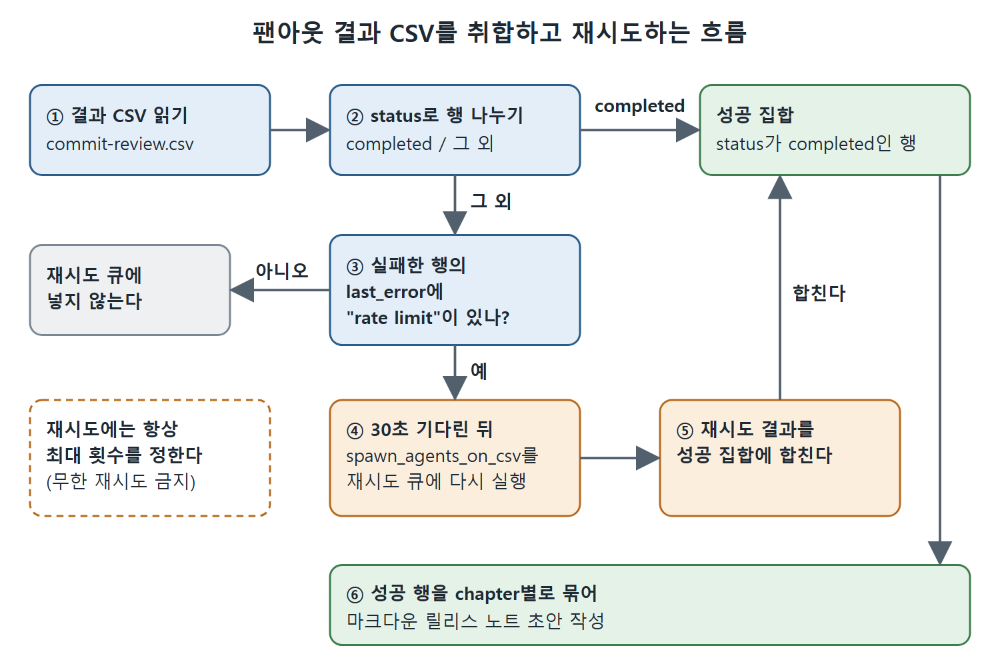

# CSV 팬아웃

가장 흔한 병렬화 패턴은 CSV 팬아웃이다. `spawn_agents_on_csv`는 CSV 파일, 지시문 템플릿, 작업 제어 매개변수를 받아 **행마다 worker 하나**를 띄운다. 각 worker는 자기 컨텍스트 윈도를 가진 독립 스레드로 돈다. 이 문서는 매개변수, 실제 예시, 결과 보고 방식, 결과 CSV를 읽고 재시도하는 방법을 다룬다.

---

## 1. 먼저 알아 둘 것

`spawn_agents_on_csv` 워크플로는 책을 쓴 시점에 아직 실험 단계다. 매개변수 이름과 기본값이 바뀔 수 있다. 이 도구가 의존하는 멀티 에이전트 협업 도구는 `multi_agent` 기능이 제공하며 기본으로 켜져 있다.

```toml
[features]
multi_agent = true
```

기본값이 켜짐이라 보통은 설정할 것이 없다. 설정에서 꺼 두었다면 다시 켜야 `spawn_agents_on_csv`를 포함한 서브에이전트 기능 전체가 돌아온다. CSV 도구가 노출되지 않는 런타임에서는, 부모가 행마다 서브에이전트를 하나씩 띄우고 결과를 기다리는 수동 방식(spawn-and-wait)으로 대신 처리한다. 작업의 흐름은 같고 중간 배관만 다르다.

그리고 `spawn_agents_on_csv`는 **부모 에이전트가 호출하는 도구**다. REPL에 직접 치거나 스크립트에 쓰는 문법이 아니다. 사용자는 자연어로 부탁하고, 부모가 도구 호출을 만든다.

## 2. 매개변수

| 매개변수 | 설명 |
|---|---|
| csv_path | 입력 CSV 경로 |
| instruction | worker 프롬프트. `{column_name}` 자리표시자를 행마다 채워 넣는다 |
| id_column | 항목별 고정 식별자를 주는 열(선택) |
| output_schema | 각 worker의 결과가 따라야 할 JSON 스키마(선택) |
| output_csv_path | 런타임이 결과 CSV를 쓸 경로 |
| max_concurrency | 이 작업에서 동시에 돌릴 worker 최대 수 |
| max_runtime_seconds | worker별 타임아웃 |

## 3. 예시: 릴리스 브랜치 커밋 분류

릴리스 노트를 기억이 아니라 데이터로 쓰기 위해, 릴리스 브랜치의 모든 커밋을 분류한다고 하자. 커밋 로그를 `commits.csv`로 내보낸다. 원서는 이 책의 원고 브랜치에 있는 실제 SHA를 쓰고, 직접 해 볼 때는 자기 것으로 바꾸라고 한다.

```csv
sha,author,subject
662e3dd,Daniel Vaughan,reviewed chapter 10
cd0265b,Daniel Vaughan,reviewed chapter 9
fc75f35,Daniel Vaughan,reviewed chapter 8
```

이렇게 부모에게 자연어로 부탁한다.

```text
Run spawn_agents_on_csv over commits.csv using the sha, author, and subject
columns. For each row, read the commit diff and write a two-sentence note
describing what changed and why. Output to commit-review.csv. Cap
concurrency at three workers and timeout each at two minutes.
```

그러면 부모는 다음 모양의 도구 호출을 만든다.

```text
spawn_agents_on_csv(
  csv_path = "commits.csv",
  instruction = "Read commit {sha} by {author}, subject: '{subject}'. ...",
  id_column = "sha",
  output_csv_path = "commit-review.csv",
  max_concurrency = 3,
  max_runtime_seconds = 120
)
```

(instruction은 원문에서 "diff를 살펴보고, 무엇이 왜 바뀌었는지 두 문장으로 쓰고, 머리말 없이 노트만 출력하라"는 내용으로 이어진다.) 런타임은 행마다 worker를 하나씩 띄우고, 열 값을 지시문에 채워 넣고, 결과 CSV를 지정한 경로에 쓴다.

## 4. 데이터 흐름

그림은 흐름을 이렇게 보여 준다. 입력 CSV의 행들이 `spawn_agents_on_csv`로 들어가면 행마다 worker가 하나씩 갈라져 나간다. 각 worker는 `report_agent_job_result`를 한 번 호출하고, 런타임은 원래 열에 job_id, item_id, status, last_error, result_json 열을 덧붙인 CSV를 내보낸다. 원서의 Figure 11.1이다.

## 5. 자리표시자 규칙

자리표시자는 `{column_name}` 형태이고, 셸 스타일의 `$INPUT`이나 `$1`이 아니다. 런타임은 지시문에서 찾은 모든 `{이름}`을 해당 행의 값으로 바꾼다. 그래서 열 이름은 유효한 자리표시자 식별자여야 한다. 공백이나 밑줄 외의 문장부호는 쓸 수 없다.

## 6. 결과 보고와 output_schema

각 worker는 `report_agent_job_result`를 **정확히 한 번** 호출해야 한다. 이것이 worker가 결과를 조율하는 쪽(orchestrator)에 넘기는 통로다. 호출 없이 끝나 버린 worker는 그 행이 실패로 기록된다.

`output_schema`를 지정하면 worker 결과가 스키마에 맞아야 한다. worker가 출력 모양을 지키게 하는 가장 믿을 만한 방법이다. 커밋 분류를 한 걸음 더 밀어 보자. 자유 문장 노트 대신, sha 문자열, 어느 장을 건드렸는지 나타내는 chapter 문자열(없으면 none), tech_review·rewrite·copy_edit·restructure·fix 중 하나인 edit_kind, 변경을 설명하는 note를 구조화된 레코드로 받는다. 이때 도구 호출에 실리는 스키마는 이렇다.

```json
{
  "type": "object",
  "required": ["sha", "chapter", "edit_kind", "note"],
  "properties": {
    "sha": { "type": "string" },
    "chapter": { "type": "string" },
    "edit_kind": {
      "type": "string",
      "enum": ["tech_review", "rewrite", "copy_edit", "restructure", "fix"]
    },
    "note": { "type": "string" }
  }
}
```

JSON 객체가 필요한 자리에 산문을 돌려준 worker는 결과 파일을 망가뜨리는 대신 구조화된 오류를 받는다. 어떤 팬아웃이든 같다. 스키마를 한 번 선언하면 모든 worker가 규격에 맞는 행을 내놓거나 실패로 기록된다.

## 7. 결과 CSV에서 취합하기

내보낸 CSV에는 원래 행에 런타임이 다섯 열을 더한 값이 들어 있다.

| 열 | 의미 |
|---|---|
| job_id | `spawn_agents_on_csv` 호출 전체의 식별자 |
| item_id | 행별 식별자. id_column이 있으면 그 값, 없으면 행 번호 |
| status | completed, failed, cancelled 중 하나. 끝난 상태만 나오므로 시작도 못 한 행은 내보낸 파일에 없다 |
| last_error | status가 completed가 아닐 때 오류 메시지 |
| result_json | worker의 구조화된 출력. output_schema를 줬다면 그 스키마와 일치한다 |

취합은 그저 CSV를 읽는 일이다. `wait_agents_all` 같은 계열의 도구는 없고, 부모가 핸들을 붙잡고 막혀 있지도 않는다. 팬아웃을 시작하면 런타임이 결과 파일을 쓰고, 부모는 데이터가 필요할 때 파일을 읽는다. status로 행을 나누어 성공과 실패를 가르고, 재시도할지 정하고, 이어서 진행한다.

팬아웃이 끝난 뒤 부모가 돌리는 전형적인 취합 흐름은 다음과 같다.

1. `commit-review.csv`를 읽는다.
2. status가 `completed`인 행과 아닌 행을 나눈다.
3. 실패한 행 중 last_error에 "rate limit"이 들어 있으면 재시도 큐에 넣는다.
4. 30초 기다린 뒤 재시도 큐에 대해 `spawn_agents_on_csv`를 다시 실행한다.
5. 재시도 결과를 성공 집합에 합친다.
6. 성공 행을 chapter별로 묶어 장마다 한 절, 커밋마다 한 줄인 마크다운 릴리스 노트 초안을 만든다.



그림은 위 여섯 단계를 한눈에 보여 준다. completed 행은 곧바로 성공 집합으로 가고, rate limit으로 실패한 행만 기다렸다가 다시 돌아 성공 집합에 합쳐지며, 재시도에는 항상 최대 횟수를 정한다.

이 정도의 조건부 재시도는 부모가 자연어로 잘 처리한다. 지수 백오프, 데드 레터 큐, 멱등성 검사 같은 더 복잡한 재시도 정책은 일반 스크립트로 취합 로직을 짜고, 부모가 그것을 도구로 호출하게 하는 편이 낫다. 부모가 머릿속으로 추론하게 두지 않는다.

한 가지는 꼭 지킨다. 부모에게 무한 재시도를 시키지 않는다. 항상 최대 재시도 횟수를 정한다. 종료 조건 없이 도는 에이전트는 예산과 인내심을 거의 같은 속도로 바닥내 버린다.

<br>
<br>
<br>

[Agentic Coding with OpenAI Codex CLI](../)
