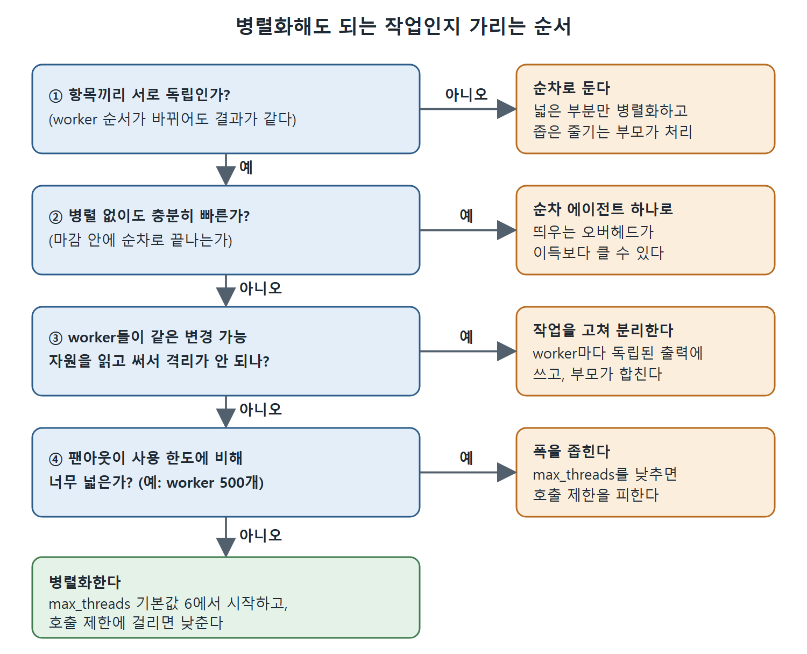

# 병렬화할 작업 고르기

TOML을 한 줄 쓰기 전에 먼저 해야 할 일은 이 작업이 병렬화에 맞는지 판단하는 것이다. 이 문서는 병렬화가 잘 되는 작업과 안 되는 작업을 가르는 기준, 그리고 병렬화를 참아야 하는 세 가지 상황을 정리한다.

---

## 1. 병렬화가 잘 되는 작업의 조건

각 작업 항목이 서로 독립적이고, 입력이 안정적이며, 출력이 하나씩 떨어지면 병렬화에 아주 알맞다. 반대로 공유하는 변경 가능 상태가 있거나, 실행 순서가 정해져 있거나, 긴밀한 조율이 필요한 작업은 병렬로 돌리면 오히려 더 느려지는 경우가 많다.

| 작업 종류 | 병렬화가 잘 되나 | 이유 |
|---|---|---|
| 파일 린트 | 잘 된다 | 파일끼리 독립이고 결과를 모으기 쉽다 |
| 모듈별 단위 테스트 생성 | 잘 된다 | 모듈끼리 변경 가능한 상태를 거의 공유하지 않는다 |
| 번역과 현지화 | 잘 된다 | 문자열이나 파일 하나하나가 독립이다 |
| 풀 리퀘스트 요약 | 잘 된다 | 읽기 전용이고 PR 목록 위에서 자연스럽게 퍼진다 |
| 코드 리뷰 코멘트 | 잘 된다 | 파일별 혹은 diff별로 나누기 쉽다 |
| 의존성 그래프 분석 | 안 된다 | 한 단계의 출력이 다음 단계의 입력이다 |
| 순차적 DB 마이그레이션 | 안 된다 | 순서가 중요하고, worker가 동시에 돌면 롤백이 복잡하다 |
| 여러 파일에 걸친 이름 변경 리팩터링 | 안 된다 | worker들이 공유 심볼 테이블에서 충돌한다 |
| 큰 파일을 조각내 처리 | 조건부 | 조각끼리 서로 참조하지 않으면 되지만, 컨텍스트가 조각 사이로 번지면 실패한다 |
| 호출 제한이 있는 API 스크래핑 | 조건부 | 팬아웃이 처리량을 높여 주지만 호출 한도를 공유 예산으로 관리해야 한다 |

## 2. 의존성 그래프로 생각하기

작업을 의존성 그래프로 그려 보면 판단이 쉽다.

- **넓고 얕은 그래프**(같은 층에 독립 항목이 많음)는 병렬화된다.
- **깊고 좁은 그래프**(의존하는 단계가 사슬처럼 이어짐)는 순차로 남는다.
- 둘이 섞여 있으면 넓은 부분만 병렬화하고, 좁은 줄기는 부모가 순차로 처리한다.

두 작업이 정말 독립인지 헷갈릴 때는 이렇게 물어본다. "worker A와 worker B가 끝나는 순서가 바뀌면 최종 결과가 달라지는가?" 달라진다면 의존성이 있는 것이다. 그 의존성은 부모의 조율 로직에 명시적으로 적어야 한다.

## 3. 병렬화하지 말아야 할 때

병렬화에는 비용이 있다. 서브에이전트는 max_threads 슬롯을 하나 차지하고, 컨텍스트 윈도 오버헤드(시스템 프롬프트, 도구 설명, 기본 골격)만큼 토큰을 쓰며, 부모가 가장 느린 worker를 기다리는 동안 지연 시간도 늘린다. 스레드 병렬화에서 통하는 암달의 법칙(Amdahl's law)은 에이전트에도 똑같이 적용된다. 이 법칙은 1967년 진 암달이 정리한 것으로, 병렬화한 프로그램이 이론적으로 얻을 수 있는 속도 향상은 순차로 남아야 하는 부분의 비율에 막힌다는 내용이다.

참아야 할 상황은 세 가지다.

1. **병렬 없이도 충분히 빠를 때.** 순차 에이전트가 파일 10개를 40초에 처리하고 마감이 몇 분 뒤라면, worker 10개를 띄우는 오버헤드(컨텍스트 준비, 스케줄링, 취합)가 이득보다 클 수 있다. 최적화하기 전에 먼저 재 본다.
2. **공유 상태 때문에 격리가 안 될 때.** worker들이 같은 변경 가능 자원(DB 테이블, 공유 파일, API 객체)을 읽고 쓴다면 락과 충돌 해결에 쓰는 노력이 병렬화로 아낀 시간보다 커진다. 이럴 때는 worker마다 독립된 출력(별도 파일, 별도 행, 별도 엔드포인트)에 쓰도록 작업을 고치고, 부모가 합치게 한다.
3. **팬아웃이 사용 한도에 비해 너무 넓을 때.** 같은 모델에 worker 500개가 동시에 몰리면 곧바로 호출 제한에 걸린다. 그러면 런타임의 대기열이 어차피 실행을 직렬로 만들어 버리는데, 컨텍스트는 500개가 올라가 있는 꼴이 된다. 폭을 좁히는 편이 호출 제한 페널티를 피해서 더 빨리 끝나는 경우가 많다.

그림은 작업의 독립성, 순차 처리 속도, 공유 상태, 팬아웃 폭을 차례로 따져 보고, 하나라도 걸리면 오른쪽 대안으로 빠지며 모두 통과해야 병렬화로 이어지는 판단 순서를 보여 준다.

시작은 max_threads 기본값 6에서 하고, 호출 제한에 걸리면 더 낮춘다. 기본값은 흔히 만나는 한도를 기준으로 잡혀 있어서, 재 보기도 전에 올리는 것은 섣부른 최적화다.

## 4. 사람에게 드는 비용

병렬 워크플로는 디버깅하기 어렵고, AGENTS.md를 다음에 읽을 사람에게 설명하기도 어렵다. 순차 방식이 명확하고 병렬 방식이 기발하기만 하다면 명확한 쪽을 택한다.

 
 
 

[Agentic Coding with OpenAI Codex CLI](../)
