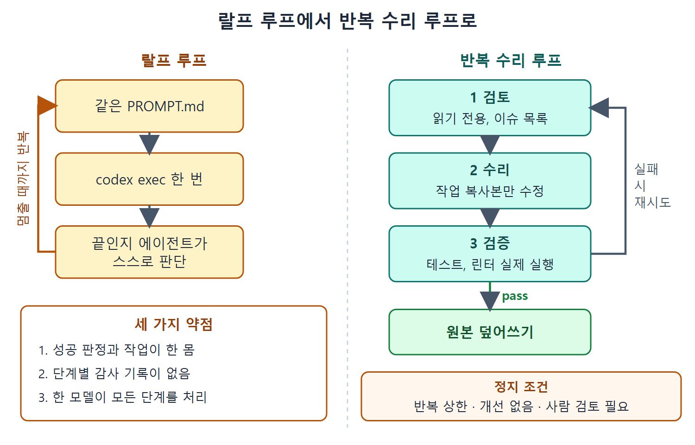

# 패턴 4. 반복 수리 루프

반복 수리 루프(Iterative Repair Loop)는 이 장 첫머리의 랄프 루프에 대한 정면 대답이다. 실행 가능한 검사 아래에서 산출물이 정답으로 수렴해야 한다는 같은 문제를 겨냥하면서, 랄프 루프의 세 약점을 한꺼번에 해결한다. 성공 판정을 작업에서 떼어 내고, 모든 단계를 감사할 수 있게 하고, 각 단계를 가장 알맞은 모델에게 맡긴다.

---

## 1. 한 개의 프롬프트를 세 단계로 쪼갠다

랄프 루프의 프롬프트 하나를 검토(Review), 수리(Repair), 검증(Validate) 세 단계로 나누고, 각 단계를 구조화된 출력으로 이어지는 별도의 `codex exec` 호출로 돌린다. OpenAI 쿡북(2026년 5월 11일자 "Build iterative repair loops with Codex")이 출력 스키마와 수렴 감지로 이 패턴을 정식화했다.

| 단계 | 하는 일 |
|---|---|
| 검토 | 산출물을 편집이나 실행 없이 살펴보고, 심각도, 설명, 수정 방향 제안이 담긴 이슈 배열을 구조화해서 돌려준다. 읽기 전용으로 두어야 판단과 행동이 분리되어 감사가 가능하다. |
| 수리 | 지적 사항과 직전 검증 피드백을 받아, 산출물의 복사본에 좁고 한정된 수정을 한다. 원본은 diff와 롤백이 가능하도록 남겨 둔다. |
| 검증 | 테스트, 린터, 타입 검사기, 계약 검증기 같은 실제 검사를 실행한다. 실패는 의견이 아니라 다음 수리 단계가 쓸 구조화 데이터가 된다. |



왼쪽은 같은 프롬프트를 멈출 때까지 되풀이하며 끝을 에이전트에게 맡기는 랄프 루프이고, 오른쪽은 검토, 수리, 검증 세 단계로 나누어 검증을 통과해야만 원본을 덮어쓰는 반복 수리 루프다.

## 2. 스크립트 뼈대

단계를 이어 붙이는 스크립트는 짧다. 각 단계는 자기 `--output-schema`와 정해진 JSON 출력 파일을 가지고, 다음 단계가 그 파일을 읽는다. 시작은 원본의 작업 복사본을 만드는 것이다.

```bash
MAX_ITERATIONS=4
ARTEFACT=$1
WORK_COPY="$ARTEFACT.repair"
cp "$ARTEFACT" "$WORK_COPY"
prev_repair_hash=""
for i in $(seq 1 "$MAX_ITERATIONS"); do
  codex exec -s read-only \
    --output-schema review-schema.json \
    -o "review-$i.json" \
    "Review $WORK_COPY and the most recent validate-*.json. Return findings."
```

검토 직후에는 사람 검토가 필요한 지적이 있는지 확인한다(정지 조건 4). 이어서 수리 단계는 작업 복사본에만 쓴다.

```bash
  if jq -e '.findings[] | select(.requires_human == true)' "review-$i.json" >/dev/null; then
    echo "Iteration $i flagged findings for human review. Stopping."; exit 2
  fi
  codex exec -s workspace-write \
    --output-schema repair-schema.json -o "repair-$i.json" \
    "Apply review-$i.json findings to $WORK_COPY. Touch no other files."
  repair_hash=$(sha256sum "$WORK_COPY" | cut -d' ' -f1)
  [ "$repair_hash" = "$prev_repair_hash" ] && exit 3   # 정지 조건 3
  prev_repair_hash=$repair_hash
```

수리가 끝나면 작업 복사본의 해시를 이전 반복과 비교해 달라진 게 없으면 정지한다(정지 조건 3, 종료 코드 3). 마지막으로 검증 단계를 돌린다.

```bash
  codex exec -s workspace-write \
    --output-schema validate-schema.json -o "validate-$i.json" \
    "Run the project's test, lint, and type-check commands against $WORK_COPY."
  if [ "$(jq -r '.status' "validate-$i.json")" = "pass" ]; then
    mv "$WORK_COPY" "$ARTEFACT"; exit 0                 # 정지 조건 1
  fi
done   # 정지 조건 2: 반복 상한 도달, 작업 복사본은 그대로 남김
```

교차 모델 리뷰 루프와 마찬가지로 반복 상태는 오케스트레이터 스크립트가 쥔다. 작업 복사본은 원본과 분리되어 있고, 검증을 통과한 경로만 원본을 덮어쓴다. 종료 코드는 사람 검토 요청이 2, 개선 없음이 3, 반복 상한 도달이 1이다.

*그림 12.4. 산출물을 작업 복사본으로 옮긴 뒤 한 반복에서 검토, 수리, 검증을 차례로 거친다. 검토 뒤에 requires_human 지적이 있으면 멈추고, 수리 뒤에 작업 복사본 해시가 그대로면 멈춘다. 검증 상태가 pass면 수렴해서 원본을 덮어쓰고, 아니면 반복 횟수가 상한 미만인지에 따라 검토로 돌아가거나 최대 반복으로 멈춘다.*

## 3. 운영용 루프에 필요한 네 가지 정지 조건

1. 검증 통과: 정상 경로다.
2. 최대 반복 도달: 안전 상한이며 보통 3~5회다.
3. 개선 없음: 남은 차이가 직전 반복과 같다.
4. 사람 검토 필요 표시: 애매한 지적은 자동 수리하지 않는다.

수렴 확인은 빼면 안 된다. 없으면 에이전트가 제자리에서 헛도는 동안 토큰만 태운다. 쿡북 레시피는 대부분의 산출물이 2~3회 반복 안에 수렴하고 3회를 넘으면 효과가 줄어든다고 보고한다.

## 4. 단계를 나눠서 얻는 세 가지 이점

1. 감사 가능성: 검토자가 찾은 것과 수리자가 바꾼 것을 따로 점검할 수 있다.
2. 단계별 모델 배정: 검증은 싼 모델로, 수리는 최상위 모델로 돌릴 수 있다.
3. 조합 가능한 검증: 수리 로직을 건드리지 않고 검증 단계를 다른 검사기로 바꿔 끼울 수 있다.

## 5. 랄프 루프는 언제 남겨 두는가

성공 판정이 정말로 결정적이고 중간 단계가 별로 흥미롭지 않은 단순 수렴 작업에는 순수 랄프 루프가 여전히 맞다. 작고 고립된 버그에 "테스트가 통과할 때까지 실행"하는 경우다. 감사 기록, 비용 최적화, 독립적인 검증 중 하나라도 중요해지는 순간 구조화된 수리 루프를 꺼내라는 것이 원문의 결론이다.

<br>
<br>
<br>

[Agentic Coding with OpenAI Codex CLI](../)
