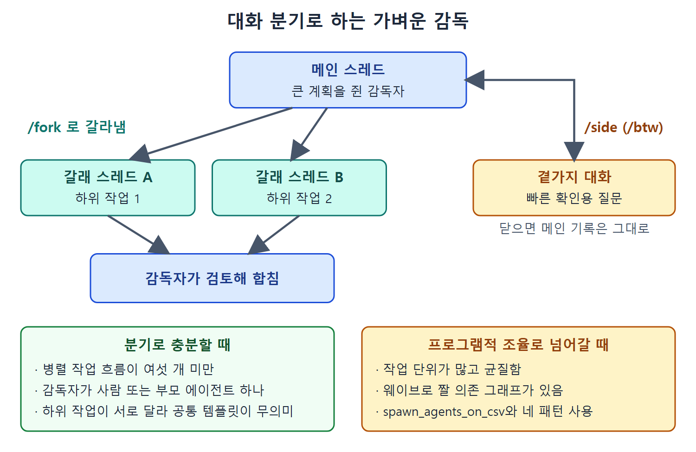

# 패턴 고르기와 대화 분기

네 패턴을 익혔으니 이제 상황에 맞게 고르는 법이 필요하다. 이 문서는 선택 기준과 비교표, 그리고 한 세션 안에서 쓰는 더 가벼운 조율 도구인 `/fork`, `/side`, `/btw`를 정리한다. 앞의 패턴이 부모 에이전트나 외부 스크립트가 일을 조율하는 방식이라면, 대화 분기는 개발자가 하니스(에이전트를 둘러싼 실행 틀) 없이 세션 안에서 직접 감독자 역할을 하는 방식이다.

---

## 1. 세 가지 질문으로 좁히기

다음 세 질문이면 선택이 빠르게 좁혀진다. 작업 단위가 서로 독립인가, 일부가 다른 것에 의존하는가, 구조적으로 독립된 리뷰가 필요한가.

| 항목 | 순차 게이트 체인 | 웨이브 기반 혼합 | 교차 모델 리뷰 루프 | 반복 수리 루프 |
|---|---|---|---|---|
| 대표 용도 | 여러 단계 문서 파이프라인 | 의존 층이 있는 모노레포 리팩터링 | 보안에 민감한 리뷰 | 테스트 아래에서 수렴하는 API 마이그레이션 |
| 빌더와 리뷰어 | 처음부터 끝까지 같은 모델 | 처음부터 끝까지 같은 모델 | 서로 다른 모델 | 같은 모델, 단계만 분리 |
| 종료 | 마지막 단계가 최종 산출물 생성 | 모든 웨이브 완료 | PASS 판정 또는 라운드 상한 | 검증 통과 또는 정지 조건 |
| 실패 양상 | 게이트 실패로 사슬 중단 | 웨이브 실패가 이후 웨이브 중단 | 라운드 상한 안에 수렴 못 함 | 반복 사이 개선 없음 |
| 지연 | 단계 지연의 합 | 웨이브 지연의 합 | 라운드당 +30~90초 | 단계당 +60~180초, 반복 횟수만큼 곱 |

## 2. 패턴은 배타적이지 않다

웨이브 계획 안의 작업 하나가 게이트 체인일 수 있다. 게이트 체인은 독립 판단이 필요한 어느 단계에서든 교차 모델 리뷰 루프를 부를 수 있다. 반복 수리 루프는 그 자체가 단계가 검토, 수리, 검증인 체인의 특수한 경우다.

어떤 패턴에도 딱 맞지 않으면 제약을 이름 붙여 보자. 독립 단위인가 의존 단위인가, 모델이 하나인가 여럿인가, 검증이 결정적인가 LLM에 맡기는가. 그러면 패턴이 대개 저절로 정해진다.

## 3. 대화 분기: 하니스 없이 하는 감독

한 세션 안에서도 슬래시 명령 세 개로 가벼운 조율이 가능하다. `/fork`, `/side`, 그리고 `/side`의 별칭인 `/btw`다.

메인 스레드의 감독자가 `/fork`로 하위 작업을 각 스레드에 갈라 맡기고 결과를 합치며, `/side`(`/btw`)는 메인 기록을 건드리지 않는 곁가지 질문에 쓴다. 아래 두 상자는 분기로 충분한 경우와 프로그램적 조율로 넘어가야 하는 경우를 가른다.

### 3.1 /fork

`/fork`는 현재 대화를 새 스레드로 갈라낸다. 지금까지의 기록을 잃지 않고 다른 접근을 탐색할 때 쓴다. 원래 스레드로는 스레드 선택기(thread picker)로 돌아가며, 갈라진 쪽은 독립된 스레드로 남는다.

이것은 감독자 패턴의 슬래시 명령 버전이다. 개발자(또는 감독자 역할의 부모 에이전트)가 큰 계획을 쥐고, 범위가 정해진 작업 단위를 각각 자기 스레드로 갈라낸다. 각 스레드는 자기 컨텍스트로 하위 작업 하나를 추구한다. 갈래들은 병렬로 진행되고, 감독자가 결과를 검토해 합친다.

### 3.2 /side와 /btw

`/side`(별칭 `/btw`)는 일시적인 곁가지 대화를 연다. 메인 스레드의 기록을 흩뜨리지 않는 집중된 후속 질문이다. 긴 작업이 메인 스레드에서 계속되는 동안 간단히 확인할 것을 묻거나, 가정을 검증하거나, 사실을 확인할 때 쓴다. 곁가지 대화 안에서 또 곁가지를 열 수 없고, 리뷰 모드 중에도 쓸 수 없다.

세 명령은 무거운 것에서 가벼운 것으로 이어지는 스펙트럼에 놓인다. `/fork`는 자기 목적을 가진 병렬 스레드를 만든다. `/side`는 메인에 영향 없이 닫히는 곁가지를 연다. 동시에 일이 진행되길 원하면 `/fork`, 빠른 조회가 필요하면 `/side`를 쓴다.

### 3.3 확인된 범위

`/fork`가 전체 기록을 복제하는지, `/side`가 메모리에만 존재하는지, 둘이 토큰 예산과 어떻게 상호작용하는지 같은 세부 구현은 계속 바뀌고 있다. 원문이 확인된 것으로 보는 범위는 명령 집합, 별칭, 리뷰 모드에서 쓸 수 없다는 제약뿐이다. 그 밖의 동작은 스크립트에 의존하기 전에 실제 REPL에서 확인해 보라고 한다.

## 4. 분기로 충분한 때, 부족한 때

대화 분기로 충분한 조건은 이렇다.

- 병렬 작업 흐름이 적다(원문 기준 여섯 개 미만).
- 감독자가 사람이거나 부모 에이전트 하나다.
- 하위 작업이 서로 달라서 공통 프롬프트 템플릿이 도움이 안 된다.

이때 쪼개기와 통합은 개발자가 하고, 에이전트는 처리량을 제공한다.

작업 단위가 많거나, 균질하거나, 자동 웨이브 스케줄링이 사람의 감독보다 잘 표현하는 의존 그래프가 있으면 프로그램적 조율(`spawn_agents_on_csv`와 앞의 네 패턴)로 넘어간다.

둘은 섞어 쓸 수 있다. `/fork`로 감독하는 사람이 큰 작업의 대량 처리 부분만 갈래 하나에게 맡기고, 그 갈래가 CSV 팬아웃을 돌리게 할 수도 있다.

 
 
 

[Agentic Coding with OpenAI Codex CLI](../)
