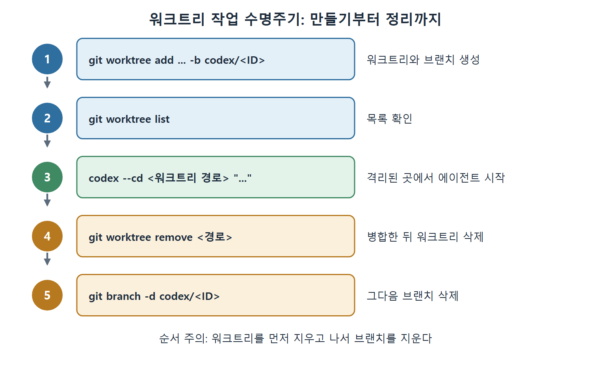
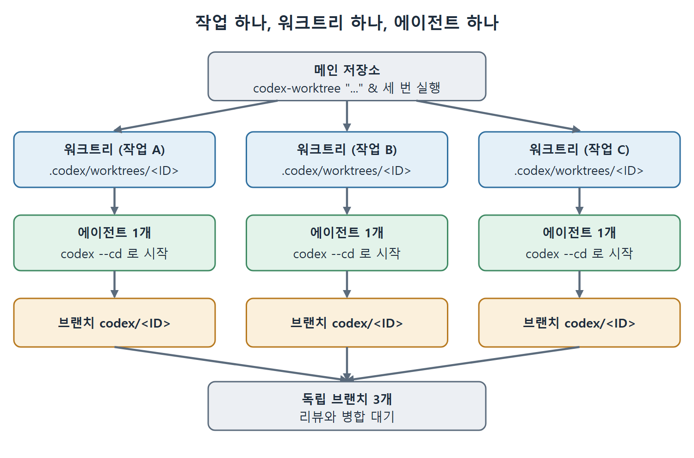

# CLI 워크트리 작업 흐름

커맨드 라인에서 워크트리를 다루는 방법은 표준 git worktree 명령과 Codex CLI의 `--cd` 옵션을 조합하는 것이다. `--cd`는 에이전트를 격리된 디렉터리로 들여보내는 역할을 한다. 이 문서는 작업용 워크트리를 만들고, 병렬로 돌리고, 상태를 살펴보는 방법을 다룬다.

---

## 1. 전제: 전용 옵션은 없다

원서가 쓰인 시점에 Codex CLI에는 전용 `--worktree` 옵션도, `codex worktree` 하위 명령 그룹도 없다. 그래서 아래 흐름은 모두 `git worktree`를 직접 쓰고, 만들어진 경로를 `--cd`로 codex에 넘기는 방식이다.

## 2. 작업용 워크트리 만들고 에이전트 시작하기

작업 ID를 무작위로 뽑아 워크트리와 브랜치를 만든 뒤 그 안에서 에이전트를 시작한다.

```bash
TASK_ID=$(uuidgen | tr '[:upper:]' '[:lower:]' | cut -c1-8)
git worktree add .codex/worktrees/$TASK_ID -b codex/$TASK_ID
codex --cd .codex/worktrees/$TASK_ID \
  "add OAuth2 support to the login flow"
```

자주 쓴다면 셸 함수로 감싸 두면 편하다.

```bash
codex-worktree() {
  local TASK_ID=$(uuidgen | tr '[:upper:]' '[:lower:]' | cut -c1-8)
  git worktree add ".codex/worktrees/$TASK_ID" -b "codex/$TASK_ID"
  codex --cd ".codex/worktrees/$TASK_ID" "$@"
}
```

## 3. 수동 수명주기 관리

에이전트를 바로 띄우지 않고 워크트리만 먼저 만들어 둘 수도 있다.

```bash
git worktree add .codex/worktrees/auth-oauth -b codex/auth-oauth
git worktree list
codex --cd .codex/worktrees/auth-oauth "implement PKCE flow"
# 병합한 뒤 정리
git worktree remove .codex/worktrees/auth-oauth
git branch -d codex/auth-oauth
```

순서는 만들기, 목록 확인, 기존 워크트리에서 에이전트 시작, 병합 후 워크트리와 브랜치 삭제다. 워크트리를 먼저 지우고 나서 브랜치를 지운다는 점을 기억하자.



그림은 워크트리 생성, 목록 확인, 에이전트 시작, 워크트리 삭제, 브랜치 삭제로 이어지는 수명주기를 순서대로 보여 준다. 삭제 순서가 워크트리 다음 브랜치라는 점도 함께 표시했다.

## 4. 병렬 실행

위의 래퍼 함수는 셸의 작업 제어와 잘 어울려서 로컬 병렬 실행이 간단하다.

```bash
codex-worktree "refactor the database layer to use connection pooling" &
codex-worktree "add end-to-end tests for the checkout flow" &
codex-worktree "update all dependencies to their latest minor versions" &
wait
```

호출할 때마다 각자 브랜치와 작업 디렉터리를 새로 받는다. 세 작업이 모두 끝나면 서로 독립된 브랜치 세 개가 리뷰와 병합을 기다리는 상태가 된다. 더 체계적인 조율이 필요하면 12장의 패턴을 쓰면 된다. 밑바탕은 늘 같다. 작업 하나에 워크트리 하나, 워크트리 하나에 에이전트 하나다.



그림은 메인 저장소에서 `codex-worktree`를 세 번 실행하면 작업마다 워크트리, 에이전트, 브랜치가 하나씩 생기고, 결과가 독립 브랜치 세 개로 모여 리뷰와 병합을 기다리는 구조를 보여 준다.

## 5. 워크트리 상태 살펴보기

```bash
git -C .codex/worktrees/auth-oauth diff
git -C .codex/worktrees/auth-oauth stash && \
  (cd .codex/worktrees/auth-oauth && npm test)
cd .codex/worktrees/auth-oauth && exec $SHELL
```

- 첫 줄은 특정 워크트리의 diff를 보여 준다.
- 둘째 줄은 메인 작업 트리를 건드리지 않고 그 워크트리 안에서 테스트를 돌린다.
- 셋째 줄은 디버깅용으로 그 워크트리에서 셸을 연다.

`git -C <경로>`는 CI 스크립트에서 특히 유용하다. 단계의 작업 디렉터리를 바꾸지 않고도 워크트리 안에서 git 명령을 실행할 수 있기 때문이다.

<br>
<br>
<br>

[Agentic Coding with OpenAI Codex CLI](../)
