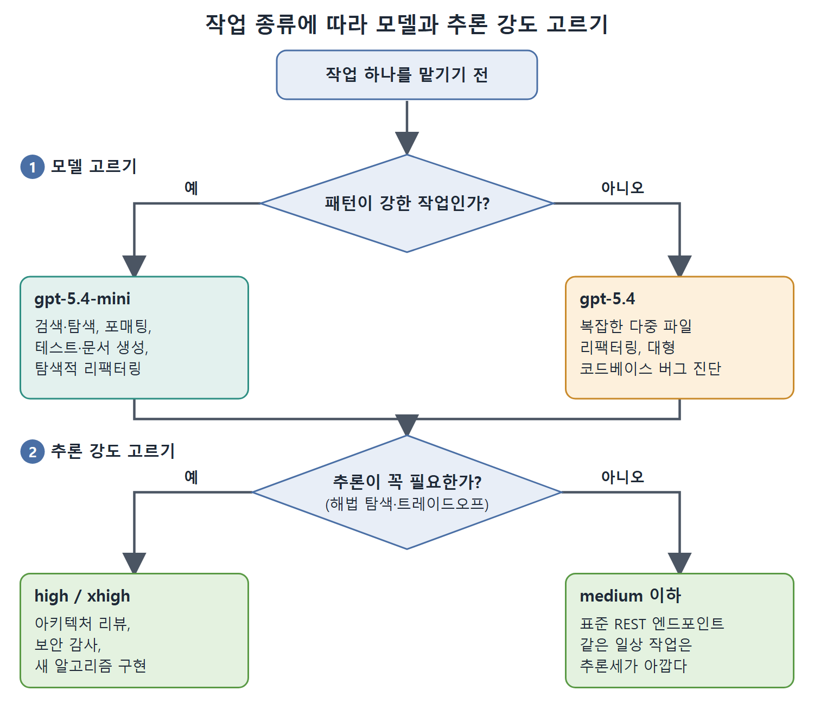

# 모델 선택과 추론 강도

에이전트 엔지니어링 작업의 상당수는 더 싼 모델로도 충분하다. 작업을 제대로 라우팅하면 품질을 해치지 않고 비용을 줄일 수 있다. 이 문서는 작업 종류별 모델 선택 기준, 추론 강도가 토큰 소비에 미치는 영향, 그리고 KV 캐시, 투자 대비 효과, 도구 개수 같은 비용 관련 관찰들을 정리한다.

---

## 1. 비용 대비 품질 결정 표

| 작업 종류 | 권장 모델 | 이유 |
|---|---|---|
| 코드 검색과 탐색 | gpt-5.4-mini | 찾는 일은 읽기와 패턴 매칭이지 종합이 아니다 |
| 포매팅, 린트 정리 | gpt-5.4-mini | 결정적인 변환이라 품질 차이가 거의 없다 |
| 알려진 패턴의 테스트 생성 | gpt-5.4-mini | 정착된 관용구에는 충분히 좋은 모델이다 |
| 문서 생성 | gpt-5.4-mini | 깊은 추론보다 문장의 유창함이 중요하다 |
| 탐색적 리팩터링 | gpt-5.4-mini | 초안 품질이면 되고 엔지니어가 검토한다 |
| 복잡한 다중 파일 리팩터링 | gpt-5.4 | 여러 파일에 걸친 일관성에는 전체 성능이 필요하다 |
| 아키텍처 설계와 리뷰 | gpt-5.4, 높은 추론 강도 | 중요도가 높은 추론이라 비용을 들일 만하다 |
| 보안 감사 | gpt-5.4-mini, xhigh 추론 강도 | 적대적 사고는 긴 추론의 덕을 본다 |
| 새로운 알고리즘 구현 | gpt-5.4-mini, xhigh 추론 강도 | 어려운 문제는 추론세를 낼 가치가 있다 |
| 대형 코드베이스의 버그 진단 | gpt-5.4 | 컨텍스트 일관성이 중요하고 mini는 맥락을 놓칠 수 있다 |

원칙은 간단하다. 패턴이 강한 작업에는 싼 모델을 쓰고, 모델이 새로운 문제를 푸는 작업에는 더 유능한 모델을 쓴다.

위 그림은 이 표를 두 번의 질문으로 줄여 보여 준다. 먼저 패턴이 강한 작업인지로 gpt-5.4-mini와 gpt-5.4를 가르고, 그다음 해법을 탐색해야 하는 작업인지로 높은 추론 강도(high, xhigh)와 medium 이하를 가른다.

---

## 2. 추론세: 높은 추론 강도의 비용

`xhigh`나 `high` 추론 강도로 설정한 모델은 출력하기 전에 "생각"한다. 이때 만들어지는 추론 토큰은 출력 토큰으로 과금되지만 사용자에게는 보이지 않는다. 이 추론세(reasoning tax) 때문에 같은 모델도 `medium`보다 호출당 더 비싸다. 논리 오류, 복잡한 상태 기계, 제약이 여러 개인 최적화처럼 추론이 꼭 필요한 문제라면 품질 향상이 비용을 정당화한다.

반대로 일상 작업에는 추론세가 아깝다. 표준 REST 엔드포인트를 만드는 데 gpt-5.4를 `xhigh`로 돌려도 `medium`보다 나은 결과가 나오지 않는다. 벤치마크에서 어느 모델이 "최고"인지가 아니라, 작업이 긴 추론의 도움을 받는지로 라우팅해야 한다.

간단한 경험칙이 있다. 에이전트를 돌리기 전에 정답 출력의 정확한 명세를 쓸 수 있다면 그 작업은 높은 추론 강도가 필요 없을 가능성이 크다. 에이전트가 해법 공간을 탐색하며 트레이드오프를 따져야 한다면 추론세가 제값을 한다.

---

## 3. 추론 강도별 토큰 소비

높은 추론 강도의 비용 배수는 대부분의 팀이 예산에 잡는 것보다 가파르고, 품질 향상은 비선형이다. 아래는 gpt-5.4로 대표적인 코딩 작업 하나를 돌렸을 때 관찰된 값이다.

| 강도 | 입력 | 출력 | 추론 토큰 | 합계 | medium 대비 비용 |
|---|---|---|---|---|---|
| minimal | 약 12,000 | 약 800 | 약 200 | 약 13,000 | 약 0.15배 |
| low | 약 15,000 | 약 1,200 | 약 1,500 | 약 17,700 | 약 0.35배 |
| medium | 약 20,000 | 약 2,500 | 약 8,000 | 약 30,500 | 1.0배(기준) |
| high | 약 25,000 | 약 4,000 | 약 35,000 | 약 64,000 | 약 3.5배 |
| xhigh | 약 30,000 | 약 6,000 | 약 120,000 | 약 156,000 | 약 12배 |

비용을 끌어올리는 주범은 추론 토큰이다. `xhigh`에서는 추론 토큰이 전체 소비의 75% 이상이다. 추론 토큰은 출력 토큰으로 과금되므로, `xhigh` 세션의 실제 비용은 사용자가 응답에서 볼 수 없는 보이지 않는 계산이 좌우한다.

---

## 4. KV 캐시 경제학

KV 캐시 미스는 모델이 이전 턴에서 계산해 둔 키-값 쌍을 재사용하지 못하고 다시 계산해야 하는 상황이다. 이 비용은 캐시 히트보다 대략 10배 비싸다. 그래서 네트워크 끊김, 프로세스 재시작, `/compact` 같은 세션 중단에는 숨은 비용 배수가 붙는다. 끊김 없이 이어지는 세션은 쌓인 컨텍스트에서 캐시 히트의 이득을 보고, 재시작하는 세션은 전체 재계산 비용을 낸다.

실무적인 결론은 오래 걸리는 작업에서 세션 재시작을 최소화하라는 것이다. 어쩔 수 없이 재시작할 때는 새 세션을 열지 말고 `codex resume --last`로 캐시된 컨텍스트를 최대한 살린다.

---

## 5. 투자 대비 효과는 쌍봉 분포

대규모 개발자 연구는 AI 코딩 도구의 생산성 향상이 쌍봉(bimodal) 분포를 보인다고 보고한다. 중앙값은 10~15% 향상이고, 상위 4분위는 40~60%, 하위 4분위는 거의 없거나 오히려 마이너스다. 이 수치는 약 12만 명의 개발자를 다룬 스탠퍼드 연구를 여러 학회 발표에서 요약한 것이다.

예산은 중앙값에 맞춰 잡고, 그보다 높은 성과는 덤으로 생각해야 한다. 모든 개발자에게서 40% 향상이 나온다고 가정하고 AI 도구 투자를 책정한 팀은 실망하게 된다.

---

## 6. 도구 역설

프로덕션 리뷰에서 나온 직관에 반하는 결과가 있다. 검토한 배포 사례에서 사용 가능한 도구를 46개에서 19개로 줄였더니 에이전트 정확도가 44% 올랐다. 도구가 많을수록 컨텍스트 오버헤드와 의사결정 복잡도가 커지기 때문이다. 도구 설명은 모든 API 호출마다 토큰을 소비하고(7장 참고), 도구가 하나 늘 때마다 잘못 고를 확률도 늘어난다.

세션에 연결한 불필요한 MCP 서버 하나하나가 비용 배수다. 의사결정이 복잡해지면 추론 체인이 길어지고 도구 사용 오류도 잦아진다.

 
 
 

[Agentic Coding with OpenAI Codex CLI](../)
