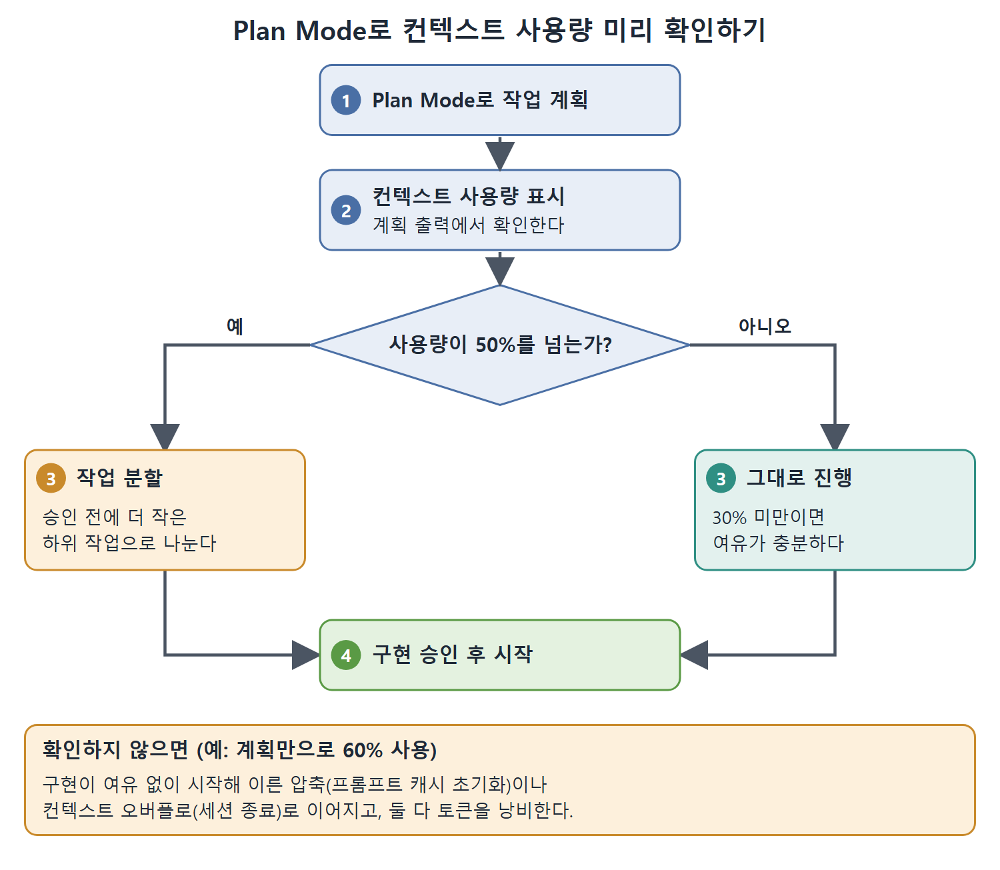

# 프롬프트 캐싱과 컨텍스트 계획

프롬프트 캐싱(prompt caching)은 어떤 모델을 고르든 그 비용을 줄여 주는, 단일 레버로는 가장 큰 비용 절감 수단이다. 이 문서는 캐시 히트율을 높이는 습관 네 가지와, 계획 단계에서 컨텍스트 사용량을 확인하는 Plan Mode, 여러 세션에 걸친 작업을 지키는 Goal Mode의 비용 효과를 정리한다.

---

## 1. 프롬프트 캐싱의 원리

OpenAI의 프롬프트 캐싱은 앞부분(prefix)이 1,024토큰을 넘는 모든 API 요청에 자동으로 적용된다. 캐시된 입력 토큰은 최대 90%까지 할인된다(모델에 따라 다르다. gpt-5.5는 캐시된 입력을 표준 입력 단가의 약 10%로 계산한다). 따로 켤 필요가 없다.

일반적인 Codex CLI 세션에서는 시스템 프롬프트, 도구 정의, AGENTS.md 내용, 초반 대화 턴이 안정적인 앞부분을 이루고, 이것이 API 호출마다 다시 전송된다. 기본 설정과 안정적인 구성에서 달성할 수 있는 85%의 캐시 히트율이면 세션 동안 입력 토큰의 실효 비용이 상당히 떨어지고, 절반 넘게 줄어드는 경우도 많다.

절감 효과는 모델 라우팅과 겹쳐서 커진다. 탐색 작업을 gpt-5.4-mini로 보내고 캐시 히트율도 높게 유지하는 팀은, 캐시 없는 gpt-5.4 기준선에 비해 아주 작은 비용만 낸다. 다만 할인율과 매칭 범위는 최신 문서에서 확인한 뒤 인용해야 한다.

---

## 2. 캐시 히트를 높이는 네 가지 습관

1. 시스템 프롬프트를 안정적으로 유지한다. 시스템 프롬프트에 타임스탬프, 빌드 번호, 세션 식별자 같은 동적 내용이 있으면 세션마다 앞부분이 달라져 캐시가 무효화된다. 변하는 데이터는 사용자 메시지로 옮긴다.
2. AGENTS.md를 앞쪽에 두고 결정적으로 유지한다. AGENTS.md 내용은 개발자 역할(developer-role) 앞부분에 합쳐진다. 이 파일들에 줄 수나 최종 수정일 같은 자동 생성 메타데이터가 있으면 호출할 때마다 앞부분이 달라진다. AGENTS.md 탐색을 특정 경로로 고정하고 동적으로 생성되는 내용을 피한다.
3. 도구 순서를 일관되게 유지한다. MCP 서버 탐색 순서는 결정적이어야 한다. 세션 도중 MCP 서버를 추가, 제거, 재배열하면 앞부분이 바뀌어 캐시 상태가 무효화된다. 모든 서버를 `config.toml`에 미리 선언하고, 제거하기보다 비활성화하는 쪽을 택한다.
4. 비슷한 작업을 안정적인 프로필 아래에 모은다. 같은 프로필로 같은 저장소에서 시작한 병렬 세션은 시스템 지시와 도구 정의가 같다. 임시 명령줄 덮어쓰기보다 프로젝트당 프로필 하나를 쓰면, 연속된 호출이 같은 캐시 키에 닿아 데워진 앞부분의 이득을 본다.

캐싱 메커니즘, 앞부분 구성, 안티 패턴, 모니터링은 OpenAI 개발자 문서의 프롬프트 캐싱 항목에 자세히 나와 있다.

---

## 3. Plan Mode로 컨텍스트 사용량 미리 보기

Codex CLI의 Plan Mode는 계획과 구현을 분리한다. 계획 출력에는 계획 단계가 컨텍스트 윈도를 얼마나 썼는지 보여 주는 컨텍스트 사용량 표시가 들어 있다.

계획만으로 컨텍스트 윈도의 60%를 쓰면 구현 단계는 여유가 적은 채로 시작한다. 그러면 이른 압축(프롬프트 캐시가 초기화된다)이나 컨텍스트 오버플로(세션이 끝난다)로 이어지고, 둘 다 토큰을 낭비한다.

실무 흐름은 이렇다.

1. 작업을 Plan Mode로 돌린다.
2. 계획 출력의 컨텍스트 사용량 표시를 확인한다.
3. 사용량이 50%를 넘으면 구현을 승인하기 전에 작업을 더 작은 하위 작업으로 나눈다.
4. 사용량이 30% 미만이면 여유가 충분하므로 그대로 진행한다.

위 그림은 이 실무 흐름을 순서대로 보여 준다. 계획 출력의 사용량 표시를 확인해 50%를 넘으면 구현 승인 전에 작업을 나누고, 여유가 충분하면 그대로 구현을 시작한다.

이렇게 하면 에이전트 세션에서 가장 비싼 실패 유형을 피할 수 있다. 컨텍스트 윈도 깊숙이 들어간 작업이 압축을 일으키고, 캐시 이득을 잃고, 불완전한 결과를 내서 두 번째 세션이 필요해지는 경우다. 구현 토큰을 쓰기 전 계획 단계에서 컨텍스트 팽창을 잡아내는 것은, 도구를 열 번 호출한 뒤에 알게 되는 것보다 언제나 싸다.

---

## 4. Goal Mode와 장기 작업의 비용

Goal Mode(12장)는 여러 세션에 걸치거나 컨텍스트 압축을 지나가는 작업의 비용 문제를 다룬다. 지속되는 목표가 없으면 "인증 모듈을 JWT에서 PASETO로 이전"처럼 긴 목표가 대화 컨텍스트 안에만 있게 되고, 압축 때 하위 작업과 완료 상태가 조용히 사라질 수 있다. 그러면 에이전트가 이미 끝낸 일을 다시 한다. 여러 세션에 걸친 워크플로에서 가장 비싼 실패다.

목표 상태는 앱 서버 안의 전용 저장 계층에 있고 휘발되는 세션 상태에 있지 않다. 진행 추적은 세션 재시작, 컨텍스트 압축, 터미널 크래시를 넘어 살아남는다. `/goal "Migrate the auth module from JWT to PASETO"`로 목표를 정하면 목표, 하위 작업, 각각의 완료 상태가 이 용도로 만든 데이터베이스에 기록된다.

비용 면에서 효과는 세 가지다.

1. 반복 작업이 없다. 목표 상태가 컨텍스트 윈도와 따로 유지되므로 압축이 진행 상황을 지우지 않는다. 압축 때문에 에이전트가 끝낸 일을 잊어 두 세션이 필요하던 작업이 한 세션에 끝난다.
2. 목표별 토큰 추적. 목표마다 토큰 소비량을 추적해 어떤 작업이 비싸고 싼지 보인다. 마이그레이션 목표 하나가 세 세션에 걸쳐 40만 토큰을 썼다면, 비슷한 모양의 다음 마이그레이션을 위한 보정된 추정치가 생긴다.
3. 예산을 아는 이어가기. 목표 이어가기는 한도에 닿으면 멈추고 무한정 돌지 않는다. 목표 세션이 토큰 예산에 닿으면 에이전트가 진행 상황을 체크포인트(checkpoint)에 남기고 멈추며, 다음 세션이 거기서 이어받는다.

프롬프트와 모델 라우팅으로 비용 최적화 스택을 쌓는 팀에게 Goal Mode는 네 번째 차원, 곧 시간에 따른 비용 분산을 더한다. 짧고 집중된 세션 세 개로 끝낸 목표가, 압축 경계를 맞닥뜨리는 하나의 장거리 세션보다 총 토큰을 덜 쓸 수 있다. 짧은 세션마다 프롬프트 캐싱을 온전히 받고, 압축 후 컨텍스트를 다시 쌓는 부담을 피하기 때문이다.

 
 
 

[Agentic Coding with OpenAI Codex CLI](../)
