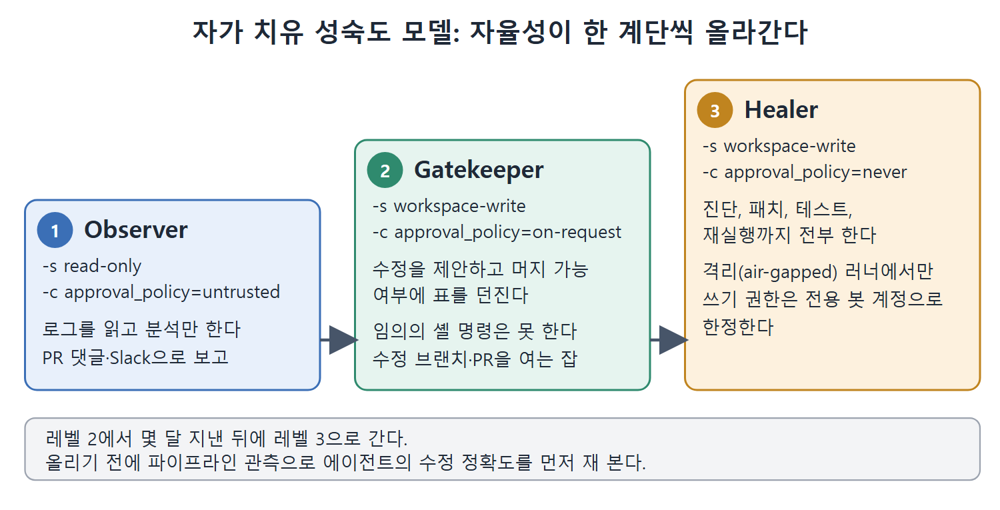
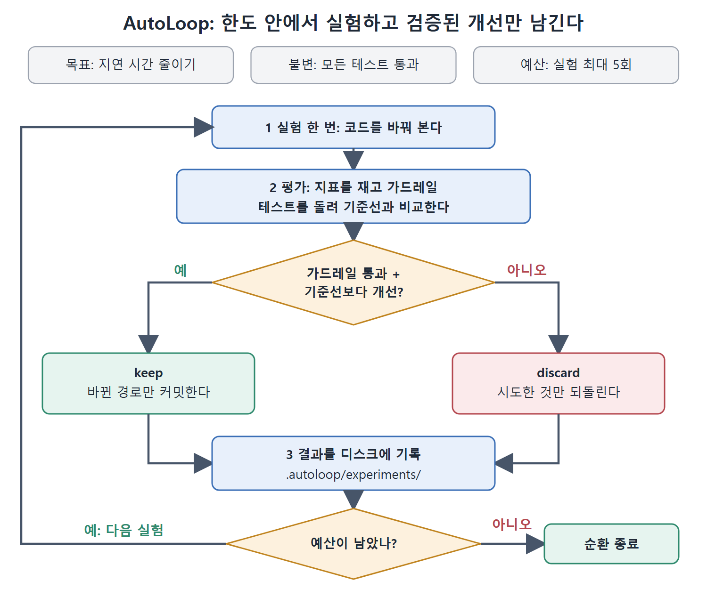

# 자가 치유 파이프라인과 AutoLoop

앞의 패턴들에서 에이전트는 시킨 일을 하는 작업자였다. 더 성숙한 단계에서는 에이전트가 파이프라인의 건강을 함께 돌보는 참여자가 된다. 이 문서는 자가 치유(self-healing) CI/CD의 3단계 성숙도 모델, 가장 단순한 자율 패턴, 실패를 자동으로 고치는 Pipeline Doctor, 그리고 CI 안에서 한도를 두고 성능을 개선하는 AutoLoop를 다룬다.

---

## 1. 자가 치유 성숙도 모델: 세 단계

세 단계는 각각 승인 모드와 짝지어진다. 자율성이 높아지는 순서대로 Observer, Gatekeeper, Healer다.

| 단계 | 이름 | 설정 | 에이전트가 하는 일 |
| --- | --- | --- | --- |
| 1 | Observer | `-s read-only -c approval_policy=untrusted` | 로그를 읽고 분석만 한다 |
| 2 | Gatekeeper | `-s workspace-write -c approval_policy=on-request` | 수정을 제안하고 머지 가능 여부에 표를 던진다 |
| 3 | Healer | `-s workspace-write -c approval_policy=never` | 진단, 패치, 테스트, 재실행까지 전부 한다 |

### 레벨 1 Observer (읽기 전용)

에이전트가 파이프라인 로그를 읽기 전용으로 지켜본다. 빌드 실패와 테스트 출력을 파싱한 뒤 분석을 PR 댓글이나 Slack 메시지로 올린다. 파일을 고치거나 잡을 다시 돌리는 일은 하지 않는다. 셸 명령도 실행하지 못하고 파일도 쓰지 못한다. 모든 출력은 `--json`을 통해 흘러나간다.

### 레벨 2 Gatekeeper (workspace-write, 관문 있음)

에이전트가 소스 수정, 설정 갱신, 테스트 픽스처 조정 같은 수정을 제안하지만 임의의 셸 명령은 실행하지 못한다. 머지 준비 상태에 표를 던진다. 고칠 수 없는 문제를 발견하면 차단하는 리뷰를 달고, 패치가 실패를 해결하면 승인한다. 워크스페이스 안에는 쓸 수 있지만 샌드박스 경계를 넘으려면 승인을 요청해야 한다. 수정 브랜치를 만들고 PR을 여는 CI 잡에 잘 맞는다.

### 레벨 3 Healer (완전 자율)

진단, 패치, 테스트, 파이프라인 재실행을 처음부터 끝까지 스스로 한다. 이 단계는 API 엔드포인트와 패키지 레지스트리 외에는 네트워크가 막힌 격리(air-gapped) 러너에서만 알맞다. 쓰기 권한은 전용 봇 계정으로 한정한다. 네트워크가 샌드박스된 러너에서 `-s workspace-write -c approval_policy=never`로 돌리거나, 같은 설정을 이름 붙은 프로필(config profile)로 담아도 된다. 피해 범위를 줄이려면 16장의 파일 시스템·샌드박스 제한을 함께 건다.



그림은 Observer, Gatekeeper, Healer가 샌드박스와 승인 설정이 달라지면서 에이전트의 자율성이 한 계단씩 높아지는 모습을 보여 준다. 아래 띠는 레벨 2에서 충분히 지낸 뒤 수정 정확도를 재 보고 레벨 3으로 올라간다는 승격 조건을 상기시킨다.

### 단계를 올리는 속도

대부분의 팀은 레벨 2에서 몇 달 지낸 뒤에 레벨 3으로 가야 한다. 성급한 자율성은 실수를 기계의 속도로 증폭시킨다. 사람 관문을 빼기 전에 파이프라인 관측으로 에이전트의 수정 정확도를 먼저 재 본다.

## 2. 가장 단순한 자율 패턴

복잡한 수정 순환에 앞서, 최소한의 자율 형태는 `codex exec` 한 번으로 문제를 찾고 고치고 검증하는 것이다.

```bash
codex exec "Fix all lint errors in src/" \
 -s workspace-write -c approval_policy=never \
 --model gpt-5.4-mini
```

`-s workspace-write -c approval_policy=never` 조합은 셸 명령 승인 없이 파일 쓰기 자율성을 준다. 모델 능력이 병목이 아닌 기계적인 수정에는 `gpt-5.4-mini`를 쓴다.

## 3. Pipeline Doctor 패턴

Pipeline Doctor는 Healer 단계를 `workflow_run`으로 트리거되는 잡으로 구현한 것이다. 다른 워크플로가 실패했는지 지켜보다가 자율 수정을 시도한다.

### 그림 15.1: 수정 순환 흐름

> 원서 그림 설명(약 324쪽, 글로 풀어 씀): 그림 15.1. Pipeline Doctor 수정 순환 흐름도. CI 워크플로 실행 실패, 저장소 체크아웃, gh run view --log-failed로 실패 로그 수집, workspace-write와 drop-sudo 아래에서 Codex가 원인을 진단하고 최소 수정 후 테스트 실행, 확신이 높은 수정인지 판단한다. 아니오면 진단만 보고하고 파일은 수정하지 않으며, 예면 create-pull-request로 수정 PR을 열고 사람이 리뷰해 머지한다.

그림의 흐름을 말로 옮기면 이렇다. CI 워크플로가 실패하면 저장소를 체크아웃하고, `gh run view --log-failed`로 실패 로그를 모은다. Codex가 `workspace-write`와 `drop-sudo` 아래에서 원인을 진단하고 최소한으로 고친 뒤 테스트를 돌린다. 마지막 판단은 확신이 높은 수정인가 하는 것이다. 아니면 진단만 보고하고 파일은 건드리지 않는다. 맞으면 `create-pull-request`로 수정 PR을 열고, 사람이 리뷰한 뒤 머지한다.

Codex 단계는 `workspace-write` 샌드박스와 `drop-sudo` 안전 전략으로 돈다. 확신이 높은 수정이 아니면 어떤 파일도 건드리지 않고 진단만 낸다. 확신이 높을 때만 수정 PR이 열리고, 그 PR은 사람이 리뷰하고 머지한다.

### 워크플로 구성

- 트리거: `workflow_run`, 대상 워크플로 `["CI"]`, 타입 `[completed]`
- 조건: `github.event.workflow_run.conclusion == 'failure'`일 때만 잡을 실행
- 체크아웃: `fetch-depth: 0`
- 실패 로그 수집: `gh run view <run id> --log-failed > /tmp/failure.log`, `GH_TOKEN`은 `secrets.GITHUB_TOKEN`
- 진단과 수정: 프롬프트는 (1) 근본 원인을 찾고 (2) 소스 코드에 최소 수정을 가하고 (3) 관련 테스트로 확인하라는 내용이다. 높은 확신으로 고칠 수 없으면 어떤 파일도 수정하지 말고 진단만 보고하라고 못박는다.
- PR 열기: 브랜치 `codex/pipeline-doctor-<run id>`, 레이블 `codex-generated, pipeline-doctor`, 본문에 리뷰 후 머지하라는 안내

```yaml
- name: Diagnose and fix
  uses: openai/codex-action@v1
  with:
    sandbox: workspace-write
    safety-strategy: drop-sudo
```

### 이 구성이 안전한 세 가지 이유

1. `workspace-write` 샌드박스는 의도된 선택이다. Pipeline Doctor는 워크스페이스 안의 소스 파일은 고칠 수 있지만 바깥은 건드리지 못한다.
2. `safety-strategy: drop-sudo` 입력이 sudo를 되돌릴 수 없게 제거한다. 권한 상승을 막는다.
3. 수정은 PR을 거친다. 사람 리뷰가 유지된다.

### 변형과 졸업

더 엄격한 변형은 일회용 러너에서 돌리고, 실패한 커밋을 `head_sha`로 체크아웃하고, PR을 열기 전에 같은 잡 안에서 테스트를 다시 돌려 패치를 확인한다. 실제로 통과하지 않는 수정은 리뷰어에게 도달하지 않는다. GitLab CI에서는 `codex exec`를 직접 쓰고 마커 기반 출력 추출과 `git apply --check` 검증을 한다. 정확도를 시간을 두고 검증한 팀은 PR 관문을 빼고 `-c approval_policy=never -s workspace-write`로 순환을 끝까지 자동으로 돌릴 수 있다.

### 자동 수정 품질을 위한 프롬프트 제약 두 가지

- 항상 최소한의 변경만 하라고 지시한다. "관련 없는 코드는 리팩터링하지 말라"는 문장이 범위가 번지는 것을 막는다.
- `git ls-files` 출력을 프롬프트에 넣는다. 존재하지 않는 경로를 지어내는 환각(hallucination)을 막는다.

## 4. AutoLoop: CI 안의 한도 있는 최적화

AutoLoop는 Karpathy의 autoresearch 패턴(GitHub 별 2만 개 이상)을 CI에 맞춘 한도 있는 최적화 순환으로 일반화한 것이다. 전통적인 CI는 통과/실패의 이분법인데, AutoLoop는 반복 개선을 더한다. 에이전트가 한도 안에서 실험을 하고, 기준선(baseline) 대비 적합도를 재고, 검증된 개선만 커밋한다.



그림은 AutoLoop가 목표, 불변 조건, 예산이라는 세 제약 안에서 실험을 돌리는 순환을 보여 준다. 가드레일을 통과하고 기준선보다 나아진 실험만 keep으로 커밋하고, 나머지는 discard로 되돌리며, 어느 쪽이든 결과를 기록한 뒤 예산이 남았을 때만 다음 실험으로 넘어간다.

### 실험 기록 보존

실험 결과는 `.autoloop/experiments/` 아래 디스크에 남는다. 세션 컴팩션(압축)이나 컨텍스트 윈도 한계를 넘어서도 살아남는다. 각 실험은 바뀐 파일, 지표 결과, 판정(keep/discard/rerun)을 기록한다.

```text
.autoloop/
├── config.toml      # 평가·가드레일 명령, 지표 파싱
├── baseline.json    # 시작 지표 스냅숏
├── learnings.md     # 자동으로 갱신되는 실험 통찰
└── experiments/     # 시간순 반복 기록
    ├── 001-reduce-alloc.json
    └── 002-batch-queries.json
```

### 설치와 실행

```bash
autoloop install codex
codex exec "Use autoloop-run to reduce benchmark latency. \
 Keep behaviour unchanged. Use at most 5 experiments." \
 -a never -s workspace-write
```

CI에서 안전한 이유는 세 제약이다. 최적화 목표(지연 시간), 행동 불변 조건(정확성, 모든 테스트가 통과해야 한다), 실험 예산(5회 반복)이다. `.autoloop/config.toml`의 가드레일이 테스트를 깨는 실험을 자동으로 버린다.

```toml
[eval]
command = "cargo bench --bench api_latency"
primary_metric = "p99_latency_ms"
direction = "lower_is_better"

[guardrails.tests]
command = "cargo test"
pass_threshold = "all"
```

### 경로 단위 되돌리기

AutoLoop는 각 실험에서 어떤 파일이 바뀌었는지 정확히 기록한다. keep이면 그 경로들만 커밋하고, discard면 시도한 것만 정확히 되돌린다. 워크트리 전체를 건드리지 않는다. 그래서 무관한 변경에 영향을 주지 않고 CI 브랜치에서 돌릴 수 있다. `.autoloop/` 설정은 Codex CLI, Claude Code, Gemini CLI, Cursor, OpenCode에서 모두 쓸 수 있어서, 여러 에이전트를 섞어 쓰는 팀도 실험 이력을 공유한다. 순환 인프라가 특정 에이전트에 묶이지 않는다.

<br>
<br>
<br>

[Agentic Coding with OpenAI Codex CLI](../)
