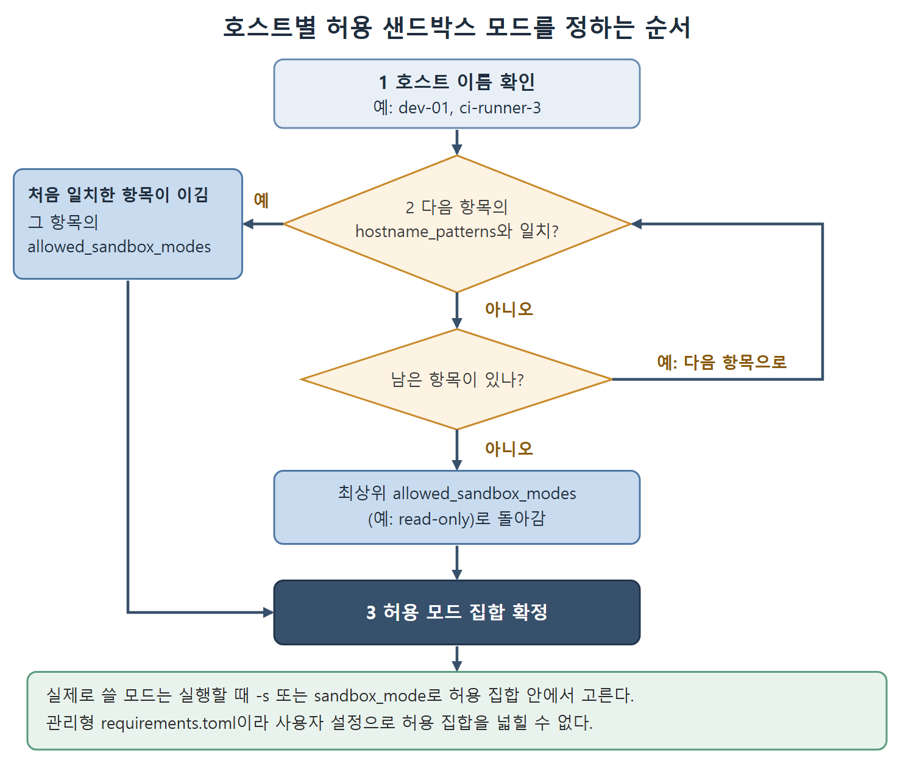

# 샌드박스와 파일 시스템 제한

피해를 줄이는 가장 믿을 만한 방법은 에이전트가 건드릴 수 있는 범위를 줄이는 것이다. 이 문서는 운영체제 수준 샌드박스의 구조, 읽기 거부(deny-read) 정책, 권한 프로필로 하는 디렉터리 제한, 호스트별 샌드박스 모드 제한을 다룬다.

5장(승인 모드와 신뢰 경계)에서 커널 수준 샌드박스 모델 전체를 다뤘다. macOS Seatbelt, Linux bubblewrap, 샌드박스 범위 설정, 완전 감독에서 완전 자동화까지의 권한 사다리가 거기에 있다. 이 장의 보안 권고는 5장에서 알맞은 샌드박스 모드를 이미 적용했다고 전제한다.

---

## 1. 운영체제 수준 샌드박스 개요

Codex CLI의 샌드박스는 단일 메커니즘이 아니다. 운영체제마다 다른 세 가지 강제 계층을 하나의 정책 추상화 뒤에 묶은 것이다. 샌드박스 정책은 쓰기 가능한 루트, 네트워크 접근 수준, 제약 플래그를 정하고, 샌드박스 매니저가 자식 프로세스를 띄우기 직전에 이 정책을 플랫폼별 강제 방식으로 번역한다.

세 플랫폼의 동작은 다음과 같다.

| 플랫폼 | 강제 방식 | 세부 사항 |
|---|---|---|
| macOS | 동적으로 만든 Seatbelt(SBPL) 프로필, 기본 거부 | 쓰기 가능한 루트 안의 .git, .agents, .codex 같은 보호 경로는 읽기 전용으로 만든다. 에이전트가 git 기록이나 자기 설정을 망가뜨리지 못한다 |
| Linux | Bubblewrap(bwrap)으로 파일 시스템을 네임스페이스로 분리 + seccomp-BPF 시스템 콜 필터링 | 시스템 경로는 읽기 전용으로 바인드 마운트하고 쓰기는 설정된 루트로 가둔다. prctl(PR_SET_NO_NEW_PRIVS)를 호출해 권한 상승을 막는다. Codex는 번들 bwrap을 제공하되 시스템 bwrap이 있으면 그쪽을 우선하며, 이전 방식인 Landlock LSM 경로는 레거시 샌드박스 정책용 대체 수단으로 남아 있다 |
| Windows | 제한된 토큰을 가진 전용 샌드박스 사용자 | 파일 시스템 경계는 ACL로, 네트워크 통제는 Windows 방화벽 규칙으로 강제한다 |

세 플랫폼의 공통점은 샌드박스가 커널 수준에서 동작한다는 것이다. 그래서 프롬프트 인젝션이나 도구 조작으로는 에이전트가 이 강제를 우회할 수 없다.

## 2. 읽기 거부 정책(deny-read)

deny-read는 관리형(managed) 제어다. 관리자가 requirements.toml에 설정하므로 사용자가 로컬 설정으로 약하게 만들 수 없다. 정확한 경로나 glob 패턴을 받으며, 파일 시스템 보안의 읽기/쓰기/실행 세 권한 중 빠져 있던 읽기 쪽을 채워 준다.

```toml
# requirements.toml (managed)
[permissions.filesystem]
deny_read = ["/**/*.env", "credentials/**", "**/.ssh/**", "/**/*.pem"]
```

glob 엔진은 작업 공간 루트 기준의 전체 경로에 패턴을 맞춘다. `*`는 한 디렉터리 구성 요소 안에서만 일치하고, `**`는 디렉터리 경계를 넘어 일치한다. 읽기가 거부되면 도구 계층에 권한 오류가 돌아간다.

여기서 반드시 알아야 할 한계가 있다. 운영체제 수준 샌드박스는 커널에서 읽기를 제한하지 못한다. 샌드박스 안의 프로세스도 디스크 전체를 읽을 수 있다. deny_read는 Codex CLI의 도구 계층에서 읽기 제한을 걸 뿐이다. 커널 수준의 읽기 제한이 꼭 필요한 환경이라면 최소한의 파일 시스템만 가진 컨테이너나 VM 안에서 에이전트를 돌려야 한다.

## 3. 디렉터리 제한: 권한 프로필

권한 프로필로 파일 시스템 범위를 정한다.

```toml
# config.toml: permission profile
[permissions.scoped]
filesystem.":workspace_roots"."." = "write"
filesystem.":workspace_roots".".git" = "deny"
filesystem.":workspace_roots".".env" = "deny"
filesystem.":workspace_roots"."secrets" = "deny"
filesystem.":workspace_roots"."infrastructure" = "deny"
```

프로필 아래의 경로마다 read, write, deny 중 하나의 판정이 명시적으로 붙는다. 우선순위 규칙은 두 가지다. 가장 구체적인 경로 일치가 이긴다. 그래서 하위 경로의 deny가 상위 경로의 write를 덮어쓴다. 같은 경로를 가리키는 항목이 둘이면 deny가 write보다, write가 read보다 앞선다. 위 예에서는 작업 공간 전체를 쓰기 가능으로 열되 .git, .env, secrets, infrastructure만 막은 셈이다.

CI 환경에서는 프로필을 최소 작업 집합까지 더 조인다.

```toml
[permissions.ci]
filesystem.":workspace_roots".src = "write"
filesystem.":workspace_roots".tests = "write"
filesystem.":workspace_roots"."src/config/production.yaml" = "deny"
```

src와 tests만 쓰기를 허용하고, 그 안에서도 운영 설정 파일 하나는 deny로 잠근다.

## 4. 환경별 샌드박스 정책

기업 배포는 한 가지 환경에서만 돌지 않는다. Codex CLI는 관리형 설정으로 호스트마다 허용되는 샌드박스 모드를 제한할 수 있어서, 머신의 호스트 이름에 따라 다른 정책이 자동으로 적용된다.

```toml
# requirements.toml (managed)
allowed_sandbox_modes = ["read-only"]   # 일치하지 않는 호스트의 기본값
[[remote_sandbox_config]]
hostname_patterns = ["dev-*"]
allowed_sandbox_modes = ["read-only", "workspace-write"]
[[remote_sandbox_config]]
hostname_patterns = ["ci-runner-*"]
allowed_sandbox_modes = ["read-only", "workspace-write"]
```



그림은 호스트 이름을 `[[remote_sandbox_config]]` 항목에 위에서부터 맞춰 보고, 처음 일치한 항목의 집합을 쓰거나 끝까지 맞지 않으면 최상위 값으로 돌아가는 판정 순서를 보여 준다.

각 항목은 일치하는 호스트에서 허용되는 샌드박스 모드 집합을 제한한다. 실제로 쓸 모드는 여전히 실행할 때 `-s` 또는 sandbox_mode로 고른다. 규칙은 다음과 같다.

- 패턴에는 `*`와 `?` 와일드카드를 쓰며 대소문자를 구분하지 않고 맞춘다.
- 처음으로 일치한 항목이 이긴다.
- 어느 항목에도 안 맞는 호스트는 최상위 allowed_sandbox_modes로 돌아간다.
- 이 설정은 관리형 requirements.toml에 있으므로 사용자 설정으로 허용 집합을 넓힐 수 없다.
- 호스트 이름 매칭은 정책을 고르기 위한 용도일 뿐, 인증된 기기 증명이 아니다.

<br>
<br>
<br>

[Agentic Coding with OpenAI Codex CLI](../)
