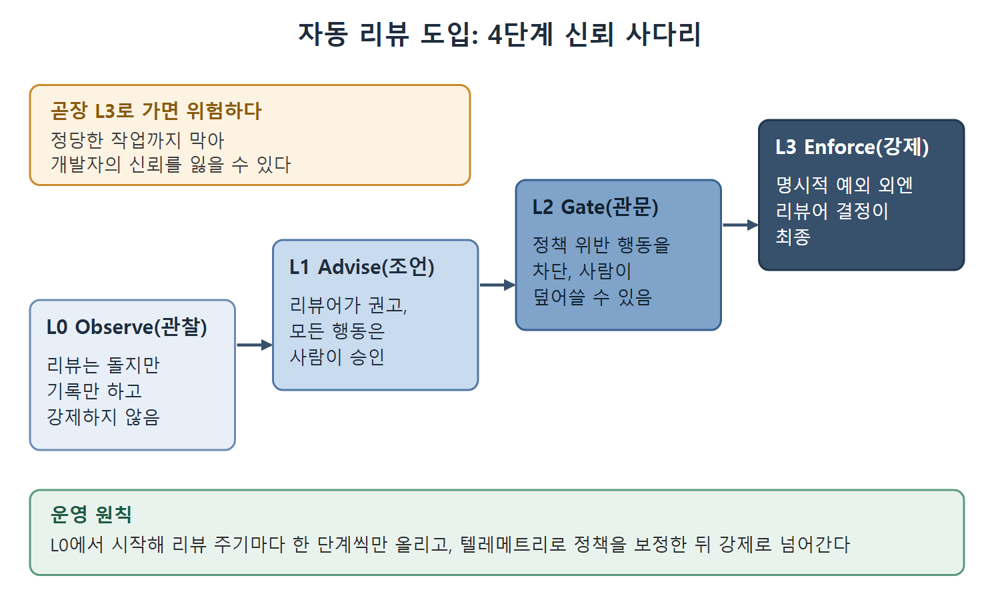

# 자동 리뷰와 신뢰 사다리

정적인 설정만으로는 잡지 못하는 정책 위반이 있다. Codex CLI의 자동 리뷰는 위험한 도구 호출을 실행하기 전에 LLM 기반 리뷰어가 평가하게 해서 그 틈을 메운다. 이 문서는 자동 리뷰를 켜는 방법, 조직에 점진적으로 도입하는 4단계 신뢰 사다리, 자동화 에이전트의 신원(identity) 문제를 다룬다.

---

## 1. 자동 리뷰

집필 시점 기준으로 Codex CLI는 자동 리뷰(automated review)를 제공한다. 설정은 다음과 같다.

- 설정에서 `approvals_reviewer = "auto_review"`로 켠다.
- `[auto_review].policy`로 리뷰어의 동작을 다듬는다.
- 기업은 requirements.toml의 `guardian_policy_config`로 관리형 리뷰어 정책을 고정할 수 있다.

리뷰어는 각 행동을 위험도(low, medium, high, critical)로 분류한다. 이미 승인이 필요한 행동만 평가하므로, 승인과 샌드박스 제어를 대체하지 않고 그 위에 얹히는 계층이다.

## 2. 4단계 신뢰 사다리

리뷰어는 도구일 뿐 도입 계획이 아니다. 아래 4단계 사다리는 저자가 제안한 프레임워크이며 Codex에 내장된 기능이 아니다. 자동 리뷰를 조직에 점차 퍼뜨리기 위한 틀이다.

| 단계 | 이름 | 동작 |
|---|---|---|
| L0 | Observe(관찰) | 리뷰는 돌지만 결정은 기록만 하고 강제하지 않는다. 리뷰어가 무엇을 막을지 먼저 파악하는 단계다 |
| L1 | Advise(조언) | 리뷰어가 권고를 내놓고, 모든 행동은 사람이 승인한다. 기존 승인 흐름 옆에서 참고용 피드가 된다 |
| L2 | Gate(관문) | 리뷰어가 정책을 어기는 행동을 막는다. 사람이 덮어쓸 수는 있다. 강제 권한이 처음 생기는 단계다 |
| L3 | Enforce(강제) | 조직 정책에 등록된 명시적 예외를 빼면 리뷰어의 결정이 최종이다 |

그림은 L0부터 L3까지 강제력이 한 단계씩 커지는 순서와, 곧장 L3로 가면 정당한 작업까지 막힌다는 주의점을 함께 보여 준다.

운영 원칙은 L0에서 시작해 리뷰 주기마다 한 단계씩만 올리는 것이다. 텔레메트리로 정책을 보정한 뒤에 강제로 넘어가야 한다. 기준선 데이터 없이 곧장 L3로 가면 정당한 작업까지 막아 개발자의 신뢰를 잃을 위험이 있다.

## 3. 리뷰 덮어쓰기와 감사 기록

기업은 관리형 리뷰어 정책으로 리뷰 덮어쓰기(override)를 설정할 수 있다. 안전하다고 알려진 운영 패턴에 대해서는 조직 정책이 자동 결정을 앞서게 하는 것이다. 이때 자동 승인과 정책에 의한 덮어쓰기를 감사 기록에서 구분해 남기는 장치가 중요하다. 조직 정책이 특정 도구 호출을 미리 승인해 두는 CI/CD 파이프라인에서 특히 쓸모 있다.

리뷰 결정은 OpenTelemetry 파이프라인에 연결해 검색 가능한 감사 로그로 만든다. 각 결정에 안정적인 식별자를 붙여 이벤트와 상태 전이에 걸쳐 대조할 수 있게 하는 것이 컴플라이언스 감사 기록의 전제 조건이다.

## 4. 에이전트 신원

CI 작업이나 예약 자동화 같은 비대화형 실행에는 개발자의 대화형 로그인이 아닌 별도 자격 증명이 필요하다. 집필 시점에 문서화된 방법은 Codex Access Tokens다. Codex 권한 범위로 제한된 ChatGPT 액세스 토큰을 러너마다 발급해, 자동화 에이전트가 사람의 세션을 빌리지 않고 자기 자격 증명으로 인증하게 한다. 백엔드 서비스는 그 토큰에 부여된 범위(scope)를 보고 인가를 결정할 수 있다.

에이전트 신원은 아직 발전 중인 영역이다. 암호학적 세션 클레임이나 부모 에이전트와 자식 에이전트 사이의 위임 권한 축소 같은 더 풍부한 에이전트별 신원은 현재 Codex가 문서화한 기능이 아니므로, 그것을 전제로 설계하면 안 된다. 인증 핸드셰이크의 양쪽 끝을 모두 통제하는 내부 서비스에서 Codex Access Tokens로 시작하는 편이 좋다.

 
 
 

[Agentic Coding with OpenAI Codex CLI](../)
