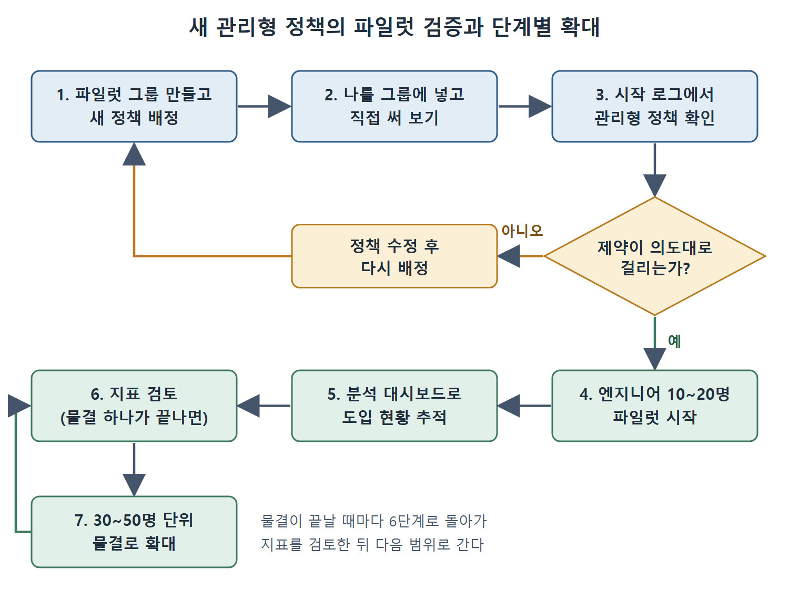

# 관리형 정책과 접근 제어

기업에서 개발자 PC의 `config.toml`만으로 정책을 지킬 수는 없다. 개발자가 파일을 고치면 그만이기 때문이다. 이 문서는 로컬 설정이 덮어쓸 수 없는 `requirements.toml` 관리형 정책, TLS 검사 환경과 권한 상승 차단 같은 런타임 통제, 관리자 역할(RBAC), 그리고 지침 층을 깔아 주는 `AGENTS.override.md`를 설명한다.

---

## 1. requirements.toml 관리형 정책

클라우드에서 관리하는 `requirements.toml` 정책은 기기마다 설정 파일을 배포하지 않고도 팀 전체의 Codex CLI 동작을 강제한다. 개발자가 기업 계정으로 인증하면 관리형 정책이 자동으로 내려와 적용된다. 로컬 `config.toml`은 관리형 정책의 값을 덮어쓸 수 없다.

### 정책 등급 설계

정책은 완결된 프로필 단위로 짠다. 기업에서 흔한 구성은 네 등급이다.

| 정책 | 적용 대상 | 목적 |
|---|---|---|
| baseline | 모든 사용자(기본값) | 일반 용도를 위한 무난한 기본값 |
| engineering | 엔지니어링 팀 | 더 넓은 샌드박스 접근, 전체 승인 정책 |
| restricted | 재무, 법무, 인사 | 규제를 받는 팀을 위한 더 빡빡한 제약 |
| admin | DevOps/플랫폼 | 환경 운영자를 위한 전체 접근 |

baseline 정책 예시는 이렇다. 샌드박스는 워크스페이스 쓰기만, 승인은 요청 시에만 허용하고, 네트워크는 허용 도메인만 열어 둔다.

```toml
allowed_sandbox_modes = ["workspace-write"]
allowed_approval_policies = ["on-request"]
# 네트워크 호스트 제어는 집필 시점에 실험 기능이다
[experimental_network]
enabled = true
allowed_domains = [
  "api.github.com",
  "registry.npmjs.org",
  "pypi.org"
]
```

명령어 접두어 규칙도 같은 정책에 넣을 수 있다. 아래는 두 줄 규칙의 형태다. `git push`는 사용자에게 물어보게 하고, `curl`은 아예 금지하면서 이유를 적는다.

```toml
[rules]
prefix_rules = [
  { pattern = [{ token = "git" }, { token = "push" }], decision = "prompt" },
  { pattern = [{ token = "curl" }], decision = "forbidden", justification = "External fetches must go through the approved egress proxy." }
]
```

`curl`을 막는 이유가 정책 파일 안에 문장으로 남는다는 점이 좋다. 막힌 개발자가 왜 막혔는지, 대신 무엇을 써야 하는지(승인된 egress 프록시)를 바로 알 수 있다.

### 롤아웃 전에 테스트하기

파일럿 그룹을 만들고, 새 정책을 배정하고, 자기 자신을 그룹에 넣은 뒤 직접 써 본다. CLI는 세션을 시작할 때 어떤 관리형 정책이 적용됐는지 로그로 남긴다. 제약이 의도대로 걸리는지 확인한 다음에 전체 그룹으로 넓힌다.

## 2. 런타임 통제 두 가지

관리형 정책 위에 기업 배포를 단단하게 하는 통제가 두 가지 더 있다.

**사용자 지정 CA 인증서.** TLS 검사 프록시가 있는 환경에서는 사내 CA 번들을 지정해야 한다. 환경 변수 `CODEX_CA_CERTIFICATE`에 번들 경로를 넣고, 값이 없으면 `SSL_CERT_FILE`로 대체된다.

```bash
export CODEX_CA_CERTIFICATE=/etc/ssl/corp-ca-bundle.pem
```

**권한 요청 잠금(request permissions lockdown).** 세션 도중에 에이전트가 스스로 권한을 올려 달라고 요청하는 길을 막는다. 관리형 요구 사항으로 승인 정책을 고정하고, 세분화된 권한 요청을 끈다.

```toml
# 관리형 requirements로 승인 정책을 고정해 세션 중 상승을 막는다
allowed_approval_policies = ["untrusted", "on-request"]
[approval_policy.granular]
request_permissions = false
```

이렇게 하면 모든 권한이 세션 시작 시점에 정책으로 정해진다. 에이전트가 작업 도중에 자기 접근 권한을 키울 수 없다.

## 3. RBAC과 접근 제어

Codex는 관심사를 깔끔하게 나누는 관리자 역할 세 가지를 제공한다.

| 역할 | 주된 기능 |
|---|---|
| Workspace Owner | 전체 관리: RBAC, 청구, 워크스페이스 설정 |
| Codex Admin | Codex 전용: 정책 관리, 분석 |
| Security/Compliance Admin | 컴플라이언스 로그와 감사 데이터 읽기 전용 접근 |

모범 사례는 ID 공급자(IdP)에 전용 Codex Admins 그룹을 만들고 SCIM으로 동기화하는 것이다. 그러면 IdP에서 새 엔지니어를 팀에 넣기만 해도 알맞은 Codex CLI 접근 등급이 자동으로 부여된다.

설정할 접근 제어는 세 가지다.

1. Allow Codex local: CLI와 IDE 확장을 누가 실행할 수 있는지 켜고 끈다.
2. Allow Codex cloud: 누가 백그라운드 클라우드 작업을 제출할 수 있는지 켜고 끈다.
3. Allow Code Review: Codex의 PR 리뷰 연동을 켜고 끈다.

현실적인 롤아웃 전략은 엔지니어 10~20명의 파일럿 그룹으로 시작하는 것이다. 분석 대시보드로 도입 현황을 추적하고, 30~50명 단위의 물결로 넓힌다. 한 물결이 끝날 때마다 분석 지표를 검토하고 나서 다음 범위로 간다.



그림은 파일럿 그룹에서 정책 적용 여부를 확인하고, 제약이 의도대로 걸리지 않으면 정책을 고쳐 다시 배정하는 흐름을 보여 준다. 확인이 끝나면 10~20명 파일럿을 거쳐 30~50명 단위 물결로 넓히며, 물결마다 지표를 다시 검토한다.

## 4. AGENTS.override.md로 팀 전반에 정책 걸기

AGENTS.md(4장)는 프로젝트가 에이전트 지침을 적는 곳이고, 기본적으로는 권고 수준이다. `AGENTS.override.md`가 이를 보완한다. 집필 시점 기준으로 Codex는 `$CODEX_HOME`에 놓인 `AGENTS.override.md`를 읽어서 프로젝트의 AGENTS.md와 함께 지침 묶음에 합친다. 이 파일을 MDM이나 구성 관리로 모든 워크스테이션의 `$CODEX_HOME`에 배포하면 보안팀이 팀들을 가로지르는 일관된 지침 층을 갖게 된다.

여기서 주의할 점이 있다. 이 파일은 강한 기본값이지 변경 불가능한 통제가 아니다. 에이전트에게 따르라고 요청하는 지침을 한 겹 더 얹는 것이고, `requirements.toml`처럼 넘을 수 없는 강제 경계가 아니다. 내용은 대략 이런 모양이다.

```markdown
# Organisation Security Policy: Codex Override
## Prohibited operations
- Do not write, read, or modify files under `src/payments/` without explicit approval from a human operator.
- Do not execute shell commands that connect to external hosts outside the approved egress list.
- Do not suggest storing credentials or private keys in source files.
## Required patterns
- All new database queries must use parameterised statements.
- Every generated migration file must include a corresponding rollback migration.
```

금지 작업(결제 코드 경로 접근, 승인된 목록 밖으로의 외부 접속, 소스에 자격 증명 저장 제안)과 필수 패턴(매개변수화된 쿼리, 마이그레이션마다 롤백 마이그레이션)을 적은 문서다. 보안팀이 관리하고, `config.toml`과 같은 수단으로 배포하며, 인프라 저장소에서 버전 관리한다.

`AGENTS.override.md`의 안전성은 그 파일을 배포하는 수단의 안전성을 넘지 못한다. 진짜 컴플라이언스 용도라면 파일 경로를 MDM이나 Ansible이 소유하게 해서, 로컬에서 고친 내용이 다음 동기화 때 덮어써지도록 함께 구성한다.

<br>
<br>
<br>

[Agentic Coding with OpenAI Codex CLI](../)
