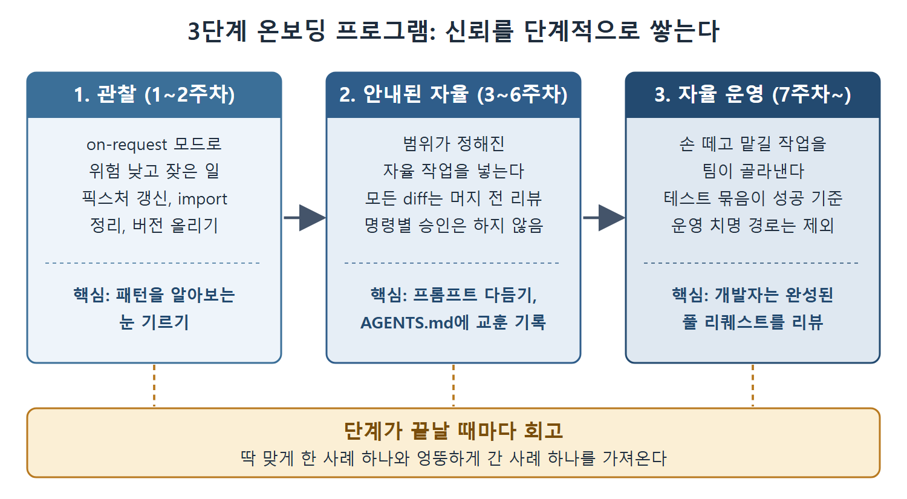

# 팀 온보딩과 ROI 측정

설치만 해 주고 "가져다 쓰세요"라고 하면 도입은 가장 빨리 식는다. 이 문서는 개발팀을 단계적으로 끌어올리는 3단계 온보딩 프로그램과, 도입 효과를 설득력 있게 보여 주는 ROI 지표를 정리한다.

---

## 1. 3단계 온보딩 프로그램

모든 개발자에게 작동하는 설치본을 쥐여 주고 알아서 쓰라고 하는 것이 도입 의욕을 꺾는 가장 빠른 길이다. 세 단계로 나누면 감각이 차근차근 쌓인다.

| 단계 | 기간 | 하는 일 | 핵심 |
|---|---|---|---|
| 1. 관찰 | 1~2주차 | `on-request` 모드로 위험이 낮고 자주 하는 일을 시킨다. 테스트 픽스처 갱신, import 정리, 의존성 버전 올리기 같은 작업이다 | 패턴을 알아보는 눈 기르기 |
| 2. 안내된 자율 | 3~6주차 | 범위가 정해진 자율 작업을 넣는다. 잘 아는 모듈의 단위 테스트 묶음 작성, 상세한 명세를 보고 기능 구현 같은 일이다. 모든 diff는 머지 전에 리뷰하지만 명령마다 승인하지는 않는다 | 프롬프트 다듬기, 1단계에서 배운 교훈을 AGENTS.md에 기록하기 |
| 3. 자율 운영 | 7주차 이후 | 손을 떼고 맡길 수 있는 작업을 팀이 골라낸다. 자동 테스트 묶음을 성공 기준으로 삼을 수 있고, 운영에 치명적인 경로를 건드리지 않는 작업이다 | 에이전트가 돌고 테스트가 통과하거나 실패하면, 개발자는 완성된 풀 리퀘스트를 리뷰한다 |

1단계에서는 공유 Slack 채널에 흥미로운 출력(좋은 것과 나쁜 것 모두)을 올리게 하면 집단 학습이 빨라진다.

각 단계가 끝날 때마다 회고를 잡는다. 개발자에게 에이전트가 딱 필요한 대로 해 준 사례 하나와 엉뚱한 방향으로 간 사례 하나를 가져오게 한다. 실패 사례가 성공 사례보다 배울 것이 많다.

그림은 1~2주차 관찰에서 3~6주차 안내된 자율, 7주차 이후 자율 운영으로 넘어가는 순서와 단계별 핵심을 보여 준다. 단계가 끝날 때마다 회고를 거쳐 다음 단계로 넘어간다는 점도 함께 나타낸다.

## 2. ROI 측정

AI 도구 시범 운영은 언젠가 "지금 내는 돈만큼 값어치가 있나?"라는 질문을 받는다. 이때 "절약한 시간"을 대표 지표로 내세우고 싶은 유혹을 참아야 한다. 개발자는 작업 단위로 시간을 기록하지 않고, "에이전트가 없었다면 얼마나 걸렸을까"라는 반사실은 지어낸 이야기이기 때문이다.

검증을 견디는 지표는 세 가지다.

**개입 없이 끝난 작업 비율.** 어떤 종류의 자율 작업이든, 개발자가 끼어들어 중단하거나 에이전트를 재시작하지 않고 처음부터 끝까지 완료되는 비율을 추적한다. 벤치마크가 아니라 예시로 든 목표치는, 2단계에서 40%를 기준선으로 잡고 3단계에서 75%까지 올라가는 궤적이다. 그럴듯한 흐름이라는 정도로 읽으면 된다.

**리뷰 통과율.** Codex가 만든 PR 중에서 첫 라운드에 수정 요청 없이 코드 리뷰를 통과하는 비율을 잰다. 개발자가 직접 쓴 PR의 기준선과 비교한다. Codex가 만든 PR이 수정 라운드를 덜 요구한다면 구체적인 품질 신호다.

**저작 방식별 결함 유출률.** 핵심 diff가 에이전트의 도움을 받았는지 여부로 PR에 태그를 붙인다. 릴리스 주기가 한 번 지난 뒤 배포 후 결함 비율을 비교한다. 쌓이는 데 시간이 걸리지만, 에이전트가 코드베이스를 더 믿을 만하게 만드는지 덜 믿을 만하게 만드는지에 직접 답해 준다.

## 3. 저작 메타데이터 수집

저작 방식별 지표를 내려면 가벼운 규칙이 필요하다. 커밋 트레일러(`Agent-Assisted: codex`)를 쓰거나, CI 파이프라인이 Codex CLI 세션 ID를 감지했을 때 PR 라벨을 붙이는 방법이 있다. 이 태깅 규율은 시범 운영 시작 시점에 세워 두어야 한다. 태깅이 없으면 위의 두 번째, 세 번째 지표에서 비교할 기준이 없다.

이 규칙은 뒤에서 다룰 "책임 공백" 문제의 해법과도 맞닿아 있다. 저작 메타데이터는 ROI 계산의 재료이자 사고가 났을 때 책임자를 찾는 단서가 된다.

 
 
 

[Agentic Coding with OpenAI Codex CLI](../)
