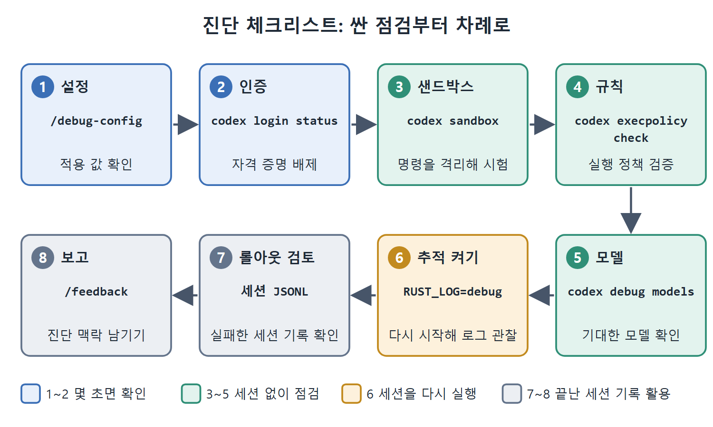

# 진단 체크리스트

무엇이 잘못됐는지 감이 오지 않을 때는 싼 점검부터 비싼 재시작 순으로 차례대로 해 보는 것이 가장 빠르다. 이 문서는 이 장에서 배운 도구를 한 줄짜리 절차로 엮어, 문제가 생겼을 때 그대로 따라 할 수 있는 순서로 정리한다. 각 도구의 자세한 사용법은 앞선 문서들을 참고한다.

---

## 1. 여덟 단계 절차

| 순서 | 점검 | 하는 일 |
|---|---|---|
| 1 | 설정 | TUI 안에서 `/debug-config`를 실행해 내 설정이 실제로 적용되는지 확인한다 |
| 2 | 인증 | `codex login status`로 자격 증명 문제를 배제한다 |
| 3 | 샌드박스 | `codex sandbox <platform> -- <command>`로 명령을 격리해 시험한다 |
| 4 | 규칙 | `codex execpolicy check --pretty --rules <file> -- <command>`로 실행 정책을 검증한다 |
| 5 | 모델 | `codex debug models`로 내 네트워크와 자격 증명에서 기대한 모델이 보이는지 확인한다 |
| 6 | 추적 켜기 | `RUST_LOG=debug codex`로 다시 시작하고 `~/.codex/logs/codex-tui.log`를 지켜본다 |
| 7 | 롤아웃 검토 | 실패한 세션의 JSONL 파일을 살펴본다 |
| 8 | 보고 | 세션을 닫기 전에 `/feedback`으로 진단 맥락을 남긴다 |

그림은 여덟 단계를 싼 점검에서 비싼 재시작 순으로 이어 보여 준다. 설정과 인증은 몇 초면 끝나고, 샌드박스·규칙·모델은 세션 없이 점검하며, 추적 켜기는 세션을 다시 돌리고, 롤아웃 검토와 보고는 끝난 세션의 기록을 쓴다.

## 2. 순서의 이유

앞쪽 단계일수록 비용이 낮고 범위가 넓다. 설정과 인증은 몇 초면 확인되고, 이 둘이 틀렸다면 뒤의 점검은 모두 헛수고가 된다. 샌드박스와 규칙, 모델 점검은 세션을 띄우지 않고도 할 수 있다. 추적을 켜고 다시 실행하는 것은 세션을 한 번 더 돌려야 하므로 그다음에 둔다. 마지막의 롤아웃 검토와 피드백 제출은 이미 끝난 세션의 기록을 활용하는 단계다.

모든 단계를 외울 필요는 없다. 위에서 아래로, 가장 싼 것부터 하나씩 배제해 나간다는 원칙만 기억하면 된다.

## 3. 증상별로 어디부터 볼까

장 전체 내용을 증상 기준으로 다시 묶으면 다음과 같다.

| 증상 | 먼저 볼 것 |
|---|---|
| 설정한 값이 먹지 않는다 | `/debug-config`로 어느 레이어가 덮어썼는지 확인 |
| 세션이 인증 오류로 시작되지 않는다 | `codex login status`, 필요하면 `codex logout` 후 `codex login` |
| 빌드나 테스트가 에이전트 안에서만 실패한다 | `codex sandbox`로 격리 재현 |
| 어떤 명령이 계속 승인을 요구하거나 막힌다 | `codex execpolicy check`로 규칙 판정 확인 |
| 모델이 달라졌거나 세션이 안 열린다 | `codex debug models` |
| AGENTS.md 지침이 먹지 않는다 | `RUST_LOG=codex_core=debug`로 로딩 확인 |
| 같은 파일을 반복해서 읽는다, 없는 파일을 말한다 | 컨텍스트 사용량 확인, `/compact` 또는 새 세션 |
| 결과물이 원래 요구와 점점 어긋난다 | SLUMP 점검과 재고정 |
| 원인을 모르겠다 | 롤아웃을 끝에서부터 거꾸로 읽기 |

 
 
 

[Agentic Coding with OpenAI Codex CLI](../)
