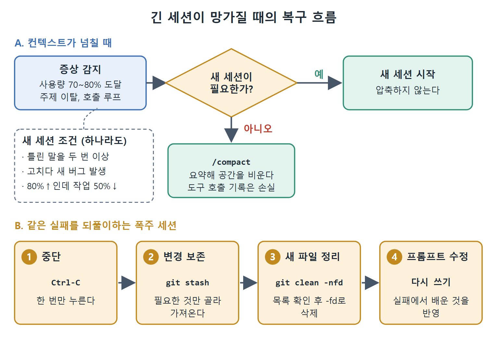

# 컨텍스트 과부하와 폭주 세션 복구

세션이 길어지면 에이전트의 품질이 떨어진다. 컨텍스트 윈도가 가득 차서 앞 내용을 잊거나, 같은 실패를 되풀이하며 토큰을 태우거나, 처음 명세에서 서서히 벗어나는 일이 생긴다. 이 문서는 그 증상을 알아보는 법, 상황별 대응(압축, 새 세션, 중단과 롤백), 그리고 명세 이탈(SLUMP)을 점검하는 법을 다룬다.

---

## 1. 컨텍스트가 넘칠 때의 증상

컨텍스트 윈도(모델이 한 번에 볼 수 있는 대화 분량)가 차면 에이전트는 세션 앞부분을 잊는다. 증상은 네 가지다.

1. 주제 이탈. 앞서 말한 제약을 무시한다.
2. 도구 호출 루프. 같은 파일을 여러 번 읽는다.
3. 존재하지 않는 파일 이름을 지어낸다.
4. 설명할 수 없는 실패. 명령 결과를 틀리게 보고한다.

세션 로그에는 컨텍스트 사용량이 퍼센트로 나온다. 70~80%에 이르면 조치를 취한다. `/compact`는 세션 기록을 요약해 압축하고 컨텍스트 공간을 비운다. 다만 손실이 있다. 압축하고 나면 상세한 도구 호출 기록은 사라진다.

압축 대신 새 세션을 시작해야 하는 경우도 있다.

- 에이전트가 파일 시스템 상태에 대해 자신 있게 틀린 말을 두 번 이상 했을 때
- 버그를 고치다가 새 버그를 만들었을 때
- 컨텍스트가 80% 넘게 찼는데 작업은 50%도 끝나지 않았을 때

## 2. 폭주하는 세션 복구하기

목표 연속 실행(goal continuation)과 재시도 루프가 문제가 될 수 있다. 사용 한도에 걸리거나 같은 장애물이 반복되면, 에이전트가 사람의 개입 없이 똑같은 실패 동작을 되풀이하며 토큰과 시간을 태울 수 있다. Codex CLI는 사용 한도나 반복되는 장애물에서 멈추고 개발자에게 제어권을 돌려준다. 에이전트가 재시도 루프에 빠진 것을 봤다면 가장 흔한 원인은 오래된 버전이고, 업그레이드로 해결된다.

중단은 깨끗하게 한다. Ctrl-C는 한 번만 누른다. 여러 번 누르면 두 번째 입력이 정리 핸들러를 취소할 수 있다.

변경분을 되돌릴 때는 `git checkout -- .`보다 `git stash`가 보통 더 안전하다. 에이전트의 변경을 보존해 두었다가 필요한 것만 골라 가져올 수 있기 때문이다.

```bash
git stash
git stash show -p   # 보관된 내용 확인
git stash drop      # 필요한 것을 가져온 뒤 폐기
```

주의할 점이 하나 더 있다. `git checkout -- .`도 `git stash`도 추적되지 않는 새 파일은 지우지 않는다. 이런 파일은 `git clean -nfd`로 미리 목록을 보고, 확인한 뒤 `git clean -fd`로 삭제한다.

롤백이 끝나면 30초를 들여, 실패한 세션에서 배운 것을 반영해 프롬프트를 고쳐 쓴다. 같은 프롬프트로 다시 돌리면 같은 곳에서 다시 막히기 쉽다.



그림의 위쪽은 컨텍스트가 넘칠 때 새 세션 조건에 해당하면 새로 시작하고, 아니면 `/compact`로 압축하는 판단을 보여 준다. 아래쪽은 폭주하는 세션을 Ctrl-C, `git stash`, `git clean -nfd`, 프롬프트 수정 순으로 복구하는 절차를 보여 준다.

## 3. 명세 이탈 감지: SLUMP

도구 실패가 아닌데 출력이 원래 명세와 점점 어긋나는 경우가 있다. 코드는 올바르게 돌지만 "요청한 것과 다른 문제"를 풀고 있는 상황이다. 이것은 도구 문제가 아니라 명세 이탈(specification drift)이다. SLUMP 프레임워크(Purdue University, 2026)는 초기 턴 출력과 후기 턴 출력이 원래 명세에 얼마나 충실한지를 비교해 이를 진단한다. 출처는 Lu Yan, Xuan Chen, Xiangyu Zhang의 arXiv:2603.17104 논문이다.

실제로 쓰는 점검은 세 단계다.

1. 명세를 특정한다. 작업을 정의한 원래의 PLANS.md, `/goal` 목표, 또는 첫 프롬프트를 찾는다.
2. 두 시점의 출력을 뽑아 비교한다. 첫 10턴 안에 에이전트가 쓴 파일과 30턴 이후의 파일을 놓고, 같은 아키텍처 결정을 구현하는지, 지정한 모듈 의존성을 쓰는지, 같은 이름 규칙을 따르는지 본다.
3. 특히 구조적 이탈을 찾는다. SLUMP 연구에 따르면 Codex CLI는 의미상의 정확성(개별 구성 요소가 맡은 일을 제대로 함)은 유지하지만, 구조적 통합(구성 요소들이 제대로 맞물림)은 잃는다. 이탈은 import 그래프와 모듈 의존성에서 가장 먼저 나타나므로 거기부터 본다.

이탈을 발견했을 때의 처방은 재고정(re-anchoring)이다. 원래 명세를 대화에 다시 붙여 넣거나, `/goal`로 목표를 다시 선언하거나, 같은 PLANS.md로 새 세션을 시작한다. Plan Mode(Shift+Tab)는 자연스러운 재고정 지점이다. Plan Mode에 들어가 현재 상태를 원래 명세와 대조한 다음, 나와서 실행을 이어 간다. SLUMP 분석과 대응 패턴의 전체 내용은 16장에 있다.

<br>
<br>
<br>

[Agentic Coding with OpenAI Codex CLI](../)
