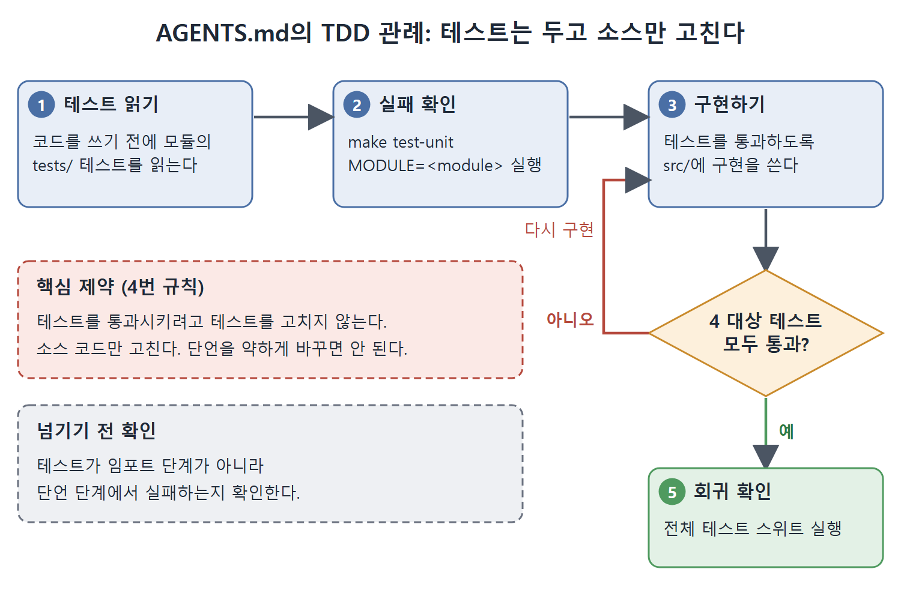

# TDD와 장기 작업 메모리

테스트를 구현보다 먼저 쓰면 Codex CLI는 '끝났다'가 무엇인지 기계로 확인할 수 있는 명세를 얻는다. 이 문서는 TDD(테스트 주도 개발)를 에이전트 피드백 루프로 쓰는 법, AGENTS.md에 TDD 관례를 적는 법, 버그 수정에서의 테스트 우선 접근, 그리고 여러 세션에 걸친 긴 작업을 위한 4개 파일 메모리 패턴을 설명한다.

---

## 1. 실패하는 테스트를 Codex에 넘기는 법

사전에 쓴 테스트가 없으면 Codex CLI는 글로 쓴 지시만 보고 '완료'의 의미를 짐작해야 한다. 테스트가 있으면 모호함 없는 완료 기준이 생긴다. 다만 실패하는 테스트도 앞서 말한 조건(격리, 결정성, 단일 명령)을 지켜야 하고, 한 가지가 더 붙는다. 임포트 단계가 아니라 단언 단계에서 실패해야 한다.

ImportError로 실패하는 테스트는 Codex CLI를 엉뚱한 방향으로 보낸다. 넘기기 전에 임포트가 성공하는지 확인한다.

```python
# 좋은 예: 단언에서 깔끔하게 실패
def test_renewal_creates_subscription_record():
    result = renew_subscription(user_id=42, plan="pro")
    assert result.status == "active"
    assert result.user_id == 42
```

반대로 아직 없는 모듈을 테스트 파일 맨 위에서 임포트해 ImportError가 나면, 테스트 로직에 닿기도 전에 실패한다. 이럴 때는 조건부 임포트나 스텁을 두어, Codex CLI가 임포트 체인 실패 대신 NotImplementedError나 실패하는 단언을 보게 한다.

```python
try:
    from src.billing.renewal import renew_subscription
except ImportError:
    def renew_subscription(*args, **kwargs):
        raise NotImplementedError("not yet implemented")
```

## 2. AGENTS.md의 TDD 관례

Codex CLI가 자동으로 TDD를 따르게 하려면 AGENTS.md에 규칙으로 적는다. 원서의 예는 기능을 구현할 때 다음 순서를 따르라는 내용이다.

1. 코드를 쓰기 전에 해당 모듈의 `tests/`에 있는 테스트를 읽는다.
2. `make test-unit MODULE=<module>`을 돌려 지금 어떤 테스트가 실패하는지 확인한다.
3. 그 테스트를 통과시키도록 `src/`에 구현을 쓴다.
4. 테스트를 통과시키려고 테스트를 고치지 않는다. 소스 코드만 고친다.
5. 대상 테스트가 모두 통과하면 전체 테스트 스위트로 회귀를 확인한다.

핵심 제약은 4번이다. Codex CLI가 단언을 약하게 바꿔서 테스트를 통과시켜서는 안 된다. 이를 코드 리뷰로 점검하고 AGENTS.md의 명시적 규칙으로 남긴다. '테스트를 수정하지 말 것'은 적어 둘 수 있는 제약 중 가장 값진 것에 속한다.



위 그림은 테스트 읽기부터 전체 스위트로 회귀를 확인하기까지의 다섯 단계를 보여 준다. 대상 테스트가 통과하지 못하면 테스트가 아니라 소스 코드만 고쳐 다시 구현하며, 이 제약이 4번 규칙의 핵심이다.

## 3. 버그 수정은 테스트부터

버그를 고칠 때는 먼저 버그를 재현하는 테스트를 쓰고, 그 테스트가 실제로 실패하는지 확인한 뒤 넘긴다. 원서가 제시하는 지시는 이런 식이다. "이 버그를 고쳐라. `tests/test_billing.py::test_duplicate_charge` 테스트가 재현한다. 테스트를 수정하지 말고 통과시켜라." 글로 설명하는 것보다 훨씬 효과적이고, 덤으로 회귀 테스트도 남는다.

## 4. 장기 작업을 위한 4개 파일 메모리 패턴

파일이 많고 결정이 많고 세션이 여러 번에 걸치는 긴 작업에는 체크포인트처럼 되돌아갈 수 있는 상태가 필요하다. 4개 파일 패턴은 `.codex/` 아래에 파일 네 개를 두고, AGENTS.md에서 참조해서 모든 세션이 자동으로 읽게 한다.

| 파일 | 목적 |
|---|---|
| PLAN.md | 분해된 작업 명세. 무엇을 어떤 순서로 할지 |
| PROGRESS.md | 완료한 단계, 현재 상태, 막힌 점 |
| DISCOVERIES.md | 예상 밖의 발견, API의 특이점, 코드베이스의 놀라운 점 |
| DECISIONS.md | 선택의 근거(언어, 라이브러리, 알고리즘) |

AGENTS.md에는 다음과 같은 규칙을 둔다.

```markdown
## Long-horizon task management
- Read PLAN.md for the task specification
- Update PROGRESS.md after each completed step
- Record unexpected findings in DISCOVERIES.md
- Document architectural choices in DECISIONS.md
Never skip the PROGRESS.md update. It is the recovery point for the next
session.
```

PROGRESS.md는 체크포인트 구실을 한다. 세션이 갑자기 끊겨도 새 세션이 이전 세션이 멈춘 자리에서 그대로 이어받는다. DECISIONS.md는 결정의 감사 기록이 된다. 네 파일을 합치면 긴 작업이 잘못됐을 때 원인을 거슬러 추적할 수 있는 기록이 된다.

### 결과와 과정을 함께 채점한다

긴 작업은 기능 결과(테스트 통과)와 과정 품질(PROGRESS.md가 갱신됐는가, DISCOVERIES.md가 채워졌는가)을 둘 다 채점한다. 계획을 따르지 않고 테스트만 통과한 에이전트는 믿을 만한 역량을 가졌다고 보기 어렵다. 과정 채점이 이를 걸러 낸다.

<br>
<br>
<br>

[Agentic Coding with OpenAI Codex CLI](../)
