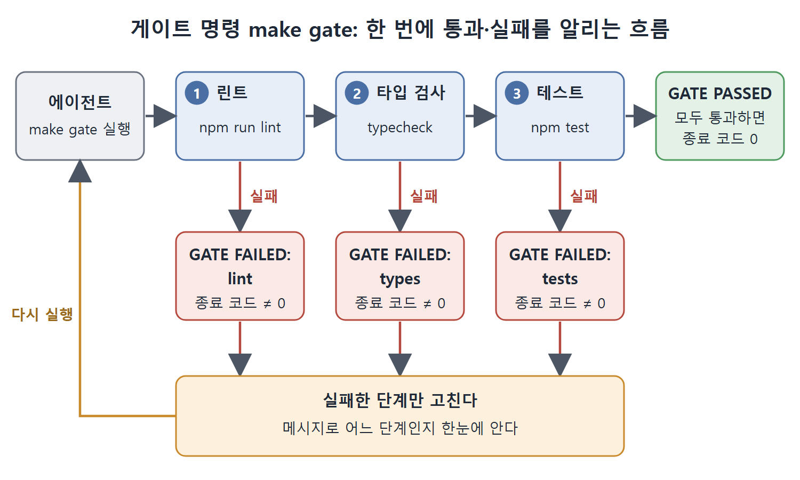

# 피드백 신호와 게이트 명령

"테스트 통과"는 코드가 맞다는 증명이 아니라 대리 지표일 뿐이다. 이 문서는 그 대리 지표를 조금이라도 믿을 만하게 만드는 방법, 즉 커버리지 기준과 린트·타입·테스트를 묶은 게이트 명령을 설명한다. 이어서 Codex CLI 자신에게 테스트 스위트를 감사시키는 방법도 다룬다.

---

## 1. 줄 커버리지보다 분기 커버리지

테스트가 통과했다는 말은 "검사한 범위 안에서는 문제가 없었다"는 뜻일 뿐이다. 대리 지표로는 줄 커버리지보다 분기 커버리지가 낫다. 에이전트가 만든 코드는 실행은 되지만 잘못된 분기를 한 번도 타지 않는 경우가 있는데, 분기 커버리지는 그런 버그를 잡아낸다.

CI에서 쓸 만한 기준값은 다음과 같다. jest의 package.json 설정 예다.

```json
"jest": {
  "coverageThreshold": {
    "global": {
      "lines": 85,
      "branches": 75,
      "functions": 90
    }
  }
}
```

줄 85, 분기 75, 함수 90 퍼센트다.

## 2. 게이트 명령 패턴

린트, 타입 검사, 테스트를 하나의 게이트 명령으로 묶고, 통과와 실패를 종료 코드로 분명히 알린다. 아래는 Makefile 예시다.

```makefile
gate:
	@echo "Running lint..."
	@npm run lint || (echo "GATE FAILED: lint" && exit 1)
	@echo "Running type check..."
	@npm run typecheck || (echo "GATE FAILED: types" && exit 1)
	@echo "Running tests..."
	@npm test || (echo "GATE FAILED: tests" && exit 1)
	@echo "GATE PASSED"
```

에이전트는 `make gate`만 실행한다. 어느 단계든 실패하면 0이 아닌 종료 코드와 어느 단계에서 실패했는지 적힌 메시지가 나온다. 모두 통과하면 "GATE PASSED"와 종료 코드 0이 나온다. 에이전트는 어느 단계를 고쳐야 하는지 한눈에 알 수 있다.



위 그림은 에이전트가 `make gate`를 실행하면 린트, 타입 검사, 테스트를 순서대로 거치는 과정을 보여 준다. 어느 단계에서든 실패하면 해당 단계를 적은 GATE FAILED 메시지와 0이 아닌 종료 코드가 나오고, 에이전트는 그 단계만 고쳐 다시 실행한다.

### 게이트가 느릴 때

게이트가 5분을 넘기면 느린 단계를 병렬로 돌릴 수 있는지 따져 본다. 린트와 타입 검사를 테스트와 동시에 돌리면 실제 소요 시간을 40~60퍼센트 줄일 수 있고, 종료 코드의 의미는 그대로다. 이때는 parallel 같은 도구나 CI 제공자의 단계 병렬화 기능을 쓰고, 에이전트 눈에 보이는 복잡성을 늘리지 않는다.

## 3. Codex CLI로 테스트 스위트 감사하기

테스트 스위트를 에이전트의 피드백 신호로 쓰기 전에, Codex CLI 자신에게 먼저 점검시킬 수 있다.

### 무엇을 요청할까

유용한 감사 프롬프트는 찾을 문제 유형을 구체적으로 나열한다.

- 모킹 없이 외부 서비스로 HTTP 호출을 하는 테스트
- 비동기 대기를 위해 sleep()이나 setTimeout을 쓰는 테스트
- 지정된 픽스처 디렉터리 밖의 파일시스템에 접근하는 테스트
- 정리 없이 모듈 수준·전역 상태를 바꾸는 테스트
- 실행 순서에 의존하는 테스트(앞선 테스트가 데이터를 만들었다고 가정)
- 하드코딩된 절대 경로를 쓰는 테스트

문제마다 파일, 줄, 한 문장짜리 문제 설명, 수정 제안을 달라고 한다. 그리고 반드시 "파일을 수정하지 말고 보고서만 만들라"고 못 박는다. 실행은 `-a untrusted -s read-only` 모드로 한다. 즉 승인 모드는 untrusted, 샌드박스는 읽기 전용이다.

Codex CLI가 믿을 만하게 찾아 주는 항목은 다음과 같다. 모킹 없는 직접 HTTP 호출, 하드코딩된 절대 경로, sleep() 호출(가끔 깨지는 테스트의 가장 흔한 원인), 정리 없이 바뀌는 전역 상태, 테스트 간 상호 의존(앞 테스트에서 만든 ID를 참조하는 경우)이다.

### 감사 결과 다루기

문제 목록이 나오면 영향이 큰 순서로 우선순위를 매긴다.

| 순서 | 문제 | 이유 |
|---|---|---|
| 1 | 네트워크 호출 | 샌드박스 실패의 가장 흔한 원인이라 가장 먼저 고친다 |
| 2 | 절대 경로 | 로컬에서는 통과해도 CI에서 실패하므로 두 번째로 고친다 |
| 3 | sleep() 호출 | 불안정함을 만들지만 대개 완전한 실패까지는 아니므로 여유가 있을 때 고친다 |
| 4 | 전역 상태 | 전부 찾기 어렵고, 영향은 테스트 순서 문제로 나타나며 보통 로컬보다 CI에서 먼저 드러나므로 문제가 나타날 때 고친다 |

<br>
<br>
<br>

[Agentic Coding with OpenAI Codex CLI](../)
