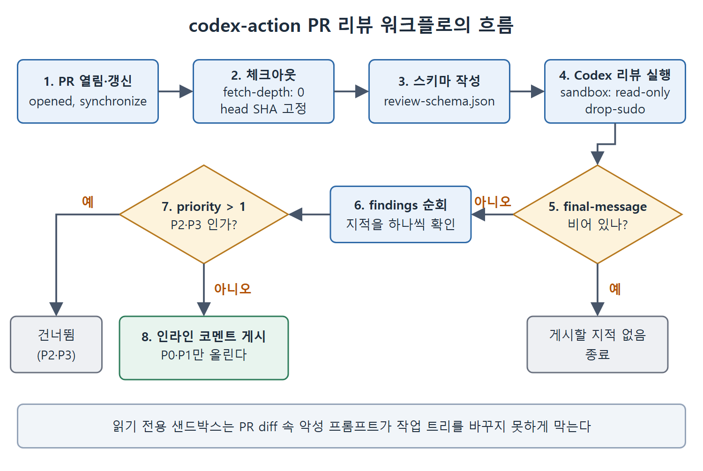

# PR 자동 리뷰와 codex-action

AI 리뷰의 효과가 가장 큰 배치 방식은 모든 풀 리퀘스트에 자동으로 붙이는 것이다. Codex CLI는 두 가지 경로를 제공한다. GitHub 클라우드 연동, 그리고 자체 호스팅이나 GitHub 이외 환경을 위한 `openai/codex-action`이다. 이 문서는 두 경로의 사용법과 GitHub Actions 워크플로 예시를 설명한다.

---

## 1. GitHub 클라우드 리뷰

연결된 저장소의 PR에 `@codex review`라고 댓글을 달면 리뷰가 시작된다. Codex는 지켜보고 있다는 표시를 남기고, 의존성 맥락과 테스트까지 포함한 diff 전체를 읽은 뒤 해당 줄에 인라인 코멘트를 단다.

영구 설정을 바꾸지 않고 한 번만 초점을 지정하고 싶다면 지시를 바로 덧붙인다.

```text
@codex review for SQL injection and authentication bypass
@codex review for N+1 queries in the new ORM layer
```

이 지시는 그때 트리거된 리뷰의 범위만 정한다. AGENTS.md나 영구 설정은 바뀌지 않는다.

Codex CLI 설정에서 Automatic reviews를 켜면 PR이 열릴 때마다 댓글 없이도 리뷰가 시작된다. 어떤 PR도 AI 1차 검토를 거치지 않고 사람 리뷰에 도달하지 않는다.

GitHub 클라우드 리뷰는 기본적으로 P0와 P1 지적만 보여 준다. 문서 누락이나 이름 불일치 같은 낮은 심각도의 문제도 보고 싶다면 AGENTS.md에 명시적으로 올려 준다. 예를 들어 "공개 API 문서 누락은 P1로 취급한다"라고 쓴다. 이렇게 하면 격상이 의도적이고 팀의 통제 아래 있게 된다.

## 2. codex-action으로 CI 리뷰하기

GitHub 클라우드 연동을 쓰지 않는 저장소(GitLab, 자체 호스팅 GitHub Enterprise, Jenkins, 또는 러너 환경과 모델 엔드포인트를 직접 통제하고 싶은 팀)에서는 `openai/codex-action`이 같은 기능을 자체 CI 파이프라인 안에서 제공한다. 구조화된 JSON 출력을 받으므로 코멘트를 달기 전에 프로그램으로 지적을 걸러내거나, 품질 대시보드로 보내거나, 커스텀 머지 관문을 만들 수 있다.

## 3. 워크플로 예시 읽기

원문 예시는 PR이 열리거나 갱신될 때 읽기 전용 샌드박스에서 Codex 리뷰를 돌리고, P0와 P1 지적을 인라인 리뷰 코멘트로 올리는 GitHub Actions 워크플로다. 핵심 부분만 보면 다음과 같다.

```yaml
name: Codex PR Review
on:
  pull_request:
    types: [opened, synchronize]
permissions:
  contents: read
  pull-requests: write
# checkout: fetch-depth: 0, ref: head.sha, then git fetch origin base_ref
```

권한은 코드는 읽기만, PR에는 쓰기만 준다. 체크아웃은 `fetch-depth: 0`으로 전체 이력을 가져오고 PR head SHA를 고정한 뒤 기준 브랜치를 fetch해야 diff를 계산할 수 있다.

다음 단계에서는 리뷰 스키마 파일 `review-schema.json`을 만든다. 스키마의 최상위에는 `findings` 배열과 `verdict` 문자열이 있고, 각 지적은 `title`, `body`, `priority`(정수), `confidence_score`(숫자), `code_location`(객체)을 가진다.

그다음 Codex를 실행하는 단계다.

```yaml
- name: Run Codex review
  id: codex
  uses: openai/codex-action@v1
  with:
    openai-api-key: ${{ secrets.OPENAI_API_KEY }}
    sandbox: read-only
    safety-strategy: drop-sudo
    output-schema-file: review-schema.json
    # prompt: origin/base_ref 와 HEAD의 diff를 정확성, 보안,
    # 성능 중심으로 리뷰하고 AGENTS.md의 Review guidelines를 따른다
```

마지막 단계는 `actions/github-script@v7`로 코멘트를 게시한다. 이 단계는 `steps.codex.outputs.final-message`가 비어 있지 않을 때만 실행된다. 스크립트는 그 JSON을 파싱해 `findings`를 돌면서 `f.priority > 1`이면 건너뛴다. 남은 지적은 `pulls.createReviewComment`로 올리는데, 본문은 굵은 제목, `P{priority}`, 신뢰도 백분율(`confidence_score`에 100을 곱해 정수로 표시), 설명을 이어 붙인 형태다. 위치는 `code_location`의 파일 경로와 `line_range.end`를 쓰고, 값이 없으면 1번 줄로 대체하며, `commit_id`는 PR head SHA다.



그림은 이 워크플로가 PR 이벤트에서 시작해 인라인 코멘트 게시까지 가는 순서와 두 번의 분기를 보여 준다. 첫 분기는 결과가 비어 있는지, 둘째 분기는 `priority > 1`인 지적을 걸러 P0와 P1만 올리는지를 가른다.

## 4. 설정값의 의미

- `sandbox: read-only`: PR diff 안에 악의적인 프롬프트가 숨어 Codex의 행동을 바꾸려 해도 작업 트리를 수정하지 못하게 한다. 프롬프트 인젝션은 CI 환경에서 실제로 알려진 위협 경로로, 저장소 파일(PR diff, 소스 코드, 커밋 메시지)에 든 악성 내용이 AI 에이전트의 지시를 가로채려는 공격이다. 이 주제는 16장에서 다룬다.
- `safety-strategy: drop-sudo`: 공유 러너에서 상승된 권한을 없앤다.
- 우선순위 값은 0에서 3까지이고 0이 치명적, 3이 제안이다. `f.priority > 1` 필터가 인라인 코멘트를 P0와 P1로 제한해 PR 스레드가 실행 가능한 이슈에 집중하게 한다.

이 0~3 정수 척도는 이 장이 채택한 스키마 관례일 뿐이다. `codex-action`은 지적 스키마를 스스로 정의하지 않으며, 사용자가 `output-schema-file`로 넘겨준다. 이 척도는 보안 취약점 분류에서 널리 쓰이는 심각도 단계와 대응된다.

<br>
<br>
<br>

[Agentic Coding with OpenAI Codex CLI](../)
