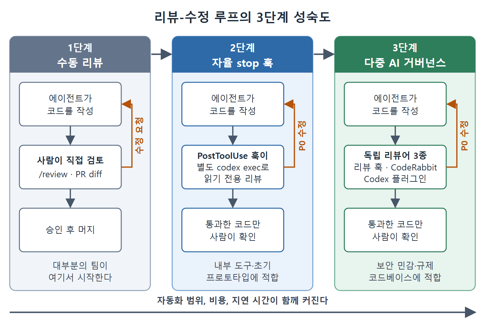

# 사람과 AI 협업과 3단계 성숙도

목표는 사람 리뷰를 없애는 것이 아니라 더 효과적으로 만드는 것이다. 이 문서는 사람과 AI가 일을 나누는 세 가지 패턴, 그리고 리뷰와 수정 루프를 얼마나 자동화할지 정하는 3단계 성숙도 모델을 설명한다.

---

## 1. 협업 패턴 세 가지

**AI가 먼저 보고, 사람이 논쟁을 정리한다.** PR이 열리면 Codex CLI가 자동으로 리뷰한다. 사람 리뷰어는 AI 지적을 읽고 해결됨 또는 이의 있음으로 표시한 뒤, AI가 표시해 둔 항목이 주석으로 달린 상태에서 diff를 본다. 처음부터 이슈를 찾아낼 필요가 없어 주기가 짧아진다. 이의가 제기된 지적은 값진 데이터이므로, 그 결론을 AGENTS.md에 반영해 두면 이후 리뷰가 더 잘 맞춰진다.

**관심사별로 리뷰를 나눈다.** 사람은 아키텍처적 의도에 강하고 AI는 기계적 정확성에 강하다. 둘을 병렬로 돌린다. 사람은 "이게 만들 만한 것인가"를 보고, Codex CLI는 "제대로 만들어졌는가"를 본다. 리뷰어가 부족한 팀에서 특히 효과적인데, 기계적인 리뷰가 한정된 사람의 주의력을 잡아먹지 않게 해 준다.

**리뷰를 대화로 만든다.** 대화형 세션에서 `/review`는 판결이 아니라 출발점이다. 첫 패스 뒤에 이렇게 이어 간다. "84번 줄 인증 검사 누락 건, 핸들러를 리팩터링하지 않고 되는 가장 단순한 수정안을 보여 줘." Codex CLI가 좁은 패치를 제안하면 적용하고, 미커밋 변경에 `/review`를 다시 돌리며 반복한다. 리뷰가 막아서는 관문이 아니라 점진적 개선 루프가 된다.

## 2. 의견이 갈릴 때 기록하기

사람과 AI의 판단이 갈리면 이유를 적어 둔다. AI가 틀렸다면 AGENTS.md에 예외 사유를 적어 이후 리뷰가 같은 오탐을 반복하지 않게 한다. AI가 맞았는데 사람이 뒤집었다면 그 사례를 추적한다. 특정 범주에서 뒤집기가 반복된다면, PR마다 기각할 것이 아니라 그 범주 자체를 논의해야 한다는 신호인 경우가 많다.

## 3. 리뷰-수정 루프의 3단계 성숙도

사람이 코드를 보기 전에 리뷰와 수정 순환이 얼마나 자율적으로 일어나는가가 핵심 질문이다. 팀은 단계적으로 자동 리뷰를 도입하므로, 이 단계를 알면 초기에 과하게 만들지 않고 인프라 투자를 계획할 수 있다.



그림은 세 단계가 모두 에이전트의 코드 작성, 리뷰, 수정 순환이라는 같은 골격을 갖되 누가 리뷰하느냐가 다르다는 점을 보여 준다. 오른쪽 단계로 갈수록 사람이 보기 전에 거치는 자동 리뷰가 늘어나고 비용과 지연 시간도 함께 커진다.

### 1단계: 수동 리뷰

에이전트가 코드를 만들고 사람이 `/review`나 PR의 diff 읽기로 직접 검토한다. 대부분의 팀이 여기서 시작한다. 에이전트는 생산성 도구이고 코드 품질은 여전히 리뷰어의 주의력과 전문성에 달려 있다. 자동 피드백 루프가 없어서 모든 문제를 사람이 발견하고, 수정을 요청하고, 해결을 확인해야 한다.

### 2단계: 자율 stop 훅

코드가 에이전트 세션을 떠나기 전에 리뷰가 자동으로 일어난다. 파일을 수정하는 도구 호출마다 Codex CLI의 PostToolUse 훅이 리뷰 패스를 일으킨다. 별도의 `codex exec` 프로세스가 리뷰 관문 역할을 하며, 출력을 AGENTS.md 지침과 프로젝트의 리뷰 스키마에 비추어 검사하고, P0 지적이 있는 커밋은 사람을 기다리지 않고 막는다.

에이전트가 코드를 쓰고, 리뷰 관문이 검사하고, 문제가 나오면 에이전트가 같은 세션 안에서 고쳐 보는 순환이다. 사람은 자동 관문을 통과한 코드만 보게 된다. 9장의 훅 기반 구조를 쓰면 구성이 간단하다.

```json
{
  "hooks": {
    "PostToolUse": [{
      "matcher": { "tool_name": "apply_patch" },
      "command": "codex exec --sandbox=read-only --output-schema review-schema.json 'Review the last patch for P0 issues'",
      "timeout_ms": 30000
    }]
  }
}
```

이 훅은 `apply_patch` 호출 뒤마다 읽기 전용 모드의 별도 `codex exec` 프로세스를 띄운다. 리뷰가 P0 지적을 반환하면 훅의 출력이 시스템 메시지로 주입되어, 계속 진행하기 전에 문제를 고치라고 세션에 지시한다. 핵심 설계 결정은 리뷰어와 생성자를 분리하는 것이다. 자기가 쓰지 않은 코드를 리뷰하는 프로세스에는 코드를 합리화할 동기가 없다.

### 3단계: 다중 AI 거버넌스

3단계는 리뷰 관문 훅 위에 독립적인 제공자 간 리뷰를 얹는다. 두 가지 플러그인이 이를 현실적으로 만든다.

- **CodeRabbit**: Codex 플러그인으로 제공되며 에이전트 세션 안에서 독립된 제3자 코드 리뷰를 제공한다. 에이전트가 워크플로 중에 CodeRabbit을 호출하면 CodeRabbit 고유의 리뷰 규칙, 보안 검사, 패턴 탐지가 적용된 관점을 얻는다. 자체 모델과 규칙 엔진이 있어 Codex 기본 리뷰어가 구조적으로 놓칠 수 있는 이슈를 잡는다.
- **Claude Code용 Codex 플러그인**: Claude Code 세션 안에서 Codex를 실행해 `/codex:review`, `/codex:adversarial-review` 같은 명령을 제공한다. 두 제공자를 한 세션에 묶으면 학습 데이터나 구조가 비슷해서 생기는 사각지대를 잡는다. CI의 적대적 패턴이 병렬 실행의 지적을 합친다면, 이 플러그인은 제공자 간 리뷰를 에이전트 세션 안으로 가져온다.

3단계에서는 한 세션이 독립 리뷰어 셋을 부른다. PostToolUse 리뷰 훅(같은 제공자, 읽기 전용 샌드박스), CodeRabbit(제3자 엔진), 제공자 간 Codex 플러그인이다. 리뷰 훅은 AGENTS.md의 프로젝트 고유 관례에 강하고, CodeRabbit은 폭넓은 보안과 정확성 규칙을 적용하며, 다른 모델 구조를 쓰는 제공자 간 조합은 같은 제공자 모델들이 공유하는 논리와 아키텍처 사각지대를 찾아낸다.

### 단계 고르기

다중 AI 거버넌스는 지연 시간과 비용을 늘린다. 3단계에서는 커밋할 만한 변경마다 사람이 보기 전에 리뷰 시스템 셋을 거친다. 보안에 민감한 라이브러리나 규제 대상 코드베이스에는 적절하다. 내부 도구나 초기 프로토타입이라면 2단계가 적은 오버헤드로 안전 효과 대부분을 준다. 프로젝트의 위험 특성에 맞춰 단계를 고르고, 프로젝트가 성숙하면 선택을 다시 점검한다.

<br>
<br>
<br>

[Agentic Coding with OpenAI Codex CLI](../)
