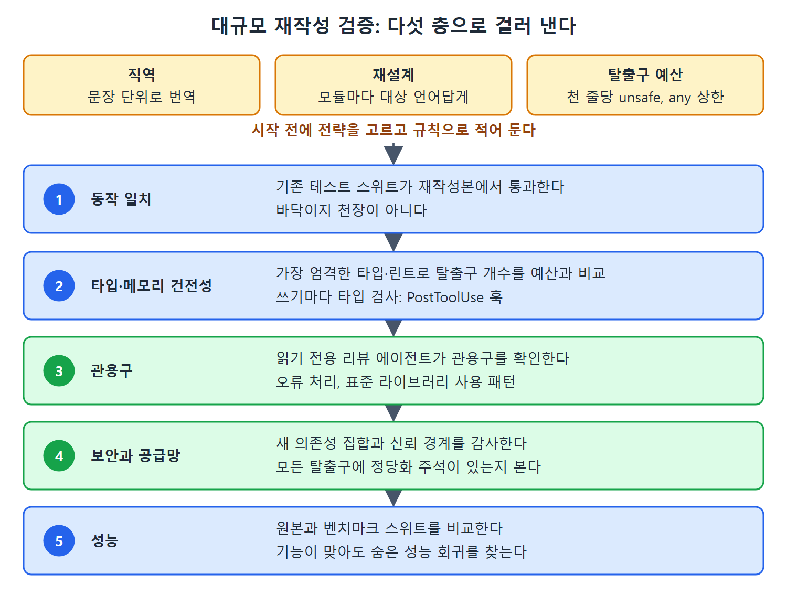

# 대규모 재작성 검증하기

다른 언어나 플랫폼으로 옮기는 번역에서는 테스트가 모두 통과한 것만으로는 충분하지 않다. 이 문서는 에이전트가 만든 대규모 재작성을 왜 층으로 나누어 검증해야 하는지, 그리고 직역과 재설계 중 어느 전략을 고를지 다룬다.

---

## 1. 테스트가 통과해도 코드는 부실할 수 있다

에이전트는 동작을 충실히 재현하면서도 결과 코드베이스를 "탈출구"로 가득 채울 수 있다. 타입 시스템을 무력화하는 형변환, 빌림 검사기(borrow checker)를 무력화하는 unsafe 블록, 실패 모델을 무력화하는 삼켜진 오류 같은 것들이다. 동작이 맞으니 테스트는 통과한다. 하지만 번역이 문자 그대로였기 때문에 코드는 건전하지 않다.

원문은 공개된 대규모 기계 보조 재작성 사례를 든다. 원본을 거의 줄 단위로 옮긴 재작성은 unsafe 블록을 수천 개 내놓았고, 대상 언어에 맞게 재설계한 비슷한 도구는 손에 꼽을 만큼만 썼다. 같은 테스트를 통과했는데 코드는 전혀 달랐다. 다만 원문 각주는 보고된 탈출구 개수가 출처와 세는 방식에 따라 다르므로, 구체적 수치는 정확한 측정값이 아니라 이런 경향의 지표로 받아들이라고 덧붙인다.

## 2. 직역과 재설계 중 고르기

이 차이는 두 전략의 차이다. 시작하기 전에 의식적으로 골라야 한다.

| 전략 | 방식 | 장점 | 대가 |
|---|---|---|---|
| 직역(transliteration) | 원래 아키텍처를 유지하고 문장 단위로 번역 | 빠르고 원본과 diff 비교가 쉽다 | 원본 언어의 관용구를 통째로 들여와 건전하지 못한 코드가 된다 |
| 재설계(redesign) | 모듈마다 대상 언어답게 다시 짠다 | 대상 언어의 도구가 지켜 줄 수 있는 코드가 된다 | 느리고 원본과 비교하기 어렵다 |

고른 전략은 에이전트가 따를 규칙으로 적어 둔다. 탈출구 예산도 명시한다. 천 줄당 unsafe나 any를 몇 개까지 허용할지 상한을 두면, 전략이 희망사항이 아니라 측정 가능한 기준이 된다.

## 3. 층으로 검증하기

각 층은 아래 층이 잡지 못하는 것을 잡는다.

1. **동작 일치(behavioural parity).** 기존 테스트 스위트가 재작성본에서 통과한다. 이것은 바닥이지 천장이 아니다.
2. **타입과 메모리 건전성.** 대상 언어가 제공하는 가장 엄격한 타입과 린트 설정을 돌리고, 탈출구 개수를 예산과 비교한다. 쓰기마다 타입 검사기를 돌리는 PostToolUse 훅(9장)을 두면 문제가 끝에서 발견되지 않고 생긴 자리에서 잡힌다.
3. **관용구.** 읽기 전용 리뷰 에이전트를 따로 두어, 번역된 파일이 대상 언어 관용구를 따르는지 확인한다. 오류 처리, 표준 라이브러리 사용, 직역이 아니라 그 언어 고유의 코드로 보이게 하는 패턴이 대상이다.
4. **보안과 공급망.** 새 의존성 집합, 신뢰 경계, 모든 탈출구에 정당화하는 주석이 있는지 감사한다. 재작성은 새 의존성 트리를 만드는 일이기도 하므로 16장의 점검이 필요하다.
5. **성능.** 원본과 벤치마크 스위트를 비교한다. 기능이 맞아도 심각한 성능 회귀가 숨을 수 있다. "더 빠른 언어로 다시 썼다"와 "더 빠르다"는 같은 말이 아니다.

그림은 전략과 탈출구 예산을 먼저 정한 뒤, 동작 일치에서 성능까지 다섯 층을 차례로 통과시키는 구조를 보여 준다. 각 층은 아래 층이 잡지 못하는 문제를 잡는다.

## 4. 언어 번역을 넘어서는 원칙

이 원리는 언어 번역에만 해당하지 않는다. 에이전트가 그럴듯하고 테스트를 통과하는 변경을 대량으로 만들어 낼 때마다, 동작 일치는 검증하기 가장 값싼 성질이지만 가장 불충분한 성질이다. 건전성부터 성능까지 남은 층이, 믿을 수 있는 재작성과 그저 돌아가기만 하는 재작성을 가른다.

 
 
 

[Agentic Coding with OpenAI Codex CLI](../)
