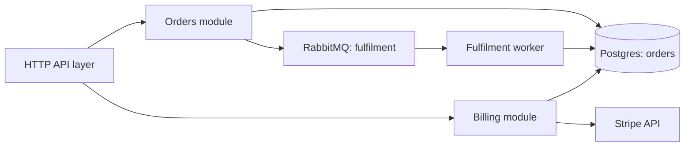

# 레거시 시스템 먼저 파악하기

레거시 시스템을 가장 빨리 망가뜨리는 방법은 무슨 일을 하는지 이해하기 전에 바꾸기 시작하는 것이다. 문서는 거짓말을 하고 주석은 낡는다. 정작 중요한 동작은 어느 하류 시스템이 의존하게 된 문서화되지 않은 버릇인 경우가 많다. 이 문서는 변환에 들어가기 전에 읽기 전용으로 시스템을 파악하는 방법을 설명한다.

---

## 1. 읽기 전용 탐색 세션

변환 전에 세션 하나를 통째로 탐색에 쓴다. 이때 에이전트는 읽기 전용 모드로 둔다. 배우는 동안 아무것도 바꾸지 못하게 하기 위해서다.

Codex CLI를 `-s read-only`로 코드베이스에 붙이고 현대화 보고서를 요청한다. 보고서에는 다음이 들어가야 한다.

- 시스템이 하는 일을 쉬운 말로 풀어 쓴 설명
- 모듈별로 의도가 아니라 실제 동작을 적은 설명
- 실제 필드 타입이 드러나는 데이터 모델
- 기술 위험 목록

```bash
codex -s read-only "Read this service and produce a modernisation report:
1. What it does, in business terms
2. Per-module behaviour, not what the name suggests
3. The data model: every persisted field, its real type, invariants
4. Risk register: date and time-zone handling, rounding, encoding,
   ordering, and global state, with the file and line of each"
```

(원문 프롬프트를 줄여 옮겼다.)

## 2. 위험 목록이 핵심이다

보고서에서 가장 값진 부분은 위험 목록이다. 재작성에서 흔히 틀리는 "다른 코드가 기대고 있는 버릇"(load-bearing quirks)을 명시적으로 짚어 달라고 요청해야 한다. 대표적인 것은 다음 다섯 가지다.

| 위험 영역 | 왜 문제가 되는가 |
|---|---|
| 날짜와 시간대 처리 | 단순하게 다시 짜면 조용히 동작이 바뀐다 |
| 숫자 반올림과 정밀도 | 같은 계산이 다른 값을 낼 수 있다 |
| 문자 인코딩 | 겉으로는 드러나지 않는다 |
| 암묵적 정렬 순서 | 누군가 그 순서에 기대고 있을 수 있다 |
| 전역 변경 가능 상태 | 모듈 간 숨은 결합을 만든다 |

테스트 스위트는 이런 동작을 거의 잡아 주지 못한다. 그래서 순진한 재작성은 이것들을 아무도 모르게 바꿔 버린다.

## 3. 기존 테스트도 돌려 본다

탐색 단계에서 기존 테스트를 돌린다. 믿음이 안 가는 스위트라도 마찬가지다. 통과하는 스위트는 어떤 동작이 고정되어 있는지 알려 준다. 스위트가 빈약하다면 어디가 깜깜한지 알려 주는 것이니, 코드를 건드리기 전에 특성화 테스트(characterisation test, 현재 동작을 그대로 기록해 두는 테스트)를 먼저 추가해야 한다는 신호다.

## 4. 알게 된 것은 AGENTS.md에 남긴다

파악한 내용은 에이전트가 다시 읽을 곳에 적어 둔다. 저장소 루트의 AGENTS.md가 그 자리다(4장). 다음을 기록한다.

- 코드 관례
- 바꿔도 안전한 모듈과 그렇지 않은 모듈
- 위험 목록에서 나온 버릇들

이렇게 하면 팀 안에서만 돌던 암묵지가 에이전트가 매 세션 다시 읽는 지침이 된다. 컨텍스트 압축(compaction)이 일어나도 이해가 남고, 열두 번째 배치에서 처음부터 다시 배우거나 잊어버리는 일이 없다. 단호한 안전 규칙도 여기에 둔다. 예를 들어 "src/legacy/billing/ 아래 파일은 명시적 승인 없이 수정하지 않는다" 같은 규칙이다.

## 5. 그림으로 구조 파악하기

시스템을 정말 모르겠다면 그림을 요청한다. Codex CLI는 모듈, 데이터 저장소, 외부 의존성을 담은 Mermaid 아키텍처 다이어그램을 만들 수 있고, 이는 풀 리퀘스트에서 바로 렌더링된다. 첫 줄을 바꾸기 전에 팀이 같은 지도를 갖게 된다.

```bash
codex --profile read-only "Map this service as a Mermaid flowchart.
Show the top-level modules, the data stores they read or write, and any
external dependencies (HTTP APIs, queues, third-party SDKs). Label each
edge with what flows across it. Output only a single fenced mermaid block."
```

결과는 대략 이런 모양이다. HTTP API 계층이 주문 모듈과 결제 모듈로 이어지고, 둘 다 Postgres의 주문 테이블을 쓴다. 결제 모듈은 Stripe API를 부르고, 주문 모듈은 RabbitMQ 큐에 이행 작업을 넣고, 큐를 읽는 워커가 다시 DB에 쓴다.



이 블록을 PR 설명이나 이슈에 붙이면 GitHub가 별도 도구 없이 그림으로 보여 준다. 에이전트는 README가 아니라 코드를 읽기 때문에 그림에는 시스템의 실제 모습이 담긴다.

다만 이 그림은 정답이 아니라 고쳐 쓸 초안으로 다뤄야 한다. 에이전트는 import와 호출 위치로 그래프를 추론하므로, 동적으로 연결되었거나 설정으로 이어진 의존성은 놓칠 수 있다. 시스템을 아는 사람들과 함께 이 그림을 읽다 보면 마이그레이션 계획의 첫 번째 빈틈이 드러나는 경우가 많다.

<br>
<br>
<br>

[Agentic Coding with OpenAI Codex CLI](../)
