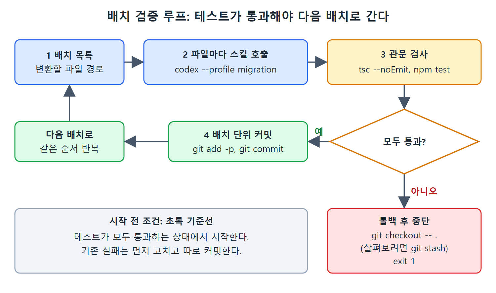

# 배치 검증 루프와 버전 마이그레이션

마이그레이션에서 가장 중요한 규율은 하나다. 이전 배치가 테스트를 통과하기 전에는 다음 배치로 넘어가지 않는다. 이 문서는 그 규칙을 셸 스크립트로 강제하는 방법과, 같은 방식을 프레임워크나 언어 버전 마이그레이션에 적용하는 방법을 설명한다.

---

## 1. 테스트를 관문으로 쓰는 검증 루프

이 규칙을 어기고 에이전트가 모듈 열 개를 옮긴 뒤에야 테스트를 돌리면, 실패를 특정 변경 탓으로 돌릴 수 없게 된다. 그러면 마이그레이션은 여러 엔지니어링 팀을 침몰시킨 빅뱅 재작성이 되어 버린다. 원문은 이 루프를 셸 스크립트로 보여 준다.

```bash
#!/usr/bin/env bash
# migrate-batch.sh - run a migration batch and gate on tests
set -euo pipefail
BATCH_FILE="$1" # file listing paths to migrate in this batch
while IFS= read -r filepath; do
  echo "Migrating: $filepath"
  codex --profile migration "/react-class-to-hooks $filepath"
done < "$BATCH_FILE"
echo "Running test suite..."
npm test -- --passWithNoTests
```

스크립트의 뒷부분은 테스트 종료 코드를 보고 갈린다. 성공하면 `git add -p`로 변경을 고르고 `git commit -m "chore: migrate batch ... to hooks"`로 커밋한 뒤 "Batch committed."를 출력한다. 실패하면 "Tests failed. Rolling back batch."를 출력하고 `git checkout -- .`로 변경을 되돌린 뒤 `exit 1`로 끝낸다.



그림은 배치 하나가 처리되는 순서를 보여 준다. 테스트와 타입 검사를 통과해야 커밋하고 다음 배치로 넘어가며, 실패하면 `git checkout -- .`로 되돌리고 `exit 1`로 멈춘다.

## 2. 이 스크립트에서 눈여겨볼 세 가지

- 롤백에 `git checkout -- .`를 쓴다. 실패한 상태를 버리기 전에 살펴보고 싶다면 `git stash`를 쓴다.
- `npm test`로 관문을 거니까, 시작 전에 테스트가 모두 통과하는 초록 상태여야 한다. 기존 실패가 있으면 새 회귀가 가려진다.
- 커밋은 파일 경계가 아니라 배치 경계에서 한다. 감사 요구 수준에 맞게 입자를 조절하면 된다.

테스트가 실패하는 코드베이스에서는 마이그레이션 배치를 돌리지 않는다. 회귀를 잡으려면 초록 기준선이 필요하다. 스위트가 초록이 아니면 기존 실패부터 고치고, 그 수정은 별도로 커밋해서 책임 소재가 분명하게 한다.

## 3. 타입 검사와 린터를 관문에 더한다

타입이 있는 코드베이스에서는 테스트 앞에 타입 검사를 더한다. TypeScript 마이그레이션은 런타임 테스트는 통과하지만 컴파일러에는 걸리는 코드를 자주 만든다.

```bash
npx tsc --noEmit && npm test
```

린터를 쓰는 코드베이스라면 린터도 붙인다. 기준은 CI가 거는 관문과 같게 맞춘다. CI가 잡을 문제라면 로컬 루프가 먼저 잡아야 한다.

## 4. 스냅샷 테스트 주의

스냅샷 테스트는 특별히 신경 써야 한다. 렌더링된 HTML을 담은 스냅샷은 클래스에서 훅으로 옮긴 뒤 동작이 똑같아도 실패할 수 있다. 내부 표현이 바뀌었기 때문이다. 시작하기 전에 정해야 한다. 스냅샷을 자동으로 갱신할지(`jest --updateSnapshot`), 실패를 차단 조건으로 볼지다. 답은 스냅샷이 동작 계약인지, 우연히 생긴 구현 부산물인지에 달려 있다. 이 구분을 마이그레이션 계획에 명시해 둔다.

## 5. 프레임워크와 언어 버전 마이그레이션

같은 패턴이 프레임워크와 언어 버전 마이그레이션에도 통한다. 원문은 세 가지 예를 든다.

**React 클래스 컴포넌트에서 훅으로.** 이 장의 대표 예시다. 변환 규칙이 분명하고 테스트가 강한 검증을 주며, 잎(leaf) 노드부터 하는 배치 순서가 작업을 감당할 만하게 만든다. 사람이 판단할 부분은 getSnapshotBeforeUpdate나 getDerivedStateFromError처럼 훅에 직접 대응이 없는 생명주기 메서드다. 에이전트는 추측하지 않고 표시만 하며, 위의 스킬 정의가 그 제약을 담고 있다.

**Python 2에서 Python 3로.** 기계적 변환은 2to3 도구가 맡는다. 2to3는 파이썬 표준 라이브러리(lib2to3 패키지)의 유틸리티로, Python 2 소스를 Python 3 문법으로 자동 변환한다. print 문, unicode 대 str, 정수 나눗셈 같은 대부분의 기계적 변환을 처리하지만, 모든 관용구 갱신이나 의존성 호환 문제까지 처리하지는 않는다. Codex CLI는 그 주변 작업에서 가치를 더한다.

- Python 3를 지원하지 않는 패키지 분석
- requirements.txt 항목 갱신
- CI 설정 갱신
- 2to3가 잘못 처리하거나 보수적으로 처리한 관용구 재작성

순서는 2to3를 먼저 돌리고, 남은 경우를 Codex CLI로 처리하는 것이다. 검증은 `python -m pytest`로 하고, 타입이 있는 코드베이스라면 mypy도 쓴다.

**AngularJS에서 Angular로.** 필연적으로 스트랭글러 피그 방식이다. 두 프레임워크는 구조적으로 호환되지 않는다. Angular 2는 컴포넌트 기반 구조, TypeScript, 새 모듈 시스템을 도입한 완전한 재작성이었고 AngularJS의 MVC 컨트롤러 패턴과 하위 호환이 없다. 그래서 큰 AngularJS 앱을 한 번에 갈아엎기는 거의 불가능하다. 에이전트는 AngularJS 컴포넌트마다 Angular 대응물을 만들고, 새 URL은 Angular로 보내고 옛 URL은 AngularJS에 남기도록 라우터를 고치고, 옛 코드베이스에 남은 의존성을 감사한다. 레거시 AngularJS 앱은 테스트가 부족한 경우가 많아서, 검증은 단위 테스트보다 실행 중인 앱을 상대로 한 종단 간(end-to-end) 테스트에 더 의존한다. 시작 전에 그 테스트에 먼저 투자해야 한다.

## 6. 정적 분석과 역할 분담

언어 버전 마이그레이션에서는 대상 버전용 정적 분석 도구를 검증 루프에 넣는다. pylint, `tsc --strict`, eslint가 예다. 이 도구들은 정상 경로만 실행하는 테스트 스위트가 놓치는 오류 부류를 통째로 잡아 준다.

공통된 교훈은 이렇다. 규모와 일관성은 에이전트가 맡고, 애매함과 판단은 사람이 맡는다. 규칙을 정의하고, 에이전트가 표시한 경우를 검토하고, 규칙이 처리하지 못하는 결정을 내린다.

<br>
<br>
<br>

[Agentic Coding with OpenAI Codex CLI](../)
