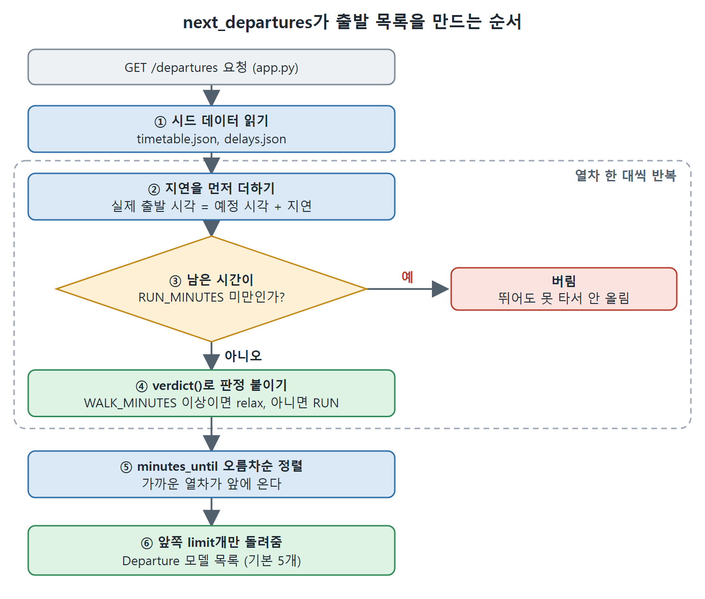

# FastAPI 규칙과 API 만들기

규칙이 AGENTS.md에 모두 들어갔으니, 이제 서비스를 짠다. FastAPI와 비동기 Python에는 Codex CLI가 스스로 추론하지 못하는 규칙이 있다. 이 규칙을 AGENTS.md에 적어 두면 에이전트가 라우트마다 즉흥으로 처리하지 않고 기본값으로 적용한다. Run or Relax API는 서비스 하나지만, 에이전트가 다루기 좋게 만드는 이 규칙은 서비스가 여러 개로 늘어도 똑같이 통한다.

---

## 1. FastAPI 서비스 규칙

FastAPI는 새 Python 서비스에서 흔한 선택이다. FastAPI는 Starlette와 Pydantic 위에 만든 고성능 웹 프레임워크이고, 2025년 8월에 나온 State of Python 2025 조사에서 사용 점유율이 1년 새 29%에서 38%로 올랐다. 핵심 규칙은 다음과 같다.

```markdown
## FastAPI conventions
- Route handlers must be async; use `httpx.AsyncClient` for outbound HTTP calls
- Pydantic response models live in `src/departures/models.py`
  (one module per service; split into a package when it grows)
- Dependency injection via FastAPI's `Depends()`: no global state
- Error handling: raise `HTTPException` from route handlers; never let domain
  exceptions propagate
- OpenAPI schema: keep `response_model` explicit on every route
- Background tasks: use `BackgroundTasks` for fire-and-forget; use a task queue
  (Celery or ARQ) for durable work
```

## 2. 비동기 패턴

비동기 Python 관례도 알려 주지 않으면 Codex CLI가 추론하지 못한다.

```markdown
## Async patterns
- Use `asyncio.gather()` for concurrent independent operations
- Database sessions: use async context managers (`async with session_factory() as session`)
- Never call blocking I/O in an async function; use `asyncio.run_in_executor` if required
- HTTP clients: create `httpx.AsyncClient` instances at startup and pass via
  dependency injection
- Avoid `asyncio.sleep(0)` as a yield point; use `asyncio.sleep(0.001)` only if
  genuinely needed
```

## 3. API를 만드는 프롬프트

AGENTS.md의 규칙과 장 앞부분의 `Departure` 모델이 있으면, 나머지 서비스는 짧은 프롬프트면 된다. 계약이 이미 정해져 있기 때문이다. 프롬프트의 요구는 이렇다.

- FastAPI로 Run or Relax API를 만들되 AGENTS.md를 따른다.
- `GET /departures?station=audley-end&now=<ISO 8601, 생략 시 현재>`를 구현한다.
- 시간표는 시드된 `data/timetable.json`에서 읽고, 모의 지연은 `data/delays.json`에서 적용한다.
- 각 출발 정보로 서비스 시각, 승강장, 지연 분, 출발까지 남은 분, RUN 또는 relax 판정을 돌려준다.
- 지연을 포함한 출발까지 남은 분이 `WALK_MINUTES`(14, 역까지 걷는 시간) 이상이면 relax, `RUN_MINUTES`(8, 역까지 뛰는 시간) 이상이면 RUN이다. `RUN_MINUTES`보다 가까운 열차는 뛰어도 못 잡으므로 안내판에 올리지 않는다.
- 환경 변수 `RUN_OR_RELAX_CORS_ORIGIN`에 적힌 안내판 출처를 허용하는 `CORSMiddleware`를 넣는다. 설정이 없으면 로컬 안내판 출처 둘, 곧 `http://localhost:3000`과 `http://127.0.0.1:3000`을 기본으로 허용한다. 23장 프론트엔드가 localhost든 127.0.0.1이든 브라우저에서 이 서비스를 부를 수 있게 하려는 것이다.
- Pydantic 응답 모델을 쓰고, pytest 테스트는 시간표를 픽스처로 주입하며 실제 시계와 네트워크를 쓰지 않는다.

## 4. CORS: 브라우저가 끼어들 때까지 보이지 않는 줄

CORS 줄은 브라우저가 등장하기 전까지는 보이지 않는 요구다. 백엔드 테스트는 이 줄 없이도 전부 통과하고, 그다음 다른 출처에서 제공되는 23장의 안내판이 교차 출처 요청을 차단당한다. 프롬프트에 미리 넣어 두면 두 장이 맞물리는 지점이 어긋나지 않는다.

기본값에는 두 번째 함정이 있고 이것도 브라우저에서만 드러난다. `http://localhost:3000`과 `http://127.0.0.1:3000`은 같은 머신으로 이어지지만, 브라우저의 동일 출처 정책(same-origin policy)에서는 서로 다른 출처다. localhost만 허용하는 기본값이면, 독자가 127.0.0.1로 안내판을 여는 순간 막히고 화면에는 `Could not reach the departure service.`만 보인다. 기본값으로 둘을 모두 허용하면 이 함정이 사라지고, 운영에서 `RUN_OR_RELAX_CORS_ORIGIN`을 설정하면 실제로 배포되는 출처 하나로 좁혀진다.

```python
DEFAULT_CORS_ORIGINS = ["http://localhost:3000", "http://127.0.0.1:3000"]

def cors_origins() -> list[str]:
    configured = os.getenv("RUN_OR_RELAX_CORS_ORIGIN")
    return [configured] if configured else DEFAULT_CORS_ORIGINS

app.add_middleware(
    CORSMiddleware, allow_origins=cors_origins(),
    allow_credentials=False, allow_methods=["GET"], allow_headers=["*"],
)
```

CORS는 단위 테스트를 다 통과하고 브라우저에서 깨지는 전형적인 접점이다. 그래서 브라우저처럼 `Origin` 헤더를 실어 보내고, 응답이 그 값을 되돌려 주는지 단언하는 테스트로 못 박아 둔다.

```python
import httpx
from departures.app import app

async def test_cors_allows_127_0_0_1() -> None:
    transport = httpx.ASGITransport(app=app)
    async with httpx.AsyncClient(transport=transport, base_url="http://test") as client:
        resp = await client.get("/departures", headers={"Origin": "http://127.0.0.1:3000"})
    assert resp.headers["access-control-allow-origin"] == "http://127.0.0.1:3000"
```

## 5. B008 함정: Annotated 형식

에이전트가 경로 동작(path operation)을 쓸 때, FastAPI의 관용적 표현인 `station: str = Query(default="audley-end")`는 Ruff의 B008(기본 인자에 함수 호출)에 걸린다. 선택한 규칙 집합에 B(flake8-bugbear)가 있기 때문이다. 대신 FastAPI가 지금 권하는 Annotated 형식을 쓴다. `station: Annotated[str, Query()] = "audley-end"`로 쓰면 기본값이 평범한 리터럴로 남아 B008을 깔끔하게 통과한다. 이 관례도 AGENTS.md에 적어 두면, 생성된 라우트가 두 번째가 아니라 첫 시도에 린트를 통과한다.

## 6. 판정 함수: 리뷰할 가치가 있는 부분

관례와 앞서 만든 `Departure` 모델이 있으니, 에이전트는 시간표 로더, 비동기 라우트, 그리고 `src/departures/verdict.py`의 작은 순수 함수로 판정 규칙을 채운다. 앞서 목표에서 경고한 까다로운 경계를 담고 있어서, 사람이 리뷰할 가치가 있는 부분이 바로 이 함수다.

```python
from datetime import datetime

WALK_MINUTES = 14  # Audley End: front door to the station at a walk
RUN_MINUTES = 8    # front door to the station at a run

def verdict(now: datetime, departs_at: datetime, delay_min: int) -> str:
    minutes_until = (departs_at - now).total_seconds() / 60 + delay_min
    return "relax" if minutes_until >= WALK_MINUTES else "RUN"
```

`verdict` 함수는 첫 번째 경계를 맡는다. "여유 부리기엔 너무 늦음"은 0분이 아니라 `WALK_MINUTES`이고, 지연은 열차를 뒤로 밀어 시간을 버는 쪽이다. 규칙을 듣지 못한 에이전트는 0과 비교하는 코드를 쓰기 쉽고, 그러면 뛰어야 겨우 탈 열차를 두고 산책하듯 나가라고 말한다. 두 번째 경계인 `RUN_MINUTES`는 로더의 일이다. 뛰어도 닿지 못하는 열차는 안내판에 오르지 않는다. 이 부분은 아래에서 다시 본다.

판정은 경계를 이름으로 드러내는 테스트로 못 박는다. 앞서 정한 픽스처 관례대로 실제 시계는 쓰지 않는다.

```python
from datetime import datetime

def test_ten_minutes_out_means_run() -> None:
    now = datetime(2026, 6, 15, 6, 52)          # 07:02 train, no delay (10 min)
    assert verdict(now, datetime(2026, 6, 15, 7, 2), 0) == "RUN"

def test_a_delay_turns_a_run_into_a_relax() -> None:
    now = datetime(2026, 6, 15, 6, 52)          # same ten minutes, 6 late
    assert verdict(now, datetime(2026, 6, 15, 7, 2), 6) == "relax"
```

## 7. 로더: 지연이 먼저, 그다음 필터, 그다음 개수 제한

`verdict`에 데이터를 넘기는 로더는 에이전트에게 맡긴다. 하지만 두 번째 경계인 `RUN_MINUTES`와, 앞서 정한 지연·필터 결정을 로더가 맡으므로, 리뷰할 때 기준이 될 모양을 알아 둘 만하다. `next_departures`는 작다. 시드 데이터를 읽고, 각 열차의 예정 시각에 지연을 더하고, 뛰어도 못 잡는 것을 버리고, 앞쪽 몇 개를 `Departure` 모델로 돌려준다.

```python
# src/departures/timetable.py (reference shape)
def next_departures(station: str, now: datetime, limit: int = 5) -> list[Departure]:
    scheduled = load_timetable()[station]      # data/timetable.json
    delays = load_delays()                     # data/delays.json
    board = []
    for train in scheduled:
        delay_min = delays.get(train.id, 0)
        departs_at = train.scheduled + timedelta(minutes=delay_min)
        minutes_until = round((departs_at - now).total_seconds() / 60)
        if minutes_until < RUN_MINUTES:        # can't make it even at a run
            continue
        board.append(Departure(service=train.service, platform=train.platform,
            delay_minutes=delay_min, minutes_until=minutes_until,
            verdict=verdict(now, train.scheduled, delay_min)))
    return sorted(board, key=lambda d: d.minutes_until)[:limit]
```

이것은 완성된 모듈이 아니라 참고용 모양이다. 로더 시그니처와 시간표 레코드는 에이전트가 시드 JSON을 어떻게 모델링하느냐에 달려 있다. 이 모양이 고정하는 것은 결정의 순서다. 지연을 먼저 반영하고, 그다음 거르고, 그다음 개수를 제한한다. 에이전트가 이 순서로 했는지 확인할 수 있다. 예컨대 지연을 적용하기 전에 예정 시각으로 먼저 거르는 식으로 순서가 어긋나면 안 된다.



그림은 `next_departures`가 지연을 먼저 더하고, `RUN_MINUTES` 미만인 열차를 버리고, 남은 열차에 `verdict()`로 판정을 붙인 뒤 정렬해서 앞쪽 `limit`개만 돌려주는 순서를 보여 준다.

## 8. 시간표와 지연 데이터 시드

로더는 뒤에 놓인 데이터만큼만 좋다. 이 시드 데이터의 첫 판은 쓴맛으로 교훈을 줬다. 아침 시간대만 담은 시간표는 API가 완벽하게 동작해도 오후마다 안내판이 비어 보인다. 다가오는 출발만 걸러서 보여 주는 안내판은 하루 전체의 열차가 있어야 러시아워가 지난 뒤에도 보여 줄 게 있다. 그래서 하루 전체를 시드한다.

데이터 디렉터리는 하드코딩한 경로 대신 패키지를 기준으로 상대 경로로 구한다. 체크아웃이 어디에 있어도 파일을 찾고, 환경 변수로 다른 데이터 묶음을 가리킬 수도 있다.

```python
DEFAULT_DATA_DIR = Path(__file__).resolve().parents[2] / "data"
DATA_DIR = Path(os.getenv("RUN_OR_RELAX_DATA_DIR", DEFAULT_DATA_DIR))
```

`parents[2]`는 `src/departures/timetable.py`에서 프로젝트 루트까지 올라가므로, `DATA_DIR`은 기본적으로 저장소의 `data/`에 닿고 특정 머신의 경로가 박히지 않는다. 다른 데이터를 쓰려면, `timetable.json`과 `delays.json` 두 파일이 든 아무 디렉터리를 이 환경 변수에 지정하면 된다.

```bash
RUN_OR_RELAX_DATA_DIR=/path/to/alternate/data \
  uv run uvicorn departures.app:app --reload --host 127.0.0.1 --port 8000
```

`data/timetable.json`에는 역 하나의 하루치 열차를 넣고, 각 열차에 지연 정보가 키로 쓸 안정적인 `id`를 붙인다. 책의 시드는 `audley-end` 키 아래 05:05부터 23:08까지 열차 45개이고, 모두 승강장은 `"2"`다. id는 `ae-lst-0505`처럼 `ae-lst-` 뒤에 시각 네 자리를 붙인 모양이다. 앞부분만 옮기면 이렇다.

```json
{
  "audley-end": [
    { "id": "ae-lst-0505", "service": "05:05", "platform": "2" },
    { "id": "ae-lst-0538", "service": "05:38", "platform": "2" },
    { "id": "ae-lst-0702", "service": "07:02", "platform": "2" },
    { "id": "ae-lst-0732", "service": "07:32", "platform": "2" },
    { "id": "ae-lst-2308", "service": "23:08", "platform": "2" }
  ]
}
```

전체 목록은 아침 러시아워(05:54, 06:06, 06:32, 06:38, 07:02, 07:08, 07:32, 07:38, 08:02, 08:08 등)에 촘촘하고, 10시부터 15시 사이에는 매시 17분과 39분으로 한 시간에 두 번씩 있으며, 저녁까지 이어져 마지막이 23:08이다. 위 예시는 줄여서 옮긴 것이다.

`data/delays.json`은 서비스 id마다 지연 분을 매기며, 실제 안내판이 계속 읽어 올 실시간 정보를 흉내 낸다. 소수만 늦고 나머지는 언급이 없으면 정시다.

```json
{
  "ae-lst-0638": 1,
  "ae-lst-0702": 0,
  "ae-lst-0732": 4,
  "ae-lst-0808": 2,
  "ae-lst-1656": 5,
  "ae-lst-1738": 3,
  "ae-lst-2208": 7
}
```

## 9. 실행

`uv run uvicorn departures.app:app --reload`로 실행하면 `GET /departures`가 localhost:8000에서 답한다. 판정은 시드된 시간표와 지연 정보로 계산된다.

## 10. 다음 두 장과의 관계

이 HTTP 계약, 곧 판정이 하나씩 붙은 출발 목록이 다음 두 장이 기대는 접점이다. 하지만 세 장을 관통하는 것은 애플리케이션 자체가 아니라 부분마다 Codex를 어떻게 설정하느냐이다. 23장은 같은 에이전트를 React 프론트엔드에, 24장은 그것을 배포하는 인프라에 겨눈다. Run or Relax가 거기서 의미 있는 이유는 프론트엔드에 그릴 실제 형태를, 배포에 올릴 실제 서비스를 주기 때문이지 안내판이 목적지여서가 아니다. 매번 요점은 그 부분의 일을 Codex가 잘하도록 어떻게 세팅하느냐다.

<br>
<br>
<br>

[Agentic Coding with OpenAI Codex CLI](../)
