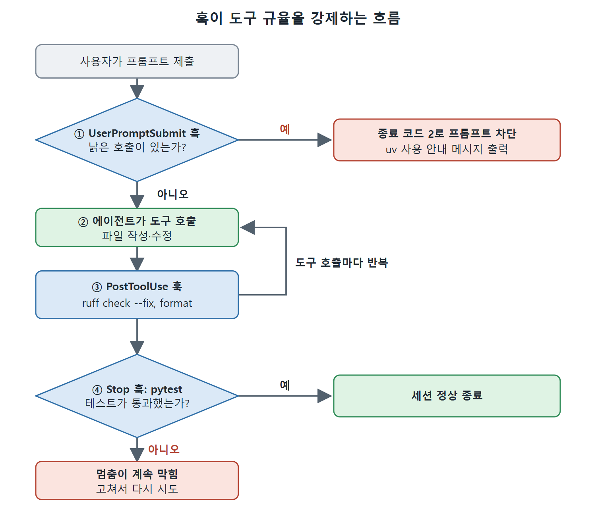

# uv, ruff 도구 체인과 훅

요즘 Python 도구 체인은 예전에 따로 놀던 도구들을 둘로 합쳤다. 이 문서는 그 두 도구, 모든 설정을 한곳에 모으는 pyproject.toml, 그리고 도구 규율을 세션 차원에서 강제하는 훅(hook)을 정리한다.

---

## 1. 도구 두 개

1. **uv**는 pip, venv, pyenv, pipx, poetry를 대체한다. Rust로 만들어져 의존성 해석이 밀리초 단위이고, 전체 의존성 그래프를 고정하는 `uv.lock`을 만든다. Astral이 개발한 도구다.
2. **Ruff**는 flake8, Black, isort, pyupgrade와 그 플러그인이 하던 900개 넘는 린트 규칙을 대체한다. 역시 Rust 기반이며 큰 코드베이스에서도 1초 안쪽에 돈다.

이 도구 체인을 하나로 묶는 규율은 한 가지다. 모든 도구 실행은 `uv run`을 거친다. 어떤 도구가 돌기 전에 프로젝트의 가상 환경이 활성화되고 최신 상태임이 보장되기 때문이다.

## 2. pyproject.toml이 단일 기준

도구 설정은 전부 pyproject.toml에 둔다. `.flake8`도, `setup.cfg`도, `mypy.ini`도 없다. 기본 골격은 다음과 같다.

```toml
[project]
name = "run-or-relax"
version = "0.1.0"
requires-python = ">=3.14,<3.15"
dependencies = ["fastapi>=0.115", "pydantic>=2.9", "uvicorn[standard]>=0.30"]
[build-system]
requires = ["hatchling"]
build-backend = "hatchling.build"
[tool.hatch.build.targets.wheel]
packages = ["src/departures"]
[dependency-groups]
dev = ["httpx>=0.27", "mypy>=1.13", "pytest>=8.3", "pytest-asyncio>=0.24",
       "pytest-cov>=6.0", "ruff>=0.9"]
```

pytest와 Ruff 기본 설정은 이렇다.

```toml
[tool.pytest.ini_options]
testpaths = ["tests"]
asyncio_mode = "auto"
addopts = "--tb=short -q"
pythonpath = ["src"]

[tool.ruff]
target-version = "py314"
line-length = 100
exclude = [".uv-cache"] # project-local uv cache: never lint third-party packages

[tool.ruff.lint]
select = ["D", "E", "F", "I", "UP", "B", "SIM"]
ignore = ["E501"]
```

```toml
[tool.ruff.lint.per-file-ignores]
"tests/**/*.py" = ["D"] # tests do not need docstrings
[tool.ruff.lint.isort]
known-first-party = ["departures"]
[tool.ruff.lint.pydocstyle]
convention = "google"
[tool.ruff.format]
quote-style = "double"
indent-style = "space"
[tool.mypy]
strict = true
ignore_missing_imports = true
mypy_path = "src"
```

`select`의 일곱 규칙은 순서대로 pydocstyle(독스트링), pycodestyle 오류, pyflakes, isort, pyupgrade, flake8-bugbear, flake8-simplify다.
## 3. 조용히 중요한 설정 여섯 가지

이 파일이 있으면 Codex CLI가 프로젝트 관례를 한곳에서 찾는다. 몇몇 항목은 눈에 띄지 않지만 이 설정들이 서비스를 지탱한다.

1. `[tool.ruff.lint]`의 `select`가 켜진 린트 규칙을 나열한다. 덕분에 생성된 코드가 첫 시도에 린트를 통과한다.
2. `exclude = [".uv-cache"]`는 Ruff가 프로젝트 안의 uv 캐시를 보지 않게 한다. 아래 훅은 캐시 쓰기를 프로젝트 안에 가두려고 `UV_CACHE_DIR=.uv-cache`를 설정하는데, 그러면 `uv run ruff check .`가 이 폴더를 훑어서 서드파티 패키지의 린트 실패를 수천 개 보고한다. 제외해 두면 전체 트리를 가리키는 `.` 대상이 안전해진다. 없으면 모든 린트 명령을 `src tests`로 좁혀야 한다.
3. `[build-system]`과 `uvicorn[standard]`가 있어야 `uv run uvicorn departures.app:app`이 해석된다. 빌드 백엔드를 선언하면 `uv run`이 프로젝트를 편집 가능 패키지로 설치하고, 그래서 `src/` 레이아웃 속 `departures` 모듈을 경로가 아닌 이름으로 import할 수 있다.
4. `[tool.hatch.build.targets.wheel]`은 Hatchling에게 패키지 위치를 알려 준다. 프로젝트 이름이 `run-or-relax`일 때 `departures`가 `src/` 아래 있다는 것을 스스로 추론하지 못한다. `packages = ["src/departures"]`가 없으면 첫 빌드가 `Unable to determine which files to ship inside the wheel`로 실패한다.
5. `pythonpath = ["src"]`는 설치 없이도 pytest가 같은 패키지를 import하게 해 준다.
6. 완료 게이트가 돌리는 타입 검사기는 ty가 아니라 mypy다. ty는 베타 대안이고, 실행 가능한 기준선은 안정적인 검사기에 둔다.

`requires-python = ">=3.14,<3.15"`의 상한은 의도적이다. 마이너 버전을 고정해야, 더 새로운 인터프리터가 설치되는 순간 uv가 그쪽으로 넘어가 버리는 일 없이 도구 체인이 재현 가능하다. 같은 값을 프로젝트 루트의 `.python-version` 파일에도 적어 두면 uv가 묻지 않고 3.14를 고른다. 파일 내용은 한 줄이다.

```text
3.14
```

한 걸음 물러나 보면 이 장의 요점이 이 패턴 자체다. pyproject.toml과 `.python-version`의 모든 줄은 Codex CLI가 더 이상 짐작하지 않아도 되는 것 하나다. 패키지 매니저, 린트 규칙, 타입 검사기, 패키지 레이아웃, 인터프리터 버전은 각각 불완전한 신호로 에이전트가 추론해야 했고 때로는 틀렸다. 한 번 적어 두면 추측이 조회된 사실로 바뀌고, 그래서 생성된 코드가 세 번째가 아니라 첫 시도에 맞게 나온다.

## 4. 자동 강제를 위한 훅

Codex CLI의 훅 시스템(9장)은 에이전트의 기억에 기대지 않고 세션 단위로 도구 규율을 강제한다. 훅 세 개가 Python 방어선의 핵심을 맡는다. 설정 파일은 `.codex/hooks.json`이다.

```json
{
 "hooks": {
  "PostToolUse": [{ "hooks": [{
    "type": "command",
    "command": "uv run ruff check . --fix --quiet && uv run ruff format . --quiet",
    "statusMessage": "Linting and formatting…",
    "timeout": 30
  }]}]
 }
}
```

위는 PostToolUse 부분이다. 아래는 Stop 부분이고, 같은 `hooks` 객체 안에 이어 붙는다.

```json
"Stop": [{ "hooks": [{
  "type": "command",
  "command": "if UV_CACHE_DIR=.uv-cache uv run --no-sync pytest tests/ -q --tb=short >&2; then printf '{}\\n'; else hook_status=$?; printf '{}\\n'; exit \"$hook_status\"; fi",
  "statusMessage": "Running test suite…",
  "timeout": 120
}]}]
```

세 번째는 UserPromptSubmit이다.

```json
"UserPromptSubmit": [{ "hooks": [{
  "type": "command",
  "command": "bash .codex/scripts/block-legacy-pip.sh",
  "statusMessage": "Checking prompt…",
  "timeout": 5
}]}]
```

`block-legacy-pip.sh` 스크립트는 낡은 도구 호출을 찾으면 메시지와 함께 종료 코드 2로 끝난다.

```bash
#!/usr/bin/env bash
# .codex/scripts/block-legacy-pip.sh
set -euo pipefail
# UserPromptSubmit passes a JSON object on stdin; the text is in `.prompt`.
prompt="$(jq -r '.prompt // empty')"
if printf '%s' "$prompt" | grep -qE 'pip install|pip add|python -m pytest|python -m ruff'; then
  echo "Use uv for all Python operations: uv add <pkg>, uv run pytest, uv run ruff" >&2
  exit 2
fi
```

9장에서 다룬 대로 UserPromptSubmit 훅은 제출된 프롬프트를 stdin의 JSON 객체로 받고 텍스트는 `prompt` 필드에 있다. 그래서 스크립트는 grep 전에 `jq -r '.prompt'`로 읽는다. 오래된 Codex 빌드를 쓴다면 이 방식에 기대기 전에 페이로드가 stdin으로 들어오는지 확인하는 편이 안전하다. 다만 stdin JSON이 문서화된 경로다.

각 훅의 역할은 이렇다.

- PostToolUse 훅은 도구 호출 뒤마다 ruff를 돌려서, 쓰인 파일이 바로 린트와 포맷을 거친다.
- Stop 훅은 테스트 게이트를 명시적으로 만든다. 끝내기 전에 테스트를 초록으로 만들어 두라는 것이다.
- UserPromptSubmit 훅은 Codex CLI가 처리하기 전에 낡은 호출을 걸러 낸다. 사후 대응이 아니라 사전 강제다.



그림은 훅 세 개가 작업 흐름의 어느 지점에서 끼어드는지 보여 준다. UserPromptSubmit 훅이 낡은 호출을 먼저 막고, PostToolUse 훅이 도구 호출마다 ruff를 돌리며, Stop 훅이 테스트가 통과해야 세션을 끝내게 한다.

## 5. Stop 명령이 복잡한 두 가지 이유

Stop 명령은 "pytest를 돌려라"보다 복잡해 보인다. 이유가 둘이다.

**첫째는 JSON 포장이다.** Stop 훅은 표준 출력에서 JSON 제어 객체를 파싱한다. pytest의 원시 출력은 올바른 JSON이 아니다. 그래서 명령은 pytest 보고서를 `>&2`로 표준 오류에 보내(그래도 사용자에게는 보인다), 파서를 만족시킬 빈 `{}` 객체를 표준 출력에 찍고, pytest 자신의 종료 코드로 다시 끝낸다. 테스트가 빨간불이면 멈춤이 계속 막힌다. 그냥 `uv run pytest tests/ -q --tb=short`를 쓰면 테스트가 전부 통과해도 훅이 실패한다. 테스트 출력의 첫 줄이 잘못된 JSON으로 파싱되기 때문이다.

**둘째는 `uv run`에 붙은 두 플래그다.** 기본적으로 `uv run`은 실행 전에 프로젝트 환경을 동기화한다. 락 파일로 해석하고 설치하는 동안 네트워크에 닿을 수 있고 uv의 전역 캐시에 쓴다. 훅 안에서는 이 동기화가 느리고, 훅이 쓸 수 없는 디렉터리에서 실패하기 쉬워서, 테스트와 무관한 실패가 보고된다. `--no-sync`는 이 동기화를 건너뛴다. 환경은 세션에서 이미 갖춰져 있다. `UV_CACHE_DIR=.uv-cache`는 훅이 소유하지 않을 수 있는 전역 위치 대신 프로젝트 안에 캐시를 쓰게 한다. 둘을 합치면 게이트가 빠르고 부수 효과 없이 돈다. 빼 버리면 바로 이 설정을 바꾸게 만든 실패가 난다.

## 6. 매처 지원 범위에 대한 주의

집필 시점에 PostToolUse의 매처(matcher) 필터는 Bash, apply_patch(Edit과 Write도 여기에 걸린다), MCP 도구 이름을 지원한다. WebSearch처럼 셸도 MCP도 아닌 도구 호출은 아직 가로채지 못한다. 위 PostToolUse 훅은 매처를 지정하지 않아서 모든 도구 호출 뒤에 돈다. ruff를 무조건 돌려도 충분히 빨라서 실제로는 큰 부담이 되지 않는다.

<br>
<br>
<br>

[Agentic Coding with OpenAI Codex CLI](../)
