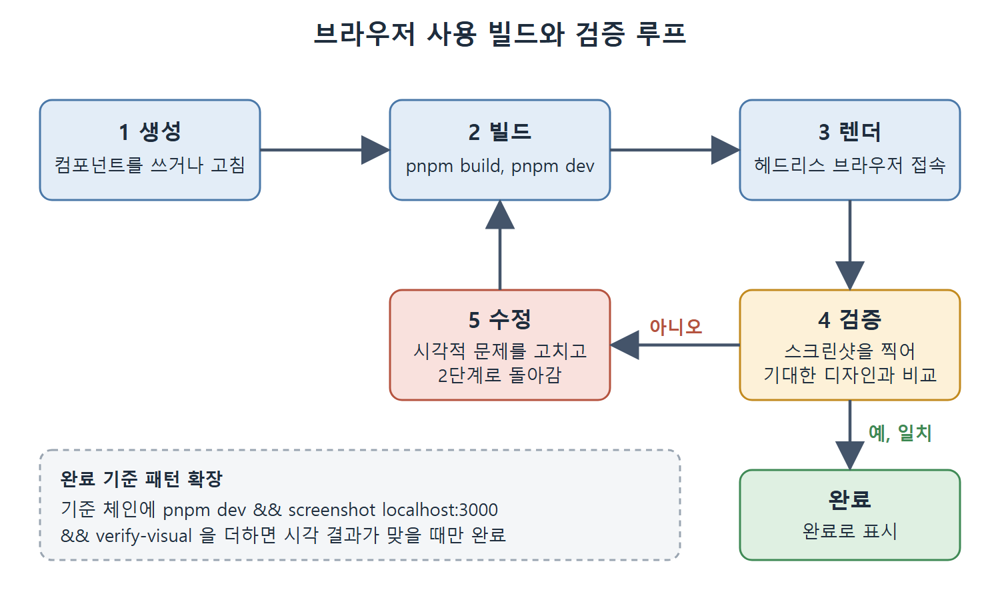

# 디자인에서 코드로와 브라우저 검증

화면을 코드로 만드는 마지막 두 가지 주제다. 하나는 디자인 파일이나 이미지에서 컴포넌트를 만드는 방법이고, 다른 하나는 에이전트가 직접 브라우저를 열어 결과를 확인하는 브라우저 사용(browser use) 검증이다. 끝에는 프런트엔드 작업 유형별 권장 패턴 표를 새로 구성해 붙였다.

---

## 1. 디자인에서 코드로

Figma의 MCP 서버는 책을 쓰던 시점에 베타였다. 컴포넌트, 변수, 레이아웃 제약 같은 디자인 파일 데이터를 MCP를 지원하는 클라이언트에 노출해, 디자인 토큰(색, 간격 같은 값)에 정확히 맞는 컴포넌트를 만들 수 있게 한다. 이 서버는 Figma의 Dev Mode MCP 서버이며, Dev 또는 Full 시트를 가진 사용자가 쓸 수 있다. 통합이 안정될 때까지는 이미지 기반 접근이 현실적이다. 디자인을 PNG로 내보내 Codex CLI의 비전 입력(이미지를 읽는 기능)으로 넘긴다.

```bash
codex "Implement this design as a React component with Tailwind.
The image is at /tmp/designs/checkout-flow.png.
Match the layout as closely as possible. Flag any interactive states
(hover, focus, disabled) that aren't visible in the static image."
```

프롬프트에 정적 이미지에 안 보이는 상호작용 상태(hover, focus, disabled)를 표시해 달라고 요청한 점을 눈여겨본다. 이미지 기반 프롬프트는 구조적 레이아웃은 정확하게 처리하지만, 간격 토큰은 사람이 직접 확인해야 한다.

## 2. 작업 유형별 권장 패턴

| 작업 유형 | 권장 패턴 | 스킬이나 플래그 | 메모 |
| --- | --- | --- | --- |
| 테스트가 있는 새 컴포넌트 | 요구사항을 다 담은 단일 프롬프트 | `$new-component` 스킬 | props 인터페이스, 상태, 테스트 시나리오를 명시 |
| UI와 API에 걸친 기능 | 탐색자/작업자 서브에이전트 | 서브에이전트 프롬프트 블록 | 탐색자가 먼저, 작업자는 병렬 |
| 접근성 점검 | 전용 점검 스킬 | `$accessibility-audit` 스킬 | Vitest(jsdom)와 Playwright(브라우저) 모두 대상 |
| 시각 검증 | UI를 바꿀 때마다 Playwright 스킬 | `$playwright-check` 스킬 | 모바일과 데스크톱 뷰포트 테스트 |
| 디자인에서 코드로 | Figma MCP(가능하면) 또는 이미지 프롬프트 | MCP 또는 비전 | 간격 토큰은 수동 확인, MCP는 베타 |
| TypeScript 마이그레이션 | 파일 하나 범위에 tsc 완료 기준 | 필요 없음 | 완료 기준에 `pnpm tsc --noEmit` 추가 |
| 컴포넌트 라이브러리 업그레이드 | 탐색자가 깨지는 변경을 읽고 작업자가 고침 | 서브에이전트 프롬프트 블록 | 작업자 하나에 컴포넌트 파일 하나로 범위 한정 |
| CI 품질 게이트 | Codex 액션을 쓰는 GitHub Actions 워크플로 | codex-action | components/**에 맞는 PR 경로에서 실행 |

## 3. 브라우저 사용 검증

책을 쓰던 시점에 브라우저 사용(Computer Use)은 Codex 데스크톱 앱에서는 쓸 수 있었지만 Codex CLI의 정식(GA) 릴리스 계열에는 없었다. 프로덕션 워크플로에서 기대기 전에 쓰는 버전에서 쓸 수 있는지 확인해야 한다. 원서는 이 기능을 설명하는 각주로 저자의 글 'Codex Browser Use: Closing the Verification Loop'(2026년 4월)을 추가 자료로 들고, 현재 제공 여부는 OpenAI의 Codex 릴리스 노트로 확인하라고 적었다.

Codex 브라우저 사용은 에이전트가 프런트엔드 결과를 헤드리스 브라우저에 그리고, 화면을 클릭해 보고, 눈으로 확인하게 한다. 원래는 개발자가 직접 봐야 했던 고리를 닫는 기능이다.

### 빌드와 검증 루프

브라우저 사용을 켜면 에이전트의 작업이 닫힌 루프가 된다.

1. 생성: 에이전트가 컴포넌트를 쓰거나 고친다.
2. 빌드: `pnpm build`와 `pnpm dev`를 실행해 컴파일하고 서빙한다.
3. 렌더: 헤드리스 브라우저로 서빙된 페이지에 들어간다.
4. 검증: 스크린샷을 찍어 기대한 디자인과 비교하고 차이를 찾아낸다.
5. 수정: 시각적 문제를 고치고 2단계로 돌아간다.



그림은 생성에서 검증까지의 순서와, 검증 결과가 다르면 수정 후 빌드로 되돌아가는 반복 고리를 보여 준다. 기대한 디자인과 일치할 때만 완료로 표시한다.

검증이 사람의 책임에서 에이전트의 책임으로 옮겨 간다. 에이전트가 시각적 충실도를 스스로 반복해서 맞추고, CSS 문제, 레이아웃 퇴행, 반응형 구간 문제를 개발자 개입 없이 잡는다.

### 다른 접근과 비교

책을 쓰던 시점에 브라우저 기반 검증에는 세 가지 접근이 있었다.

| 항목 | Codex 브라우저 사용 | Claude Computer Use | Devin 샌드박스 브라우저 |
| --- | --- | --- | --- |
| 환경 | 헤드리스, 에이전트가 제어 | 포그라운드, 개발자 데스크톱을 점유 | 샌드박스 VM |
| 훅 연동 | 완전: 승인과 PostToolUse 훅 적용 | 부분: 제한된 훅 모델 | 해당 없음(독점) |
| 비용 구조 | 세션에 포함 | 스크린샷마다 비전 API 요금 | Devin 구독에 포함 |
| 잘 맞는 곳 | 반복적인 프런트엔드 검증 루프 | 어떤 애플리케이션이든 GUI 자동화 | 자체 완결형 프로젝트 실행 |

Codex의 방식은 기존 훅과 승인 체계에 통합된다는 점이 특징이다. 브라우저에서 하는 모든 동작도 셸 명령과 파일 쓰기를 통제하는 것과 같은 PreToolUse, PostToolUse 훅의 적용을 받는다. 기업 팀은 다른 에이전트 동작에 쓰는 거버넌스 패턴 그대로 브라우저 상호작용을 감사하고, 정책을 적용하고, 컴플라이언스 검토용으로 스크린샷을 기록할 수 있다.

### 언제 쓸 것인가

브라우저 사용은 지연과 토큰 비용을 더한다. 골라서 쓴다.

- 권장: 시각적 컴포넌트를 마친 뒤의 최종 검증, 반응형 레이아웃 테스트, 커밋 전 시각 퇴행 확인
- 비권장: 비즈니스 로직을 빠르게 반복할 때, API만 바꿀 때, 시각 요소가 없는 백엔드 작업

완료 기준 패턴을 여기까지 넓힐 수도 있다. 기준 체인에 `pnpm dev && screenshot localhost:3000 && verify-visual`을 더하면, 시각 결과가 기대와 맞을 때만 에이전트가 작업을 완료로 표시한다.

<br>
<br>
<br>

[Agentic Coding with OpenAI Codex CLI](../)
