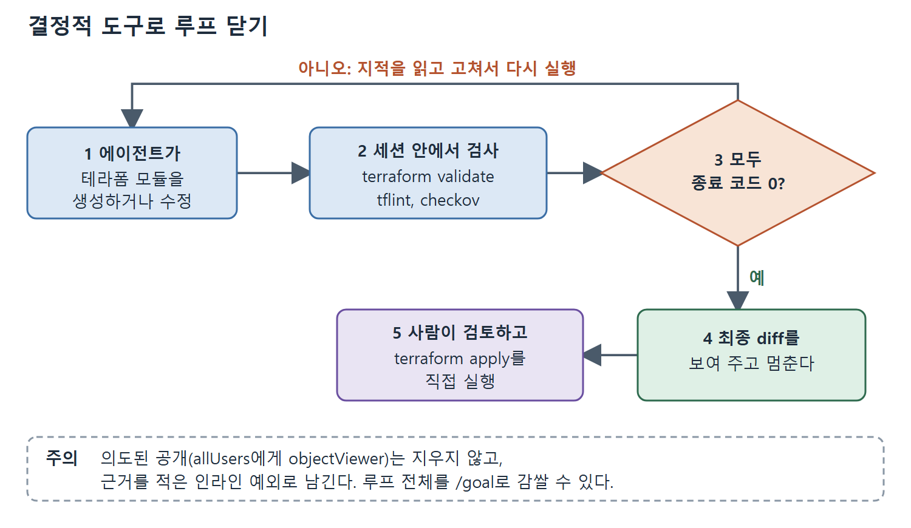

# 결정적 도구로 루프 닫기

AGENTS.md는 에이전트가 처음부터 틀리는 양을 줄여 주지만 없애지는 못한다. 보완책은 에이전트와 커밋 사이에 결정적(deterministic, 같은 입력에 항상 같은 결과를 내는) 검사를 두고 그 출력을 다시 에이전트에게 돌려주는 것이다. 이 문서는 tflint와 checkov를 쓰는 루프, 의도적으로 남기는 예외, `/goal`로 감싸는 방법, CI 게이트, 그리고 이 도구들의 한계를 다룬다.

---

## 1. 왜 린터와 스캐너가 맞는 심판인가

린터와 보안 스캐너는 에이전트가 쓴 인프라를 판정하기에 알맞다. 빠르고, 매번 같은 판정을 내리고, 지적 하나하나가 특정 파일과 줄을 가리키기 때문이다. 에이전트는 확률적으로 움직이지만 이 도구들은 그렇지 않고, 그 대비가 쓸모의 이유다.

거의 모든 테라폼 저장소에서 두 가지가 제 몫을 한다.

1. **tflint**는 `terraform validate`가 놓치는 것을 잡는다. 폐기된 문법, 잘못된 인자 같은 프로바이더별 오류, 쓰이지 않는 선언, AGENTS.md가 정한 이름 규칙 위반이다. Google 룰셋을 켜면 Cloud Run과 Cloud Storage 특성까지 안다.
2. **checkov**는 이 장 초반에 나온 보안 설정 실수를 스캔한다. 암호화되지 않은 저장소, 공개된 인그레스, 과한 IAM처럼 `terraform validate`가 그냥 통과시키는 것들이다. 그래프 기반 검사라서 리소스를 하나씩이 아니라 서로의 관계 속에서 따지므로, 단일 리소스 스캐너가 놓치는 관계형 실수까지 잡는다. 검사가 실패하면 0이 아닌 값으로 종료하므로 게이트로 쓸 수 있다.

## 2. 세션 안에서 돌린다

효과는 세션이 끝난 뒤가 아니라 세션 안에서 돌릴 때 나온다. 도구가 결정적이라서 "깨끗하게 종료"가 에이전트가 맞춰 볼 수 있는 분명한 목표가 된다. "안전하게 만들어라"는 근사만 가능하지만 종료 코드 0은 근사가 필요 없다.

```text
codex --profile infra-write "Generate the Cloud Storage bucket module that
serves the Run or Relax board as a static website, described in README.md.
Then run tflint and checkov on the result and fix every issue they report.
Repeat until both commands exit zero, then show me the final diff."
```

한 번 돌 때마다, 그럴듯해 보이기만 하는 HCL과 검사를 통과하는 HCL 사이의 틈이 줄어든다. 전형적인 흐름은 이렇다. 에이전트가 모듈을 생성하고, checkov가 버킷에 uniform bucket-level access나 버저닝이 없다고 경고하면, 둘을 추가하고 다시 돌려서 도구가 조용해질 때 멈춘다.



그림은 생성, 검사, 수정을 종료 코드 0이 나올 때까지 반복하고, 통과한 diff만 사람에게 넘겨 apply는 사람이 직접 실행하는 흐름을 보여 준다.

## 3. 침묵시키면 안 되는 지적: 의도된 공개

하나는 에이전트가 함부로 없애면 안 되는 지적이고, 오히려 교훈이 된다. 웹사이트 버킷은 `allUsers`에게 `roles/storage.objectViewer`를 줘야 하고, checkov는 이 공개 읽기를 매번 지적한다. 버킷이 원래 공개용이므로 올바른 처리는 코드 수정이 아니라 문서화된 인라인 예외(suppression) 처리다. 그러면 검토자는 지적 하나만 빼고 깨끗한 diff를 보게 되고, 그 예외는 읽고 승인할 수 있다.

## 4. /goal로 감싸기

이 지점이 Goal Mode(12장)가 제 역할을 하는 자리다. 목표(goal)에는 에이전트 바깥에 있는 검증 수단이 필요하다. 종료 코드로 "끝났는가?"에 답하는 명령이고, tflint와 checkov가 깨끗하게 도는 것이 정확히 그런 수단이다. 루프를 `/goal`로 감싸면 종료 조건이 명시적이 되고, 토큰 예산으로 작업 범위도 제한된다. `/goal`은 셸 인자가 아니라 Codex TUI 안에서 치는 슬래시 명령이므로 세션 안에서 설정한다.

```text
/goal "Generate the static-site bucket module for the Run or Relax board
from README.md. Done when terraform validate, tflint, and checkov all exit
zero, with the public-read finding suppressed and justified inline. Write
only under modules/site/."
```

에이전트는 검사가 통과하거나 예산이 바닥날 때까지 반복한다. 완료 기준이 에이전트 자신의 말이 아니라 실제 명령이므로, 스캐너를 여전히 통과하지 못하는 인프라를 두고 승리를 선언할 수 없다. 시작하기 전에 12장의 다섯 질문 기준표를 목표 문장에 적용해 본다. 적용 경계는 그대로다. 목표는 작성하고 검증할 뿐 `terraform apply`는 실행하지 않는다.

## 5. CI의 필수 게이트

같은 도구를 CI에도 협상 불가의 게이트로 넣는다. 그러면 풀 리퀘스트를 검토하는 사람은 이미 검사를 통과한 변경만 보게 된다.

```yaml
# .github/workflows/terraform-review.yml (lint and scan step)
- name: Lint and scan
  run: |
    tflint --format compact
    checkov -d . --compact
```

## 6. 한계: 목록으로 만들 수 있는 것만 잡는다

한계는 분명하다. 결정적 도구는 목록으로 만들 수 있는 문제(cataloguable)를 잡을 뿐 의도는 모른다. 버킷이 누구에게나 읽힌다는 사실은 알려 주지만, 그것이 정적 웹사이트(괜찮다)인지 데이터 버킷(유출 사고)인지는 알려 주지 못한다. 모듈이 잘못된 추상화라는 것도, 계획이 서비스를 삭제한다는 것도 알려 주지 못한다. 그 판단은 뒤에서 다루는 계획 검토와 apply를 직접 실행하는 사람의 몫이다. 린터는 바닥을 끌어올릴 뿐 천장을 대신하지 않는다.

<br>
<br>
<br>

[Agentic Coding with OpenAI Codex CLI](../)
