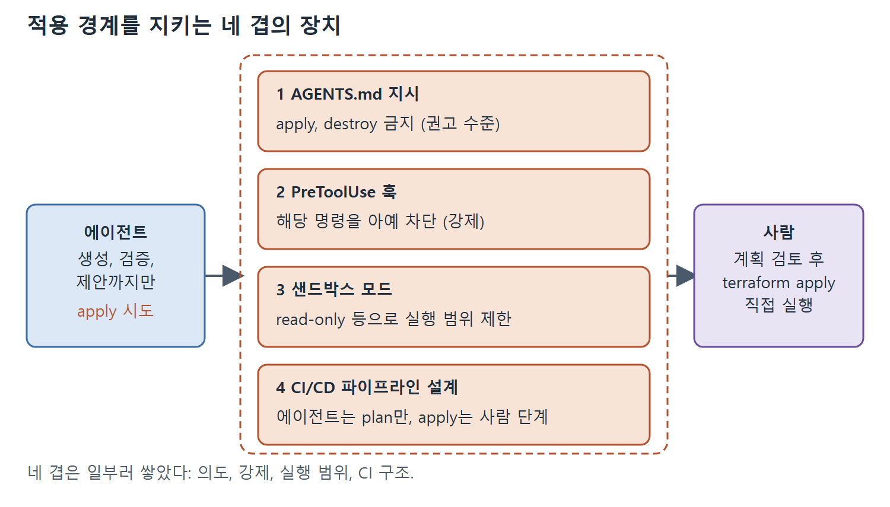

# 안전장치와 CI-CD와 운영

앞 문서들이 만든 부품을 하나로 묶는 문서다. 인프라 작업용 승인 모드 프로필, CI/CD에서 계획 검토를 돌리는 법, 적용 경계를 지키는 네 겹의 장치, 배포 이후의 2일차 운영(드리프트 감지), 테라폼 외 도구, 마지막으로 프로젝트 README를 생성하는 단계까지 다룬다.

---

## 1. 승인 모드 설정

인프라 작업에 권장하는 설정은 애플리케이션 코드보다 엄격하다. `approval_policy`와 `sandbox_mode`는 최상위 설정 키이므로, 두 가지 태세를 담는 가장 깔끔한 방법은 `--profile`로 기본 설정 위에 겹쳐 쓰는 프로필 설정 파일 두 개다.

```toml
# ~/.codex/infra-review.config.toml — 계획 검토: 읽기 전용
approval_policy = "untrusted"
sandbox_mode = "read-only"

# ~/.codex/infra-write.config.toml — 작성: 쓰기는 승인 필요
approval_policy = "untrusted"
sandbox_mode = "workspace-write"
```

계획 분석과 코드 리뷰에는 `codex --profile infra-review`, 모듈을 생성하거나 리팩터링할 때는 `codex --profile infra-write`로 호출한다. `untrusted` 승인 정책은 에이전트가 명령을 실행하기 전에 명시적 승인을 받으려고 멈춘다는 뜻이라서, 모든 파일 쓰기에 관문이 생긴다.

## 2. CI/CD 통합: 풀 리퀘스트마다 계획 검토

인프라 파이프라인에서 Codex CLI가 가장 분명하게 들어갈 자리는 모든 풀 리퀘스트의 계획 검토다. 예시는 GitHub Actions를 쓰지만 Cloud Build에서도 모양은 같다. 중요한 것은 에이전트가 검토만 하고 적용하지 않는다는 점이다.

```yaml
# .github/workflows/terraform-review.yml
- name: Generate Terraform plan
  run: terraform plan -out=tfplan -no-color > plan-output.txt
- name: AI plan review
  run: |
    codex exec -a never -s read-only \
      "Review the Terraform plan in plan-output.txt. Flag resource deletions, IAM changes, and cost implications." \
      -o review-comment.md
```

세 번째 단계가 검토 결과를 게시한다.

```yaml
- name: Post review comment
  uses: actions/github-script@v8
  with:
    script: |
      const review = require('fs').readFileSync('review-comment.md', 'utf8');
      github.rest.issues.createComment({ ...context.repo,
        issue_number: context.issue.number, body: review });
```

앞에서 본 계획 검토 패턴을 CI에 연결한 것이다. 인프라를 건드리는 모든 풀 리퀘스트에서 계획을 만들고, Codex CLI가 읽기 전용으로 검토해 결과를 파일에 쓰고, 그 파일을 PR 댓글로 올린다. 그러면 계획과 위험이 변경 옆에 놓여 사람 검토자에게 보인다. 에이전트는 적용하지 않고 주석만 단다. CI에서는 사람이 없으므로 `-a never`를 쓰고, 대신 `-s read-only`로 실행 범위를 막아 둔 점이 눈에 띈다.

파이프라인에서 Codex CLI를 쓰는 또 다른 정기 작업인 드리프트 감지도 같은 읽기 전용, 보고 전용의 틀에 들어간다. 이는 배포 파이프라인이 아니라 2일차 운영에 속하므로 아래에서 따로 다룬다.

## 3. 적용 경계를 지키는 네 겹의 장치

인프라 에이전트의 기본 규칙은 자동 apply 금지다. 에이전트는 생성하고, 검증하고, 제안한다. 사람이 계획을 검토하고 `terraform apply`를 실행한다. 이 경계는 다음 네 가지로 강제한다.

1. **AGENTS.md 지시**: apply, destroy, 직접적인 `gcloud run deploy`를 금지한다. 권고 수준이며 에이전트는 대개 따른다.
2. **PreToolUse 훅**: 해당 명령을 아예 막아서 지시를 믿는 것이 아니라 강제한다.
3. **샌드박스 모드 제한**: 명령 실행을 막거나(`read-only`) 제한한다(네트워크 없는 `workspace-write`).
4. **CI/CD 파이프라인 설계**: 에이전트는 계획을 만들고, apply는 사람이 거치는 단계가 수행한다.

네 겹을 일부러 쌓았다. AGENTS.md 한 줄은 의도를 밝히고, 훅은 그것을 구속력 있게 만들고, 샌드박스는 에이전트가 애초에 실행할 수 있는 것을 제한하며, 파이프라인은 같은 경계를 CI에서도 유지한다.



그림은 에이전트가 apply를 시도해도 네 겹의 장치를 모두 지나야 하고, 최종 적용은 계획을 검토한 사람만 실행하는 구조를 보여 준다.

## 4. 2일차 운영: 드리프트 감지와 런북

프로비저닝은 첫날의 일이고 더 긴 일은 둘째 날부터다. 상태 점검, 드리프트 감지, 인증서 갱신, 컴플라이언스 스캔 같은 꾸준한 일상 작업이 운영을 유지한다. 이런 작업은 상태를 읽고 보고할 뿐 바꾸지 않으므로 자연스럽게 적용 경계의 안전한 쪽에 있고, `codex exec`가 이를 재현 가능하고 감사할 수 있는 파이프라인으로 바꿔 준다.

모양은 일관된다. 스케줄러(cron이나 CI 잡)가 운영용 스킬과 출력 스키마를 가진 `codex exec`를 돌린다. 에이전트는 샌드박스에 들어 있는 읽기 전용 도구(gcloud, terraform, kubectl)로 인프라 상태를 읽고, 이상 징후를 추론해 구조화된 보고서를 내놓는다. 후속 도구가 그 JSON을 파싱해 Slack, PagerDuty, 대시보드로 보낸다.

드리프트 감지가 대표 사례다. 선언된 구성과 실제 상태를 비교해 차이를 표시한다. 출력 스키마가 결과를 기계가 읽을 수 있게 유지한다.

```bash
codex exec \
  --sandbox read-only \
  --output-schema ./schemas/drift-report.json \
  -o /tmp/drift-report.json \
  "Run the drift-check skill against the staging environment."
```

읽기 전용 샌드박스가 요점 전부다. 운영상의 읽기 작업은 상태를 바꾸면 안 된다. 수정이 정말 필요하면 감지기의 권한을 올리지 말고 워크플로를 나눈다. 감지 스킬은 읽기 전용으로 돌며 보고서를 내고, 수정은 별도의, 사람이 승인한 단계가 맡는다. `terraform apply`를 막는 금지는 운영 작업에도 똑같이 적용된다. 에이전트는 관찰하고 제안하며, 사람이나 조정 컨트롤러가 행동한다.

## 5. 다른 인프라 도구

테라폼 중심의 패턴은 인프라 도구 상자의 다른 도구로 옮겨 간다. 도구마다 `terraform plan` 자리를 대신하는 안전한 미리보기 명령이 있다.

| 도구 | AGENTS.md에 적을 내용 | 안전한 미리보기 |
| --- | --- | --- |
| Ansible | `ansible-lint`로 린트 | `ansible-playbook --check --diff` (적용 없이 변경 미리보기, `terraform plan`과 같은 역할) |
| Pulumi | 프로그램이 범용 코드(TypeScript, Python, Go)이므로 인프라 의미를 가진 애플리케이션 코드로 취급 | `pulumi preview`는 안전하고, `pulumi up`은 사람의 승인이 필요하다 |

어느 경우든 규칙은 같다. 무엇이 바뀔지 보여 주는 명령과 실제로 바꾸는 명령이 있고, 에이전트에게는 앞의 것만 허용한다.

## 6. 스택 문서화: 프로젝트 README

세 장을 거치면 체크아웃에는 완전한 시스템이 있다. `src/`의 FastAPI 서비스, `frontend/`의 Next.js 보드, `infra/`의 둘을 위한 테라폼이다. 아직 없는 것은 다음 독자, 또는 6개월 뒤의 자신에게 조각들이 어떻게 맞물리는지, 어떻게 실행하는지 알려 주는 파일이다. 이 세 장이 정직하게 맞추려고 애쓴 이음매(CORS origin, 두 URL 출력, 적용 경계)는 세 장에 흩어진 글 속에 있다. 루트 `README.md`가 그것들을 하나의 운영 매뉴얼로 모으는 곳이다. 이를 생성하는 것이 마지막 빌드 단계이며, 에이전트는 세션에서 이미 필요한 사실을 모두 알고 있다. 원서의 프롬프트가 요구하는 항목은 다음과 같다.

- 아키텍처: FastAPI 출발 API, 정적 Next.js 보드, 테라폼 스택, 그리고 보드가 API에 닿는 방식(`NEXT_PUBLIC_DEPARTURES_API_URL`)과 API가 보드의 origin을 허용하는 방식(`RUN_OR_RELAX_CORS_ORIGIN`).
- 두 도구 체인의 로컬 설정: 백엔드는 uv, 프런트엔드는 pnpm과 Corepack.
- 백엔드 명령: `uv run uvicorn`, `uv run pytest`, `uv run ruff check/format`.
- 프런트엔드 명령: `pnpm dev`, `pnpm build`(`out/`로 정적 내보내기), `pnpm test`, `pnpm test:e2e`.
- 서비스별 환경 변수와 기본값.
- 시드 데이터 파일(`data/timetable.json`, `data/delays.json`)과 그것이 제어하는 것.
- 테라폼 검증 워크플로: fmt, `init -backend=false`, validate, tflint, checkov.
- 굵게 표시한 인프라 경계: 에이전트는 작성하고 검증하며, 사람이 `terraform apply`와 gcloud 업로드를 실행한다. 이 저장소의 어떤 것도 스스로 적용하지 않는다.

적용 금지 경계를 AGENTS.md에만 두지 말고 README 안에도 분명히 적는다. AGENTS.md는 에이전트에게 하면 안 되는 일을 알려 주고, README는 사람 운영자에게 어디서 손이 필요한지 알려 준다. 둘은 같은 경계를 양쪽에서 읽은 것이다.

<br>
<br>
<br>

[Agentic Coding with OpenAI Codex CLI](../)
