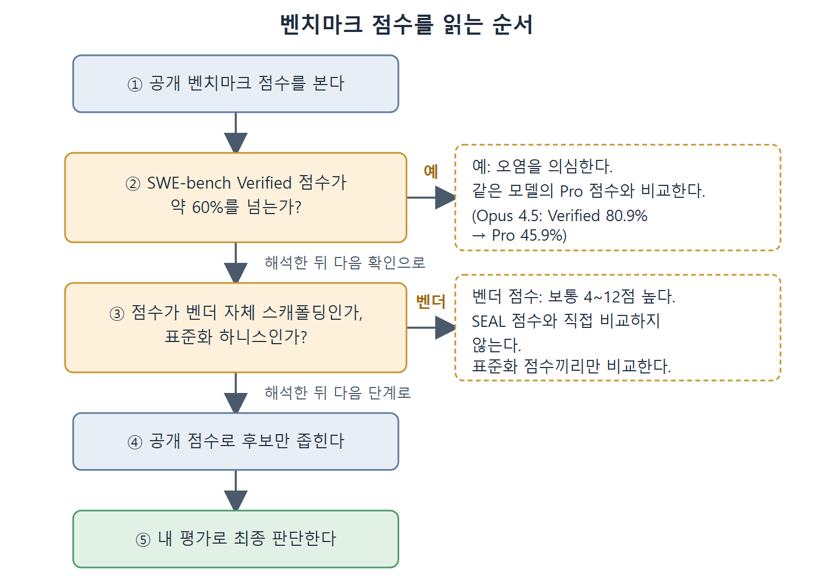

# 벤치마크 지형과 읽는 법

2026년의 AI 연구소들은 홍보 자료 맨 앞에 벤치마크 점수(%)를 내건다. 이 숫자는 무엇을 재고 무엇을 일부러 재지 않는지 알아야 제대로 읽힌다. 벤치마크는 일관되고 재현 가능한 신호를 준다는 점에서 쓸모가 있다. 하지만 점수가 성공의 기준이 되는 순간 연구소들이 실제 능력보다 점수 자체를 끌어올리는 쪽으로 움직이기 때문에 오해를 부르기도 한다.

이 문서는 장의 앞부분을 정리한다. 먼저 코딩 에이전트 평가에서 가장 자주 인용되는 벤치마크 세 가지를 비교하고, 5년 동안 모델 점수가 어떻게 올랐는지 본 다음, SWE-bench가 어떻게 "표준"에서 "경계해야 할 사례"가 되었는지 설명한다. 이 장을 마치면 벤치마크 주장 하나를 보고 다른 주장과 비교할 수 있는지 판단하는 변수를 짚을 수 있어야 한다.

---

## 1. 이 장의 학습 목표

- 벤치마크 주장을 읽고, 다른 주장과 비교 가능한지를 가르는 변수를 찾아낸다.
- 평가 데이터를 근거로 작업 종류별로 알맞은 Codex CLI 모델 설정을 고른다.
- Terminal-Bench 작업 형식을 본떠 내 코드베이스용 가벼운 벤치마크 묶음을 설계하고 돌린다.

## 2. 2026년 초에 자주 인용되는 벤치마크 세 가지

세 평가가 AI 코딩 에이전트 논의를 지배한다. 각각 재는 능력의 조각이 다르고, 어떤 벤치마크를 내세우느냐는 대개 자기 모델이 어디서 잘하느냐를 반영한다.

| 벤치마크 | 작업 규모 | 범위 | 오염 저항성 |
|---|---|---|---|
| SWE-bench Verified | 파이썬 작업 500개 | 버그 수정 패치 | 낮음. 오염 우려가 알려져 있다 |
| SWE-bench Pro | 여러 언어의 작업 1,865개 | 여러 파일에 걸친 변경 | 높음. GPL 및 비공개 코드베이스에서 가져왔다 |
| Terminal-Bench 2.0 | 처음부터 끝까지 수행하는 작업 89개 | 터미널 작업 전체 흐름 | 높음. Docker 환경이고 크라우드소싱으로 만들었다 |

여기서 "오염(contamination)"은 평가용 문제나 정답이 모델 학습 데이터에 섞여 들어간 상태를 뜻한다. 오염되면 모델이 문제를 푸는 게 아니라 외운 답을 꺼내게 된다. 제품 발표, 학회 발표, 벤더 비교표에서 어떤 점수를 보든 이 세 가지의 차이를 아는 것이 해석의 전제가 된다.

## 3. 5년간의 진화와 포화

OpenAI의 첫 Codex(2021)부터 GPT-5.4(2026)까지의 궤적은 비슷한 패턴을 반복한다. 빠르게 점수가 오르다가 벤치마크가 포화되고, 그러면 커뮤니티가 더 어려운 평가를 요구한다.

### HumanEval (함수 단위 코드 생성)

| 모델 | 연도 | 점수 |
|---|---|---|
| Codex-12B | 2021 | 28.8% |
| GPT-3.5 Turbo | 2023 | 67.0% |
| GPT-4 | 2023 | 87.0% |
| GPT-4o | 2024 | 90.2% |
| GPT-5 / Claude 4 Opus 이상 | 2025 이후 | 95% 이상(포화) |

HumanEval은 사실상 포화됐다. 최신 모델이 모두 90%를 넘으니 남은 차이는 신호가 아니라 잡음이다. 그래서 커뮤니티는 변별력 있는 평가로 SWE-bench와 Terminal-Bench 쪽으로 옮겨 갔다.

### SWE-bench Verified (실제 GitHub 이슈 해결)

| 모델/에이전트 | 연도 | 점수 |
|---|---|---|
| GPT-4o(기준선) | 2024 | 33.2% |
| o1-preview | 2024 | 41.3% |
| o3 | 2025 | 71.7% |
| GPT-5.2 Codex | 2025 | 75.2% |
| Claude Opus 4.5 | 2026 | 80.9% |
| GPT-5.5 | 2026 | 88.7% |

프런티어(최상위) 모델이 약 60%를 넘는 점수는 오염 때문에 의심해서 봐야 한다. 점수 상승 자체는 사실이지만 부풀려져 있다.

### Codeforces Elo (경쟁 프로그래밍)

| 모델 | 연도 | Elo |
|---|---|---|
| o1 | 2024 | 1,258 |
| o3 | 2025 | 2,727 |

o1에서 o3로 1,258에서 2,727까지 오른 것은 코딩 벤치마크 가운데 한 세대 만에 이룬 가장 극적인 도약이다. 사람 경쟁 프로그래머의 최상위권에 해당한다. 다만 이 능력은 알고리즘이 무거운 작업에는 이어지지만, SWE-bench나 Terminal-Bench가 재는 여러 파일에 걸친 엔지니어링 작업의 성능까지 예측해 주지는 않는다.

이 궤적에서 얻는 교훈은 벤치마크 향상이 실제이긴 해도 작업 종류별로 고르게 퍼져 있지 않다는 점이다. 경쟁 프로그래밍에서 압도하는 모델이 실제 저장소를 헤집고 다니는 일에서는 부진할 수 있다. 그러니 항상 내 작업에 맞는 벤치마크를 골라서 봐야 한다.

## 4. SWE-bench: 표준에서 반면교사로

### 무엇을 재는가

SWE-bench는 프린스턴 연구진이 만들었고, 인기 있는 파이썬 저장소 12개의 실제 GitHub 이슈로 언어 모델을 평가한다. 에이전트는 이슈 설명과, 이슈가 올라온 시점의 저장소를 받아 패치를 만들어야 한다. 결과는 이분법이다. 패치를 적용하고 기존 테스트를 돌려서 통과하면 성공, 아니면 실패이며 부분 점수는 없다.

HumanEval이나 MBPP 같은 이전 벤치마크보다 훨씬 어렵다. 처음 보는 코드베이스를 탐색하고, 파일 사이의 상호작용을 이해하고, 다른 엔지니어가 다른 목적으로 쓴 테스트를 만족하는 패치를 내야 하기 때문이다. 출범 당시에는 이런 성질 덕분에 진짜로 진단력이 있었다.

### Verified와 오염 문제

2024년 8월 OpenAI가 SWE-bench Verified를 내놓았다. 원래 2,294개 중에서 사람이 검증한 500개 작업이다. 곧 에이전트를 비교하는 사실상의 표준이 됐고, 2025년 내내 점수가 꾸준히 올랐으며 벤더들은 리더보드 정상을 두고 경쟁했다. 그러다 감사가 시작됐다.

2026년 초까지 공개된 감사와 벤더들의 신중한 태도로 많은 이들이 의심하던 사실이 확인됐다. 프런티어 모델이 Verified 작업 일부에 대해 정답(gold) 패치를 그대로 재현할 수 있고, 어려운 작업 일부는 엉뚱한 이유로 테스트를 통과한다는 것이다. 이 벤치마크는 여전히 약한 모델과 중간급 모델을 구별해 주지만, 프런티어 모델의 Verified 점수가 약 60%를 넘으면 신중하게 봐야 한다. 그 숫자가 무언가를 재는 건 맞지만 진짜 추론이 얼마이고 암기가 얼마인지 알 수 없다.

### 굿하트의 법칙

이것은 굿하트의 법칙이 눈앞에서 벌어진 사례다. 측정 지표가 목표가 되면 더 이상 좋은 지표가 아니라는 말이다. Verified가 리더보드의 대표 지표가 되자 연구소들은 이 점수를 직접 겨냥했다. 비슷한 작업으로 파인튜닝하고, 평가용 하니스에 맞춰 스캐폴딩(모델을 감싸는 보조 구조)을 조정하고, 벤치마크와 가까운 코드를 학습 데이터에 넣었다. 그 결과 최상위권에서는 점수가 더 이상 의미 있게 구별해 주지 못한다. 벤치마크가 실패한 게 아니라 굿하트화된 것이다.

오염 문제는 SWE-bench만의 일이 아니다. 90%를 넘는 HumanEval 점수도 같은 이유로 의심해야 한다. 공개 상태로 오래 남은 벤치마크는 결국 학습 목표가 된다.

## 5. SWE-bench Pro: 더 정직한 척도

SWE-bench Pro는 Verified의 구조적 약점을 보완하려고 만들었다. 차이는 다음과 같다.

1. 작업이 500개가 아니라 1,865개다.
2. 파이썬만이 아니라 여러 언어를 다룬다.
3. 패치 하나가 평균 4.1개 파일에 걸쳐 107줄이다. Verified는 패치당 중앙값이 4줄이다.
4. GPL 라이선스 코드와 비공개 코드베이스에서 작업을 가져와 학습 데이터에 넣기 어렵게 법적 장벽을 만들었다.
5. Scale Labs 리더보드에서만 보이는 비공개 보류(held-out) 부분이 있어 스캐폴딩 팀이 평가 집합에 맞춰 튜닝할 수 없다.

결과는 겸손해진다. Claude Opus 4.5는 Verified에서 80.9%지만 Pro에서는 45.9%다. 같은 모델, 같은 능력인데 점수가 거의 절반이다. 비공개 부분에서는 차이가 더 벌어진다. Claude Opus 4.1은 22.7%에서 17.8%로, GPT-5는 23.1%에서 14.9%로 떨어진다. 이 하락은 Verified 점수의 상당 부분이 일반화가 아니라 암기를 반영한다는 가장 분명한 신호다.

참고로 Scale AI의 SEAL 리더보드는 동일한 도구와 250턴 제한으로 SWE-bench Pro 점수를 표준화해 올린다. 모델 능력을 스캐폴딩 품질과 분리해서 보려는 장치다.

Codex CLI의 경우 OpenAI는 자체 에이전트 스캐폴딩과 gpt-5.3-codex로 SWE-bench Pro(공개) 56.8%를 보고했다(집필 시점). 표준화된 스캐폴딩의 SEAL 리더보드에서는 GPT-5(High)가 41.8%, GPT-5.2 Codex가 41.0%였다. 이 10~15점 차이가 스캐폴딩 프리미엄이며, 자세한 내용은 [하니스 효과와 모델 선택](%ED%95%98%EB%8B%88%EC%8A%A4%20%ED%9A%A8%EA%B3%BC%EC%99%80%20%EB%AA%A8%EB%8D%B8%20%EC%84%A0%ED%83%9D.md) 문서에서 다룬다. 벤치마크 점수를 비교할 때는 항상 그 숫자가 벤더 자체 스캐폴딩에서 나왔는지, 표준화된 평가 하니스에서 나왔는지 확인해야 한다. 벤더가 보고한 점수는 같은 모델의 독립 표준화 점수보다 보통 4~12점 높다.

그림은 공개 점수를 만났을 때 Verified 오염 여부와 스캐폴딩 출처를 차례로 확인한 뒤, 공개 점수는 후보를 좁히는 데만 쓰고 최종 판단은 내 평가로 내리는 순서를 보여 준다.

 
 
 

[Agentic Coding with OpenAI Codex CLI](../)
