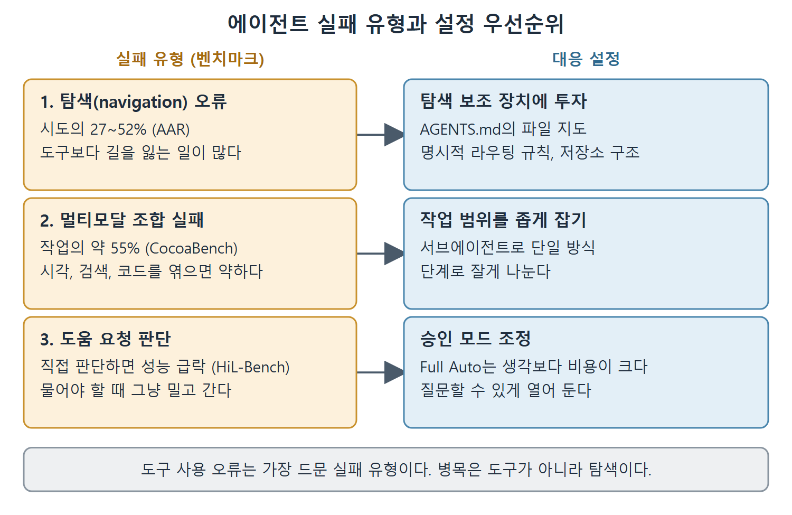

# 에이전트 실패 유형 벤치마크

2026년 4월에 나온 동료 검토 벤치마크 세 건은 에이전트가 무엇을 맞히는지가 아니라 어떻게 실패하는지에 초점을 맞춘다. CocoaBench, HiL-Bench, AAR(The Amazing Agent Race)를 합치면 에이전트 코딩 도구의 실패 유형을 처음으로 체계적으로 분류할 수 있고, 에이전트가 어디서 막히는지에 대한 널리 퍼진 가정이 뒤집힌다. 이 문서는 그 세 연구와 그에 따른 설정 우선순위를 정리한다.

---

## 1. 실패 유형 분류

2025년까지의 지배적인 서사는 도구 사용이 주된 병목이라는 것이었다. 알맞은 API를 부르지 못하거나 알맞은 명령을 실행하지 못해서 실패한다는 이야기다. 이 벤치마크들은 그 서사를 뒤집는다. 세 연구를 모은 분류는 다음과 같다.

| 실패 유형 | 실패율 | 출처 벤치마크 | 시사점 |
|---|---|---|---|
| 탐색(navigation) 오류 | 시도의 27~52% | AAR | 에이전트는 도구를 잘못 쓰는 것보다 훨씬 자주 길을 잃는다 |
| 멀티모달 조합 | 작업의 약 55% 실패(성공 45.1%) | CocoaBench | 시각, 검색, 코드를 엮는 장기 작업은 여전히 약하다 |
| 도움 요청 판단 | 상위 단계로 넘겨야 할 때 성능이 급락 | HiL-Bench | 언제 도움을 청할지 판단하지 못하면 크게 나빠진다 |
| 도구 사용 오류 | 가장 드문 실패 유형 | AAR, CocoaBench | 지금까지 벤치마크가 주로 보던 도구 사용은 거의 병목이 아니다 |

결론은 뒤집힘이다. 지배적인 실패 원인은 도구 사용이 아니라 탐색이다. 에이전트는 올바른 파일을 찾고 나면 도구를 정확히 부른다. 못하는 것은 올바른 곳에 도달하는 일이다.

## 2. AAR: 정확도 37.2%, 병목은 탐색

AAR 연구는 도구 사용과 여러 단계의 탐색이 맞물리는 작업으로 에이전트를 평가한다. 부제가 "도구는 잘 쓰지만 탐색은 약하다(Strong Tool Users, Weak Navigators)"이며 결과를 그대로 요약한다. 가장 좋은 에이전트의 정확도가 37.2%에 그쳤고, 탐색 오류가 작업 복잡도에 따라 시도의 27~52%를 차지하며 도구 사용 오류를 훨씬 앞선다.

주의할 점이 있다. AAR은 소스 저장소가 아니라 퍼즐과 검색 형태의 탐색을 측정한다. 코드베이스 작업에 적용한 것은 이 책의 비유다. 그래도 패턴은 그대로 옮겨진다. 에이전트는 올바른 곳에 도착한 뒤에는 도구를 능숙하게 부르지만, 거기까지 가는 데 약하다.

Codex CLI 사용자에게 실용적인 결론은 분명하다. 에이전트 성능을 높이는 가장 효과 큰 투자는 탐색 보조 장치를 개선하는 것이다. AGENTS.md 안의 파일 지도(4장 참고), 잘 짜인 디렉터리 구조, 명시적 라우팅 규칙이 에이전트가 뒤져야 할 탐색 공간을 줄여 주고, 가장 큰 실패 원인을 직접 겨냥한다.

## 3. CocoaBench: 멀티모달 조합에서 55% 실패

CocoaBench는 통합 에이전트를 시각, 검색, 코드라는 여러 방식(모달리티)을 하나의 일관된 작업으로 엮어야 하는 장기 작업으로 평가한다. 평가된 시스템 중 가장 좋은 것도 성공률이 45.1%여서 대략 55%의 작업이 실패한다. 에이전트는 개별 방식은 잘 다루지만 그 사이에서 일관성을 유지하는 데 어려움을 겪는다.

이는 7장에서 설명한 컨텍스트 윈도 포화 패턴과 맞아떨어진다. 작업이 더 많은 파일과 방식에 걸칠수록 컨텍스트 윈도가 이질적인 내용으로 채워지고, 모델이 그것을 통합하기 힘들어진다.

## 4. HiL-Bench: 도움을 청하는 판단의 격차

HiL-Bench(Human-in-the-Loop Benchmark, 사람 개입 벤치마크)는 이전 어떤 벤치마크도 시험하지 않은 능력, 곧 사람에게 도움을 청할 시점을 판단하는 능력을 잰다. 작업에는 탐색 과정에서만 드러나는, 사람이 검증한 막힘 요소(정보 누락, 모호함, 모순)가 들어 있다.

결과는 선명하다. 프런티어 에이전트는 완전한 맥락이 주어지면 복잡한 작업을 풀지만, 상위로 넘길지를 스스로 판단해야 하면 어떤 최상위 모델도 완전 정보 상태 성능의 일부만 회복한다. 병목은 능력이 아니라 판단이다. 이는 승인 모드 설계(5장)에 직접 영향을 준다. Suggest, Auto Edit, Full Auto 중 무엇을 고르느냐는 통제 수준의 문제만이 아니라, 에이전트가 불확실함을 인식했을 때 물어볼 수 있게 해 주느냐의 문제이기도 하다.

## 5. 설정에서 챙길 세 가지 우선순위

그림은 탐색 오류, 멀티모달 조합 실패, 도움 요청 판단 실패가 각각 어떤 설정 조정으로 이어지는지 짝지어 보여 준다. 도구 사용 오류는 가장 드문 유형이므로 대응 대상에서 뒤로 밀린다.

1. **탐색 보조 장치에 투자한다.** AGENTS.md의 파일 지도, 명시적 라우팅 규칙, 구조가 잘 잡힌 저장소 레이아웃이 27~52%의 탐색 실패율을 직접 다룬다. 파일 지도 패턴은 4장을 본다.
2. **작업 범위를 좁게 잡는다.** 약 55%에 이르는 멀티모달 조합 실패율을 보면, "이 모듈을 리팩터링하고 테스트와 문서도 모두 고쳐라" 같은 넓고 열린 작업은 잘게 나눈 하위 작업보다 더 자주 실패한다. 서브에이전트(11장)로 멀티모달 작업을 단일 방식 단계로 쪼갠다.
3. **승인 모드를 조정한다.** 도움 요청 판단에서 성능이 크게 떨어진다는 점에서 Full Auto 모드는 생각보다 비용이 크다. 에이전트가 위험한 일을 해서가 아니라, 질문하는 편이 맞았을 작업에서 그냥 밀고 나가기 때문이다.

 
 
 

[Agentic Coding with OpenAI Codex CLI](../)
