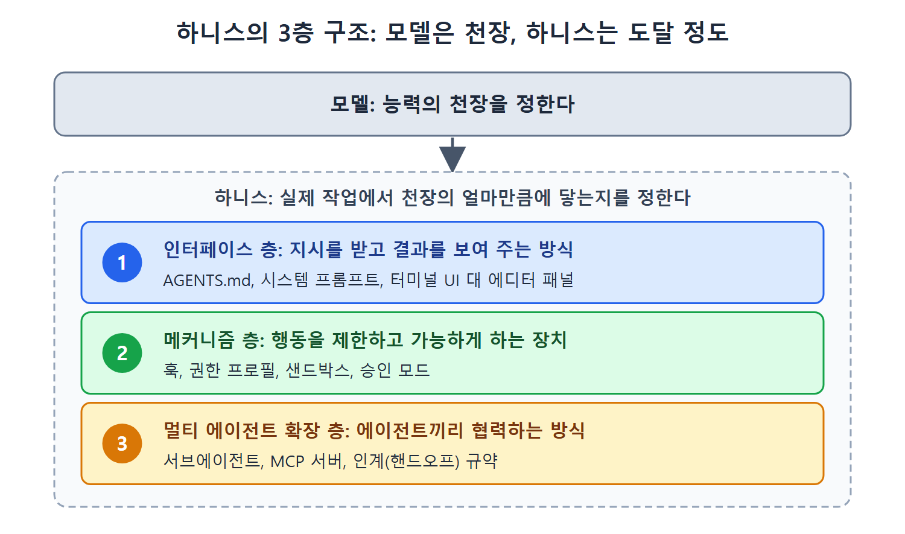

# 도구 선택의 기준과 판단 틀

코딩 에이전트 시장은 분기마다 판이 바뀐다. 그래서 이 장은 특정 제품을 추천하는 대신, 제품이 속한 구조적 범주를 기준으로 도구를 고르는 방법을 다룬다. 이 문서에서는 시장을 나누는 가장 큰 축, 도구마다 결과가 다른 이유를 설명하는 하니스 관점, 그리고 상황별로 어떤 도구를 집어 들지 정리한 판단표를 설명한다.

앞 장(25장)의 결론을 이어받는다. 같은 모델이라도 하니스(모델을 감싸서 도구 호출, 권한, 컨텍스트를 관리하는 틀)에 따라 성능이 크게 달라진다는 이야기였다. 이 장은 그 관점을 경쟁 도구 비교에 적용한다.

---

## 1. 이름보다 범주를 본다

원서는 먼저 한 가지를 못 박는다. 특정 도구를 다른 도구들과 견주어 하나만 추천하는 책은 금방 낡는다. 로스터가 석 달마다 바뀌기 때문이다. 이 책을 읽는 시점에는 시장이 더 정리되어 있을 것이고, 여기 나오는 제품 일부는 이름이 바뀌거나 사라졌을 수 있다. 그러니 책에 나오는 도구는 "그 범주에서 지금 가장 알기 쉬운 예"로만 읽어야 한다. 범주는 오래가고 브랜드는 오래가지 않는다.

시장은 하나의 구조적 축으로 갈린다.

- **CLI 에이전트**: 터미널에서 돌면서 파일 시스템을 직접 다룬다.
- **IDE 에이전트**: 에디터 안에 살면서 시각적 diff와 인라인 완성으로 AI를 보여 준다.

둘 다 걸치는 도구도 있지만, 설계 철학을 보면 어느 쪽을 먼저 겨냥했는지 드러난다. 두 층이 최적화하는 대상이 다르기 때문에 구분이 중요하다.

| 구분 | 최적화 대상 |
|---|---|
| 터미널(CLI) 에이전트 | 사람 없이 돌리는 실행, 스크립트로 엮기, CI/CD 파이프라인 연동 |
| IDE 에이전트 | 짧은 피드백 루프, 시각적 diff, 에디터를 떠나지 않는 편안함 |

층을 잘못 고르면 비효율에서 끝나지 않고 구조적으로 불가능한 경우도 있다. IDE 플러그인으로는 커널 샌드박스를 건 CI 파이프라인을 돌릴 수 없고, 헤드리스(화면 없는) 터미널 에이전트로는 인라인 시각 diff를 볼 수 없다.

원서가 덧붙이는 솔직한 말도 있다. 지금 쓰는 도구에서 원하는 결과가 나온다면 굳이 갈아탈 필요가 없다. 이 장의 목적은 그 결론에 의식적으로 도달하게 하거나, Codex CLI의 강점이 실제로 이기는 상황을 짚어 주는 것이다.

## 2. 하니스 관점: 모델이 아니라 하니스가 다르다

42명의 저자가 쓴 서베이 논문 "Code as Agent Harness"(arXiv 2605.18747)는 같은 모델을 쓰는 도구들의 결과가 왜 그렇게 다른지 설명하는 학술적 틀을 준다. 논문은 모든 코딩 에이전트에 공통된 3층 구조를 제시한다.

1. **인터페이스 층**: 에이전트가 지시를 받고 결과를 보여 주는 방식. AGENTS.md 파일, 시스템 프롬프트, 터미널 UI 대 에디터 패널 같은 것이 여기에 든다.
2. **메커니즘 층**: 에이전트의 행동을 제한하고 가능하게 하는 장치. 훅, 권한 프로필, 샌드박스, 승인 모드가 여기에 든다.
3. **멀티 에이전트 확장 층**: 에이전트끼리 협력하는 방식. 서브에이전트, MCP 서버, 인계(핸드오프) 규약이 여기에 든다.

핵심 통찰은 차별 요소가 모델이 아니라 하니스라는 것이다. 비슷한 모델을 쓰는 두 도구가 확연히 다른 결과를 내는 이유는 층마다 엔지니어링 선택이 다르기 때문이다. 어떤 도구는 메커니즘 층에서 커널 수준 샌드박스와 토큰 효율에 투자하고, 다른 도구는 인터페이스 층에서 프로그래밍 가능한 훅과 더 풍부한 추론 표시에 투자한다. 모델은 능력의 천장을 정하고, 하니스는 실제 작업에서 그 천장의 얼마만큼에 닿는지를 정한다. 이 논문의 핵심 주장은 "하니스가 루프를 소유한다"로 요약된다. 27장이 이 주제를 본격적으로 다루고, 이 장은 그것을 구매자의 관점에서 쓴다.

위 그림은 모델이 능력의 천장을 정하고, 그 아래의 하니스가 인터페이스 층, 메커니즘 층, 멀티 에이전트 확장 층의 세 층으로 실제 도달 정도를 정하는 구조를 보여 준다.

## 3. 상황별 판단표

경험 많은 개발자는 대부분 도구를 하나 이상 쓴다. 따라서 질문은 "무엇을 고를까"가 아니라 "이 작업, 이 제약 조건에서는 어느 쪽을 집어 들까"다. 원서의 표 26-1을 한국어로 다시 구성하면 다음과 같다.

| 상황 | 고를 범주(대표 도구) | 주된 이유 |
|---|---|---|
| 커널 수준 샌드박스가 필수 조건 | OS가 격리를 강제하는 CLI 에이전트(Codex CLI) | Seatbelt/bubblewrap이 앱 계층 정책이 아니라 OS 계층에서 강제한다 |
| 복잡하고 프로그램으로 짜야 하는 컴플라이언스 로직 | 훅 이벤트가 풍부한 CLI 에이전트(Claude Code) | 정책을 설정이 아니라 프로그램으로 표현한다 |
| 대량 배치 작업에서 토큰 효율 | 터미널 중심 CLI 에이전트(Codex CLI) | 헤드리스 운영이라 IDE 프로토콜 오버헤드가 없다 |
| 처음 보는 버그를 푸는 최고 수준 추론 | 가장 강한 최신 모델을 쓰는 에이전트 | 새로운 문제에서는 모델 능력이 결과를 좌우한다 |
| 반영 전에 시각적 diff로 확인 | IDE 네이티브 에이전트(Cursor) | 인라인 diff 리뷰가 기본 사용 경험이다 |
| 에디터를 떠나기 싫음 | IDE 네이티브 에이전트(Cursor, GitHub Copilot) | 터미널로 전환할 필요가 없다 |
| 이슈를 맡기고 자리를 뜸 | 비동기 클라우드 에이전트(GitHub Copilot 코딩 에이전트) | 로컬 세션 없이 호스팅 샌드박스에서 이슈에서 PR까지 간다 |
| 벤더 중립, 모델 무관, 망 분리 | 오픈소스 CLI 에이전트(OpenCode) | 제공사에 묶이지 않고 자기 모델을 가져온다 |
| 예산이 가장 큰 제약 | 무료 티어나 오픈소스 에이전트 | 한계 비용이 0에 가까우면 쓰는 습관이 바뀐다 |
| 샌드박스를 걸고 사람 없이 돌리는 CI/CD | 터미널 중심 CLI 에이전트(codex exec) | 스크립트화가 쉽고, 커널 샌드박스이며, 헤드리스용으로 만들어졌다 |

이 표는 브랜드 추천이 아니라 구조적 약속의 목록으로 읽어야 한다. 커널 샌드박스가 CLI 에이전트로 이어지는 이유는 특정 회사가 착해서가 아니다. OS가 강제하는 격리는 도구가 하위 프로세스를 띄우는 방식에서 나오는 성질인데, IDE 플러그인에는 대개 그것이 없기 때문이다. 오른쪽 열의 이유는 왼쪽 행의 도구 이름이 바뀌어도 대체로 그대로 남는다.

## 4. 이 장의 학습 목표

장을 마치면 다음을 할 수 있어야 한다.

1. 작업과 제약 조건에 따라 Codex CLI와 경쟁 에이전트 중 무엇을 쓸지 판단 틀로 정한다.
2. 커널 수준 샌드박스, 프로그램 가능한 훅, IDE 네이티브 피드백 루프의 구조적 트레이드오프를 설명한다.
3. 같은 작업을 두 도구에서 돌려 비용, 품질, 사용성을 비교한다.
4. 도구마다 구조적 강점을 맡기는 멀티 도구 워크플로를 설계한다.
5. 샌드박스를 가장 강한 경계가 아니라 가장 약하게 강제되는 경계로 분류한다.
6. Claude Code 같은 다른 에이전트의 설정, 스킬, 서브에이전트, 훅을 Codex CLI로 옮긴다.

## 5. 이 문서에서 기억할 것

- 시장은 CLI와 IDE라는 축으로 갈리고, 각각 최적화하는 대상이 다르다.
- 하니스의 3층(인터페이스, 메커니즘, 멀티 에이전트 확장)이 도구 간 차이를 만든다. 모델은 천장이고 하니스가 도달 정도를 정한다.
- 판단표는 브랜드가 아니라 구조적 이유로 읽는다.
- 이미 잘 쓰고 있다면 갈아타지 않아도 된다.

 
 
 

[Agentic Coding with OpenAI Codex CLI](../)
