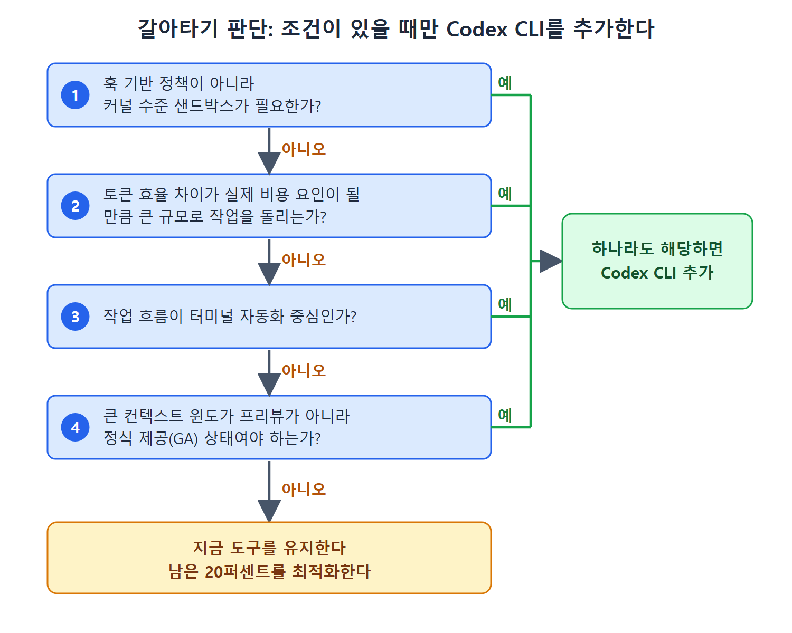

# 멀티 도구 패턴과 갈아타기 판단

대부분의 비교 글은 도구 하나를 골라 끝까지 가야 한다고 전제하지만, 경험 많은 개발자는 그렇게 하지 않는다. 도구마다 구조적 강점이 있는 자리를 맡기는 층층이 쌓은 스택을 쓴다. 이 문서는 그 구성, 한 에이전트가 만들고 다른 에이전트가 검토하는 이중 도구 리뷰, 데스크톱 래퍼 앱, 그리고 갈아타야 할 때와 그대로 둘 때의 기준을 설명한다.

---

## 1. 층층이 쌓은 스택

원서가 말하는 전형적인 구성은 세 층이다.

1. **IDE 에이전트**: 대화형 개발용. 기능 작성, 낯선 코드 탐색, 시각적 피드백이 중요한 페어 프로그래밍에 쓴다.
2. **CLI 에이전트**: 자동화용. CI/CD 작업, 일괄 리팩터링, 테스트 생성, 커널 수준 격리가 필요한 모든 일에 쓴다.
3. **두 번째 CLI 에이전트 또는 클라우드 에이전트**: 첫 번째가 가장 약한 영역용. 복잡한 추론, 프로그램 가능한 정책 강제, 로컬 세션이 필요 없는 장시간 비동기 작업을 맡긴다.

도구들은 git을 통해 같은 코드베이스를 공유하고, 앞서 본 수렴 계층을 통해 같은 컨텍스트를 공유한다. 그래서 개발자는 플랫폼에 대한 충성이 아니라 작업별로 도구를 고른다. 경계는 대체로 분명하다.

| 작업 | 맞는 도구 |
|---|---|
| 파일 하나를 고치면서 반영 전에 diff를 보고 싶다 | IDE 에이전트 |
| 파일 시스템을 건드리고 테스트를 돌리며 격리가 필요한 여러 단계 작업 | CLI 에이전트 |
| 맡기고 자리를 뜬다 | 비동기 에이전트 |

한 줄짜리 완성에 풀 터미널 에이전트를 쓰는 것은 과잉 설계이고, 커널 샌드박스가 필요한 여러 단계 CI 작업에 IDE 플러그인을 쓰는 것은 과소 설계다.

## 2. 이중 도구 리뷰

멀티 도구 사용에는 작업을 나누는 것을 넘어 품질을 올리는 변형이 하나 있다. 한 에이전트가 만들고 다른 에이전트가 감사하는 이중 도구 리뷰 워크플로다. 원서가 인용한 사례에서는 CLI 에이전트 하나가 웹 애플리케이션의 초기 개발을 맡았고, 두 번째 에이전트의 리뷰 단계에서 첫 번째가 놓친 버그가 약 스무 개 나왔다. 타임스탬프 오류, 내비게이션 결함, 만든 쪽 모델이 보지 못한 경계 사례였다.

원칙은 단순하다. 모델 하나만 본 코드는 내보내지 않는다. 모델마다 사각지대가 다르기 때문에, 두 번째 에이전트가 첫 번째 에이전트의 diff를 읽는 것은 단일 모델 한 번으로는 얻을 수 없는 싸고 효과적인 점검이다. 20장의 적대적 리뷰 패턴과 같은 본능에서 나왔고, 한 도구 안이 아니라 도구를 가로질러 적용한 것이다.

## 3. 데스크톱 래퍼

여러 CLI 에이전트(Codex CLI와 경쟁 제품)를 작업 스케줄링, git 워크트리 관리(13장), 원격 운영과 함께 하나의 앱에 통합한 데스크톱 래퍼도 늘고 있다. 이들은 밑의 에이전트 엔진이 아니라 개발자가 하루 종일 열어 두는 화면의 자리를 놓고 경쟁한다. 밑에 있는 Codex 엔진은 그대로이고, 가치는 그 위의 조율 계층에 있다. 그 계층을 쓸 가치가 있는지는 스케줄링과 작업공간 관리가 codex exec와 OS 수준 도구로 직접 조립한 것보다 나은지에 달려 있다. 원서는 많은 팀에서 아직은 아니라고 보지만 지켜볼 만한 범주라고 말한다.

## 4. 갈아타지 말아야 할 때

도구를 바꾸면 학습 곡선, 설정 이전, 팀 정렬이라는 실제 비용이 든다. 구조적 트레이드오프가 그 비용을 정당화할 때만 바꾸라는 것이 원서의 입장이다. 지금 다른 도구로 생산적이라면 Codex CLI를 추가해야 할 근거는 특정 조건에 있다.

- 훅 기반 정책이 아니라 커널 수준 샌드박스가 필요하다.
- 토큰 효율 차이가 실제 비용 요인이 될 만한 규모로 작업을 돌린다.
- 작업 흐름이 터미널 자동화 중심이다.
- 큰 컨텍스트 윈도가 프리뷰가 아니라 정식 제공(GA) 상태여야 한다.

위 그림은 네 가지 조건을 차례로 확인해 하나라도 해당하면 Codex CLI를 추가하고, 모두 아니오이면 지금 도구를 유지하며 남은 20퍼센트를 최적화하는 판단 흐름을 보여 준다.

이 중 하나도 해당하지 않으면 지금 도구로 충분하고, 이 책의 Codex 설정 심화는 실무가 아니라 학술적 지식에 가깝다. 반대 방향에도 같은 논리가 적용된다. 에디터에 머물고 싶고, 반영 전에 diff를 보고 싶고, 터미널 자동화를 거의 하지 않는다면 어떤 CLI 에이전트보다 IDE 에이전트가 더 잘 맞는다. 터미널 우선이라는 열정이 자기 작업 방식의 선호를 덮어서는 안 된다. 현재 도구가 사용 사례의 80퍼센트를 잘 처리한다면 스택을 통째로 갈아엎지 말고 남은 20퍼센트를 최적화한다.

팀에 처음 에이전트 도구를 도입한다면 잘 정의된 한 가지 작업 유형에 도구 하나로 시작한 다음 넓힌다. IDE 에이전트는 인라인 편집에 자신 있게 쓰고 Codex CLI는 CI 작업에 의도해서 쓰는 팀이, 도구 다섯 개를 깔아 놓고 언제 무엇을 쓸지 관례가 없는 팀보다 더 안정적으로 출시한다.

## 5. 이 문서에서 기억할 것

- IDE, CLI, 보완용 CLI 또는 클라우드 에이전트를 작업 성격에 따라 나눠 쓴다.
- 이중 도구 리뷰는 모델 하나만 본 코드를 내보내지 않는 습관이며, 모델별 사각지대를 이용한다.
- 데스크톱 래퍼는 조율 계층 경쟁이며, codex exec와 OS 도구로 직접 조립한 것과 비교해 판단한다.
- 구체적 조건이 없으면 갈아타지 않는다. 80퍼센트가 잘 되면 나머지 20퍼센트를 개선한다.
- 팀 도입은 도구 하나, 작업 유형 하나로 시작한다.

 
 
 

[Agentic Coding with OpenAI Codex CLI](../)
