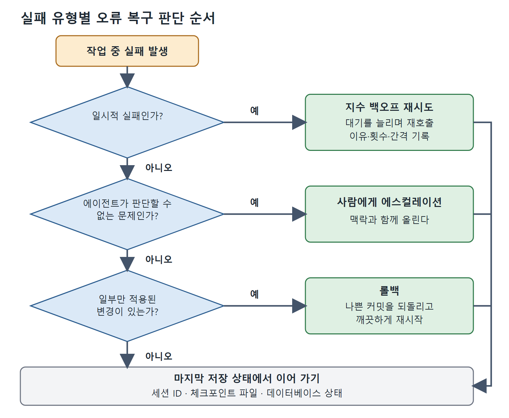

# 상태 저장과 오류 복구

오래 도는 에이전트는 중간에 끊길 수 있다. 네트워크 타임아웃, 프로세스 재시작, 예산 한도, CI 러너 교체 같은 일이 작업 도중에 에이전트를 죽인다. 이때 처음부터 다시 시작하지 않고 마지막 안전한 지점에서 이어 가려면 상태 저장이 필요하고, 실패한 뒤 무엇을 할지는 오류 복구가 정한다. 이 문서는 두 가지를 차례로 설명한다.

---

## 1. 상태 저장의 세 단계

상태를 얼마나 잘게 저장할지는 세 단계가 있고, 작업 시간과 비용에 따라 고른다.

**세션 ID 재개**는 가장 가벼운 방법이다. Codex CLI는 모든 대화에 세션 ID를 붙인다. 그 ID를 저장해 두었다가 /resume으로, 또는 다음 호출에 식별자를 넘겨서 이어 가면 에이전트가 하던 자리에서 계속한다. 한계는 실행 중에 세션 맥락이 메모리에 있다는 점이다. ID를 기록하기 전에 프로세스가 끝나면 ID를 잃는다.

**체크포인트 파일**은 단계가 뚜렷이 나뉘는 작업에 맞는다. 하니스가 끝난 단계와 그 산출물을 적은 체크포인트를 쓰고, 재시작하면 그것을 읽어 기록된 단계부터 이어 가라고 에이전트에 지시한다. 형식은 평범한 JSON이라 보기도, 재현하기도, 보관하기도 쉽다. 원서의 예시는 다음과 같은 모양이다.

```json
{
  "issue_id": "ENG-4821",
  "branch": "fix/auth-token-expiry",
  "phases_completed": ["diagnosis", "implementation"],
  "phases_remaining": ["tests", "documentation"],
  "artifacts": {
    "diagnosis": "Root cause: JWT expiry check off by one in token_service.py line 147",
    "implementation": "Patch applied to token_service.py, session_manager.py"
  },
  "last_updated": "2026-03-26T14:23:11Z"
}
```

artifacts에는 단계별 산출물이 문장으로 남는다. 진단 단계에는 원인(JWT 만료 검사가 하나 어긋남)이, 구현 단계에는 패치를 적용한 파일이 적혀 있어서, 재시작한 에이전트가 앞 단계 결과를 다시 만들 필요 없이 읽고 이어 간다.

**데이터베이스 기반 상태**는 여러 에이전트를 동시에 돌리면서 그 진행 상황을 한꺼번에 조회, 감시, 관리해야 할 때 맞는다. Symphony가 이 방식을 쓴다. 각 에이전트의 상태가 Postgres 테이블의 한 행이고, 조율자가 그 테이블을 조회해서 새 일을 배정하고, 멈춘 에이전트를 찾고, 완료 지표를 집계한다. 한 팀이 쓰는 환경에는 과한 설계지만, 공유 백로그를 두고 에이전트 수십 개를 돌리는 조직에서는 이것이 규모에 맞는 유일한 방법이다.

어떤 방식을 고르든 체크포인트 형식에 스키마 버전 필드를 꼭 넣어야 한다. 에이전트 파이프라인은 계속 바뀌고, 형식이 바뀌면 기존 체크포인트를 이전해야 한다. 버전 필드가 없는 체크포인트 저장소는 기술 부채이고, 그 부채는 프로덕션 장애로 돌아온다.

## 2. 오류 복구의 세 패턴

상태 저장이 실패 시점의 위치를 알려 준다면, 오류 복구는 그 뒤에 무엇을 할지 정한다. 실패 유형 셋에 패턴 셋이 대응한다.

| 실패 유형 | 패턴 | 요점 |
|---|---|---|
| 일시적 실패(요청 한도, 잠깐의 네트워크 오류, 두 번째에 통과하는 불안정 테스트) | 지수 백오프 재시도 | 대기 간격을 재시도마다 늘려 같은 입력으로 다시 호출 |
| 에이전트가 판단할 수 없는 문제(모호한 요구, 상충하는 제약, 진짜 회귀인지 잘못된 테스트인지 모를 실패) | 사람에게 에스컬레이션 | Linear, Slack, GitHub로 막힘을 풀 만큼의 맥락과 함께 올림 |
| 일부만 적용된 변경을 되돌려야 하는 경우 | 롤백 | 원자적 커밋이면 나쁜 커밋을 찾아 되돌리고 깨끗하게 재시작 |



위 그림은 실패가 났을 때 일시적 실패인지, 에이전트가 판단할 수 없는 문제인지, 일부만 적용된 변경이 있는지를 차례로 물어 알맞은 패턴으로 가는 순서를 보여 준다. 처리가 끝나면 저장해 둔 마지막 상태에서 작업을 이어 간다.

**지수 백오프 재시도**에서는 하니스가 실패를 잡고, 재시도할 때마다 길어지는 대기 시간을 두었다가 같은 입력으로 에이전트를 다시 부른다. 최대 재시도 횟수와 백오프 상한은 WORKFLOW.md 프런트 매터에서 설정할 수 있어야 한다. 코드에 박아 두면 파이프라인이 경직되는데, 흔히 하는 실수다.

**사람 개입(human-in-the-loop) 에스컬레이션**은 에이전트가 줄 수 없는 판단이 필요한 실패를 다룬다. 하니스는 에이전트가 다시 움직일 수 있을 만큼의 맥락을 담아 사람에게 실패를 올린다. 목표는 에스컬레이션을 없애는 것이 아니라 최소화하는 것이다.

**롤백**은 일부만 적용된 변경을 다시 시도하기 전에 되돌려야 할 때 쓴다. 에이전트가 원자적으로 커밋하면, 즉 커밋 하나에 논리적 변경 하나를 담으면, 하니스가 나쁜 커밋을 찾아 되돌리고 깨끗하게 다시 시작할 수 있다. 좋은 작업과 나쁜 작업이 한 커밋에 섞인 덩어리 커밋은 되돌리기가 훨씬 어렵다.

## 3. 조용한 재시도 루프 금지

오류 정보를 삼키는 조용한 재시도 루프는 만들지 않는다. 재시도마다 실패 이유, 재시도 횟수, 백오프 간격을 기록해야 한다. 실패하는 작업을 조용히 스무 번 재시도한 끝에 성공한 에이전트는 예산을 스무 배 썼다. 조용히 재시도하다가 끝내 포기한 에이전트는 아무것도 만들지 못했고 아무 말도 남기지 않았다. 사람이 보지 않는 무인 운영에서 관측 가능성은 선택이 아니다.

<br>
<br>
<br>

[Agentic Coding with OpenAI Codex CLI](../)
