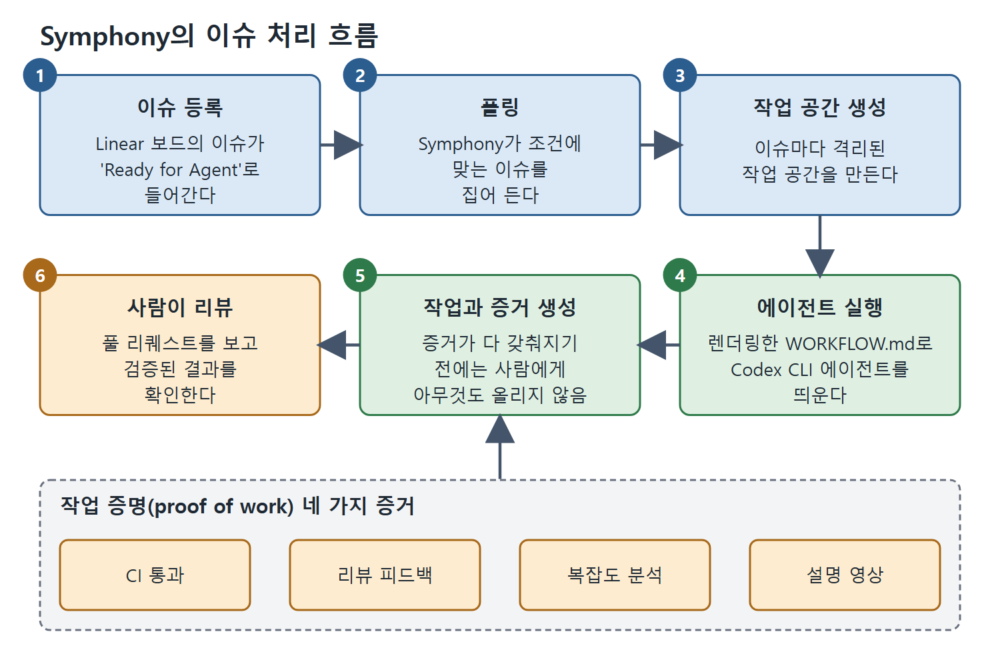

# 참조 구현과 패턴 선택

기둥, 정책 형식, 부품을 알았다면 이것들을 조립한 완성형 하니스를 볼 차례다. 서로 다른 지점에 있는 두 오픈 시스템, Symphony와 NanoClaw를 살펴보고, 내 상황에 맞는 패턴을 고르는 결정 가이드로 마무리한다.

---

## 1. Symphony: 참조 구현

Symphony는 하니스 엔지니어링을 규모 있게 구현한 OpenAI의 오픈소스 참조 구현이다. 구조를 보면 추상적인 패턴이 구체적으로 보인다.

동작 순서는 이렇다.

1. Linear 보드의 이슈가 'Ready for Agent' 상태로 들어간다.
2. Symphony가 폴링해서 조건에 맞는 이슈를 집어 든다.
3. 이슈마다 격리된 작업 공간을 만든다.
4. 렌더링된 WORKFLOW.md를 시스템 프롬프트로 삼아 Codex CLI 에이전트를 띄운다.
5. 에이전트가 일한다. 필요한 작업 증명 산출물이 다 갖춰지기 전에는 사람에게 아무것도 올라가지 않는다.
6. 사람은 CI 상태, 코드 리뷰 분석, 설명 영상이 붙은 풀 리퀘스트를 리뷰한다. 감독한 과정이 아니라 검증된 결과를 보는 것이다.

위 그림은 이슈 등록부터 사람의 리뷰까지 여섯 단계를 순서대로 보여 주고, 5단계의 관문이 되는 작업 증명 네 가지 증거(CI 통과, 리뷰 피드백, 복잡도 분석, 설명 영상)를 함께 나타낸다.

Symphony는 Erlang/BEAM 런타임 위의 Elixir로 만들어졌다. 문제의 요구에서 나온 선택이다.

- BEAM은 가벼운 동시 프로세스 수천 개를 다룬다. 그래서 Codex CLI 에이전트 50개를 병렬로 돌리는 일이 5개를 돌리는 일과 운영상 비슷하다.
- OTP 감독 트리 덕분에 에이전트 하나가 실패해도 자동으로 재시작되고 다른 에이전트에 영향이 없다.
- BEAM은 오래 도는 프로세스를 위해 설계되었다. 몇 분에서 몇 시간 걸리는 에이전트가 스트레스 테스트가 아니라 본래의 사용 사례다.

집필 시점에 Symphony는 엔지니어링 프리뷰 단계이고 제약이 뚜렷하다. Linear는 지원하지만 Jira나 GitHub Issues는 지원하지 않는다. 이슈 하나에 에이전트 하나만 돌리고 내부에서 서브에이전트를 만들지 않는다. 커스터마이징에는 Elixir 지식이 필요하다. 대부분의 팀에는 프로덕션 의존성보다 참조 아키텍처로서 쓸모가 크다. 원서 주석에 따르면 Apache 2.0 라이선스로 공개된 프로토타입 소프트웨어이며, OpenAI는 SPEC.md를 바탕으로 한 강화 버전을 직접 구현하라고 권한다. 또 Elixir 구현 설명에 따르면 BEAM의 핫 코드 리로딩 덕분에 실행 중인 서브에이전트를 멈추지 않고 개발할 수 있다.

Symphony의 SPEC.md는 왜 공유 환경이 아니라 격리된 작업 공간인지, 왜 단계별 리뷰가 아니라 작업 증명인지, 왜 Python이 아니라 Elixir인지를 설명한다. Symphony의 이슈별 작업 공간은 git 워크트리다. 생성, 세션 맥락 지정, 정리 방법은 13장에 있다.

## 2. NanoClaw: 상주형 조율 참조

Symphony가 이슈를 집어 처리하고 PR을 전달하는 배치 지향 하니스라면, NanoClaw는 상주형 조율(persistent orchestration) 패턴을 대표한다. 항상 켜져 있는 에이전트 조율기로, 작업 레지스트리를 유지하고, 반복 작업을 스케줄하고, 컨테이너로 격리한 워커 풀을 관리하며, 채널 기반 메시지로 소통한다. 원서 주석에 따르면 호스트 프로세스 하나가 채널의 메시지를 샌드박스 컨테이너 안의 세션별 에이전트에 전달하고, SQLite 작업 및 세션 레지스트리와 예약 작업이 이를 뒷받침한다.

Symphony의 배치 모델을 보완하는 패턴이 네 가지 있다.

1. **상주 스케줄링**: 외부 이벤트가 아니라 간격으로 작업을 건다. 8시간마다, 또는 매일 오전 8시에 같은 식이다. 밤사이 코드 품질 점검, 매일 문서 최신성 확인, 매주 의존성 감사처럼 선제적인 워크플로가 가능해진다.
2. **컨테이너 격리**: 워커마다 자기 컨테이너에서 돌아 워크트리만 쓸 때보다 격리가 강하다. 잘못 동작하는 에이전트가 다른 워커나 조율기에 영향을 줄 수 없다.
3. **채널 기반 통신**: 워커가 공유 상태가 아니라 구조화된 메시지 채널로 조율기와 소통한다. 파일시스템 기반 방식으로는 만들기 어려운 협력 패턴이 가능해진다.
4. **작업 수명 주기 관리**: 작업을 상태 손실 없이 일시 정지, 재개, 취소하고 우선순위를 다시 매길 수 있다. 몇 시간에서 며칠에 걸치는 장기 워크플로에는 필수다.

NanoClaw는 Symphony의 대체재가 아니라 설계 공간의 다른 지점에 있다. Symphony는 작업 증명 관문이 있는 이슈 주도 배치 워크플로에, NanoClaw는 상주하며 스케줄로 도는 연속 운영에 강하다. 많은 프로덕션 환경은 작업 종류에 따라 두 패턴을 함께 쓰게 된다.

## 3. 패턴 선택 가이드

대부분의 팀이 지금 하는 일과 Symphony가 하는 일을 비교해 보면 배울 점이 있다. 원서의 표 27-1을 새로 정리하면 다음과 같다.

| 상황 | 쓸 패턴 | Symphony에서 대응하는 것 |
|---|---|---|
| 에이전트 한 개, 대화형 세션 | AGENTS.md + 수동 승인 | 해당 없음 |
| 에이전트 한 개, 무인 CI 실행 | WORKFLOW.md + 체크포인트 파일 + codex exec | 이슈 하나짜리 Symphony 실행 |
| 에이전트 여러 개, 순차 작업 | 단계마다 체크포인트를 둔 관문 체인 | 선형 의존이 있는 Symphony 이슈 여러 개 |
| 에이전트 여러 개, 병렬 작업 | 데이터베이스 기반 상태의 병렬 군집 | 공유 Linear 보드 위의 Symphony 군단 |
| 에이전트 출력에 사람 승인이 필요 | 작업 증명 산출물 + 에스컬레이션 훅 | 증거 패키지가 붙은 Symphony PR |
| 에이전트가 작업 중 실패 | 체크포인트 파일 + 백오프 재시도 | OTP 감독 트리 재시작 |
| 에이전트 정책이 계속 바뀜 | git의 WORKFLOW.md + PR 리뷰 | Symphony 저장소에서 버전 관리되는 WORKFLOW.md |
| 다른 작업과 격리가 필요 | git 워크트리 + 샌드박스 설정 | 이슈별 격리 작업 공간 |

위에서 아래로 갈수록 대화형 도구 사용에서 자율 군단 운영으로 간다. 대부분의 팀은 중간 어딘가에 있다. Symphony의 가치는 반드시 써야 한다는 데 있지 않고, 앞으로 갈 길의 모양을 보여 줘서 오늘의 하니스를 내일의 요구까지 염두에 두고 설계하게 해 준다는 데 있다.

 
 
 

[Agentic Coding with OpenAI Codex CLI](../)
