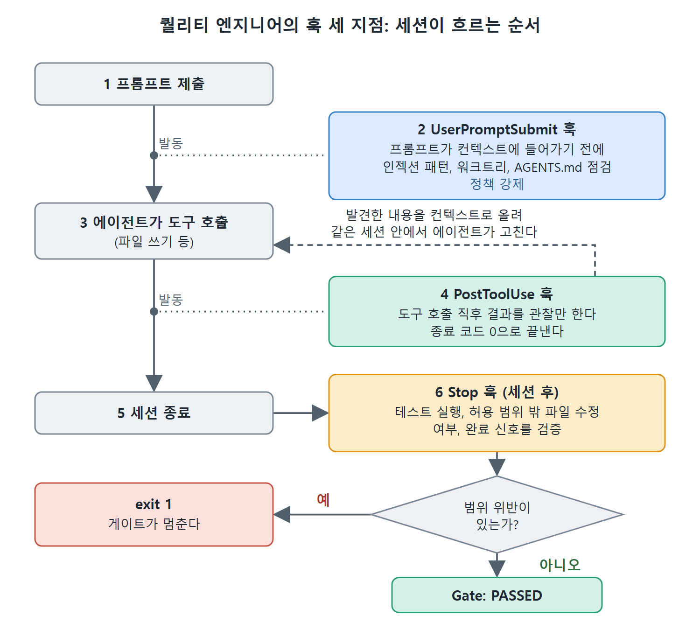
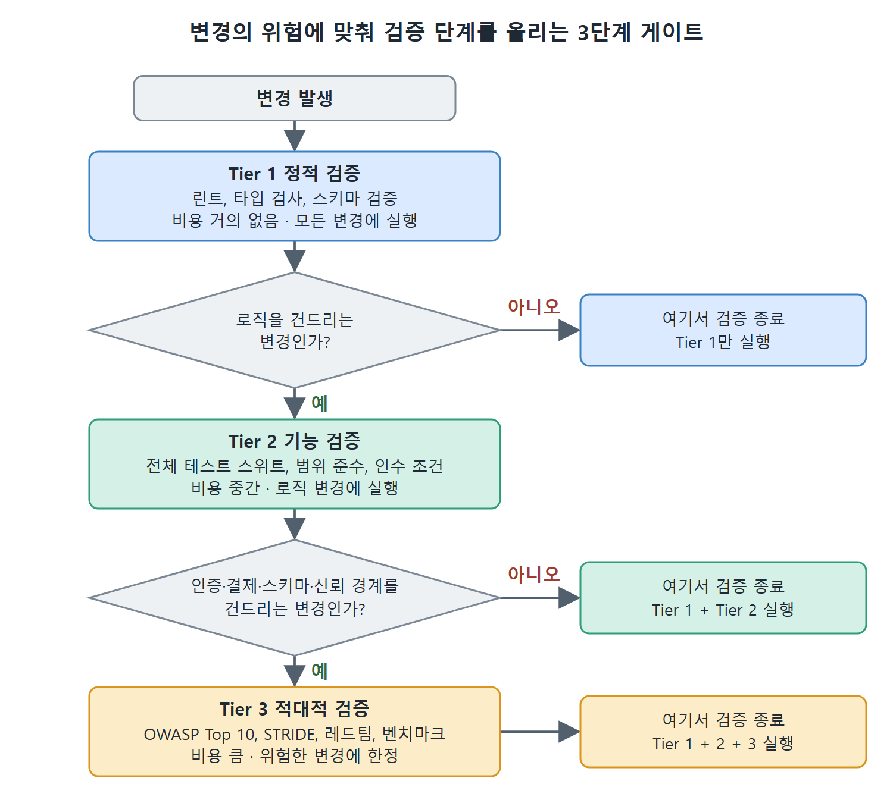

# 퀄리티 엔지니어

퀄리티 엔지니어(Quality Engineer)는 팟에서 신뢰를 맡는다. 만들어진 결과가 옳고 안전하고 믿을 만하다는 것을 증거로 보이는 사람이며, 누가 또는 무엇이 만들었든 변경을 막을 수 있는 품질 거부권을 가진다. 이 문서는 이 역할의 책임, 도구 인터페이스 설계 원칙, 훅 작성, 비용 단계별 게이트, 에이전트 쌍둥이 설정을 정리한다.

---

## 1. 이 역할이 맡는 것

퀄리티 엔지니어는 신뢰 플랫폼을 책임진다. CI/CD 파이프라인, 자동 게이트, 보안 통제, 검증 인프라가 여기에 든다. 이 역할은 품질 거부권(quality veto)을 가진다. 변경을 만든 사람이나 에이전트가 누구든 막을 수 있는 권한이다. 밸류 엔지니어도 컨텍스트 아키텍트도 이 게이트를 뒤집을 수 없다. 이 권한은 정치적인 것이 아니라 구조적인 것이다.

거부권이 있는 이유는 책임을 에이전트에게 위임할 수 없기 때문이다. 코딩 에이전트는 자기가 내보낸 결과에 책임을 질 수 없고, 제품을 출시한 조직이 끝까지 책임을 진다. 그래서 엔터프라이즈 전달은 확신이 아니라 증거로 돌아간다. 퀄리티 엔지니어의 일은 무엇을 요청했는지, 에이전트가 무엇을 했는지, 무엇을 테스트했는지, 누가 리뷰했는지, 왜 출시해도 안전했는지를 팟이 보여 줄 수 있게 만드는 것이다. 증거가 충분하지 않을 때 일을 멈추는 장치가 거부권이다.

책임 영역은 네 가지다.

- **검증과 품질 엔지니어링**: 기능 정확성, 성능, 신뢰성을 검증하는 자동 시스템을 설계하고 만든다. 안전한 도구 계약 패턴(타입이 있는 입출력, 멱등성, 최소 권한, 허용 목록)을 이끈다.
- **적대적 테스트**: 프롬프트 인젝션, 안전하지 않은 도구 사용, 데이터 노출에 대해 에이전트 워크플로를 먼저 레드팀한다. 주기적 감사가 아니라 계속 이어지는 엔지니어링 활동이다.
- **운영 뼈대**: CI/CD 파이프라인, 안전한 컨텍스트 저장, 에이전트 격리, 의존성 스캔, 공급망 무결성을 유지한다.
- **자율성 강제**: 컨텍스트 아키텍트의 자율성 사다리를 말뿐인 계획에서 실제로 돌아가는 체계로 만드는 훅, 게이트, 파이프라인 검사를 구현한다.

## 2. 결정적인 도구 인터페이스 설계

퀄리티 엔지니어는 만들 때부터 안전한 에이전트 도구 인터페이스를 설계한다. 세 가지 성질은 양보할 수 없다.

- **타입이 있는 입출력**: 팟의 에이전트가 쓰는 모든 도구에는 명시적인 입력 스키마와 출력 계약이 있어야 한다. 타입 없는 인터페이스는 검증을 불가능하게 하고 부작용을 예측할 수 없게 만든다.
- **멱등성**: 같은 입력으로 여러 번 불러도 안전해야 한다. 에이전트는 재시도하고, 멱등하지 않은 도구는 이중 청구, 중복 레코드, 일관성 깨진 상태를 부른다.
- **최소 권한**: 각 에이전트 역할은 필요한 도구만 접근한다. 구현 에이전트에게 운영 DB 자격 증명은 필요 없고, 리뷰 에이전트에게 소스 파일 쓰기 권한은 필요 없다. 퀄리티 엔지니어가 권한 구조를 설계하고 실제 에이전트 동작과 대조해 검증한다.

## 3. 퀄리티 엔지니어가 작성하는 훅

훅(9장 참고)은 퀄리티 엔지니어의 주된 강제 수단이다. 가장 중요한 훅 지점은 세 곳이다.

- **프롬프트 전 훅(UserPromptSubmit)**: 프롬프트가 에이전트 컨텍스트에 들어가기 전에 발동한다. 프롬프트 인젝션 패턴 검사, 올바른 워크트리인지 확인, AGENTS.md 맥락이 최신인지 점검 같은 정책 강제에 쓴다.
- **쓰기마다 도는 훅(PostToolUse)**: 도구 호출이 끝난 직후 발동한다. 9장에서 설명했듯이 PostToolUse는 동작을 막는 문지기가 아니라 결과를 관찰하는 훅이다. 도구는 이미 실행됐으므로 훅은 발견한 내용을 컨텍스트에 올리고 종료 코드 0으로 끝낸다. 같은 세션 안에서 에이전트가 바로 고칠 수 있는 빠른 파일 단위 피드백에 알맞다.
- **세션 후 훅(Stop)**: Codex 세션이 끝날 때 발동한다. 테스트 스위트 실행, 허용 범위 밖 파일이 수정되지 않았는지, 감사 이벤트가 발행됐는지, 기대한 완료 신호가 있는지 같은 검증에 쓴다.

SessionStart, Stop, UserPromptSubmit 훅의 설정과 강제 방식은 9장에서 다룬다. 이 장의 세션 후 검증 훅은 그곳에서 설명한 Stop 훅 수명 주기에 기댄다.



그림은 한 세션이 흐르는 순서에 세 훅이 어느 시점에 끼어드는지 보여 준다. PostToolUse 훅은 점선을 따라 발견한 내용을 에이전트에게 돌려줄 뿐 막지 않고, 실제로 멈추는 일은 세션 후 Stop 훅이 맡는다.

### 세션 후 검증 훅

`.codex/hooks/post-session-verify.sh`는 세 가지를 확인한다. 아래는 핵심 줄이다.

```bash
set -euo pipefail
TASK_ID="${CODEX_TASK_ID:-unknown}"
# 1. 전체 테스트 실행
npm test --silent 2>&1 | tee ".codex/tasks/$TASK_ID/test-results.log"
# 2. 허용 범위 밖 파일 수정 여부
MODIFIED=$(git diff --name-only HEAD)
VIOLATIONS=$(echo "$MODIFIED" | grep -E "^(infrastructure/|AGENTS\.md)" || true)
if [ -n "$VIOLATIONS" ]; then exit 1; fi
# 3. 세션 로그에서 완료 신호 확인
grep -q "IMPLEMENTATION_COMPLETE" ".codex/tasks/$TASK_ID/session.log"
```

원문은 1번에서 전체 테스트를 돌려 결과를 `.codex/tasks/$TASK_ID/test-results.log`에 남기고, 2번에서 `infrastructure/` 또는 `AGENTS.md`가 바뀌었으면 '범위 위반' 메시지를 출력하고 `exit 1`로 게이트를 멈추며, 3번에서 `IMPLEMENTATION_COMPLETE`가 없으면 경고만 출력한다. 모두 끝나면 `Gate: PASSED`를 출력한다. 범위 위반은 실패시키고 완료 신호 누락은 경고에 그친다는 점이 다르다.

### PostToolUse 예시 - 마크다운 린트

더 가벼운 예로 PostToolUse 패턴만 따로 보자. 에이전트가 마크다운 파일을 쓰는 순간 린트를 돌려 스타일과 구조 문제가 에이전트가 아직 루프 안에 있을 때 드러나게 한다. PostToolUse의 matcher는 파일 종류가 아니라 도구 이름으로 고르므로, 마크다운인지는 훅이 스스로 걸러야 한다.

```bash
# .codex/hooks/lint-markdown.sh (핵심만)
TOOL="$(jq -r '.tool_name // empty')"
case "$TOOL" in
  write_file|str_replace_editor|apply_patch|"") ;;
  *) exit 0 ;;
esac
CHANGED=$(git diff --name-only HEAD -- '*.md')
[ -z "$CHANGED" ] && exit 0
echo "$CHANGED" | xargs markdownlint 2>&1 || true
exit 0
```

PostToolUse는 도구 이름이 stdin의 JSON에서 `.tool_name`으로 들어온다. 파일을 쓰는 도구(빈 값은 수동 실행 허용)일 때만 동작하고, 방금 바뀐 마크다운 파일만 린트하며, markdownlint가 설치되어 있지 않으면 안내만 하고 건너뛴다. 마지막은 항상 `exit 0`이다. 관찰만 하고 막지 않는 것이 원칙이다.

`.codex/hooks.json`에서는 `PostToolUse` 아래에 이렇게 연결한다.

```json
{ "hooks": { "PostToolUse": [ { "hooks": [ {
  "type": "command",
  "command": "bash .codex/hooks/lint-markdown.sh",
  "statusMessage": "Linting changed Markdown...",
  "timeout": 20
} ] } ] } }
```

이 훅은 에이전트의 동작을 실패시키지 않고 린트 결과를 컨텍스트로 되돌려 에이전트가 스스로 고치게 한다. 마크다운 기준을 반드시 지켜야 한다면 단순히 보여 주는 데서 끝내지 말고, 0이 아닌 종료 코드로 일을 멈출 수 있는 세션 후 게이트에 검사를 넣어야 한다.

### 플러그인으로 강제하는 훅 - 우회를 구조적으로 불가능하게

훅이 `.codex/hooks/`의 흩어진 스크립트라면 개발자 누구나 지우거나 고칠 수 있다. 플러그인은 이 점을 바꾼다. `marketplace.json`에서 `INSTALLED_BY_DEFAULT` 정책으로 배포된 플러그인의 훅은 세션 시작 때 설치되고 개별 개발자가 제거할 수 없다. 퀄리티 엔지니어는 플러그인을 유지하고, 플랫폼 팀은 마켓플레이스 정책으로 설치를 강제한다. 우회는 권장되지 않는 정도가 아니라 불가능해진다. PostToolUse 훅에도 같은 방식이 통해서, 파일 범위 강제, 정적 분석 게이트, 감사 이벤트 확인이 기업 안 모든 팟의 모든 도구 호출에서 발동한다. 설치 정책(INSTALLED_BY_DEFAULT, AVAILABLE, NOT_AVAILABLE)과 저장소 마켓플레이스 거버넌스는 10장에 있다. 여러 팟에 일관되게 퍼뜨리는 방법은 뒤의 플러그인 배포 문서에서 다룬다.

## 4. 검증 경제학 - 비용 단계별 게이트

검증에는 시간, 토큰 비용, 사이클 지연이라는 비용이 든다. 두 줄짜리 버그 수정마다 완전한 적대적 보안 리뷰를 돌리는 것은 엄격함이 아니라 프로세스가 잘못 맞춰졌다는 신호다. 퀄리티 엔지니어의 일은 검증 깊이를 최대로 올리는 것이 아니라 변경의 위험에 검증 노력을 맞추는 것이다.

세 단계 모델이 잘 맞는다.

| 단계 | 내용 | 비용과 적용 대상 |
|---|---|---|
| Tier 1 정적 검증 | 린트, 타입 검사, 스키마 검증 | 비용이 거의 없고 모든 변경에 예외 없이 실행 |
| Tier 2 기능 검증 | 전체 테스트 스위트, 범위 준수 검사, 인수 조건 확인 | 더 비싸지만 일상적이며 로직을 건드리는 모든 변경에 실행 |
| Tier 3 적대적 검증 | 보안 모델링(OWASP Top 10, STRIDE), 성능 벤치마크, 적대적 입력 테스트, 수동 레드팀 | 비싸므로 새 인증 경로, 결제 흐름, 스키마 변경, 높은 신뢰 경계를 건드리는 변경에 한정 |



그림은 변경이 Tier 1에서 시작해 두 번의 판단을 거치며 위험에 따라 검증 깊이가 늘어나는 모습을 보여 준다. 위험이 낮은 변경은 값싼 검사에서 끝나고, 비싼 Tier 3는 위험한 변경에만 쓰인다.

Codex 스킬 묶음으로 이를 그대로 구현할 수 있다. 실제 브라우저를 열어 애플리케이션을 써 보고, 버그를 찾고, 회귀 테스트를 생성하는 QA 스킬은 Tier 2 작업이며 대부분의 기능 변경에 알맞다. 보안과 관련된 변경에는 STRIDE 위협 모델링과 OWASP Top 10 점검을 더하는 무거운 보안 리뷰 스킬을 얹는다. 검증 예산은 남는 시간이나 리뷰어의 습관이 아니라 위험에 따라 커진다.

퀄리티 엔지니어는 변경 범주를 검증 단계에 대응시켜 AGENTS.md에 적는 식으로 이를 경제적으로 실행한다. 컨텍스트 아키텍트가 자율성 사다리에 쓰는 것과 같은 대응표다. 스키마 변경은 항상 Tier 3이고, 읽기 경로 리팩터링은 Tier 1과 Tier 2다. 자동화가 알맞은 단계를 실행하고, 퀄리티 엔지니어는 검토하며 판단이 필요하면 단계를 올릴 수 있다.

## 5. 퀄리티 엔지니어의 TOML 설정

퀄리티 엔지니어의 자동 검증 실행은 대화형이 아니다. 대화형 터미널 세션이 아니라 CI에서 돈다. 검증은 추론이 많이 필요한 일이 아니라 기계적인 일이므로 모델 등급을 낮추고, 샌드박스는 엄격하게 둔다.

```toml
# .codex/agents/quality-engineer.toml
name = "quality-engineer"
description = "Automated verification: test execution, security review, gate enforcement."
developer_instructions = """ ...(아래 규칙 요약)... """
model = "gpt-5.4-mini"
model_reasoning_effort = "minimal"
approval_policy = "never"
sandbox_mode = "read-only"
```

지시문의 할 일은 다섯 가지다. 전체 테스트를 돌려 결과를 기록하기, 보안 스캐너(`npm audit --audit-level=moderate`) 실행하기, 과제 브리프의 모든 인수 조건이 입증되는지 확인하기, 과제의 허용 범위 밖에서 수정된 파일 찾기, 모든 쓰기 경로 작업에서 감사 이벤트가 발행되는지 확인하기다. 금지 사항은 테스트를 통과시키려고 소스 파일을 고치지 말 것, 개별 테스트를 끄거나 건너뛰지 말 것이다. 테스트가 실패하면 실패를 빠짐없이 기록하고 `VERIFICATION_FAILED`를, 모든 게이트가 통과하면 `VERIFICATION_PASSED`를 출력한다. 결과는 `.codex/tasks/$TASK_ID/verification.md`에 쓴다.

`sandbox_mode = "read-only"`는 의도적이다. 모델이 환각으로 소스를 고치라는 지시를 만들어 내더라도 검증 에이전트가 소스 파일에 쓸 수 없어야 한다. `approval_policy = "never"`와 합치면 에이전트가 CI에서 사람의 프롬프트 없이 비대화형으로 검증 검사를 돌리고, 샌드박스가 우발적인 변경을 막는다.

<br>
<br>
<br>

[Agentic Coding with OpenAI Codex CLI](../)
