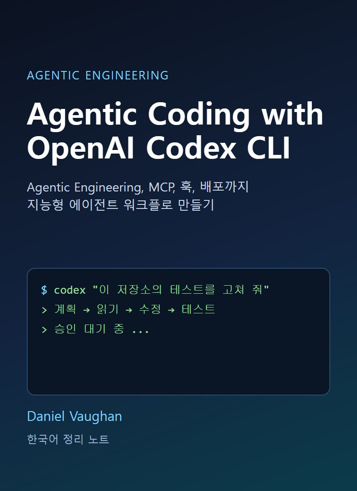
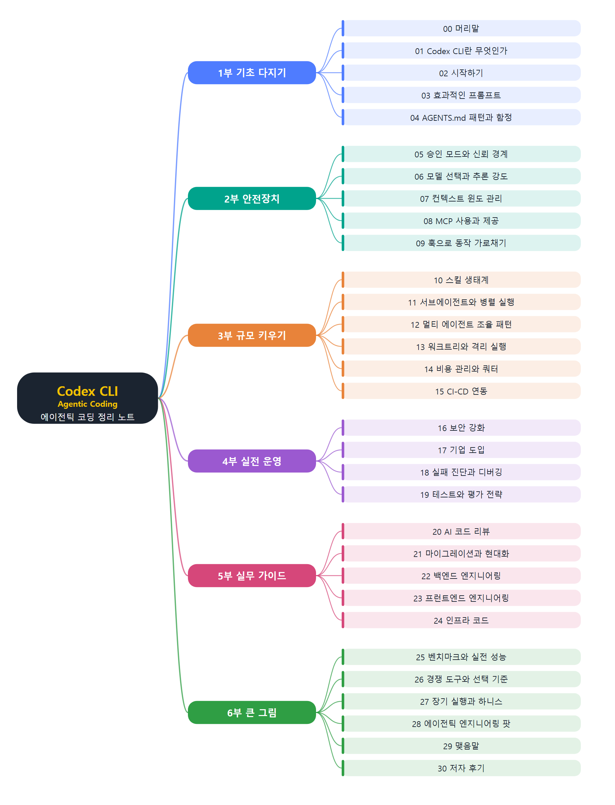

# **Agentic Coding with OpenAI Codex CLI**
(Codex CLI로 배우는 에이전틱 코딩: Agentic Engineering, MCP, 훅, 배포까지 지능형 에이전트 워크플로 만들기)
 

 
 

이 문서는 Daniel Vaughan이 쓴 『Agentic Coding with OpenAI Codex CLI』를 장별로 정리한 한국어 학습 노트입니다. 원문을 그대로 번역한 것이 아니라 내용을 풀어서 다시 설명했고, 처음 쓰는 용어는 쉬운 말로 풀이를 붙였습니다. 책은 6부 28개 장으로 되어 있습니다. 1부에서 Codex CLI가 무엇인지, 어떻게 시작하고 프롬프트와 AGENTS.md를 어떻게 쓰는지 다집니다. 2부는 승인 모드와 샌드박스, 모델과 추론 강도, 컨텍스트 윈도 관리, MCP, 훅 같은 안전장치와 제어 수단을 다룹니다. 3부는 스킬, 서브에이전트와 멀티 에이전트 조율, 워크트리, 비용 관리, CI/CD 연동으로 규모를 키우는 방법입니다. 4부는 보안 강화, 기업 도입, 실패 진단, 테스트와 평가 전략 같은 실전 운영 주제입니다. 5부는 코드 리뷰, 마이그레이션, 백엔드·프런트엔드·인프라 코드 작업의 실무 가이드이고, 6부는 벤치마크, 경쟁 도구, 하니스 엔지니어링, 에이전틱 엔지니어링 팟이라는 큰 그림을 정리합니다. 장마다 핵심 흐름을 보여 주는 그림 한두 개를 새로 그려 넣었습니다.
 
 
 

---

- [00. 머리말과 이 책에 대하여](00.%20%EB%A8%B8%EB%A6%AC%EB%A7%90%EA%B3%BC%20%EC%9D%B4%20%EC%B1%85%EC%97%90%20%EB%8C%80%ED%95%98%EC%97%AC/Readme.md)
- [01. Codex CLI란 무엇인가](01.%20Codex%20CLI%EB%9E%80%20%EB%AC%B4%EC%97%87%EC%9D%B8%EA%B0%80/Readme.md)
  - [Codex 이전의 역사](01.%20Codex%20CLI%EB%9E%80%20%EB%AC%B4%EC%97%87%EC%9D%B8%EA%B0%80/Codex%20%EC%9D%B4%EC%A0%84%EC%9D%98%20%EC%97%AD%EC%82%AC.md)
  - [자동완성의 한계와 에이전트 방식](01.%20Codex%20CLI%EB%9E%80%20%EB%AC%B4%EC%97%87%EC%9D%B8%EA%B0%80/%EC%9E%90%EB%8F%99%EC%99%84%EC%84%B1%EC%9D%98%20%ED%95%9C%EA%B3%84%EC%99%80%20%EC%97%90%EC%9D%B4%EC%A0%84%ED%8A%B8%20%EB%B0%A9%EC%8B%9D.md)
  - [AI 코딩 도구 지형](01.%20Codex%20CLI%EB%9E%80%20%EB%AC%B4%EC%97%87%EC%9D%B8%EA%B0%80/AI%20%EC%BD%94%EB%94%A9%20%EB%8F%84%EA%B5%AC%20%EC%A7%80%ED%98%95.md)
  - [Codex CLI의 정의와 설계 결정](01.%20Codex%20CLI%EB%9E%80%20%EB%AC%B4%EC%97%87%EC%9D%B8%EA%B0%80/Codex%20CLI%EC%9D%98%20%EC%A0%95%EC%9D%98%EC%99%80%20%EC%84%A4%EA%B3%84%20%EA%B2%B0%EC%A0%95.md)
  - [터미널이 중요한 이유](01.%20Codex%20CLI%EB%9E%80%20%EB%AC%B4%EC%97%87%EC%9D%B8%EA%B0%80/%ED%84%B0%EB%AF%B8%EB%84%90%EC%9D%B4%20%EC%A4%91%EC%9A%94%ED%95%9C%20%EC%9D%B4%EC%9C%A0.md)
  - [핵심 제안 네 가지](01.%20Codex%20CLI%EB%9E%80%20%EB%AC%B4%EC%97%87%EC%9D%B8%EA%B0%80/%ED%95%B5%EC%8B%AC%20%EC%A0%9C%EC%95%88%20%EB%84%A4%20%EA%B0%80%EC%A7%80.md)
  - [요약](01.%20Codex%20CLI%EB%9E%80%20%EB%AC%B4%EC%97%87%EC%9D%B8%EA%B0%80/%EC%9A%94%EC%95%BD.md)
  - [연습 문제](01.%20Codex%20CLI%EB%9E%80%20%EB%AC%B4%EC%97%87%EC%9D%B8%EA%B0%80/%EC%97%B0%EC%8A%B5%20%EB%AC%B8%EC%A0%9C.md)
- [02. Codex CLI 시작하기](02.%20Codex%20CLI%20%EC%8B%9C%EC%9E%91%ED%95%98%EA%B8%B0/Readme.md)
  - [첫 세션 미리보기](02.%20Codex%20CLI%20%EC%8B%9C%EC%9E%91%ED%95%98%EA%B8%B0/%EC%B2%AB%20%EC%84%B8%EC%85%98%20%EB%AF%B8%EB%A6%AC%EB%B3%B4%EA%B8%B0.md)
  - [설치와 사전 준비](02.%20Codex%20CLI%20%EC%8B%9C%EC%9E%91%ED%95%98%EA%B8%B0/%EC%84%A4%EC%B9%98%EC%99%80%20%EC%82%AC%EC%A0%84%20%EC%A4%80%EB%B9%84.md)
  - [인증 방법](02.%20Codex%20CLI%20%EC%8B%9C%EC%9E%91%ED%95%98%EA%B8%B0/%EC%9D%B8%EC%A6%9D%20%EB%B0%A9%EB%B2%95.md)
  - [첫 세션 실행과 첫 주 실수](02.%20Codex%20CLI%20%EC%8B%9C%EC%9E%91%ED%95%98%EA%B8%B0/%EC%B2%AB%20%EC%84%B8%EC%85%98%20%EC%8B%A4%ED%96%89%EA%B3%BC%20%EC%B2%AB%20%EC%A3%BC%20%EC%8B%A4%EC%88%98.md)
  - [codex와 codex exec](02.%20Codex%20CLI%20%EC%8B%9C%EC%9E%91%ED%95%98%EA%B8%B0/codex%EC%99%80%20codex%20exec.md)
  - [설정 위치와 환경 변수](02.%20Codex%20CLI%20%EC%8B%9C%EC%9E%91%ED%95%98%EA%B8%B0/%EC%84%A4%EC%A0%95%20%EC%9C%84%EC%B9%98%EC%99%80%20%ED%99%98%EA%B2%BD%20%EB%B3%80%EC%88%98.md)
  - [AGENTS.md 1분 소개](02.%20Codex%20CLI%20%EC%8B%9C%EC%9E%91%ED%95%98%EA%B8%B0/AGENTS.md%201%EB%B6%84%20%EC%86%8C%EA%B0%9C.md)
  - [요약](02.%20Codex%20CLI%20%EC%8B%9C%EC%9E%91%ED%95%98%EA%B8%B0/%EC%9A%94%EC%95%BD.md)
  - [연습 문제](02.%20Codex%20CLI%20%EC%8B%9C%EC%9E%91%ED%95%98%EA%B8%B0/%EC%97%B0%EC%8A%B5%20%EB%AC%B8%EC%A0%9C.md)
- [03. 효과적인 프롬프트 작성](03.%20%ED%9A%A8%EA%B3%BC%EC%A0%81%EC%9D%B8%20%ED%94%84%EB%A1%AC%ED%94%84%ED%8A%B8%20%EC%9E%91%EC%84%B1/Readme.md)
  - [에이전트 프롬프트의 특징과 네 요소](03.%20%ED%9A%A8%EA%B3%BC%EC%A0%81%EC%9D%B8%20%ED%94%84%EB%A1%AC%ED%94%84%ED%8A%B8%20%EC%9E%91%EC%84%B1/%EC%97%90%EC%9D%B4%EC%A0%84%ED%8A%B8%20%ED%94%84%EB%A1%AC%ED%94%84%ED%8A%B8%EC%9D%98%20%ED%8A%B9%EC%A7%95%EA%B3%BC%20%EB%84%A4%20%EC%9A%94%EC%86%8C.md)
  - [추론 강도와 플랜 모드](03.%20%ED%9A%A8%EA%B3%BC%EC%A0%81%EC%9D%B8%20%ED%94%84%EB%A1%AC%ED%94%84%ED%8A%B8%20%EC%9E%91%EC%84%B1/%EC%B6%94%EB%A1%A0%20%EA%B0%95%EB%8F%84%EC%99%80%20%ED%94%8C%EB%9E%9C%20%EB%AA%A8%EB%93%9C.md)
  - [중간 수정과 작업별 프롬프트 패턴](03.%20%ED%9A%A8%EA%B3%BC%EC%A0%81%EC%9D%B8%20%ED%94%84%EB%A1%AC%ED%94%84%ED%8A%B8%20%EC%9E%91%EC%84%B1/%EC%A4%91%EA%B0%84%20%EC%88%98%EC%A0%95%EA%B3%BC%20%EC%9E%91%EC%97%85%EB%B3%84%20%ED%94%84%EB%A1%AC%ED%94%84%ED%8A%B8%20%ED%8C%A8%ED%84%B4.md)
  - [문서 생성에 활용하기](03.%20%ED%9A%A8%EA%B3%BC%EC%A0%81%EC%9D%B8%20%ED%94%84%EB%A1%AC%ED%94%84%ED%8A%B8%20%EC%9E%91%EC%84%B1/%EB%AC%B8%EC%84%9C%20%EC%83%9D%EC%84%B1%EC%97%90%20%ED%99%9C%EC%9A%A9%ED%95%98%EA%B8%B0.md)
  - [반복 맥락을 프롬프트 밖으로](03.%20%ED%9A%A8%EA%B3%BC%EC%A0%81%EC%9D%B8%20%ED%94%84%EB%A1%AC%ED%94%84%ED%8A%B8%20%EC%9E%91%EC%84%B1/%EB%B0%98%EB%B3%B5%20%EB%A7%A5%EB%9D%BD%EC%9D%84%20%ED%94%84%EB%A1%AC%ED%94%84%ED%8A%B8%20%EB%B0%96%EC%9C%BC%EB%A1%9C.md)
  - [출력 제어와 비용 설정](03.%20%ED%9A%A8%EA%B3%BC%EC%A0%81%EC%9D%B8%20%ED%94%84%EB%A1%AC%ED%94%84%ED%8A%B8%20%EC%9E%91%EC%84%B1/%EC%B6%9C%EB%A0%A5%20%EC%A0%9C%EC%96%B4%EC%99%80%20%EB%B9%84%EC%9A%A9%20%EC%84%A4%EC%A0%95.md)
  - [메타프롬프팅](03.%20%ED%9A%A8%EA%B3%BC%EC%A0%81%EC%9D%B8%20%ED%94%84%EB%A1%AC%ED%94%84%ED%8A%B8%20%EC%9E%91%EC%84%B1/%EB%A9%94%ED%83%80%ED%94%84%EB%A1%AC%ED%94%84%ED%8C%85.md)
  - [공식 워크플로 레시피 여덟 가지](03.%20%ED%9A%A8%EA%B3%BC%EC%A0%81%EC%9D%B8%20%ED%94%84%EB%A1%AC%ED%94%84%ED%8A%B8%20%EC%9E%91%EC%84%B1/%EA%B3%B5%EC%8B%9D%20%EC%9B%8C%ED%81%AC%ED%94%8C%EB%A1%9C%20%EB%A0%88%EC%8B%9C%ED%94%BC%20%EC%97%AC%EB%8D%9F%20%EA%B0%80%EC%A7%80.md)
  - [요약](03.%20%ED%9A%A8%EA%B3%BC%EC%A0%81%EC%9D%B8%20%ED%94%84%EB%A1%AC%ED%94%84%ED%8A%B8%20%EC%9E%91%EC%84%B1/%EC%9A%94%EC%95%BD.md)
  - [연습 문제](03.%20%ED%9A%A8%EA%B3%BC%EC%A0%81%EC%9D%B8%20%ED%94%84%EB%A1%AC%ED%94%84%ED%8A%B8%20%EC%9E%91%EC%84%B1/%EC%97%B0%EC%8A%B5%20%EB%AC%B8%EC%A0%9C.md)
- [04. AGENTS.md 패턴과 함정](04.%20AGENTS.md%20%ED%8C%A8%ED%84%B4%EA%B3%BC%20%ED%95%A8%EC%A0%95/Readme.md)
  - [AGENTS.md가 읽히는 방식](04.%20AGENTS.md%20%ED%8C%A8%ED%84%B4%EA%B3%BC%20%ED%95%A8%EC%A0%95/AGENTS.md%EA%B0%80%20%EC%9D%BD%ED%9E%88%EB%8A%94%20%EB%B0%A9%EC%8B%9D.md)
  - [3단 지식 구조](04.%20AGENTS.md%20%ED%8C%A8%ED%84%B4%EA%B3%BC%20%ED%95%A8%EC%A0%95/3%EB%8B%A8%20%EC%A7%80%EC%8B%9D%20%EA%B5%AC%EC%A1%B0.md)
  - [꼭 들어갈 섹션과 보안](04.%20AGENTS.md%20%ED%8C%A8%ED%84%B4%EA%B3%BC%20%ED%95%A8%EC%A0%95/%EA%BC%AD%20%EB%93%A4%EC%96%B4%EA%B0%88%20%EC%84%B9%EC%85%98%EA%B3%BC%20%EB%B3%B4%EC%95%88.md)
  - [모노레포와 CI 설정](04.%20AGENTS.md%20%ED%8C%A8%ED%84%B4%EA%B3%BC%20%ED%95%A8%EC%A0%95/%EB%AA%A8%EB%85%B8%EB%A0%88%ED%8F%AC%EC%99%80%20CI%20%EC%84%A4%EC%A0%95.md)
  - [흔한 실수와 정리](04.%20AGENTS.md%20%ED%8C%A8%ED%84%B4%EA%B3%BC%20%ED%95%A8%EC%A0%95/%ED%9D%94%ED%95%9C%20%EC%8B%A4%EC%88%98%EC%99%80%20%EC%A0%95%EB%A6%AC.md)
  - [openai-codex 저장소 사례](04.%20AGENTS.md%20%ED%8C%A8%ED%84%B4%EA%B3%BC%20%ED%95%A8%EC%A0%95/openai-codex%20%EC%A0%80%EC%9E%A5%EC%86%8C%20%EC%82%AC%EB%A1%80.md)
  - [함께 쓰는 Markdown 파일들](04.%20AGENTS.md%20%ED%8C%A8%ED%84%B4%EA%B3%BC%20%ED%95%A8%EC%A0%95/%ED%95%A8%EA%BB%98%20%EC%93%B0%EB%8A%94%20Markdown%20%ED%8C%8C%EC%9D%BC%EB%93%A4.md)
  - [요약](04.%20AGENTS.md%20%ED%8C%A8%ED%84%B4%EA%B3%BC%20%ED%95%A8%EC%A0%95/%EC%9A%94%EC%95%BD.md)
  - [연습 문제](04.%20AGENTS.md%20%ED%8C%A8%ED%84%B4%EA%B3%BC%20%ED%95%A8%EC%A0%95/%EC%97%B0%EC%8A%B5%20%EB%AC%B8%EC%A0%9C.md)
- [05. 승인 모드와 신뢰 경계](05.%20%EC%8A%B9%EC%9D%B8%20%EB%AA%A8%EB%93%9C%EC%99%80%20%EC%8B%A0%EB%A2%B0%20%EA%B2%BD%EA%B3%84/Readme.md)
  - [신뢰 모델과 두 가지 제어](05.%20%EC%8A%B9%EC%9D%B8%20%EB%AA%A8%EB%93%9C%EC%99%80%20%EC%8B%A0%EB%A2%B0%20%EA%B2%BD%EA%B3%84/%EC%8B%A0%EB%A2%B0%20%EB%AA%A8%EB%8D%B8%EA%B3%BC%20%EB%91%90%20%EA%B0%80%EC%A7%80%20%EC%A0%9C%EC%96%B4.md)
  - [승인 모드 세 가지](05.%20%EC%8A%B9%EC%9D%B8%20%EB%AA%A8%EB%93%9C%EC%99%80%20%EC%8B%A0%EB%A2%B0%20%EA%B2%BD%EA%B3%84/%EC%8A%B9%EC%9D%B8%20%EB%AA%A8%EB%93%9C%20%EC%84%B8%20%EA%B0%80%EC%A7%80.md)
  - [샌드박스와 네트워크](05.%20%EC%8A%B9%EC%9D%B8%20%EB%AA%A8%EB%93%9C%EC%99%80%20%EC%8B%A0%EB%A2%B0%20%EA%B2%BD%EA%B3%84/%EC%83%8C%EB%93%9C%EB%B0%95%EC%8A%A4%EC%99%80%20%EB%84%A4%ED%8A%B8%EC%9B%8C%ED%81%AC.md)
  - [운영체제별 샌드박스](05.%20%EC%8A%B9%EC%9D%B8%20%EB%AA%A8%EB%93%9C%EC%99%80%20%EC%8B%A0%EB%A2%B0%20%EA%B2%BD%EA%B3%84/%EC%9A%B4%EC%98%81%EC%B2%B4%EC%A0%9C%EB%B3%84%20%EC%83%8C%EB%93%9C%EB%B0%95%EC%8A%A4.md)
  - [프로필과 권한 설정](05.%20%EC%8A%B9%EC%9D%B8%20%EB%AA%A8%EB%93%9C%EC%99%80%20%EC%8B%A0%EB%A2%B0%20%EA%B2%BD%EA%B3%84/%ED%94%84%EB%A1%9C%ED%95%84%EA%B3%BC%20%EA%B6%8C%ED%95%9C%20%EC%84%A4%EC%A0%95.md)
  - [권한 사다리](05.%20%EC%8A%B9%EC%9D%B8%20%EB%AA%A8%EB%93%9C%EC%99%80%20%EC%8B%A0%EB%A2%B0%20%EA%B2%BD%EA%B3%84/%EA%B6%8C%ED%95%9C%20%EC%82%AC%EB%8B%A4%EB%A6%AC.md)
  - [요약](05.%20%EC%8A%B9%EC%9D%B8%20%EB%AA%A8%EB%93%9C%EC%99%80%20%EC%8B%A0%EB%A2%B0%20%EA%B2%BD%EA%B3%84/%EC%9A%94%EC%95%BD.md)
  - [연습 문제](05.%20%EC%8A%B9%EC%9D%B8%20%EB%AA%A8%EB%93%9C%EC%99%80%20%EC%8B%A0%EB%A2%B0%20%EA%B2%BD%EA%B3%84/%EC%97%B0%EC%8A%B5%20%EB%AC%B8%EC%A0%9C.md)
- [06. 모델 선택과 추론 강도](06.%20%EB%AA%A8%EB%8D%B8%20%EC%84%A0%ED%83%9D%EA%B3%BC%20%EC%B6%94%EB%A1%A0%20%EA%B0%95%EB%8F%84/Readme.md)
  - [모델 역할과 추론 강도](06.%20%EB%AA%A8%EB%8D%B8%20%EC%84%A0%ED%83%9D%EA%B3%BC%20%EC%B6%94%EB%A1%A0%20%EA%B0%95%EB%8F%84/%EB%AA%A8%EB%8D%B8%20%EC%97%AD%ED%95%A0%EA%B3%BC%20%EC%B6%94%EB%A1%A0%20%EA%B0%95%EB%8F%84.md)
  - [프로필로 설정 묶기](06.%20%EB%AA%A8%EB%8D%B8%20%EC%84%A0%ED%83%9D%EA%B3%BC%20%EC%B6%94%EB%A1%A0%20%EA%B0%95%EB%8F%84/%ED%94%84%EB%A1%9C%ED%95%84%EB%A1%9C%20%EC%84%A4%EC%A0%95%20%EB%AC%B6%EA%B8%B0.md)
  - [모델 라우팅과 다중 모델 워크플로](06.%20%EB%AA%A8%EB%8D%B8%20%EC%84%A0%ED%83%9D%EA%B3%BC%20%EC%B6%94%EB%A1%A0%20%EA%B0%95%EB%8F%84/%EB%AA%A8%EB%8D%B8%20%EB%9D%BC%EC%9A%B0%ED%8C%85%EA%B3%BC%20%EB%8B%A4%EC%A4%91%20%EB%AA%A8%EB%8D%B8%20%EC%9B%8C%ED%81%AC%ED%94%8C%EB%A1%9C.md)
  - [클라우드와 로컬 모델 공급자](06.%20%EB%AA%A8%EB%8D%B8%20%EC%84%A0%ED%83%9D%EA%B3%BC%20%EC%B6%94%EB%A1%A0%20%EA%B0%95%EB%8F%84/%ED%81%B4%EB%9D%BC%EC%9A%B0%EB%93%9C%EC%99%80%20%EB%A1%9C%EC%BB%AC%20%EB%AA%A8%EB%8D%B8%20%EA%B3%B5%EA%B8%89%EC%9E%90.md)
  - [다중 공급자 복원력과 모델 폐기 점검](06.%20%EB%AA%A8%EB%8D%B8%20%EC%84%A0%ED%83%9D%EA%B3%BC%20%EC%B6%94%EB%A1%A0%20%EA%B0%95%EB%8F%84/%EB%8B%A4%EC%A4%91%20%EA%B3%B5%EA%B8%89%EC%9E%90%20%EB%B3%B5%EC%9B%90%EB%A0%A5%EA%B3%BC%20%EB%AA%A8%EB%8D%B8%20%ED%8F%90%EA%B8%B0%20%EC%A0%90%EA%B2%80.md)
  - [요약](06.%20%EB%AA%A8%EB%8D%B8%20%EC%84%A0%ED%83%9D%EA%B3%BC%20%EC%B6%94%EB%A1%A0%20%EA%B0%95%EB%8F%84/%EC%9A%94%EC%95%BD.md)
  - [연습 문제](06.%20%EB%AA%A8%EB%8D%B8%20%EC%84%A0%ED%83%9D%EA%B3%BC%20%EC%B6%94%EB%A1%A0%20%EA%B0%95%EB%8F%84/%EC%97%B0%EC%8A%B5%20%EB%AC%B8%EC%A0%9C.md)
- [07. 컨텍스트 윈도 관리](07.%20%EC%BB%A8%ED%85%8D%EC%8A%A4%ED%8A%B8%20%EC%9C%88%EB%8F%84%20%EA%B4%80%EB%A6%AC/Readme.md)
  - [이차 증가와 세션 이어가기](07.%20%EC%BB%A8%ED%85%8D%EC%8A%A4%ED%8A%B8%20%EC%9C%88%EB%8F%84%20%EA%B4%80%EB%A6%AC/%EC%9D%B4%EC%B0%A8%20%EC%A6%9D%EA%B0%80%EC%99%80%20%EC%84%B8%EC%85%98%20%EC%9D%B4%EC%96%B4%EA%B0%80%EA%B8%B0.md)
  - [컨텍스트를 먹는 것들과 측정](07.%20%EC%BB%A8%ED%85%8D%EC%8A%A4%ED%8A%B8%20%EC%9C%88%EB%8F%84%20%EA%B4%80%EB%A6%AC/%EC%BB%A8%ED%85%8D%EC%8A%A4%ED%8A%B8%EB%A5%BC%20%EB%A8%B9%EB%8A%94%20%EA%B2%83%EB%93%A4%EA%B3%BC%20%EC%B8%A1%EC%A0%95.md)
  - [컴팩션](07.%20%EC%BB%A8%ED%85%8D%EC%8A%A4%ED%8A%B8%20%EC%9C%88%EB%8F%84%20%EA%B4%80%EB%A6%AC/%EC%BB%B4%ED%8C%A9%EC%85%98.md)
  - [위임과 대형 코드베이스 전략](07.%20%EC%BB%A8%ED%85%8D%EC%8A%A4%ED%8A%B8%20%EC%9C%88%EB%8F%84%20%EA%B4%80%EB%A6%AC/%EC%9C%84%EC%9E%84%EA%B3%BC%20%EB%8C%80%ED%98%95%20%EC%BD%94%EB%93%9C%EB%B2%A0%EC%9D%B4%EC%8A%A4%20%EC%A0%84%EB%9E%B5.md)
  - [프롬프트 캐싱](07.%20%EC%BB%A8%ED%85%8D%EC%8A%A4%ED%8A%B8%20%EC%9C%88%EB%8F%84%20%EA%B4%80%EB%A6%AC/%ED%94%84%EB%A1%AC%ED%94%84%ED%8A%B8%20%EC%BA%90%EC%8B%B1.md)
  - [세션을 넘는 메모리](07.%20%EC%BB%A8%ED%85%8D%EC%8A%A4%ED%8A%B8%20%EC%9C%88%EB%8F%84%20%EA%B4%80%EB%A6%AC/%EC%84%B8%EC%85%98%EC%9D%84%20%EB%84%98%EB%8A%94%20%EB%A9%94%EB%AA%A8%EB%A6%AC.md)
  - [컨텍스트 실패 유형](07.%20%EC%BB%A8%ED%85%8D%EC%8A%A4%ED%8A%B8%20%EC%9C%88%EB%8F%84%20%EA%B4%80%EB%A6%AC/%EC%BB%A8%ED%85%8D%EC%8A%A4%ED%8A%B8%20%EC%8B%A4%ED%8C%A8%20%EC%9C%A0%ED%98%95.md)
  - [요약](07.%20%EC%BB%A8%ED%85%8D%EC%8A%A4%ED%8A%B8%20%EC%9C%88%EB%8F%84%20%EA%B4%80%EB%A6%AC/%EC%9A%94%EC%95%BD.md)
  - [연습 문제](07.%20%EC%BB%A8%ED%85%8D%EC%8A%A4%ED%8A%B8%20%EC%9C%88%EB%8F%84%20%EA%B4%80%EB%A6%AC/%EC%97%B0%EC%8A%B5%20%EB%AC%B8%EC%A0%9C.md)
- [08. MCP 사용하기와 제공하기](08.%20MCP%20%EC%82%AC%EC%9A%A9%ED%95%98%EA%B8%B0%EC%99%80%20%EC%A0%9C%EA%B3%B5%ED%95%98%EA%B8%B0/Readme.md)
  - [MCP 기본 개념](08.%20MCP%20%EC%82%AC%EC%9A%A9%ED%95%98%EA%B8%B0%EC%99%80%20%EC%A0%9C%EA%B3%B5%ED%95%98%EA%B8%B0/MCP%20%EA%B8%B0%EB%B3%B8%20%EA%B0%9C%EB%85%90.md)
  - [자주 쓰는 서버 연결하기](08.%20MCP%20%EC%82%AC%EC%9A%A9%ED%95%98%EA%B8%B0%EC%99%80%20%EC%A0%9C%EA%B3%B5%ED%95%98%EA%B8%B0/%EC%9E%90%EC%A3%BC%20%EC%93%B0%EB%8A%94%20%EC%84%9C%EB%B2%84%20%EC%97%B0%EA%B2%B0%ED%95%98%EA%B8%B0.md)
  - [컨텍스트 비용 관리](08.%20MCP%20%EC%82%AC%EC%9A%A9%ED%95%98%EA%B8%B0%EC%99%80%20%EC%A0%9C%EA%B3%B5%ED%95%98%EA%B8%B0/%EC%BB%A8%ED%85%8D%EC%8A%A4%ED%8A%B8%20%EB%B9%84%EC%9A%A9%20%EA%B4%80%EB%A6%AC.md)
  - [기업 환경의 MCP](08.%20MCP%20%EC%82%AC%EC%9A%A9%ED%95%98%EA%B8%B0%EC%99%80%20%EC%A0%9C%EA%B3%B5%ED%95%98%EA%B8%B0/%EA%B8%B0%EC%97%85%20%ED%99%98%EA%B2%BD%EC%9D%98%20MCP.md)
  - [간단한 MCP 서버 만들기](08.%20MCP%20%EC%82%AC%EC%9A%A9%ED%95%98%EA%B8%B0%EC%99%80%20%EC%A0%9C%EA%B3%B5%ED%95%98%EA%B8%B0/%EA%B0%84%EB%8B%A8%ED%95%9C%20MCP%20%EC%84%9C%EB%B2%84%20%EB%A7%8C%EB%93%A4%EA%B8%B0.md)
  - [Codex CLI를 MCP 서버로 쓰기](08.%20MCP%20%EC%82%AC%EC%9A%A9%ED%95%98%EA%B8%B0%EC%99%80%20%EC%A0%9C%EA%B3%B5%ED%95%98%EA%B8%B0/Codex%20CLI%EB%A5%BC%20MCP%20%EC%84%9C%EB%B2%84%EB%A1%9C%20%EC%93%B0%EA%B8%B0.md)
  - [운영 환경의 MCP](08.%20MCP%20%EC%82%AC%EC%9A%A9%ED%95%98%EA%B8%B0%EC%99%80%20%EC%A0%9C%EA%B3%B5%ED%95%98%EA%B8%B0/%EC%9A%B4%EC%98%81%20%ED%99%98%EA%B2%BD%EC%9D%98%20MCP.md)
  - [요약](08.%20MCP%20%EC%82%AC%EC%9A%A9%ED%95%98%EA%B8%B0%EC%99%80%20%EC%A0%9C%EA%B3%B5%ED%95%98%EA%B8%B0/%EC%9A%94%EC%95%BD.md)
  - [연습 문제](08.%20MCP%20%EC%82%AC%EC%9A%A9%ED%95%98%EA%B8%B0%EC%99%80%20%EC%A0%9C%EA%B3%B5%ED%95%98%EA%B8%B0/%EC%97%B0%EC%8A%B5%20%EB%AC%B8%EC%A0%9C.md)
- [09. 훅으로 에이전트 동작 가로채기](09.%20%ED%9B%85%EC%9C%BC%EB%A1%9C%20%EC%97%90%EC%9D%B4%EC%A0%84%ED%8A%B8%20%EB%8F%99%EC%9E%91%20%EA%B0%80%EB%A1%9C%EC%B1%84%EA%B8%B0/Readme.md)
  - [훅 시스템 개요](09.%20%ED%9B%85%EC%9C%BC%EB%A1%9C%20%EC%97%90%EC%9D%B4%EC%A0%84%ED%8A%B8%20%EB%8F%99%EC%9E%91%20%EA%B0%80%EB%A1%9C%EC%B1%84%EA%B8%B0/%ED%9B%85%20%EC%8B%9C%EC%8A%A4%ED%85%9C%20%EA%B0%9C%EC%9A%94.md)
  - [훅 생명주기 흐름](09.%20%ED%9B%85%EC%9C%BC%EB%A1%9C%20%EC%97%90%EC%9D%B4%EC%A0%84%ED%8A%B8%20%EB%8F%99%EC%9E%91%20%EA%B0%80%EB%A1%9C%EC%B1%84%EA%B8%B0/%ED%9B%85%20%EC%83%9D%EB%AA%85%EC%A3%BC%EA%B8%B0%20%ED%9D%90%EB%A6%84.md)
  - [세션 시작과 프롬프트 훅](09.%20%ED%9B%85%EC%9C%BC%EB%A1%9C%20%EC%97%90%EC%9D%B4%EC%A0%84%ED%8A%B8%20%EB%8F%99%EC%9E%91%20%EA%B0%80%EB%A1%9C%EC%B1%84%EA%B8%B0/%EC%84%B8%EC%85%98%20%EC%8B%9C%EC%9E%91%EA%B3%BC%20%ED%94%84%EB%A1%AC%ED%94%84%ED%8A%B8%20%ED%9B%85.md)
  - [도구 호출과 권한 훅](09.%20%ED%9B%85%EC%9C%BC%EB%A1%9C%20%EC%97%90%EC%9D%B4%EC%A0%84%ED%8A%B8%20%EB%8F%99%EC%9E%91%20%EA%B0%80%EB%A1%9C%EC%B1%84%EA%B8%B0/%EB%8F%84%EA%B5%AC%20%ED%98%B8%EC%B6%9C%EA%B3%BC%20%EA%B6%8C%ED%95%9C%20%ED%9B%85.md)
  - [압축과 서브에이전트와 종료 훅](09.%20%ED%9B%85%EC%9C%BC%EB%A1%9C%20%EC%97%90%EC%9D%B4%EC%A0%84%ED%8A%B8%20%EB%8F%99%EC%9E%91%20%EA%B0%80%EB%A1%9C%EC%B1%84%EA%B8%B0/%EC%95%95%EC%B6%95%EA%B3%BC%20%EC%84%9C%EB%B8%8C%EC%97%90%EC%9D%B4%EC%A0%84%ED%8A%B8%EC%99%80%20%EC%A2%85%EB%A3%8C%20%ED%9B%85.md)
  - [튼튼한 훅 작성 원칙](09.%20%ED%9B%85%EC%9C%BC%EB%A1%9C%20%EC%97%90%EC%9D%B4%EC%A0%84%ED%8A%B8%20%EB%8F%99%EC%9E%91%20%EA%B0%80%EB%A1%9C%EC%B1%84%EA%B8%B0/%ED%8A%BC%ED%8A%BC%ED%95%9C%20%ED%9B%85%20%EC%9E%91%EC%84%B1%20%EC%9B%90%EC%B9%99.md)
  - [실전 패턴 모음](09.%20%ED%9B%85%EC%9C%BC%EB%A1%9C%20%EC%97%90%EC%9D%B4%EC%A0%84%ED%8A%B8%20%EB%8F%99%EC%9E%91%20%EA%B0%80%EB%A1%9C%EC%B1%84%EA%B8%B0/%EC%8B%A4%EC%A0%84%20%ED%8C%A8%ED%84%B4%20%EB%AA%A8%EC%9D%8C.md)
  - [기업 거버넌스와 자기 진화 루프](09.%20%ED%9B%85%EC%9C%BC%EB%A1%9C%20%EC%97%90%EC%9D%B4%EC%A0%84%ED%8A%B8%20%EB%8F%99%EC%9E%91%20%EA%B0%80%EB%A1%9C%EC%B1%84%EA%B8%B0/%EA%B8%B0%EC%97%85%20%EA%B1%B0%EB%B2%84%EB%84%8C%EC%8A%A4%EC%99%80%20%EC%9E%90%EA%B8%B0%20%EC%A7%84%ED%99%94%20%EB%A3%A8%ED%94%84.md)
  - [훅 운영 도구](09.%20%ED%9B%85%EC%9C%BC%EB%A1%9C%20%EC%97%90%EC%9D%B4%EC%A0%84%ED%8A%B8%20%EB%8F%99%EC%9E%91%20%EA%B0%80%EB%A1%9C%EC%B1%84%EA%B8%B0/%ED%9B%85%20%EC%9A%B4%EC%98%81%20%EB%8F%84%EA%B5%AC.md)
  - [요약](09.%20%ED%9B%85%EC%9C%BC%EB%A1%9C%20%EC%97%90%EC%9D%B4%EC%A0%84%ED%8A%B8%20%EB%8F%99%EC%9E%91%20%EA%B0%80%EB%A1%9C%EC%B1%84%EA%B8%B0/%EC%9A%94%EC%95%BD.md)
  - [연습 문제](09.%20%ED%9B%85%EC%9C%BC%EB%A1%9C%20%EC%97%90%EC%9D%B4%EC%A0%84%ED%8A%B8%20%EB%8F%99%EC%9E%91%20%EA%B0%80%EB%A1%9C%EC%B1%84%EA%B8%B0/%EC%97%B0%EC%8A%B5%20%EB%AC%B8%EC%A0%9C.md)
- [10. 스킬 생태계](10.%20%EC%8A%A4%ED%82%AC%20%EC%83%9D%ED%83%9C%EA%B3%84/Readme.md)
  - [스킬의 개념과 표준](10.%20%EC%8A%A4%ED%82%AC%20%EC%83%9D%ED%83%9C%EA%B3%84/%EC%8A%A4%ED%82%AC%EC%9D%98%20%EA%B0%9C%EB%85%90%EA%B3%BC%20%ED%91%9C%EC%A4%80.md)
  - [스킬 찾기와 설치와 관리](10.%20%EC%8A%A4%ED%82%AC%20%EC%83%9D%ED%83%9C%EA%B3%84/%EC%8A%A4%ED%82%AC%20%EC%B0%BE%EA%B8%B0%EC%99%80%20%EC%84%A4%EC%B9%98%EC%99%80%20%EA%B4%80%EB%A6%AC.md)
  - [SKILL.md 작성 규칙](10.%20%EC%8A%A4%ED%82%AC%20%EC%83%9D%ED%83%9C%EA%B3%84/SKILL.md%20%EC%9E%91%EC%84%B1%20%EA%B7%9C%EC%B9%99.md)
  - [openai.yaml과 스킬 만들어 배포하기](10.%20%EC%8A%A4%ED%82%AC%20%EC%83%9D%ED%83%9C%EA%B3%84/openai.yaml%EA%B3%BC%20%EC%8A%A4%ED%82%AC%20%EB%A7%8C%EB%93%A4%EC%96%B4%20%EB%B0%B0%ED%8F%AC%ED%95%98%EA%B8%B0.md)
  - [스킬 평가하기](10.%20%EC%8A%A4%ED%82%AC%20%EC%83%9D%ED%83%9C%EA%B3%84/%EC%8A%A4%ED%82%AC%20%ED%8F%89%EA%B0%80%ED%95%98%EA%B8%B0.md)
  - [플러그인과 마켓플레이스](10.%20%EC%8A%A4%ED%82%AC%20%EC%83%9D%ED%83%9C%EA%B3%84/%ED%94%8C%EB%9F%AC%EA%B7%B8%EC%9D%B8%EA%B3%BC%20%EB%A7%88%EC%BC%93%ED%94%8C%EB%A0%88%EC%9D%B4%EC%8A%A4.md)
  - [워크플로 조합과 사례](10.%20%EC%8A%A4%ED%82%AC%20%EC%83%9D%ED%83%9C%EA%B3%84/%EC%9B%8C%ED%81%AC%ED%94%8C%EB%A1%9C%20%EC%A1%B0%ED%95%A9%EA%B3%BC%20%EC%82%AC%EB%A1%80.md)
  - [요약](10.%20%EC%8A%A4%ED%82%AC%20%EC%83%9D%ED%83%9C%EA%B3%84/%EC%9A%94%EC%95%BD.md)
  - [연습 문제](10.%20%EC%8A%A4%ED%82%AC%20%EC%83%9D%ED%83%9C%EA%B3%84/%EC%97%B0%EC%8A%B5%20%EB%AC%B8%EC%A0%9C.md)
- [11. 서브에이전트와 병렬 실행](11.%20%EC%84%9C%EB%B8%8C%EC%97%90%EC%9D%B4%EC%A0%84%ED%8A%B8%EC%99%80%20%EB%B3%91%EB%A0%AC%20%EC%8B%A4%ED%96%89/Readme.md)
  - [서브에이전트 기본 개념](11.%20%EC%84%9C%EB%B8%8C%EC%97%90%EC%9D%B4%EC%A0%84%ED%8A%B8%EC%99%80%20%EB%B3%91%EB%A0%AC%20%EC%8B%A4%ED%96%89/%EC%84%9C%EB%B8%8C%EC%97%90%EC%9D%B4%EC%A0%84%ED%8A%B8%20%EA%B8%B0%EB%B3%B8%20%EA%B0%9C%EB%85%90.md)
  - [커스텀 에이전트 정의](11.%20%EC%84%9C%EB%B8%8C%EC%97%90%EC%9D%B4%EC%A0%84%ED%8A%B8%EC%99%80%20%EB%B3%91%EB%A0%AC%20%EC%8B%A4%ED%96%89/%EC%BB%A4%EC%8A%A4%ED%85%80%20%EC%97%90%EC%9D%B4%EC%A0%84%ED%8A%B8%20%EC%A0%95%EC%9D%98.md)
  - [모델 선택과 세션 한도](11.%20%EC%84%9C%EB%B8%8C%EC%97%90%EC%9D%B4%EC%A0%84%ED%8A%B8%EC%99%80%20%EB%B3%91%EB%A0%AC%20%EC%8B%A4%ED%96%89/%EB%AA%A8%EB%8D%B8%20%EC%84%A0%ED%83%9D%EA%B3%BC%20%EC%84%B8%EC%85%98%20%ED%95%9C%EB%8F%84.md)
  - [병렬화할 작업 고르기](11.%20%EC%84%9C%EB%B8%8C%EC%97%90%EC%9D%B4%EC%A0%84%ED%8A%B8%EC%99%80%20%EB%B3%91%EB%A0%AC%20%EC%8B%A4%ED%96%89/%EB%B3%91%EB%A0%AC%ED%99%94%ED%95%A0%20%EC%9E%91%EC%97%85%20%EA%B3%A0%EB%A5%B4%EA%B8%B0.md)
  - [CSV 팬아웃](11.%20%EC%84%9C%EB%B8%8C%EC%97%90%EC%9D%B4%EC%A0%84%ED%8A%B8%EC%99%80%20%EB%B3%91%EB%A0%AC%20%EC%8B%A4%ED%96%89/CSV%20%ED%8C%AC%EC%95%84%EC%9B%83.md)
  - [한 세션을 넘어서는 3단계 병렬화](11.%20%EC%84%9C%EB%B8%8C%EC%97%90%EC%9D%B4%EC%A0%84%ED%8A%B8%EC%99%80%20%EB%B3%91%EB%A0%AC%20%EC%8B%A4%ED%96%89/%ED%95%9C%20%EC%84%B8%EC%85%98%EC%9D%84%20%EB%84%98%EC%96%B4%EC%84%9C%EB%8A%94%203%EB%8B%A8%EA%B3%84%20%EB%B3%91%EB%A0%AC%ED%99%94.md)
  - [운영상 주의점과 병렬화가 해로운 경우](11.%20%EC%84%9C%EB%B8%8C%EC%97%90%EC%9D%B4%EC%A0%84%ED%8A%B8%EC%99%80%20%EB%B3%91%EB%A0%AC%20%EC%8B%A4%ED%96%89/%EC%9A%B4%EC%98%81%EC%83%81%20%EC%A3%BC%EC%9D%98%EC%A0%90%EA%B3%BC%20%EB%B3%91%EB%A0%AC%ED%99%94%EA%B0%80%20%ED%95%B4%EB%A1%9C%EC%9A%B4%20%EA%B2%BD%EC%9A%B0.md)
  - [요약](11.%20%EC%84%9C%EB%B8%8C%EC%97%90%EC%9D%B4%EC%A0%84%ED%8A%B8%EC%99%80%20%EB%B3%91%EB%A0%AC%20%EC%8B%A4%ED%96%89/%EC%9A%94%EC%95%BD.md)
  - [연습 문제](11.%20%EC%84%9C%EB%B8%8C%EC%97%90%EC%9D%B4%EC%A0%84%ED%8A%B8%EC%99%80%20%EB%B3%91%EB%A0%AC%20%EC%8B%A4%ED%96%89/%EC%97%B0%EC%8A%B5%20%EB%AC%B8%EC%A0%9C.md)
- [12. 멀티 에이전트 조율 패턴](12.%20%EB%A9%80%ED%8B%B0%20%EC%97%90%EC%9D%B4%EC%A0%84%ED%8A%B8%20%EC%A1%B0%EC%9C%A8%20%ED%8C%A8%ED%84%B4/Readme.md)
  - [조율의 출발점, 랄프 루프](12.%20%EB%A9%80%ED%8B%B0%20%EC%97%90%EC%9D%B4%EC%A0%84%ED%8A%B8%20%EC%A1%B0%EC%9C%A8%20%ED%8C%A8%ED%84%B4/%EC%A1%B0%EC%9C%A8%EC%9D%98%20%EC%B6%9C%EB%B0%9C%EC%A0%90%20%EB%9E%84%ED%94%84%20%EB%A3%A8%ED%94%84.md)
  - [패턴 1. 순차 게이트 체인](12.%20%EB%A9%80%ED%8B%B0%20%EC%97%90%EC%9D%B4%EC%A0%84%ED%8A%B8%20%EC%A1%B0%EC%9C%A8%20%ED%8C%A8%ED%84%B4/%EC%88%9C%EC%B0%A8%20%EA%B2%8C%EC%9D%B4%ED%8A%B8%20%EC%B2%B4%EC%9D%B8.md)
  - [패턴 2. 웨이브 기반 혼합](12.%20%EB%A9%80%ED%8B%B0%20%EC%97%90%EC%9D%B4%EC%A0%84%ED%8A%B8%20%EC%A1%B0%EC%9C%A8%20%ED%8C%A8%ED%84%B4/%EC%9B%A8%EC%9D%B4%EB%B8%8C%20%EA%B8%B0%EB%B0%98%20%ED%98%BC%ED%95%A9.md)
  - [패턴 3. 교차 모델 리뷰 루프](12.%20%EB%A9%80%ED%8B%B0%20%EC%97%90%EC%9D%B4%EC%A0%84%ED%8A%B8%20%EC%A1%B0%EC%9C%A8%20%ED%8C%A8%ED%84%B4/%EA%B5%90%EC%B0%A8%20%EB%AA%A8%EB%8D%B8%20%EB%A6%AC%EB%B7%B0%20%EB%A3%A8%ED%94%84.md)
  - [패턴 4. 반복 수리 루프](12.%20%EB%A9%80%ED%8B%B0%20%EC%97%90%EC%9D%B4%EC%A0%84%ED%8A%B8%20%EC%A1%B0%EC%9C%A8%20%ED%8C%A8%ED%84%B4/%EB%B0%98%EB%B3%B5%20%EC%88%98%EB%A6%AC%20%EB%A3%A8%ED%94%84.md)
  - [패턴 고르기와 대화 분기](12.%20%EB%A9%80%ED%8B%B0%20%EC%97%90%EC%9D%B4%EC%A0%84%ED%8A%B8%20%EC%A1%B0%EC%9C%A8%20%ED%8C%A8%ED%84%B4/%ED%8C%A8%ED%84%B4%20%EA%B3%A0%EB%A5%B4%EA%B8%B0%EC%99%80%20%EB%8C%80%ED%99%94%20%EB%B6%84%EA%B8%B0.md)
  - [/goal: 지속 목표](12.%20%EB%A9%80%ED%8B%B0%20%EC%97%90%EC%9D%B4%EC%A0%84%ED%8A%B8%20%EC%A1%B0%EC%9C%A8%20%ED%8C%A8%ED%84%B4/goal%20%EC%A7%80%EC%86%8D%20%EB%AA%A9%ED%91%9C.md)
  - [외부 조율, 디버깅, 안티패턴](12.%20%EB%A9%80%ED%8B%B0%20%EC%97%90%EC%9D%B4%EC%A0%84%ED%8A%B8%20%EC%A1%B0%EC%9C%A8%20%ED%8C%A8%ED%84%B4/%EC%99%B8%EB%B6%80%20%EC%A1%B0%EC%9C%A8%EA%B3%BC%20%EB%94%94%EB%B2%84%EA%B9%85%EA%B3%BC%20%EC%95%88%ED%8B%B0%ED%8C%A8%ED%84%B4.md)
  - [요약](12.%20%EB%A9%80%ED%8B%B0%20%EC%97%90%EC%9D%B4%EC%A0%84%ED%8A%B8%20%EC%A1%B0%EC%9C%A8%20%ED%8C%A8%ED%84%B4/%EC%9A%94%EC%95%BD.md)
  - [연습 문제](12.%20%EB%A9%80%ED%8B%B0%20%EC%97%90%EC%9D%B4%EC%A0%84%ED%8A%B8%20%EC%A1%B0%EC%9C%A8%20%ED%8C%A8%ED%84%B4/%EC%97%B0%EC%8A%B5%20%EB%AC%B8%EC%A0%9C.md)
- [13. 워크트리와 격리 실행](13.%20%EC%9B%8C%ED%81%AC%ED%8A%B8%EB%A6%AC%EC%99%80%20%EA%B2%A9%EB%A6%AC%20%EC%8B%A4%ED%96%89/Readme.md)
  - [워크트리 기초와 필요성](13.%20%EC%9B%8C%ED%81%AC%ED%8A%B8%EB%A6%AC%EC%99%80%20%EA%B2%A9%EB%A6%AC%20%EC%8B%A4%ED%96%89/%EC%9B%8C%ED%81%AC%ED%8A%B8%EB%A6%AC%20%EA%B8%B0%EC%B4%88%EC%99%80%20%ED%95%84%EC%9A%94%EC%84%B1.md)
  - [하나의 에이전트 하나의 워크트리](13.%20%EC%9B%8C%ED%81%AC%ED%8A%B8%EB%A6%AC%EC%99%80%20%EA%B2%A9%EB%A6%AC%20%EC%8B%A4%ED%96%89/%ED%95%98%EB%82%98%EC%9D%98%20%EC%97%90%EC%9D%B4%EC%A0%84%ED%8A%B8%20%ED%95%98%EB%82%98%EC%9D%98%20%EC%9B%8C%ED%81%AC%ED%8A%B8%EB%A6%AC.md)
  - [런타임 격리의 빈틈](13.%20%EC%9B%8C%ED%81%AC%ED%8A%B8%EB%A6%AC%EC%99%80%20%EA%B2%A9%EB%A6%AC%20%EC%8B%A4%ED%96%89/%EB%9F%B0%ED%83%80%EC%9E%84%20%EA%B2%A9%EB%A6%AC%EC%9D%98%20%EB%B9%88%ED%8B%88.md)
  - [CLI 워크트리 작업 흐름](13.%20%EC%9B%8C%ED%81%AC%ED%8A%B8%EB%A6%AC%EC%99%80%20%EA%B2%A9%EB%A6%AC%20%EC%8B%A4%ED%96%89/CLI%20%EC%9B%8C%ED%81%AC%ED%8A%B8%EB%A6%AC%20%EC%9E%91%EC%97%85%20%ED%9D%90%EB%A6%84.md)
  - [작업 결과 병합하기](13.%20%EC%9B%8C%ED%81%AC%ED%8A%B8%EB%A6%AC%EC%99%80%20%EA%B2%A9%EB%A6%AC%20%EC%8B%A4%ED%96%89/%EC%9E%91%EC%97%85%20%EA%B2%B0%EA%B3%BC%20%EB%B3%91%ED%95%A9%ED%95%98%EA%B8%B0.md)
  - [설정 스크립트와 CI 수명주기](13.%20%EC%9B%8C%ED%81%AC%ED%8A%B8%EB%A6%AC%EC%99%80%20%EA%B2%A9%EB%A6%AC%20%EC%8B%A4%ED%96%89/%EC%84%A4%EC%A0%95%20%EC%8A%A4%ED%81%AC%EB%A6%BD%ED%8A%B8%EC%99%80%20CI%20%EC%88%98%EB%AA%85%EC%A3%BC%EA%B8%B0.md)
  - [팀 규모별 워크트리 패턴](13.%20%EC%9B%8C%ED%81%AC%ED%8A%B8%EB%A6%AC%EC%99%80%20%EA%B2%A9%EB%A6%AC%20%EC%8B%A4%ED%96%89/%ED%8C%80%20%EA%B7%9C%EB%AA%A8%EB%B3%84%20%EC%9B%8C%ED%81%AC%ED%8A%B8%EB%A6%AC%20%ED%8C%A8%ED%84%B4.md)
  - [요약](13.%20%EC%9B%8C%ED%81%AC%ED%8A%B8%EB%A6%AC%EC%99%80%20%EA%B2%A9%EB%A6%AC%20%EC%8B%A4%ED%96%89/%EC%9A%94%EC%95%BD.md)
  - [연습 문제](13.%20%EC%9B%8C%ED%81%AC%ED%8A%B8%EB%A6%AC%EC%99%80%20%EA%B2%A9%EB%A6%AC%20%EC%8B%A4%ED%96%89/%EC%97%B0%EC%8A%B5%20%EB%AC%B8%EC%A0%9C.md)
- [14. 비용 관리와 쿼터 전략](14.%20%EB%B9%84%EC%9A%A9%20%EA%B4%80%EB%A6%AC%EC%99%80%20%EC%BF%BC%ED%84%B0%20%EC%A0%84%EB%9E%B5/Readme.md)
  - [사용 한도와 요금 체계](14.%20%EB%B9%84%EC%9A%A9%20%EA%B4%80%EB%A6%AC%EC%99%80%20%EC%BF%BC%ED%84%B0%20%EC%A0%84%EB%9E%B5/%EC%82%AC%EC%9A%A9%20%ED%95%9C%EB%8F%84%EC%99%80%20%EC%9A%94%EA%B8%88%20%EC%B2%B4%EA%B3%84.md)
  - [팀 비용 추정과 낭비 요인](14.%20%EB%B9%84%EC%9A%A9%20%EA%B4%80%EB%A6%AC%EC%99%80%20%EC%BF%BC%ED%84%B0%20%EC%A0%84%EB%9E%B5/%ED%8C%80%20%EB%B9%84%EC%9A%A9%20%EC%B6%94%EC%A0%95%EA%B3%BC%20%EB%82%AD%EB%B9%84%20%EC%9A%94%EC%9D%B8.md)
  - [프로필과 설정으로 비용 제어](14.%20%EB%B9%84%EC%9A%A9%20%EA%B4%80%EB%A6%AC%EC%99%80%20%EC%BF%BC%ED%84%B0%20%EC%A0%84%EB%9E%B5/%ED%94%84%EB%A1%9C%ED%95%84%EA%B3%BC%20%EC%84%A4%EC%A0%95%EC%9C%BC%EB%A1%9C%20%EB%B9%84%EC%9A%A9%20%EC%A0%9C%EC%96%B4.md)
  - [훅으로 비용 모니터링](14.%20%EB%B9%84%EC%9A%A9%20%EA%B4%80%EB%A6%AC%EC%99%80%20%EC%BF%BC%ED%84%B0%20%EC%A0%84%EB%9E%B5/%ED%9B%85%EC%9C%BC%EB%A1%9C%20%EB%B9%84%EC%9A%A9%20%EB%AA%A8%EB%8B%88%ED%84%B0%EB%A7%81.md)
  - [모델 선택과 추론 강도](14.%20%EB%B9%84%EC%9A%A9%20%EA%B4%80%EB%A6%AC%EC%99%80%20%EC%BF%BC%ED%84%B0%20%EC%A0%84%EB%9E%B5/%EB%AA%A8%EB%8D%B8%20%EC%84%A0%ED%83%9D%EA%B3%BC%20%EC%B6%94%EB%A1%A0%20%EA%B0%95%EB%8F%84.md)
  - [프롬프트 캐싱과 컨텍스트 계획](14.%20%EB%B9%84%EC%9A%A9%20%EA%B4%80%EB%A6%AC%EC%99%80%20%EC%BF%BC%ED%84%B0%20%EC%A0%84%EB%9E%B5/%ED%94%84%EB%A1%AC%ED%94%84%ED%8A%B8%20%EC%BA%90%EC%8B%B1%EA%B3%BC%20%EC%BB%A8%ED%85%8D%EC%8A%A4%ED%8A%B8%20%EA%B3%84%ED%9A%8D.md)
  - [클라우드 결제 경로와 로컬 추론](14.%20%EB%B9%84%EC%9A%A9%20%EA%B4%80%EB%A6%AC%EC%99%80%20%EC%BF%BC%ED%84%B0%20%EC%A0%84%EB%9E%B5/%ED%81%B4%EB%9D%BC%EC%9A%B0%EB%93%9C%20%EA%B2%B0%EC%A0%9C%20%EA%B2%BD%EB%A1%9C%EC%99%80%20%EB%A1%9C%EC%BB%AC%20%EC%B6%94%EB%A1%A0.md)
  - [토큰 압축 프록시와 컨텍스트 건강](14.%20%EB%B9%84%EC%9A%A9%20%EA%B4%80%EB%A6%AC%EC%99%80%20%EC%BF%BC%ED%84%B0%20%EC%A0%84%EB%9E%B5/%ED%86%A0%ED%81%B0%20%EC%95%95%EC%B6%95%20%ED%94%84%EB%A1%9D%EC%8B%9C%EC%99%80%20%EC%BB%A8%ED%85%8D%EC%8A%A4%ED%8A%B8%20%EA%B1%B4%EA%B0%95.md)
  - [요약](14.%20%EB%B9%84%EC%9A%A9%20%EA%B4%80%EB%A6%AC%EC%99%80%20%EC%BF%BC%ED%84%B0%20%EC%A0%84%EB%9E%B5/%EC%9A%94%EC%95%BD.md)
  - [연습 문제](14.%20%EB%B9%84%EC%9A%A9%20%EA%B4%80%EB%A6%AC%EC%99%80%20%EC%BF%BC%ED%84%B0%20%EC%A0%84%EB%9E%B5/%EC%97%B0%EC%8A%B5%20%EB%AC%B8%EC%A0%9C.md)
- [15. CI-CD 연동](15.%20CI-CD%20%EC%97%B0%EB%8F%99/Readme.md)
  - [헤드리스 실행 codex exec](15.%20CI-CD%20%EC%97%B0%EB%8F%99/%ED%97%A4%EB%93%9C%EB%A6%AC%EC%8A%A4%20%EC%8B%A4%ED%96%89%20codex%20exec.md)
  - [재현 가능한 실행과 샌드박스 제한](15.%20CI-CD%20%EC%97%B0%EB%8F%99/%EC%9E%AC%ED%98%84%20%EA%B0%80%EB%8A%A5%ED%95%9C%20%EC%8B%A4%ED%96%89%EA%B3%BC%20%EC%83%8C%EB%93%9C%EB%B0%95%EC%8A%A4%20%EC%A0%9C%ED%95%9C.md)
  - [GitHub Actions 기본 패턴](15.%20CI-CD%20%EC%97%B0%EB%8F%99/GitHub%20Actions%20%EA%B8%B0%EB%B3%B8%20%ED%8C%A8%ED%84%B4.md)
  - [프로젝트 스킬과 스택 PR](15.%20CI-CD%20%EC%97%B0%EB%8F%99/%ED%94%84%EB%A1%9C%EC%A0%9D%ED%8A%B8%20%EC%8A%A4%ED%82%AC%EA%B3%BC%20%EC%8A%A4%ED%83%9D%20PR.md)
  - [GitLab CI-CD 연동](15.%20CI-CD%20%EC%97%B0%EB%8F%99/GitLab%20CI-CD%20%EC%97%B0%EB%8F%99.md)
  - [자가 치유 파이프라인과 AutoLoop](15.%20CI-CD%20%EC%97%B0%EB%8F%99/%EC%9E%90%EA%B0%80%20%EC%B9%98%EC%9C%A0%20%ED%8C%8C%EC%9D%B4%ED%94%84%EB%9D%BC%EC%9D%B8%EA%B3%BC%20AutoLoop.md)
  - [CI 에이전트 안전 전략과 관측](15.%20CI-CD%20%EC%97%B0%EB%8F%99/CI%20%EC%97%90%EC%9D%B4%EC%A0%84%ED%8A%B8%20%EC%95%88%EC%A0%84%20%EC%A0%84%EB%9E%B5%EA%B3%BC%20%EA%B4%80%EC%B8%A1.md)
  - [빌드 시스템과 실증 연구 그리고 패턴 표](15.%20CI-CD%20%EC%97%B0%EB%8F%99/%EB%B9%8C%EB%93%9C%20%EC%8B%9C%EC%8A%A4%ED%85%9C%EA%B3%BC%20%EC%8B%A4%EC%A6%9D%20%EC%97%B0%EA%B5%AC%20%EA%B7%B8%EB%A6%AC%EA%B3%A0%20%ED%8C%A8%ED%84%B4%20%ED%91%9C.md)
  - [요약](15.%20CI-CD%20%EC%97%B0%EB%8F%99/%EC%9A%94%EC%95%BD.md)
  - [연습 문제](15.%20CI-CD%20%EC%97%B0%EB%8F%99/%EC%97%B0%EC%8A%B5%20%EB%AC%B8%EC%A0%9C.md)
- [16. 보안 강화](16.%20%EB%B3%B4%EC%95%88%20%EA%B0%95%ED%99%94/Readme.md)
  - [에이전트 위협 모델](16.%20%EB%B3%B4%EC%95%88%20%EA%B0%95%ED%99%94/%EC%97%90%EC%9D%B4%EC%A0%84%ED%8A%B8%20%EC%9C%84%ED%98%91%20%EB%AA%A8%EB%8D%B8.md)
  - [프롬프트 인젝션 공격과 방어](16.%20%EB%B3%B4%EC%95%88%20%EA%B0%95%ED%99%94/%ED%94%84%EB%A1%AC%ED%94%84%ED%8A%B8%20%EC%9D%B8%EC%A0%9D%EC%85%98%20%EA%B3%B5%EA%B2%A9%EA%B3%BC%20%EB%B0%A9%EC%96%B4.md)
  - [샌드박스와 파일 시스템 제한](16.%20%EB%B3%B4%EC%95%88%20%EA%B0%95%ED%99%94/%EC%83%8C%EB%93%9C%EB%B0%95%EC%8A%A4%EC%99%80%20%ED%8C%8C%EC%9D%BC%20%EC%8B%9C%EC%8A%A4%ED%85%9C%20%EC%A0%9C%ED%95%9C.md)
  - [자동 리뷰와 신뢰 사다리](16.%20%EB%B3%B4%EC%95%88%20%EA%B0%95%ED%99%94/%EC%9E%90%EB%8F%99%20%EB%A6%AC%EB%B7%B0%EC%99%80%20%EC%8B%A0%EB%A2%B0%20%EC%82%AC%EB%8B%A4%EB%A6%AC.md)
  - [CI 격리와 네트워크 허용 목록](16.%20%EB%B3%B4%EC%95%88%20%EA%B0%95%ED%99%94/CI%20%EA%B2%A9%EB%A6%AC%EC%99%80%20%EB%84%A4%ED%8A%B8%EC%9B%8C%ED%81%AC%20%ED%97%88%EC%9A%A9%20%EB%AA%A9%EB%A1%9D.md)
  - [시크릿 관리](16.%20%EB%B3%B4%EC%95%88%20%EA%B0%95%ED%99%94/%EC%8B%9C%ED%81%AC%EB%A6%BF%20%EA%B4%80%EB%A6%AC.md)
  - [감사와 컴플라이언스](16.%20%EB%B3%B4%EC%95%88%20%EA%B0%95%ED%99%94/%EA%B0%90%EC%82%AC%EC%99%80%20%EC%BB%B4%ED%94%8C%EB%9D%BC%EC%9D%B4%EC%96%B8%EC%8A%A4.md)
  - [보안 체크리스트](16.%20%EB%B3%B4%EC%95%88%20%EA%B0%95%ED%99%94/%EB%B3%B4%EC%95%88%20%EC%B2%B4%ED%81%AC%EB%A6%AC%EC%8A%A4%ED%8A%B8.md)
  - [요약](16.%20%EB%B3%B4%EC%95%88%20%EA%B0%95%ED%99%94/%EC%9A%94%EC%95%BD.md)
  - [연습 문제](16.%20%EB%B3%B4%EC%95%88%20%EA%B0%95%ED%99%94/%EC%97%B0%EC%8A%B5%20%EB%AC%B8%EC%A0%9C.md)
- [17. 기업 도입](17.%20%EA%B8%B0%EC%97%85%20%EB%8F%84%EC%9E%85/Readme.md)
  - [기업 도입의 본질과 설정 배포](17.%20%EA%B8%B0%EC%97%85%20%EB%8F%84%EC%9E%85/%EA%B8%B0%EC%97%85%20%EB%8F%84%EC%9E%85%EC%9D%98%20%EB%B3%B8%EC%A7%88%EA%B3%BC%20%EC%84%A4%EC%A0%95%20%EB%B0%B0%ED%8F%AC.md)
  - [관리형 정책과 접근 제어](17.%20%EA%B8%B0%EC%97%85%20%EB%8F%84%EC%9E%85/%EA%B4%80%EB%A6%AC%ED%98%95%20%EC%A0%95%EC%B1%85%EA%B3%BC%20%EC%A0%91%EA%B7%BC%20%EC%A0%9C%EC%96%B4.md)
  - [팀 온보딩과 ROI 측정](17.%20%EA%B8%B0%EC%97%85%20%EB%8F%84%EC%9E%85/%ED%8C%80%20%EC%98%A8%EB%B3%B4%EB%94%A9%EA%B3%BC%20ROI%20%EC%B8%A1%EC%A0%95.md)
  - [멀티 클라우드 모델 제공자 전략](17.%20%EA%B8%B0%EC%97%85%20%EB%8F%84%EC%9E%85/%EB%A9%80%ED%8B%B0%20%ED%81%B4%EB%9D%BC%EC%9A%B0%EB%93%9C%20%EB%AA%A8%EB%8D%B8%20%EC%A0%9C%EA%B3%B5%EC%9E%90%20%EC%A0%84%EB%9E%B5.md)
  - [거버넌스와 모니터링](17.%20%EA%B8%B0%EC%97%85%20%EB%8F%84%EC%9E%85/%EA%B1%B0%EB%B2%84%EB%84%8C%EC%8A%A4%EC%99%80%20%EB%AA%A8%EB%8B%88%ED%84%B0%EB%A7%81.md)
  - [기업 도입이 실패하는 다섯 가지 방식과 점검표](17.%20%EA%B8%B0%EC%97%85%20%EB%8F%84%EC%9E%85/%EA%B8%B0%EC%97%85%20%EB%8F%84%EC%9E%85%EC%9D%B4%20%EC%8B%A4%ED%8C%A8%ED%95%98%EB%8A%94%20%EB%8B%A4%EC%84%AF%20%EA%B0%80%EC%A7%80%20%EB%B0%A9%EC%8B%9D%EA%B3%BC%20%EC%A0%90%EA%B2%80%ED%91%9C.md)
  - [요약](17.%20%EA%B8%B0%EC%97%85%20%EB%8F%84%EC%9E%85/%EC%9A%94%EC%95%BD.md)
  - [연습 문제](17.%20%EA%B8%B0%EC%97%85%20%EB%8F%84%EC%9E%85/%EC%97%B0%EC%8A%B5%20%EB%AC%B8%EC%A0%9C.md)
- [18. 에이전트 실패 진단과 디버깅](18.%20%EC%97%90%EC%9D%B4%EC%A0%84%ED%8A%B8%20%EC%8B%A4%ED%8C%A8%20%EC%A7%84%EB%8B%A8%EA%B3%BC%20%EB%94%94%EB%B2%84%EA%B9%85/Readme.md)
  - [세션 기록으로 원인 찾기](18.%20%EC%97%90%EC%9D%B4%EC%A0%84%ED%8A%B8%20%EC%8B%A4%ED%8C%A8%20%EC%A7%84%EB%8B%A8%EA%B3%BC%20%EB%94%94%EB%B2%84%EA%B9%85/%EC%84%B8%EC%85%98%20%EA%B8%B0%EB%A1%9D%EC%9C%BC%EB%A1%9C%20%EC%9B%90%EC%9D%B8%20%EC%B0%BE%EA%B8%B0.md)
  - [세션 전 점검 codex doctor와 인증](18.%20%EC%97%90%EC%9D%B4%EC%A0%84%ED%8A%B8%20%EC%8B%A4%ED%8C%A8%20%EC%A7%84%EB%8B%A8%EA%B3%BC%20%EB%94%94%EB%B2%84%EA%B9%85/%EC%84%B8%EC%85%98%20%EC%A0%84%20%EC%A0%90%EA%B2%80%20codex%20doctor%EC%99%80%20%EC%9D%B8%EC%A6%9D.md)
  - [AGENTS.md 로딩 실패 진단](18.%20%EC%97%90%EC%9D%B4%EC%A0%84%ED%8A%B8%20%EC%8B%A4%ED%8C%A8%20%EC%A7%84%EB%8B%A8%EA%B3%BC%20%EB%94%94%EB%B2%84%EA%B9%85/AGENTS.md%20%EB%A1%9C%EB%94%A9%20%EC%8B%A4%ED%8C%A8%20%EC%A7%84%EB%8B%A8.md)
  - [샌드박스와 실행 정책 오프라인 검증](18.%20%EC%97%90%EC%9D%B4%EC%A0%84%ED%8A%B8%20%EC%8B%A4%ED%8C%A8%20%EC%A7%84%EB%8B%A8%EA%B3%BC%20%EB%94%94%EB%B2%84%EA%B9%85/%EC%83%8C%EB%93%9C%EB%B0%95%EC%8A%A4%EC%99%80%20%EC%8B%A4%ED%96%89%20%EC%A0%95%EC%B1%85%20%EC%98%A4%ED%94%84%EB%9D%BC%EC%9D%B8%20%EA%B2%80%EC%A6%9D.md)
  - [컨텍스트 과부하와 폭주 세션 복구](18.%20%EC%97%90%EC%9D%B4%EC%A0%84%ED%8A%B8%20%EC%8B%A4%ED%8C%A8%20%EC%A7%84%EB%8B%A8%EA%B3%BC%20%EB%94%94%EB%B2%84%EA%B9%85/%EC%BB%A8%ED%85%8D%EC%8A%A4%ED%8A%B8%20%EA%B3%BC%EB%B6%80%ED%95%98%EC%99%80%20%ED%8F%AD%EC%A3%BC%20%EC%84%B8%EC%85%98%20%EB%B3%B5%EA%B5%AC.md)
  - [RUST_LOG 추적과 codex debug](18.%20%EC%97%90%EC%9D%B4%EC%A0%84%ED%8A%B8%20%EC%8B%A4%ED%8C%A8%20%EC%A7%84%EB%8B%A8%EA%B3%BC%20%EB%94%94%EB%B2%84%EA%B9%85/RUST_LOG%20%EC%B6%94%EC%A0%81%EA%B3%BC%20codex%20debug.md)
  - [3단계 관측 스택과 트레이스 활용](18.%20%EC%97%90%EC%9D%B4%EC%A0%84%ED%8A%B8%20%EC%8B%A4%ED%8C%A8%20%EC%A7%84%EB%8B%A8%EA%B3%BC%20%EB%94%94%EB%B2%84%EA%B9%85/3%EB%8B%A8%EA%B3%84%20%EA%B4%80%EC%B8%A1%20%EC%8A%A4%ED%83%9D%EA%B3%BC%20%ED%8A%B8%EB%A0%88%EC%9D%B4%EC%8A%A4%20%ED%99%9C%EC%9A%A9.md)
  - [진단 체크리스트](18.%20%EC%97%90%EC%9D%B4%EC%A0%84%ED%8A%B8%20%EC%8B%A4%ED%8C%A8%20%EC%A7%84%EB%8B%A8%EA%B3%BC%20%EB%94%94%EB%B2%84%EA%B9%85/%EC%A7%84%EB%8B%A8%20%EC%B2%B4%ED%81%AC%EB%A6%AC%EC%8A%A4%ED%8A%B8.md)
  - [요약](18.%20%EC%97%90%EC%9D%B4%EC%A0%84%ED%8A%B8%20%EC%8B%A4%ED%8C%A8%20%EC%A7%84%EB%8B%A8%EA%B3%BC%20%EB%94%94%EB%B2%84%EA%B9%85/%EC%9A%94%EC%95%BD.md)
  - [연습 문제](18.%20%EC%97%90%EC%9D%B4%EC%A0%84%ED%8A%B8%20%EC%8B%A4%ED%8C%A8%20%EC%A7%84%EB%8B%A8%EA%B3%BC%20%EB%94%94%EB%B2%84%EA%B9%85/%EC%97%B0%EC%8A%B5%20%EB%AC%B8%EC%A0%9C.md)
- [19. 워크플로 테스트와 평가 전략](19.%20%EC%9B%8C%ED%81%AC%ED%94%8C%EB%A1%9C%20%ED%85%8C%EC%8A%A4%ED%8A%B8%EC%99%80%20%ED%8F%89%EA%B0%80%20%EC%A0%84%EB%9E%B5/Readme.md)
  - [에이전트 친화적 테스트](19.%20%EC%9B%8C%ED%81%AC%ED%94%8C%EB%A1%9C%20%ED%85%8C%EC%8A%A4%ED%8A%B8%EC%99%80%20%ED%8F%89%EA%B0%80%20%EC%A0%84%EB%9E%B5/%EC%97%90%EC%9D%B4%EC%A0%84%ED%8A%B8%20%EC%B9%9C%ED%99%94%EC%A0%81%20%ED%85%8C%EC%8A%A4%ED%8A%B8.md)
  - [에이전트 실행을 위한 테스트 설계](19.%20%EC%9B%8C%ED%81%AC%ED%94%8C%EB%A1%9C%20%ED%85%8C%EC%8A%A4%ED%8A%B8%EC%99%80%20%ED%8F%89%EA%B0%80%20%EC%A0%84%EB%9E%B5/%EC%97%90%EC%9D%B4%EC%A0%84%ED%8A%B8%20%EC%8B%A4%ED%96%89%EC%9D%84%20%EC%9C%84%ED%95%9C%20%ED%85%8C%EC%8A%A4%ED%8A%B8%20%EC%84%A4%EA%B3%84.md)
  - [피드백 신호와 게이트 명령](19.%20%EC%9B%8C%ED%81%AC%ED%94%8C%EB%A1%9C%20%ED%85%8C%EC%8A%A4%ED%8A%B8%EC%99%80%20%ED%8F%89%EA%B0%80%20%EC%A0%84%EB%9E%B5/%ED%94%BC%EB%93%9C%EB%B0%B1%20%EC%8B%A0%ED%98%B8%EC%99%80%20%EA%B2%8C%EC%9D%B4%ED%8A%B8%20%EB%AA%85%EB%A0%B9.md)
  - [단위 테스트를 넘어선 평가](19.%20%EC%9B%8C%ED%81%AC%ED%94%8C%EB%A1%9C%20%ED%85%8C%EC%8A%A4%ED%8A%B8%EC%99%80%20%ED%8F%89%EA%B0%80%20%EC%A0%84%EB%9E%B5/%EB%8B%A8%EC%9C%84%20%ED%85%8C%EC%8A%A4%ED%8A%B8%EB%A5%BC%20%EB%84%98%EC%96%B4%EC%84%A0%20%ED%8F%89%EA%B0%80.md)
  - [TDD와 장기 작업 메모리](19.%20%EC%9B%8C%ED%81%AC%ED%94%8C%EB%A1%9C%20%ED%85%8C%EC%8A%A4%ED%8A%B8%EC%99%80%20%ED%8F%89%EA%B0%80%20%EC%A0%84%EB%9E%B5/TDD%EC%99%80%20%EC%9E%A5%EA%B8%B0%20%EC%9E%91%EC%97%85%20%EB%A9%94%EB%AA%A8%EB%A6%AC.md)
  - [에이전트 테스트 품질과 벤치마크](19.%20%EC%9B%8C%ED%81%AC%ED%94%8C%EB%A1%9C%20%ED%85%8C%EC%8A%A4%ED%8A%B8%EC%99%80%20%ED%8F%89%EA%B0%80%20%EC%A0%84%EB%9E%B5/%EC%97%90%EC%9D%B4%EC%A0%84%ED%8A%B8%20%ED%85%8C%EC%8A%A4%ED%8A%B8%20%ED%92%88%EC%A7%88%EA%B3%BC%20%EB%B2%A4%EC%B9%98%EB%A7%88%ED%81%AC.md)
  - [요약](19.%20%EC%9B%8C%ED%81%AC%ED%94%8C%EB%A1%9C%20%ED%85%8C%EC%8A%A4%ED%8A%B8%EC%99%80%20%ED%8F%89%EA%B0%80%20%EC%A0%84%EB%9E%B5/%EC%9A%94%EC%95%BD.md)
  - [연습 문제](19.%20%EC%9B%8C%ED%81%AC%ED%94%8C%EB%A1%9C%20%ED%85%8C%EC%8A%A4%ED%8A%B8%EC%99%80%20%ED%8F%89%EA%B0%80%20%EC%A0%84%EB%9E%B5/%EC%97%B0%EC%8A%B5%20%EB%AC%B8%EC%A0%9C.md)
- [20. AI 코드 리뷰](20.%20AI%20%EC%BD%94%EB%93%9C%20%EB%A6%AC%EB%B7%B0/Readme.md)
  - [AI 리뷰가 잘하는 일과 못하는 일](20.%20AI%20%EC%BD%94%EB%93%9C%20%EB%A6%AC%EB%B7%B0/AI%20%EB%A6%AC%EB%B7%B0%EA%B0%80%20%EC%9E%98%ED%95%98%EB%8A%94%20%EC%9D%BC%EA%B3%BC%20%EB%AA%BB%ED%95%98%EB%8A%94%20%EC%9D%BC.md)
  - [에이전트 PR 신뢰 문제](20.%20AI%20%EC%BD%94%EB%93%9C%20%EB%A6%AC%EB%B7%B0/%EC%97%90%EC%9D%B4%EC%A0%84%ED%8A%B8%20PR%20%EC%8B%A0%EB%A2%B0%20%EB%AC%B8%EC%A0%9C.md)
  - [리뷰 모델 설정과 review 명령](20.%20AI%20%EC%BD%94%EB%93%9C%20%EB%A6%AC%EB%B7%B0/%EB%A6%AC%EB%B7%B0%20%EB%AA%A8%EB%8D%B8%20%EC%84%A4%EC%A0%95%EA%B3%BC%20review%20%EB%AA%85%EB%A0%B9.md)
  - [PR 자동 리뷰와 codex-action](20.%20AI%20%EC%BD%94%EB%93%9C%20%EB%A6%AC%EB%B7%B0/PR%20%EC%9E%90%EB%8F%99%20%EB%A6%AC%EB%B7%B0%EC%99%80%20codex-action.md)
  - [구조화 출력과 교차 모델 리뷰](20.%20AI%20%EC%BD%94%EB%93%9C%20%EB%A6%AC%EB%B7%B0/%EA%B5%AC%EC%A1%B0%ED%99%94%20%EC%B6%9C%EB%A0%A5%EA%B3%BC%20%EA%B5%90%EC%B0%A8%20%EB%AA%A8%EB%8D%B8%20%EB%A6%AC%EB%B7%B0.md)
  - [AGENTS.md 리뷰 지침과 프로젝트별 설정](20.%20AI%20%EC%BD%94%EB%93%9C%20%EB%A6%AC%EB%B7%B0/AGENTS.md%20%EB%A6%AC%EB%B7%B0%20%EC%A7%80%EC%B9%A8%EA%B3%BC%20%ED%94%84%EB%A1%9C%EC%A0%9D%ED%8A%B8%EB%B3%84%20%EC%84%A4%EC%A0%95.md)
  - [사람과 AI 협업과 3단계 성숙도](20.%20AI%20%EC%BD%94%EB%93%9C%20%EB%A6%AC%EB%B7%B0/%EC%82%AC%EB%9E%8C%EA%B3%BC%20AI%20%ED%98%91%EC%97%85%EA%B3%BC%203%EB%8B%A8%EA%B3%84%20%EC%84%B1%EC%88%99%EB%8F%84.md)
  - [요약](20.%20AI%20%EC%BD%94%EB%93%9C%20%EB%A6%AC%EB%B7%B0/%EC%9A%94%EC%95%BD.md)
  - [연습 문제](20.%20AI%20%EC%BD%94%EB%93%9C%20%EB%A6%AC%EB%B7%B0/%EC%97%B0%EC%8A%B5%20%EB%AC%B8%EC%A0%9C.md)
- [21. 코드베이스 마이그레이션과 현대화](21.%20%EC%BD%94%EB%93%9C%EB%B2%A0%EC%9D%B4%EC%8A%A4%20%EB%A7%88%EC%9D%B4%EA%B7%B8%EB%A0%88%EC%9D%B4%EC%85%98%EA%B3%BC%20%ED%98%84%EB%8C%80%ED%99%94/Readme.md)
  - [마이그레이션에 에이전트가 맞는 이유](21.%20%EC%BD%94%EB%93%9C%EB%B2%A0%EC%9D%B4%EC%8A%A4%20%EB%A7%88%EC%9D%B4%EA%B7%B8%EB%A0%88%EC%9D%B4%EC%85%98%EA%B3%BC%20%ED%98%84%EB%8C%80%ED%99%94/%EB%A7%88%EC%9D%B4%EA%B7%B8%EB%A0%88%EC%9D%B4%EC%85%98%EC%97%90%20%EC%97%90%EC%9D%B4%EC%A0%84%ED%8A%B8%EA%B0%80%20%EB%A7%9E%EB%8A%94%20%EC%9D%B4%EC%9C%A0.md)
  - [레거시 시스템 먼저 파악하기](21.%20%EC%BD%94%EB%93%9C%EB%B2%A0%EC%9D%B4%EC%8A%A4%20%EB%A7%88%EC%9D%B4%EA%B7%B8%EB%A0%88%EC%9D%B4%EC%85%98%EA%B3%BC%20%ED%98%84%EB%8C%80%ED%99%94/%EB%A0%88%EA%B1%B0%EC%8B%9C%20%EC%8B%9C%EC%8A%A4%ED%85%9C%20%EB%A8%BC%EC%A0%80%20%ED%8C%8C%EC%95%85%ED%95%98%EA%B8%B0.md)
  - [마이그레이션 계획과 변환 스킬](21.%20%EC%BD%94%EB%93%9C%EB%B2%A0%EC%9D%B4%EC%8A%A4%20%EB%A7%88%EC%9D%B4%EA%B7%B8%EB%A0%88%EC%9D%B4%EC%85%98%EA%B3%BC%20%ED%98%84%EB%8C%80%ED%99%94/%EB%A7%88%EC%9D%B4%EA%B7%B8%EB%A0%88%EC%9D%B4%EC%85%98%20%EA%B3%84%ED%9A%8D%EA%B3%BC%20%EB%B3%80%ED%99%98%20%EC%8A%A4%ED%82%AC.md)
  - [점진적 마이그레이션 패턴](21.%20%EC%BD%94%EB%93%9C%EB%B2%A0%EC%9D%B4%EC%8A%A4%20%EB%A7%88%EC%9D%B4%EA%B7%B8%EB%A0%88%EC%9D%B4%EC%85%98%EA%B3%BC%20%ED%98%84%EB%8C%80%ED%99%94/%EC%A0%90%EC%A7%84%EC%A0%81%20%EB%A7%88%EC%9D%B4%EA%B7%B8%EB%A0%88%EC%9D%B4%EC%85%98%20%ED%8C%A8%ED%84%B4.md)
  - [배치 검증 루프와 버전 마이그레이션](21.%20%EC%BD%94%EB%93%9C%EB%B2%A0%EC%9D%B4%EC%8A%A4%20%EB%A7%88%EC%9D%B4%EA%B7%B8%EB%A0%88%EC%9D%B4%EC%85%98%EA%B3%BC%20%ED%98%84%EB%8C%80%ED%99%94/%EB%B0%B0%EC%B9%98%20%EA%B2%80%EC%A6%9D%20%EB%A3%A8%ED%94%84%EC%99%80%20%EB%B2%84%EC%A0%84%20%EB%A7%88%EC%9D%B4%EA%B7%B8%EB%A0%88%EC%9D%B4%EC%85%98.md)
  - [모놀리스 분해하기](21.%20%EC%BD%94%EB%93%9C%EB%B2%A0%EC%9D%B4%EC%8A%A4%20%EB%A7%88%EC%9D%B4%EA%B7%B8%EB%A0%88%EC%9D%B4%EC%85%98%EA%B3%BC%20%ED%98%84%EB%8C%80%ED%99%94/%EB%AA%A8%EB%86%80%EB%A6%AC%EC%8A%A4%20%EB%B6%84%ED%95%B4%ED%95%98%EA%B8%B0.md)
  - [대규모 재작성 검증하기](21.%20%EC%BD%94%EB%93%9C%EB%B2%A0%EC%9D%B4%EC%8A%A4%20%EB%A7%88%EC%9D%B4%EA%B7%B8%EB%A0%88%EC%9D%B4%EC%85%98%EA%B3%BC%20%ED%98%84%EB%8C%80%ED%99%94/%EB%8C%80%EA%B7%9C%EB%AA%A8%20%EC%9E%AC%EC%9E%91%EC%84%B1%20%EA%B2%80%EC%A6%9D%ED%95%98%EA%B8%B0.md)
  - [요약](21.%20%EC%BD%94%EB%93%9C%EB%B2%A0%EC%9D%B4%EC%8A%A4%20%EB%A7%88%EC%9D%B4%EA%B7%B8%EB%A0%88%EC%9D%B4%EC%85%98%EA%B3%BC%20%ED%98%84%EB%8C%80%ED%99%94/%EC%9A%94%EC%95%BD.md)
  - [연습 문제](21.%20%EC%BD%94%EB%93%9C%EB%B2%A0%EC%9D%B4%EC%8A%A4%20%EB%A7%88%EC%9D%B4%EA%B7%B8%EB%A0%88%EC%9D%B4%EC%85%98%EA%B3%BC%20%ED%98%84%EB%8C%80%ED%99%94/%EC%97%B0%EC%8A%B5%20%EB%AC%B8%EC%A0%9C.md)
- [22. 백엔드 엔지니어링](22.%20%EB%B0%B1%EC%97%94%EB%93%9C%20%EC%97%94%EC%A7%80%EB%8B%88%EC%96%B4%EB%A7%81/Readme.md)
  - [만들 서비스 소개](22.%20%EB%B0%B1%EC%97%94%EB%93%9C%20%EC%97%94%EC%A7%80%EB%8B%88%EC%96%B4%EB%A7%81/%EB%A7%8C%EB%93%A4%20%EC%84%9C%EB%B9%84%EC%8A%A4%20%EC%86%8C%EA%B0%9C.md)
  - [파이썬이 에이전트에게 어려운 이유](22.%20%EB%B0%B1%EC%97%94%EB%93%9C%20%EC%97%94%EC%A7%80%EB%8B%88%EC%96%B4%EB%A7%81/%ED%8C%8C%EC%9D%B4%EC%8D%AC%EC%9D%B4%20%EC%97%90%EC%9D%B4%EC%A0%84%ED%8A%B8%EC%97%90%EA%B2%8C%20%EC%96%B4%EB%A0%A4%EC%9A%B4%20%EC%9D%B4%EC%9C%A0.md)
  - [파이썬용 AGENTS.md 작성](22.%20%EB%B0%B1%EC%97%94%EB%93%9C%20%EC%97%94%EC%A7%80%EB%8B%88%EC%96%B4%EB%A7%81/%ED%8C%8C%EC%9D%B4%EC%8D%AC%EC%9A%A9%20AGENTS.md%20%EC%9E%91%EC%84%B1.md)
  - [pytest와 테스트 생성](22.%20%EB%B0%B1%EC%97%94%EB%93%9C%20%EC%97%94%EC%A7%80%EB%8B%88%EC%96%B4%EB%A7%81/pytest%EC%99%80%20%ED%85%8C%EC%8A%A4%ED%8A%B8%20%EC%83%9D%EC%84%B1.md)
  - [타입 힌트와 독스트링 자동화](22.%20%EB%B0%B1%EC%97%94%EB%93%9C%20%EC%97%94%EC%A7%80%EB%8B%88%EC%96%B4%EB%A7%81/%ED%83%80%EC%9E%85%20%ED%9E%8C%ED%8A%B8%EC%99%80%20%EB%8F%85%EC%8A%A4%ED%8A%B8%EB%A7%81%20%EC%9E%90%EB%8F%99%ED%99%94.md)
  - [uv, ruff 도구 체인과 훅](22.%20%EB%B0%B1%EC%97%94%EB%93%9C%20%EC%97%94%EC%A7%80%EB%8B%88%EC%96%B4%EB%A7%81/uv%2C%20ruff%20%EB%8F%84%EA%B5%AC%20%EC%B2%B4%EC%9D%B8%EA%B3%BC%20%ED%9B%85.md)
  - [FastAPI 규칙과 API 만들기](22.%20%EB%B0%B1%EC%97%94%EB%93%9C%20%EC%97%94%EC%A7%80%EB%8B%88%EC%96%B4%EB%A7%81/FastAPI%20%EA%B7%9C%EC%B9%99%EA%B3%BC%20API%20%EB%A7%8C%EB%93%A4%EA%B8%B0.md)
  - [요약](22.%20%EB%B0%B1%EC%97%94%EB%93%9C%20%EC%97%94%EC%A7%80%EB%8B%88%EC%96%B4%EB%A7%81/%EC%9A%94%EC%95%BD.md)
  - [연습 문제](22.%20%EB%B0%B1%EC%97%94%EB%93%9C%20%EC%97%94%EC%A7%80%EB%8B%88%EC%96%B4%EB%A7%81/%EC%97%B0%EC%8A%B5%20%EB%AC%B8%EC%A0%9C.md)
- [23. 프런트엔드 엔지니어링](23.%20%ED%94%84%EB%9F%B0%ED%8A%B8%EC%97%94%EB%93%9C%20%EC%97%94%EC%A7%80%EB%8B%88%EC%96%B4%EB%A7%81/Readme.md)
  - [프런트엔드 AGENTS.md 설정](23.%20%ED%94%84%EB%9F%B0%ED%8A%B8%EC%97%94%EB%93%9C%20%EC%97%94%EC%A7%80%EB%8B%88%EC%96%B4%EB%A7%81/%ED%94%84%EB%9F%B0%ED%8A%B8%EC%97%94%EB%93%9C%20AGENTS.md%20%EC%84%A4%EC%A0%95.md)
  - [프로젝트 만들기와 막힘 해결](23.%20%ED%94%84%EB%9F%B0%ED%8A%B8%EC%97%94%EB%93%9C%20%EC%97%94%EC%A7%80%EB%8B%88%EC%96%B4%EB%A7%81/%ED%94%84%EB%A1%9C%EC%A0%9D%ED%8A%B8%20%EB%A7%8C%EB%93%A4%EA%B8%B0%EC%99%80%20%EB%A7%89%ED%9E%98%20%ED%95%B4%EA%B2%B0.md)
  - [백엔드 연결과 타입 계약](23.%20%ED%94%84%EB%9F%B0%ED%8A%B8%EC%97%94%EB%93%9C%20%EC%97%94%EC%A7%80%EB%8B%88%EC%96%B4%EB%A7%81/%EB%B0%B1%EC%97%94%EB%93%9C%20%EC%97%B0%EA%B2%B0%EA%B3%BC%20%ED%83%80%EC%9E%85%20%EA%B3%84%EC%95%BD.md)
  - [컴포넌트 생성과 전광판 만들기](23.%20%ED%94%84%EB%9F%B0%ED%8A%B8%EC%97%94%EB%93%9C%20%EC%97%94%EC%A7%80%EB%8B%88%EC%96%B4%EB%A7%81/%EC%BB%B4%ED%8F%AC%EB%84%8C%ED%8A%B8%20%EC%83%9D%EC%84%B1%EA%B3%BC%20%EC%A0%84%EA%B4%91%ED%8C%90%20%EB%A7%8C%EB%93%A4%EA%B8%B0.md)
  - [테스트 생성과 Playwright 확인](23.%20%ED%94%84%EB%9F%B0%ED%8A%B8%EC%97%94%EB%93%9C%20%EC%97%94%EC%A7%80%EB%8B%88%EC%96%B4%EB%A7%81/%ED%85%8C%EC%8A%A4%ED%8A%B8%20%EC%83%9D%EC%84%B1%EA%B3%BC%20Playwright%20%ED%99%95%EC%9D%B8.md)
  - [탐색자와 작업자 서브에이전트 패턴](23.%20%ED%94%84%EB%9F%B0%ED%8A%B8%EC%97%94%EB%93%9C%20%EC%97%94%EC%A7%80%EB%8B%88%EC%96%B4%EB%A7%81/%ED%83%90%EC%83%89%EC%9E%90%EC%99%80%20%EC%9E%91%EC%97%85%EC%9E%90%20%EC%84%9C%EB%B8%8C%EC%97%90%EC%9D%B4%EC%A0%84%ED%8A%B8%20%ED%8C%A8%ED%84%B4.md)
  - [접근성 점검 자동화](23.%20%ED%94%84%EB%9F%B0%ED%8A%B8%EC%97%94%EB%93%9C%20%EC%97%94%EC%A7%80%EB%8B%88%EC%96%B4%EB%A7%81/%EC%A0%91%EA%B7%BC%EC%84%B1%20%EC%A0%90%EA%B2%80%20%EC%9E%90%EB%8F%99%ED%99%94.md)
  - [디자인에서 코드로와 브라우저 검증](23.%20%ED%94%84%EB%9F%B0%ED%8A%B8%EC%97%94%EB%93%9C%20%EC%97%94%EC%A7%80%EB%8B%88%EC%96%B4%EB%A7%81/%EB%94%94%EC%9E%90%EC%9D%B8%EC%97%90%EC%84%9C%20%EC%BD%94%EB%93%9C%EB%A1%9C%EC%99%80%20%EB%B8%8C%EB%9D%BC%EC%9A%B0%EC%A0%80%20%EA%B2%80%EC%A6%9D.md)
  - [요약](23.%20%ED%94%84%EB%9F%B0%ED%8A%B8%EC%97%94%EB%93%9C%20%EC%97%94%EC%A7%80%EB%8B%88%EC%96%B4%EB%A7%81/%EC%9A%94%EC%95%BD.md)
  - [연습 문제](23.%20%ED%94%84%EB%9F%B0%ED%8A%B8%EC%97%94%EB%93%9C%20%EC%97%94%EC%A7%80%EB%8B%88%EC%96%B4%EB%A7%81/%EC%97%B0%EC%8A%B5%20%EB%AC%B8%EC%A0%9C.md)
- [24. 인프라 코드](24.%20%EC%9D%B8%ED%94%84%EB%9D%BC%20%EC%BD%94%EB%93%9C/Readme.md)
  - [인프라 코드가 에이전트에게 어려운 이유](24.%20%EC%9D%B8%ED%94%84%EB%9D%BC%20%EC%BD%94%EB%93%9C/%EC%9D%B8%ED%94%84%EB%9D%BC%20%EC%BD%94%EB%93%9C%EA%B0%80%20%EC%97%90%EC%9D%B4%EC%A0%84%ED%8A%B8%EC%97%90%EA%B2%8C%20%EC%96%B4%EB%A0%A4%EC%9A%B4%20%EC%9D%B4%EC%9C%A0.md)
  - [인프라용 AGENTS.md와 apply 차단 훅](24.%20%EC%9D%B8%ED%94%84%EB%9D%BC%20%EC%BD%94%EB%93%9C/%EC%9D%B8%ED%94%84%EB%9D%BC%EC%9A%A9%20AGENTS.md%EC%99%80%20apply%20%EC%B0%A8%EB%8B%A8%20%ED%9B%85.md)
  - [결정적 도구로 루프 닫기](24.%20%EC%9D%B8%ED%94%84%EB%9D%BC%20%EC%BD%94%EB%93%9C/%EA%B2%B0%EC%A0%95%EC%A0%81%20%EB%8F%84%EA%B5%AC%EB%A1%9C%20%EB%A3%A8%ED%94%84%20%EB%8B%AB%EA%B8%B0.md)
  - [테라폼 작업 흐름](24.%20%EC%9D%B8%ED%94%84%EB%9D%BC%20%EC%BD%94%EB%93%9C/%ED%85%8C%EB%9D%BC%ED%8F%BC%20%EC%9E%91%EC%97%85%20%ED%9D%90%EB%A6%84.md)
  - [Cloud Run 배포 준비와 부트스트랩](24.%20%EC%9D%B8%ED%94%84%EB%9D%BC%20%EC%BD%94%EB%93%9C/Cloud%20Run%20%EB%B0%B0%ED%8F%AC%20%EC%A4%80%EB%B9%84%EC%99%80%20%EB%B6%80%ED%8A%B8%EC%8A%A4%ED%8A%B8%EB%9E%A9.md)
  - [Cloud Run 서비스와 checkov 예외](24.%20%EC%9D%B8%ED%94%84%EB%9D%BC%20%EC%BD%94%EB%93%9C/Cloud%20Run%20%EC%84%9C%EB%B9%84%EC%8A%A4%EC%99%80%20checkov%20%EC%98%88%EC%99%B8.md)
  - [Terraform MCP 서버와 GitOps](24.%20%EC%9D%B8%ED%94%84%EB%9D%BC%20%EC%BD%94%EB%93%9C/Terraform%20MCP%20%EC%84%9C%EB%B2%84%EC%99%80%20GitOps.md)
  - [안전장치와 CI-CD와 운영](24.%20%EC%9D%B8%ED%94%84%EB%9D%BC%20%EC%BD%94%EB%93%9C/%EC%95%88%EC%A0%84%EC%9E%A5%EC%B9%98%EC%99%80%20CI-CD%EC%99%80%20%EC%9A%B4%EC%98%81.md)
  - [요약](24.%20%EC%9D%B8%ED%94%84%EB%9D%BC%20%EC%BD%94%EB%93%9C/%EC%9A%94%EC%95%BD.md)
  - [연습 문제](24.%20%EC%9D%B8%ED%94%84%EB%9D%BC%20%EC%BD%94%EB%93%9C/%EC%97%B0%EC%8A%B5%20%EB%AC%B8%EC%A0%9C.md)
- [25. 벤치마크와 실전 성능](25.%20%EB%B2%A4%EC%B9%98%EB%A7%88%ED%81%AC%EC%99%80%20%EC%8B%A4%EC%A0%84%20%EC%84%B1%EB%8A%A5/Readme.md)
  - [벤치마크 지형과 읽는 법](25.%20%EB%B2%A4%EC%B9%98%EB%A7%88%ED%81%AC%EC%99%80%20%EC%8B%A4%EC%A0%84%20%EC%84%B1%EB%8A%A5/%EB%B2%A4%EC%B9%98%EB%A7%88%ED%81%AC%20%EC%A7%80%ED%98%95%EA%B3%BC%20%EC%9D%BD%EB%8A%94%20%EB%B2%95.md)
  - [Terminal-Bench 2.0과 직접 실행](25.%20%EB%B2%A4%EC%B9%98%EB%A7%88%ED%81%AC%EC%99%80%20%EC%8B%A4%EC%A0%84%20%EC%84%B1%EB%8A%A5/Terminal-Bench%202.0%EA%B3%BC%20%EC%A7%81%EC%A0%91%20%EC%8B%A4%ED%96%89.md)
  - [하니스 효과와 모델 선택](25.%20%EB%B2%A4%EC%B9%98%EB%A7%88%ED%81%AC%EC%99%80%20%EC%8B%A4%EC%A0%84%20%EC%84%B1%EB%8A%A5/%ED%95%98%EB%8B%88%EC%8A%A4%20%ED%9A%A8%EA%B3%BC%EC%99%80%20%EB%AA%A8%EB%8D%B8%20%EC%84%A0%ED%83%9D.md)
  - [내 코드베이스로 벤치마크 만들기](25.%20%EB%B2%A4%EC%B9%98%EB%A7%88%ED%81%AC%EC%99%80%20%EC%8B%A4%EC%A0%84%20%EC%84%B1%EB%8A%A5/%EB%82%B4%20%EC%BD%94%EB%93%9C%EB%B2%A0%EC%9D%B4%EC%8A%A4%EB%A1%9C%20%EB%B2%A4%EC%B9%98%EB%A7%88%ED%81%AC%20%EB%A7%8C%EB%93%A4%EA%B8%B0.md)
  - [에이전트 실패 유형 벤치마크](25.%20%EB%B2%A4%EC%B9%98%EB%A7%88%ED%81%AC%EC%99%80%20%EC%8B%A4%EC%A0%84%20%EC%84%B1%EB%8A%A5/%EC%97%90%EC%9D%B4%EC%A0%84%ED%8A%B8%20%EC%8B%A4%ED%8C%A8%20%EC%9C%A0%ED%98%95%20%EB%B2%A4%EC%B9%98%EB%A7%88%ED%81%AC.md)
  - [품질 벤치마크와 보완 평가](25.%20%EB%B2%A4%EC%B9%98%EB%A7%88%ED%81%AC%EC%99%80%20%EC%8B%A4%EC%A0%84%20%EC%84%B1%EB%8A%A5/%ED%92%88%EC%A7%88%20%EB%B2%A4%EC%B9%98%EB%A7%88%ED%81%AC%EC%99%80%20%EB%B3%B4%EC%99%84%20%ED%8F%89%EA%B0%80.md)
  - [실무 코드 품질 보고서](25.%20%EB%B2%A4%EC%B9%98%EB%A7%88%ED%81%AC%EC%99%80%20%EC%8B%A4%EC%A0%84%20%EC%84%B1%EB%8A%A5/%EC%8B%A4%EB%AC%B4%20%EC%BD%94%EB%93%9C%20%ED%92%88%EC%A7%88%20%EB%B3%B4%EA%B3%A0%EC%84%9C.md)
  - [요약](25.%20%EB%B2%A4%EC%B9%98%EB%A7%88%ED%81%AC%EC%99%80%20%EC%8B%A4%EC%A0%84%20%EC%84%B1%EB%8A%A5/%EC%9A%94%EC%95%BD.md)
  - [연습 문제](25.%20%EB%B2%A4%EC%B9%98%EB%A7%88%ED%81%AC%EC%99%80%20%EC%8B%A4%EC%A0%84%20%EC%84%B1%EB%8A%A5/%EC%97%B0%EC%8A%B5%20%EB%AC%B8%EC%A0%9C.md)
- [26. 경쟁 도구와 선택 기준](26.%20%EA%B2%BD%EC%9F%81%20%EB%8F%84%EA%B5%AC%EC%99%80%20%EC%84%A0%ED%83%9D%20%EA%B8%B0%EC%A4%80/Readme.md)
  - [도구 선택의 기준과 판단 틀](26.%20%EA%B2%BD%EC%9F%81%20%EB%8F%84%EA%B5%AC%EC%99%80%20%EC%84%A0%ED%83%9D%20%EA%B8%B0%EC%A4%80/%EB%8F%84%EA%B5%AC%20%EC%84%A0%ED%83%9D%EC%9D%98%20%EA%B8%B0%EC%A4%80.md)
  - [CLI 에이전트 비교](26.%20%EA%B2%BD%EC%9F%81%20%EB%8F%84%EA%B5%AC%EC%99%80%20%EC%84%A0%ED%83%9D%20%EA%B8%B0%EC%A4%80/CLI%20%EC%97%90%EC%9D%B4%EC%A0%84%ED%8A%B8%20%EB%B9%84%EA%B5%90.md)
  - [IDE 에이전트와 에디터](26.%20%EA%B2%BD%EC%9F%81%20%EB%8F%84%EA%B5%AC%EC%99%80%20%EC%84%A0%ED%83%9D%20%EA%B8%B0%EC%A4%80/IDE%20%EC%97%90%EC%9D%B4%EC%A0%84%ED%8A%B8%EC%99%80%20%EC%97%90%EB%94%94%ED%84%B0.md)
  - [수렴 계층: 도구 사이를 오가는 표준](26.%20%EA%B2%BD%EC%9F%81%20%EB%8F%84%EA%B5%AC%EC%99%80%20%EC%84%A0%ED%83%9D%20%EA%B8%B0%EC%A4%80/%EC%88%98%EB%A0%B4%20%EA%B3%84%EC%B8%B5.md)
  - [Claude Code에서 Codex CLI로 옮기기](26.%20%EA%B2%BD%EC%9F%81%20%EB%8F%84%EA%B5%AC%EC%99%80%20%EC%84%A0%ED%83%9D%20%EA%B8%B0%EC%A4%80/Claude%20Code%EC%97%90%EC%84%9C%20%EC%98%AE%EA%B8%B0%EA%B8%B0.md)
  - [에이전트 간 이식 도구와 도구 종료 대응](26.%20%EA%B2%BD%EC%9F%81%20%EB%8F%84%EA%B5%AC%EC%99%80%20%EC%84%A0%ED%83%9D%20%EA%B8%B0%EC%A4%80/%EC%9D%B4%EC%8B%9D%20%EB%8F%84%EA%B5%AC%EC%99%80%20%EB%8F%84%EA%B5%AC%20%EC%A2%85%EB%A3%8C.md)
  - [멀티 도구 패턴과 갈아타기 판단](26.%20%EA%B2%BD%EC%9F%81%20%EB%8F%84%EA%B5%AC%EC%99%80%20%EC%84%A0%ED%83%9D%20%EA%B8%B0%EC%A4%80/%EB%A9%80%ED%8B%B0%20%EB%8F%84%EA%B5%AC%20%ED%8C%A8%ED%84%B4.md)
  - [샌드박스 지형](26.%20%EA%B2%BD%EC%9F%81%20%EB%8F%84%EA%B5%AC%EC%99%80%20%EC%84%A0%ED%83%9D%20%EA%B8%B0%EC%A4%80/%EC%83%8C%EB%93%9C%EB%B0%95%EC%8A%A4%20%EC%A7%80%ED%98%95.md)
  - [요약](26.%20%EA%B2%BD%EC%9F%81%20%EB%8F%84%EA%B5%AC%EC%99%80%20%EC%84%A0%ED%83%9D%20%EA%B8%B0%EC%A4%80/%EC%9A%94%EC%95%BD.md)
  - [연습 문제](26.%20%EA%B2%BD%EC%9F%81%20%EB%8F%84%EA%B5%AC%EC%99%80%20%EC%84%A0%ED%83%9D%20%EA%B8%B0%EC%A4%80/%EC%97%B0%EC%8A%B5%20%EB%AC%B8%EC%A0%9C.md)
- [27. 장기 실행 에이전트와 하니스 엔지니어링](27.%20%EC%9E%A5%EA%B8%B0%20%EC%8B%A4%ED%96%89%20%EC%97%90%EC%9D%B4%EC%A0%84%ED%8A%B8%EC%99%80%20%ED%95%98%EB%8B%88%EC%8A%A4%20%EC%97%94%EC%A7%80%EB%8B%88%EC%96%B4%EB%A7%81/Readme.md)
  - [하니스 엔지니어링의 개념](27.%20%EC%9E%A5%EA%B8%B0%20%EC%8B%A4%ED%96%89%20%EC%97%90%EC%9D%B4%EC%A0%84%ED%8A%B8%EC%99%80%20%ED%95%98%EB%8B%88%EC%8A%A4%20%EC%97%94%EC%A7%80%EB%8B%88%EC%96%B4%EB%A7%81/%ED%95%98%EB%8B%88%EC%8A%A4%20%EC%97%94%EC%A7%80%EB%8B%88%EC%96%B4%EB%A7%81%EC%9D%98%20%EA%B0%9C%EB%85%90.md)
  - [WORKFLOW.md 패턴](27.%20%EC%9E%A5%EA%B8%B0%20%EC%8B%A4%ED%96%89%20%EC%97%90%EC%9D%B4%EC%A0%84%ED%8A%B8%EC%99%80%20%ED%95%98%EB%8B%88%EC%8A%A4%20%EC%97%94%EC%A7%80%EB%8B%88%EC%96%B4%EB%A7%81/WORKFLOW.md%20%ED%8C%A8%ED%84%B4.md)
  - [상태 저장과 오류 복구](27.%20%EC%9E%A5%EA%B8%B0%20%EC%8B%A4%ED%96%89%20%EC%97%90%EC%9D%B4%EC%A0%84%ED%8A%B8%EC%99%80%20%ED%95%98%EB%8B%88%EC%8A%A4%20%EC%97%94%EC%A7%80%EB%8B%88%EC%96%B4%EB%A7%81/%EC%83%81%ED%83%9C%20%EC%A0%80%EC%9E%A5%EA%B3%BC%20%EC%98%A4%EB%A5%98%20%EB%B3%B5%EA%B5%AC.md)
  - [작업 증명 원칙](27.%20%EC%9E%A5%EA%B8%B0%20%EC%8B%A4%ED%96%89%20%EC%97%90%EC%9D%B4%EC%A0%84%ED%8A%B8%EC%99%80%20%ED%95%98%EB%8B%88%EC%8A%A4%20%EC%97%94%EC%A7%80%EB%8B%88%EC%96%B4%EB%A7%81/%EC%9E%91%EC%97%85%20%EC%A6%9D%EB%AA%85%20%EC%9B%90%EC%B9%99.md)
  - [지금 붙일 수 있는 하니스 부품](27.%20%EC%9E%A5%EA%B8%B0%20%EC%8B%A4%ED%96%89%20%EC%97%90%EC%9D%B4%EC%A0%84%ED%8A%B8%EC%99%80%20%ED%95%98%EB%8B%88%EC%8A%A4%20%EC%97%94%EC%A7%80%EB%8B%88%EC%96%B4%EB%A7%81/%EC%A7%80%EA%B8%88%20%EB%B6%99%EC%9D%BC%20%EC%88%98%20%EC%9E%88%EB%8A%94%20%ED%95%98%EB%8B%88%EC%8A%A4%20%EB%B6%80%ED%92%88.md)
  - [참조 구현과 패턴 선택](27.%20%EC%9E%A5%EA%B8%B0%20%EC%8B%A4%ED%96%89%20%EC%97%90%EC%9D%B4%EC%A0%84%ED%8A%B8%EC%99%80%20%ED%95%98%EB%8B%88%EC%8A%A4%20%EC%97%94%EC%A7%80%EB%8B%88%EC%96%B4%EB%A7%81/%EC%B0%B8%EC%A1%B0%20%EA%B5%AC%ED%98%84%EA%B3%BC%20%ED%8C%A8%ED%84%B4%20%EC%84%A0%ED%83%9D.md)
  - [하니스가 모델을 이기는 근거](27.%20%EC%9E%A5%EA%B8%B0%20%EC%8B%A4%ED%96%89%20%EC%97%90%EC%9D%B4%EC%A0%84%ED%8A%B8%EC%99%80%20%ED%95%98%EB%8B%88%EC%8A%A4%20%EC%97%94%EC%A7%80%EB%8B%88%EC%96%B4%EB%A7%81/%ED%95%98%EB%8B%88%EC%8A%A4%EA%B0%80%20%EB%AA%A8%EB%8D%B8%EC%9D%84%20%EC%9D%B4%EA%B8%B0%EB%8A%94%20%EA%B7%BC%EA%B1%B0.md)
  - [더 큰 그림과 현장 엔지니어](27.%20%EC%9E%A5%EA%B8%B0%20%EC%8B%A4%ED%96%89%20%EC%97%90%EC%9D%B4%EC%A0%84%ED%8A%B8%EC%99%80%20%ED%95%98%EB%8B%88%EC%8A%A4%20%EC%97%94%EC%A7%80%EB%8B%88%EC%96%B4%EB%A7%81/%EB%8D%94%20%ED%81%B0%20%EA%B7%B8%EB%A6%BC%EA%B3%BC%20%ED%98%84%EC%9E%A5%20%EC%97%94%EC%A7%80%EB%8B%88%EC%96%B4.md)
  - [요약](27.%20%EC%9E%A5%EA%B8%B0%20%EC%8B%A4%ED%96%89%20%EC%97%90%EC%9D%B4%EC%A0%84%ED%8A%B8%EC%99%80%20%ED%95%98%EB%8B%88%EC%8A%A4%20%EC%97%94%EC%A7%80%EB%8B%88%EC%96%B4%EB%A7%81/%EC%9A%94%EC%95%BD.md)
  - [연습 문제](27.%20%EC%9E%A5%EA%B8%B0%20%EC%8B%A4%ED%96%89%20%EC%97%90%EC%9D%B4%EC%A0%84%ED%8A%B8%EC%99%80%20%ED%95%98%EB%8B%88%EC%8A%A4%20%EC%97%94%EC%A7%80%EB%8B%88%EC%96%B4%EB%A7%81/%EC%97%B0%EC%8A%B5%20%EB%AC%B8%EC%A0%9C.md)
- [28. 에이전틱 엔지니어링 팟](28.%20%EC%97%90%EC%9D%B4%EC%A0%84%ED%8B%B1%20%EC%97%94%EC%A7%80%EB%8B%88%EC%96%B4%EB%A7%81%20%ED%8C%9F/Readme.md)
  - [팟의 구조와 세 가지 역할](28.%20%EC%97%90%EC%9D%B4%EC%A0%84%ED%8B%B1%20%EC%97%94%EC%A7%80%EB%8B%88%EC%96%B4%EB%A7%81%20%ED%8C%9F/%ED%8C%9F%EC%9D%98%20%EA%B5%AC%EC%A1%B0%EC%99%80%20%EC%84%B8%20%EA%B0%80%EC%A7%80%20%EC%97%AD%ED%95%A0.md)
  - [컨텍스트 아키텍트](28.%20%EC%97%90%EC%9D%B4%EC%A0%84%ED%8B%B1%20%EC%97%94%EC%A7%80%EB%8B%88%EC%96%B4%EB%A7%81%20%ED%8C%9F/%EC%BB%A8%ED%85%8D%EC%8A%A4%ED%8A%B8%20%EC%95%84%ED%82%A4%ED%85%8D%ED%8A%B8.md)
  - [밸류 엔지니어](28.%20%EC%97%90%EC%9D%B4%EC%A0%84%ED%8B%B1%20%EC%97%94%EC%A7%80%EB%8B%88%EC%96%B4%EB%A7%81%20%ED%8C%9F/%EB%B0%B8%EB%A5%98%20%EC%97%94%EC%A7%80%EB%8B%88%EC%96%B4.md)
  - [퀄리티 엔지니어](28.%20%EC%97%90%EC%9D%B4%EC%A0%84%ED%8B%B1%20%EC%97%94%EC%A7%80%EB%8B%88%EC%96%B4%EB%A7%81%20%ED%8C%9F/%ED%80%84%EB%A6%AC%ED%8B%B0%20%EC%97%94%EC%A7%80%EB%8B%88%EC%96%B4.md)
  - [기능 하나의 생애 주기](28.%20%EC%97%90%EC%9D%B4%EC%A0%84%ED%8B%B1%20%EC%97%94%EC%A7%80%EB%8B%88%EC%96%B4%EB%A7%81%20%ED%8C%9F/%EA%B8%B0%EB%8A%A5%20%ED%95%98%EB%82%98%EC%9D%98%20%EC%83%9D%EC%95%A0%20%EC%A3%BC%EA%B8%B0.md)
  - [실패 유형과 안티패턴](28.%20%EC%97%90%EC%9D%B4%EC%A0%84%ED%8B%B1%20%EC%97%94%EC%A7%80%EB%8B%88%EC%96%B4%EB%A7%81%20%ED%8C%9F/%EC%8B%A4%ED%8C%A8%20%EC%9C%A0%ED%98%95%EA%B3%BC%20%EC%95%88%ED%8B%B0%ED%8C%A8%ED%84%B4.md)
  - [플러그인으로 팟 배포하기](28.%20%EC%97%90%EC%9D%B4%EC%A0%84%ED%8B%B1%20%EC%97%94%EC%A7%80%EB%8B%88%EC%96%B4%EB%A7%81%20%ED%8C%9F/%ED%94%8C%EB%9F%AC%EA%B7%B8%EC%9D%B8%EC%9C%BC%EB%A1%9C%20%ED%8C%9F%20%EB%B0%B0%ED%8F%AC%ED%95%98%EA%B8%B0.md)
  - [요약](28.%20%EC%97%90%EC%9D%B4%EC%A0%84%ED%8B%B1%20%EC%97%94%EC%A7%80%EB%8B%88%EC%96%B4%EB%A7%81%20%ED%8C%9F/%EC%9A%94%EC%95%BD.md)
  - [연습 문제](28.%20%EC%97%90%EC%9D%B4%EC%A0%84%ED%8B%B1%20%EC%97%94%EC%A7%80%EB%8B%88%EC%96%B4%EB%A7%81%20%ED%8C%9F/%EC%97%B0%EC%8A%B5%20%EB%AC%B8%EC%A0%9C.md)
- [29. 맺음말 에이전틱 엔지니어](29.%20%EB%A7%BA%EC%9D%8C%EB%A7%90%20%EC%97%90%EC%9D%B4%EC%A0%84%ED%8B%B1%20%EC%97%94%EC%A7%80%EB%8B%88%EC%96%B4/Readme.md)
- [30. 저자 후기 이 책은 어떻게 만들어졌나](30.%20%EC%A0%80%EC%9E%90%20%ED%9B%84%EA%B8%B0%20%EC%9D%B4%20%EC%B1%85%EC%9D%80%20%EC%96%B4%EB%96%BB%EA%B2%8C%20%EB%A7%8C%EB%93%A4%EC%96%B4%EC%A1%8C%EB%82%98/Readme.md)
