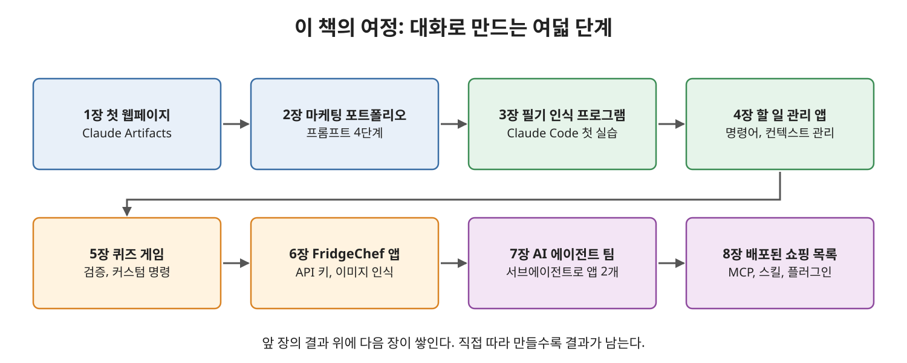

# 머리말과 이 책에 대하여

이 문서는 Taeho Jo가 쓴 'Build with Claude Code: From zero to deployed apps with AI-assisted development'(Packt, 영어판)의 추천사, 저자와 감수자 소개, 서문(Preface)을 정리한 것이다. 이 책이 누구를 위해 쓰였는지, 여덟 개 장이 어떤 순서로 이어지는지, 따라 하려면 무엇을 준비해야 하는지를 먼저 훑어 둔다. 책 전체의 지도를 손에 쥐고 본문으로 들어가는 용도다.

이 책은 바이브 코딩(Vibe Coding, 코드를 직접 한 줄씩 쓰는 대신 AI와 대화하며 프로그램을 만드는 방식)을 직접 해 보며 익히는 실습서다. 읽는 책이라기보다 옆에 펴 두고 따라 만드는 작업 안내서에 가깝다. 이 노트는 장마다 같은 형식으로 정리하며, 이 문서는 그 첫머리에 해당한다.

비유로 말하면 이 책은 요리책보다 요리 교실에 가깝다. 레시피를 읽는 데서 끝나지 않고, 한 장마다 접시 하나를 실제로 완성하게 한다.

---

## 1. 추천사: 읽지 말고 만들어라

추천사는 AI 전문가 Aemal Sayer가 썼다. 그는 유럽과 미국의 대기업에 AI 에이전트를 구축해 주는 회사 Avanai를 공동 창업했고, 경험 많은 엔지니어와 컨설턴트에게 이 도구들을 가르치는 일을 한다고 소개한다.

추천사의 첫 장면은 이렇다. AI 에이전트에게 이틀 치 일로 가늠한 작업을 맡겼더니, 티켓을 읽고 코드를 살피고 고치고 테스트까지 돌려서 설명하는 것을 커피 한 잔 마시는 사이에 끝냈다. 처음 반응은 흥분이 아니라 직업의 모양이 바뀌었다는 조용한 불편함이었다고 한다.

추천사가 짚는 핵심 주장은 세 가지다.

- 이제 격차는 코드를 짤 줄 아는 사람과 모르는 사람 사이에 있지 않다. AI 코딩 에이전트를 부릴 줄 아는 사람과 여전히 전부 손으로 치는 사람 사이에 있다.
- Claude Code는 자동 완성이나 조각 코드를 내놓는 채팅창이 아니다. 프로젝트를 읽고, 계획을 세우고, 도구를 쓰고, 스스로 결과를 점검하며 반복하는 협력자다. 그래서 소프트웨어 작업의 단위는 코드 한 줄이 아니라 분명하게 표현된 의도가 된다.
- 저자가 이 책의 적임자인 이유는 이력에 있다. Macromedia Korea에서 선임 소프트웨어 엔지니어로 일하다 생물정보학 연구자이자 교수가 되었고, 딥러닝 교재로 여러 대학의 표준 교과서를 만든 교육자다. 기술을 존중하는 엔지니어와 기술의 목적을 묻는 과학자의 시선이 함께 있다는 평가다.

독서 조언은 한 문장이다. "읽지 말고 해 보라." Claude Code를 한 창에 열고 책을 다른 창에 두고, 아무리 작아도 진짜 무언가를 만들며 따라가라는 것이다. 이 도구는 이론보다 연습에 보답하며, 찾고 있는 자신감은 손으로 해 본 첫 스무 시간 너머에 있다고 말한다. 퍼스널 컴퓨터 이후 소프트웨어를 만드는 사람의 범위가 가장 크게 넓어지는 시기이고, 이 책은 그 큰 문으로 들어가는 초대장이라는 말로 끝난다.

## 2. 저자와 감수자

| 구분 | 내용 |
|---|---|
| 저자 Taeho Jo | 인디애나대학교 의과대학 조교수. 딥러닝을 알츠하이머병 연구에 적용한다(유전 변이 발굴, 뇌 영상과 바이오마커 분석). SWAT, Deep-Block, TrUE-Net, DuAL-Net 등을 만들었다. 전산생물학 박사. |
| 저자의 오픈소스 | AlphaGenome MCP. 유전체 모델 AlphaGenome을 Claude Code와 Claude Desktop에 연결해 과학자가 평범한 말로 복잡한 분석을 돌리게 하는 도구다. |
| 저자의 경력과 저서 | 학계에 들어가기 전 Macromedia Korea(현재 Adobe 소속)에서 소프트웨어 엔지니어로 일했다. 『모두를 위한 딥러닝』은 한국에서 오랫동안 베스트셀러이자 대학 교재였고, Claude Code 안내서는 국내 서점 IT 분야 1위에 올랐다. 이 책은 그 한국어 책의 영어판이다. |
| 기술 감수자 Hari Prasad Renganathan | 에이전틱 AI, RAG 시스템, AI 플랫폼 아키텍처 전문 시니어 AI 엔지니어이자 두 번 창업한 사람. 컬럼비아대학교 졸업. 금융, 게임, 영업 분야에 실서비스 AI를 구축했고 900명 이상의 예비 엔지니어를 멘토링한다. TEDx 연사. |

저자는 감사의 글에서 가족, 희귀 변이 연구를 제안해 AlphaGenome MCP와 이 책의 계기를 만든 Andrew J. Saykin 박사, 영어권 독자를 위한 방향을 잡아 준 Packt 팀, 한국어판을 만든 한빛미디어 팀에게 고마움을 전한다.

참고(노트 작성자): 감사의 글의 인명은 이 노트에서 따로 정리하지 않고 위와 같이 줄였다. 그리고 책의 AI 사용 고지에 따르면, 이 책은 한국어로 먼저 쓰였고 영어판은 Claude와 DeepL을 번역, 어휘 점검, 교정, 이미지 화질 개선에 보조로 썼으며 모든 내용은 저자와 감수자와 편집진이 검토했다.

## 3. 책의 목적과 대상 독자

서문(Preface)은 이렇게 시작한다. 얼마 전까지 소프트웨어를 만든다는 것은 먼저 코딩을 배운다는 뜻이었다. 만들고 싶은 그림이 선명해도 프로그래밍 언어를 못 하면 문 앞에서 막혔다. AI의 도움으로 이것이 바뀌었다. Claude Code에서는 대화 자체가 인터페이스가 되고, 원하는 것을 말로 설명하는 일이 곧 만들기의 첫걸음이다.

이 책의 목표는 독자를 전통적인 프로그래머로 만드는 것이 아니다. 아이디어를 동작하는 소프트웨어로 바꿀 수 있는 사람, 즉 AI를 단순한 조수가 아니라 진짜 개발 파트너로 쓰는 사람이 되게 하는 것이다.

서문은 단순한 요령을 넘어 반복할 수 있는 결과를 낳는 능력을 배운다고 밝힌다. 운 좋은 결과와 되풀이 가능한 결과를 가르는 것들이다.

- 원하는 것을 정확히 얻는 프롬프트(Prompt, AI에게 하는 요청이나 지시)를 쓰는 법
- AI가 만든 내용을 검증하는 법
- CLAUDE.md와 커스텀 명령(Custom Command, 자주 하는 작업을 이름 붙여 저장해 둔 나만의 명령)으로 프로젝트를 관리하는 법
- MCP 서버, 에이전트 스킬, 플러그인으로 Claude Code를 확장하는 법

대상 독자는 초보자부터 숙련자까지다. 제품 관리자, 마케터, 연구자, 교육자, 창업가, AI 지원 개발에 관심 있는 모든 사람에게 좋고, 경력 초기의 소프트웨어 엔지니어에게도 가치가 있다고 한다. 애플리케이션을 만들고 싶었지만 코딩 실력에 막혀 있던 사람을 위한 실용적이고 접근하기 쉬운 길이라는 설명이다.

## 4. 책의 구성

서문의 'What this book covers'를 바탕으로 장별 결과물을 표로 정리한다. 장 제목은 이 노트에서 쓰는 한국어 이름이다.

| 장 | 한국어 제목 | 만드는 것과 배우는 것 |
|---|---|---|
| 1 | 나의 첫 바이브 코딩 | AI 코딩 도구의 유형과 AI의 발전사를 보고, Claude 아티팩트로 첫 웹페이지를 만든다 |
| 2 | 효과적인 프롬프트로 AI의 잠재력 끌어내기 | 5W1H와 구조화 템플릿으로 제품 기획서를 쓰고, 4단계 전략으로 마케팅 포트폴리오를 완성한다 |
| 3 | Claude Code 시작하기 | Windows, macOS, Linux에 설치하고 초기 설정을 하며, MNIST 필기 인식 프로그램을 만든 뒤 CLAUDE.md와 계층 구조로 웹 버전으로 키운다 |
| 4 | Claude Code 실전 활용 | 웹의 Claude와 터미널의 Claude Code를 함께 써서 할 일 관리 앱을 만든다. 핵심 명령, 자동 승인 모드, 컨텍스트 윈도우 관리, 스크린샷으로 UI 개선, 파일 참조를 익힌다 |
| 5 | 게임 제작으로 배우는 체계적 개발과 관리 | 퀴즈 게임으로 AI 생성 내용을 검증하고 환각을 막는 법을 배운다. 커스텀 명령을 만들어 연결하고 저장과 랭킹 기능을 더한다 |
| 6 | API로 Claude Code에 날개 달기 | API가 무엇인지, OpenRouter 같은 통합 플랫폼과 직접 연결 중 무엇을 고를지 배운다. API 키를 안전하게 관리하며 이미지 인식과 글 생성을 합친 FridgeChef 앱을 만든다 |
| 7 | Claude Code AI 에이전트로 개발 팀 꾸리기 | 코드 리뷰어, 최적화 담당, UX 디자이너 같은 서브에이전트(Sub-agent, 맡은 역할과 모델과 권한을 따로 가진 보조 AI)를 만들고, 제품 관리자, 백엔드와 프론트엔드 개발자, QA, AI 통합 전문가로 이뤄진 팀으로 앱 두 개를 만든다 |
| 8 | MCP, 스킬, 플러그인으로 Claude Code 확장하기 | Notion, Sequential Thinking, Playwright, GitHub의 MCP 서버를 연결하고 스킬과 플러그인 마켓플레이스를 쓴다. Vercel로 배포하고 Supabase 데이터베이스를 연결해 누구나 쓰는 서비스를 만든다 |

부록 성격으로 각 장의 복습 문제가 장 끝에 있고, 정답은 책 뒤쪽에 모여 있다. 이 노트에서는 장 문서에 문제를 싣고 정답은 09장에 모았다.

## 5. 읽는 순서

서문은 책 순서가 곧 난이도 순서라고 본다. 초반 장에서는 코딩 경험이 있는 독자가 더 빨리 지나가면 된다.

- 처음 접하는 독자: 1장부터 차례로 읽는다. 1장과 2장은 웹의 Claude만 쓰므로 설치 부담이 없다.
- 이미 AI 챗봇을 쓰는 독자: 1장은 훑고 2장의 4단계 전략을 본 뒤 3장 설치로 간다.
- Claude Code를 써 본 독자: 4장 이후에서 필요한 주제를 골라 읽는다. 5장은 검증과 커스텀 명령, 7장은 서브에이전트, 8장은 MCP와 배포다.
- 각 장을 마치면 장 끝의 복습 문제로 개념을 확인한다.

## 6. 실습 준비물

서문이 밝힌 준비물을 정리하면 다음과 같다.

- 프로그래밍 경험은 필요 없다. 3장의 파이썬 프로그램처럼 특정 언어가 필요한 곳에서는 Claude Code가 코드를 쓰고 실행해 준다.
- Windows, macOS, Linux 중 하나가 깔린 컴퓨터와 안정적인 인터넷 연결이 필요하다. Git과 Claude Code 설치는 3장에서, 로컬 MCP 서버용 Node.js는 8장에서 안내한다.
- 2장부터는 Claude 유료 구독이 필요하다. 최소 Pro 요금제이고, 3장부터는 토큰 사용량이 많아져서 Max 요금제를 고려할 만하다고 한다(요금은 책이 쓰인 시점 기준이며 1장에서 비교한다).
- 뒤쪽 장에서 OpenRouter, Notion, GitHub, Vercel, Supabase의 무료 계정을 쓴다. 각 계정은 해당 장에서 단계별로 만들며, 이 책의 모든 내용은 무료 한도로 충분하다고 한다.
- 예제 코드 묶음은 첫 웹페이지부터 필기 인식, 할 일 앱, 퀴즈 게임, FridgeChef, 에이전트가 만든 앱, 배포된 쇼핑 목록 서비스까지 모든 프로젝트를 담고 있다. 공식 GitHub 저장소 PacktPublishing/Build-with-Claude-Code와 Packt 홈페이지에서 받는다. 개인 학습과 비상업 프로젝트에서는 자유롭게 고쳐 써도 된다.
- 책을 사면 색이 있는 DRM 없는 PDF와 몇 가지 무료 혜택을 받는다. 구입처에 따라 packtpub.com/unlock에서 구매 증빙을 올려 풀며, 직접 구매자는 송장이 필요 없다.

## 7. 이 책 읽는 법

서문의 마지막 조언은 책 옆에서 같이 만들라는 것이다. 프롬프트를 직접 입력하고 명령을 실행하고 이것저것 시도해 보라고 한다. 화면의 결과와 내 결과가 다르더라도 실수가 아니다. AI와 일하는 일의 일부라는 설명이다.

표기 관례도 알아 두면 읽기 편하다. 코드, 파일명, 경로, 사용자 입력은 코드 글꼴로 적는다. 프롬프트나 코드 블록은 따로 구분해 보인다. 새 용어와 화면의 메뉴 이름은 굵게 적고, 주의사항은 Note, 요령은 Tip 상자로 보인다. 이 노트는 책의 스크린샷을 싣지 않는 대신, 같은 내용을 글과 표와 그림으로 풀어 쓴다.

참고(노트 작성자): 원서의 서문에는 같은 문단이 한 번 겹쳐 인쇄되어 있다('배우게 될 것들' 문단). 의미는 같아 한 번만 정리했다. 또한 23쪽의 QR 코드와 26쪽의 혜택 안내 그림은 글로 옮길 내용이 없어 다루지 않았다.

 
 
 

[Build with Claude Code](../)
