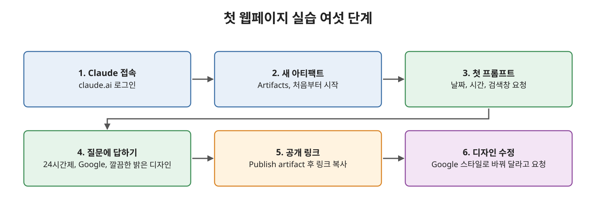

# Claude 아티팩트로 첫 웹페이지 만들기

이 문서는 1장의 실습 부분이다. 코드를 한 줄도 쓰지 않고 Claude 웹 화면에서 대화만으로 나만의 시작 페이지를 만들고, 공개 링크로 공유한 뒤, 디자인까지 바꿔 본다. 결과물은 매일 아침 컴퓨터를 켜면 보고 싶은 정보를 한눈에 보여 주는 개인 시작 페이지다.

비유하면 인테리어 업체에 방을 맡기는 일과 비슷하다. 도면을 그릴 줄 몰라도 "밝고 깔끔하게, 책상은 창가에"라고 말하면 시안이 나오고, 마음에 안 들면 다시 말해서 고친다.

---

## 1. 시작하기 전에: 웹페이지는 세 재료로 만든다

웹페이지는 HTML, CSS, JavaScript 세 가지가 합쳐져 만들어진다. HTML은 뼈대를 만들고, CSS는 색과 배치를 다듬고, JavaScript는 기능과 상호작용을 더한다. 예전에는 개발자가 이 코드를 전부 직접 썼다. 바이브 코딩에서는 원하는 기능과 디자인을 AI에게 자세히 설명하면 세 재료를 알아서 합쳐 완전하게 동작하는 페이지를 만들어 준다.

책이 처음 제안하는 프로젝트는 날씨, 뉴스, 시계, 검색 기능이 들어간 개인 시작 페이지다. 이 절의 실습에서는 오늘의 날짜와 시간, 그리고 검색창이 있는 홈페이지로 줄여서 만든다. 지나치게 복잡하게 하지 말고 편한 자연어로 요청하라는 것이 책의 방침이다.



## 2. Claude에 접속하고 새 아티팩트 열기

먼저 웹 브라우저에서 Claude 공식 사이트(claude.ai)에 들어가 로그인한다. 처음이면 화면의 안내대로 계정을 만든다. 계정 관리가 편하도록 Google 계정으로 계속하기를 권하며, 데스크톱 앱 설치를 묻는다면 건너뛰기를 누른다. 이번에는 웹에서 해 보기 때문이다. 로그인하면 왼쪽 사이드바의 새 채팅(+) 아이콘으로 채팅 화면에 들어간다.

아티팩트(Artifact)는 대화창과 분리된 패널이다. 글만 주고받는 데서 벗어나 실제로 동작하는 결과를 바로 볼 수 있다. 보고서, 차트, 간단한 웹페이지처럼 아이디어를 빠르게 검증하는 데 특히 쓸모 있다. 수정할 때마다 이전 버전이 저장되므로 망설이지 않고 실험할 수 있고, 그러면서 프롬프트를 한 단계씩 다듬는 법도 자연스럽게 익힌다.

새 아티팩트를 여는 순서는 다음과 같다.

- 왼쪽 사이드바에서 Artifacts 아이콘을 누른다.
- Artifacts 페이지의 New artifact 버튼을 누른다.
- 아티팩트 분류에서 Start from scratch(처음부터 시작)를 고른다.
- Claude가 어떤 앱이나 웹사이트를 만들지 묻는 화면이 나오면 이제 첫 프롬프트를 줄 준비가 된 것이다.

참고(노트 작성자): 메뉴 이름과 화면 구성은 책이 쓰인 시점 기준이며, Claude 화면은 자주 바뀐다. 달라진 항목은 비슷한 이름의 메뉴로 찾으면 된다.

## 3. 첫 프롬프트로 페이지 만들기

바이브 코딩의 핵심은 프로그래밍 용어 없이 자연어로 AI에게 코딩을 시키는 것이다. AI에게 하는 요청이나 지시를 프롬프트라고 한다. 바이브 코딩에서 프롬프트는 단순한 명령이 아니라 결과의 방향과 품질을 정하는 핵심 자원이다. 구체적이고 상황에 맞을수록 의도에 맞는 코드와 아이디어가 나오고, 모호하면 수정과 재작업이 늘어 효율이 떨어진다.

채팅창에 다음 문장을 입력하고 Enter를 누른다.

```text
I want to create my own personal start homepage with today's date and
time and a search bar.
```

우리말로는 "오늘 날짜와 시간, 검색창이 있는 나만의 시작 홈페이지를 만들고 싶다"는 뜻이다. 책은 영어 프롬프트를 쓰지만 한국어로 입력해도 같은 방식으로 동작한다. 참고(노트 작성자): 이 문장은 책의 화면 예시를 그대로 옮긴 것이다.

Claude는 곧바로 만들지 않고 몇 가지를 먼저 묻는다. 질문은 입력한 프롬프트에 따라 달라지므로 취향에 맞는 선택지를 고르면 된다. 책에서는 이렇게 답했다.

| 질문 | 책에서 고른 답 |
|---|---|
| 시계 표기 방식 | 24시간제 |
| 검색 엔진 | Google |
| 디자인 스타일 | Minimal and clean (light), 곧 깔끔하고 밝은 스타일 |

답을 마치면 잠시 뒤 요청한 기능이 들어간 홈페이지가 만들어진다. 왼쪽에는 Claude가 구현한 기능의 요약이, 오른쪽에는 실제로 동작하는 화면이 보인다.

## 4. 공개하고 동작 확인하기

만든 사이트를 다른 사람과 나누거나 공개 링크로 열고 싶으면 다음 순서를 따른다.

- 오른쪽 위 Copy 버튼 옆 메뉴를 열고 Publish artifact를 고른다.
- 나타나는 Publish artifact 창에서 Publish and copy link 버튼을 눌러 공유 링크를 복사한다.
- 복사한 링크를 새 브라우저 탭에 붙여 넣어 공개된 사이트를 연다.
- 검색창에 Today's Stock News 같은 말을 입력하고 Enter를 눌러 검색이 실제로 되는지 확인한다.

결과는 새 브라우저 탭에서 열리고, Google 검색 결과 페이지에 입력한 말에 관한 결과가 나온다. 책은 한 가지 함정을 알려 준다. 공개된 페이지에서는 외부 링크가 막혀 아무 일도 일어나지 않을 수 있다. 그럴 때는 채팅의 Download로 HTML 파일을 저장해 브라우저에서 열고 거기서 검색해 보면 된다.

## 5. 커스터마이징: 내 손으로 고치기

바이브 코딩의 핵심은 편집과 맞춤이다. 첫 결과가 완벽하지 않아도 원하는 방향으로 한 단계씩 다듬어 나가는 것이 중요하다. Claude가 만든 페이지도 디자인이 무작위로 정해졌기 때문에 취향과 안 맞을 수 있다. 이번에도 스크립트를 직접 고칠 필요는 없다.

아티팩트를 만든 Claude 채팅으로 돌아가 디자인을 바꿔 달라고 요청한다.

```text
Please modify this design to match the Google style.
```

Claude는 요청을 이해하고 디자인을 바꾸는 CSS와 HTML 코드를 새로 만든다. 잠시 기다리면 페이지가 Google 홈페이지와 비슷한 모습으로 바뀐다. 이 맞춤 기능으로 아티팩트의 디자인을 바꾸거나 새 기능을 더할 수 있다.

여기까지가 첫 바이브 코딩이다. 짧은 시간에 코드를 한 줄도 쓰지 않고 날짜, 시간, 검색 기능이 있는 개인 페이지를 대화만으로 만들었고, 그것도 실제로 동작하는 웹페이지다. 이것이 바이브 코딩의 힘이라고 저자는 말한다.

## 6. 프롬프트의 중요성: 2장으로 가는 다리

이 실습에서 눈치챘을 중요한 사실이 있다. "날짜와 검색 기능이 있는 홈페이지"처럼 구체적으로 요청하면 "웹사이트 하나 만들어 줘"처럼 막연한 요청보다 훨씬 만족스러운 결과가 나온다. AI에게는 의도를 정확히 이해할 구체적인 지시가 필요하다. 다음 장에서 프롬프트를 잘 쓰는 전략적 의사소통법을 배워 AI의 잠재력을 끌어낸다.

<br>
<br>
<br>

[Build with Claude Code](../)
