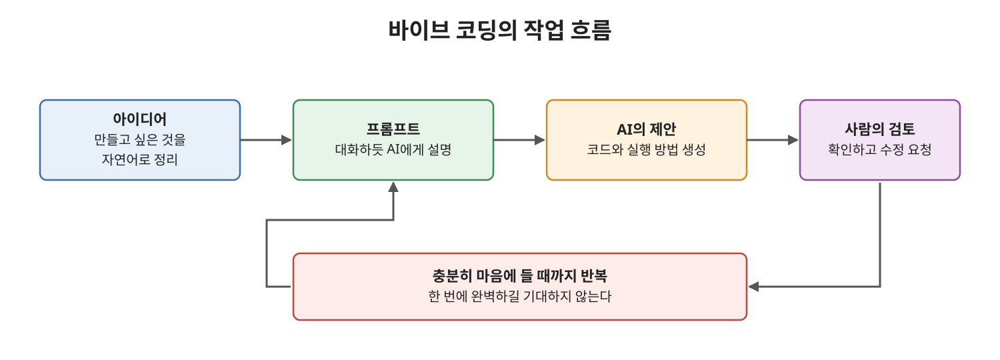
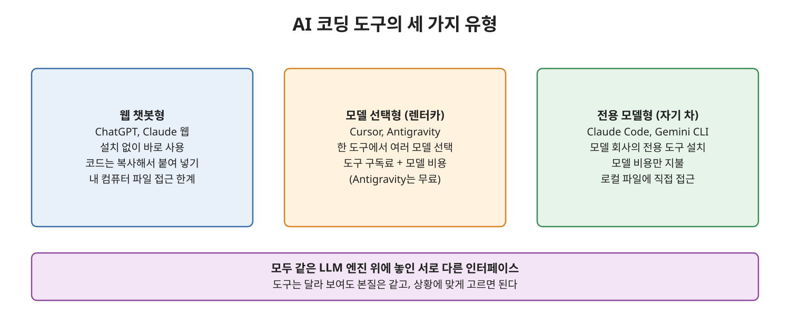

# 바이브 코딩과 AI 코딩 도구

1장의 앞부분은 바이브 코딩이 무엇이고, 어떤 도구로 할 수 있는지를 지도처럼 펼쳐 보여 준다. 저자는 프로그래머라는 말에서 떠오르는 이미지부터 바꾸자고 한다. 화면을 노려보며 혼자 문제와 싸우는 사람이 아니라, 아이디어를 함께 궁리하고 질문에 답하고 옆에서 같이 코드를 쓰는 AI 파트너를 둔 사람이다.

비유 하나로 요약하면 이렇다. 예전의 프로그래밍이 악보를 한 음씩 직접 연주하는 일이었다면, 바이브 코딩은 연주자에게 곡의 분위기를 말로 설명하고 연주를 들으며 고쳐 가는 일이다.

---

## 1. 바이브 코딩이란

LLM(Large Language Model, 대규모 언어 모델)이 코딩에 쓸모 있는 이유는 자연어뿐 아니라 방대한 프로그래밍 코드와 기술 문서까지 학습했기 때문이다. 그래서 프로그래밍 언어의 문법과 패턴을 알아보고, 사람의 말로 된 지시에 맞춰 코드를 만들어 낸다. 이 가능성을 알아본 개발자들이 실제 코딩에 쓰기 시작했고, 이것이 새로운 개발 방식의 출발이 되었다.

바이브 코딩은 사람이 코드를 한 줄씩 쓰던 전통 방식을 넘어, AI와 대화하며 프로그램을 구현하는 방식이다. 이 말은 OpenAI 공동 창업자 Andrej Karpathy가 2025년 2월에 만들었다고 책은 소개한다. 과정은 다음 순서다.

- 사람이 아이디어를 자연어로 설명한다.
- AI가 이를 해석해 코드와 실행 방법을 제안한다.
- 사람이 제안을 검토하고 고치며 품질을 조금씩 끌어올린다.

핵심은 소프트웨어 개발의 문턱이 낮아진다는 점이다. 개발 기술을 전문가 수준까지 익히는 데 몇 해를 들일 필요 없이, 아이디어만 있으면 AI와의 대화로 프로그램을 완성할 수 있다. 코드를 쓰는 일 자체에 좌절했던 초보자에게는 새 기회가 되고, 숙련 개발자에게는 생산성을 크게 높이는 길이 된다.

원서는 ChatGPT와 Claude에게 똑같이 달력 웹 앱을 만들어 달라고 한 장면을 예로 든다. 둘 다 잠깐 생각한 뒤 곧바로 웹 앱 스크립트를 만들었고, 미리보기 창에서 달력 페이지가 실제로 동작했다. Claude는 이 결과를 아티팩트(Artifact, 대화창 옆에 따로 열리는 결과물 패널)에 띄웠다.

다만 웹 채팅으로 코딩하면 한계가 있었다. 채팅창에 나온 코드를 직접 복사해 개발 환경에 붙여 넣어야 했고, 웹 기반 서비스의 특성상 내 컴퓨터의 파일에 접근하거나 프로젝트 전체를 아우르며 관리하기가 어려웠다.

## 2. AI 통합 도구의 두 유형

이 한계를 풀려고 AI를 개발자의 실제 작업 환경에 직접 끼워 넣은 도구들이 나왔다. 코드를 만드는 데 그치지 않고 개발 전 과정에서 AI의 도움을 받게 하는 도구다. 책은 이를 두 가지로 나눈다. 자동차에 비유한 설명이 이해하기 쉽다.

첫째는 모델 선택형이다. 렌터카처럼 같은 개발 도구 안에서 여러 LLM 중 하나를 골라 쓴다. 코드 편집기와 AI가 하나로 합쳐져 있어서 복사와 붙여 넣기 없이 화면 안에서 코드를 쓰고 고친다. 대표 도구는 Cursor와 Antigravity다. 장점은 필요에 맞는 모델을 고를 수 있다는 것이다. 단점은 렌터카에 기름값과 대여료가 드는 것처럼, 모델 사용료 외에 도구 구독료가 더 들 수 있다는 점이다. Cursor가 그렇고, Antigravity는 무료로 제공된다. 그래서 도구마다 요금 정책을 미리 확인해야 한다.

둘째는 전용 모델형이다. 특정 AI 언어 모델 전용 소프트웨어를 내 컴퓨터에 직접 설치하며, 자기 차를 갖는 것과 비슷하다. 대표 예가 Claude 기반의 Claude Code와 Google의 Gemini CLI다. 모델 개발사가 내놓은 전용 소프트웨어를 쓰므로 모델 비용만 내면 되고, 로컬 파일에 직접 접근해 프로젝트 전체를 관리하기 좋다.

전용 모델형은 대개 CLI(Command Line Interface, 명령 줄 인터페이스)로 동작한다. 터미널에 글자로 명령을 입력하는 방식이다. 처음에는 낯설어도 책을 따라 한 단계씩 배우면 생각보다 어렵지 않고, 마우스 클릭보다 더 빠르고 정확하게 일하게 된다고 한다.

원서가 따로 상자로 풀어 둔 GUI와 CLI의 차이도 짚어 둔다.

| 구분 | 설명 | 예 |
|---|---|---|
| GUI(그래픽 사용자 인터페이스) | 아이콘, 버튼, 창을 마우스로 눌러 조작하는 일반적인 방식 | 바탕화면의 폴더 아이콘을 눌러 연다 |
| CLI(명령 줄 인터페이스) | 명령 프롬프트 같은 창에 글자 명령을 입력해 조작하는 방식 | `mkdir temp`는 temp라는 새 폴더를 만든다 |

CLI는 처음에는 어려워 보이지만 빠르고 가벼워서, 서버를 관리하거나 반복 작업을 자동화하는 전문가에게는 GUI보다 훨씬 효율적이다.

## 3. 도구는 달라도 본질은 같다

저자는 바이브 코딩 도구가 계속 진화하지만 겉모습이 달라도 본질은 같다고 강조한다. 모두 강력한 LLM 엔진 위에 만든 서로 다른 인터페이스일 뿐이다. 그러니 내 필요와 상황에 맞는 도구를 고르면 된다.

모델 성능은 계속 좋아지므로 기본적인 코딩은 어느 모델을 써도 비슷한 결과를 기대할 수 있다. 다만 작업이 어려워질수록 맥락 이해와 시스템 통합이 더 중요해진다. 이 책은 Claude를 AI의 기반으로, Claude Code를 그 능력을 명령 줄 코딩 흐름으로 가져오는 도구로 쓴다.

책은 상자 글로 시장 수치도 하나 소개한다. Menlo Ventures의 2025년 중반 LLM 시장 업데이트에 따르면 AI 코드 생성 시장에서 Claude의 점유율은 42퍼센트, OpenAI는 21퍼센트로, Claude가 다른 도구의 두 배가 넘는다(책이 인용한 2025년 중반 수치이며 이후 달라졌을 수 있다).

## 4. 깊이 보기: AI의 탄생과 진화

1장은 AI 비서가 어디서 왔는지 짧게 훑는 심화 절을 둔다. 핵심 흐름은 이렇다.

- 1940년대에 신경망(Neural Network) 관련 초기 연구로 AI의 역사가 시작되었다. 기계가 주어진 데이터에서 패턴을 찾아 예측하게 하려는 시도가 이어졌고, 2010년 무렵 이 분야가 딥러닝(Deep Learning)이라는 이름으로 널리 알려졌다.
- 초기 딥러닝 모델 중 이미지 처리와 생성, 순차 데이터 처리에 쓰인 것들이 있었다. 아래 표로 정리한다.
- 이후 트랜스포머(Transformer)가 어텐션(Attention, 입력의 어느 부분에 집중할지 정하는 방식) 메커니즘으로 RNN의 한계를 넘었고, ChatGPT와 Claude 같은 대규모 언어 모델의 기반 기술이 되었다.
- 2017년 Google 연구팀이 트랜스포머를 발표한 것이 언어 모델의 돌파구가 된 전환점이다.

| 모델 | 한 줄 설명 | 주로 쓰이는 곳 |
|---|---|---|
| CNN(합성곱 신경망) | 필터를 겹겹이 쌓은 구조로 이미지의 특징을 스스로 학습 | 이미지 분류와 인식 |
| GAN(생성적 적대 신경망) | 생성기와 판별기가 서로 겨루며 성능을 높임 | 새로운 데이터 생성 |
| AE(오토인코더) | 인코더와 디코더로 이뤄진 자기 지도 신경망으로 데이터의 핵심 표현을 뽑아 복원 | 핵심 표현 추출과 재구성 |
| RNN(순환 신경망) | 순서가 있는 데이터의 패턴을 학습하도록 설계 | 텍스트, 시계열 데이터 |

회사 이야기도 이어진다. OpenAI는 트랜스포머 기반 인프라에 대규모로 투자하면 성능이 오른다고 보고 GPT 시리즈를 냈고, 3.5 버전에서 ChatGPT라는 이름으로 상용화에 성공했다. 이후 2021년 OpenAI 출신 연구자들이 AI 안전에 초점을 두고 세운 Anthropic이 Claude를 개발했고, 지금은 코딩 분야에서 가장 인기 있는 AI 도구로 자리 잡았다고 책은 말한다. 뒤늦게 Google이 Gemini를 내놓았고, xAI는 Grok 같은 모델을 잇달아 공개하며 AI 붐을 이끌고 있다.

이 절에서 챙길 것은 연대표 그 자체보다 하나의 줄기다. 신경망에서 딥러닝, 트랜스포머, LLM으로 이어졌다는 순서다. 1장 복습 문제에서도 이 순서를 묻는다.

## 5. 이 절의 마무리와 다음 단계

원서는 이 절을 세 가지 핵심 낱말로 닫는다.

- 바이브 코딩은 AI와 자연스럽게 대화하며 코드를 만드는 새로운 개발 방식이다.
- 모델 선택형 도구는 여러 언어 모델 중에서 고를 수 있다는 장점이 있다.
- 전용 모델형 도구는 특정 모델이나 모델군과 더 깊이 통합되도록 설계되었다.

다음 절에서는 Claude 웹 화면으로 프로젝트를 직접 돌려 첫 바이브 코딩을 시작한다. 2장에서 구조화된 프롬프트 작성법을 배우고, 3장부터 Claude Code로 본격적인 바이브 코딩에 들어간다.

 
 
 

[Build with Claude Code](../)
