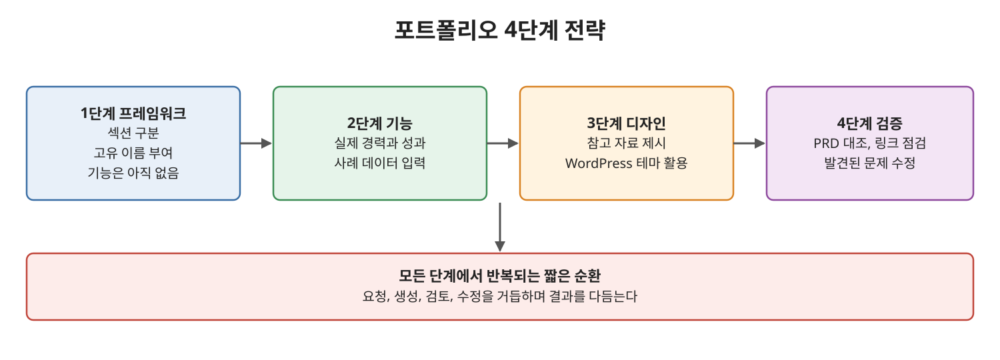

# 마케팅 포트폴리오 1단계 프레임워크와 2단계 기능

앞 절에서 AI와 함께 포트폴리오 PRD를 만들었다. 이제 그 기획서를 실제 웹페이지로 바꾼다. 이 문서는 4단계 전략의 앞쪽 절반, 곧 뼈대를 세우는 프레임워크 단계와 실제 내용을 채우는 기능 단계를 다룬다. 결과물은 섹션마다 이름이 붙은 포트폴리오 페이지에 실제 경력과 성과가 들어간 상태다.

비유하면 집짓기다. 먼저 방 구조를 나눈 뼈대를 세우고(프레임워크), 그다음 가구와 짐을 들인다(기능). 페인트와 인테리어는 그 뒤에 한다.

---

## 1. 왜 한 번에 만들지 않는가

HTML은 섹션(Section, 하나의 주제를 담는 영역)들로 이뤄진 문서로 볼 수 있다. 웹페이지 맨 위 소개, 성과를 요약한 목록, 아래쪽 연락 링크가 각각 별개의 섹션이다. HTML에서는 section 태그로 이를 나눈다. 이렇게 나누면 코드가 읽기 쉬워지고 특정 부분만 고치거나 따로 스타일을 입히기가 훨씬 쉬워진다.

PRD 전체를 AI에게 보여 주고 "이 기획서대로 웹페이지를 만들어 줘"라고 하는 것은 좋지 않다. 기획서가 자세할수록 요구사항이 많고, 그것을 한꺼번에 코드로 바꾸면 HTML, CSS, JavaScript가 복잡하게 뒤섞이기 쉽다. 그러면 코드 구조를 이해하기도, 요청한 기능이 모두 구현됐는지 확인하기도 어렵고 수정할 때 문제가 생긴다. 해결책은 PRD의 요구사항을 기능별로 나눠 단계적으로 구현하고, 단계마다 분명한 목표를 이뤄 확인하는 것이다.

Claude Code로 작업한다면 AI가 직접 단계를 나누게 할 수도 있다. 다음 프롬프트로 단계별 프롬프트를 준비한다.

```text
Convert the given PRD into a 5-step prompt for use with Claude Code.
```

책은 이 5단계가 Claude Code의 구현 흐름을 가리키며 이 장의 4단계 포트폴리오 전략과는 별개라고 주의를 준다. Claude Code는 3장부터 다룬다. 반면 웹의 Claude 채팅창에서 작업하거나 개발 목표와 우선순위가 분명한 프로젝트라면 AI에게 나누게 하기보다 내가 단계를 설계하는 편이 더 효과적일 수 있다고 한다.

## 2. 4단계 전략과 공통 순환

채용용 포트폴리오는 첫인상이 결정적이다. 그리고 마케팅이라는 직업의 특성상 시각적 인상과 정보의 분명한 전달을 모두 해내야 한다. 이 특성을 고려해 네 단계로 차근차근 만든다.

1. 프레임워크(Framework)
2. 기능(Features)
3. 디자인(Design)
4. 검증(Verification)

모든 단계에서 요청, 생성, 검토, 수정의 짧은 순환을 반복한다. 변경 위험을 줄이고 구조와 품질을 단계적으로 맞추기 위해서다. 필요하면 검토와 수정을 거듭한다.



AI와 일할 때는 처음부터 완벽한 결과를 기대하기보다 요청하고 생성하고 검토하고 수정하는 과정을 반복하는 편이 효과적이다. 먼저 원하는 일을 요청하면 AI가 결과를 만들고, 사람이 의도에 맞는지 살피고, 부족하거나 틀린 곳이 있으면 수정을 요청한다. 이 짧은 순환을 여러 번 거치면 웹페이지가 구상에 가까워진다.

## 3. 1단계 프레임워크: 뼈대와 섹션 이름

### 요청과 생성: 구조만 보여 달라고 하기

앞서 만든 PRD를 Claude에 불러온 뒤 웹페이지의 기본 구조를 만들게 한다. 핵심은 HTML 안의 요소를 주제별 섹션으로 묶고, 섹션마다 고유한 이름을 붙여 나중에 수정하기 쉽게 하는 것이다. PRD를 만든 같은 채팅에서 입력해도 되고, 새 채팅 창에 PRD를 올리고 링크를 공유해도 된다.

```text
I'm going to proceed according to this PRD. First, please write an HTML
document based on the PRD. Divide it into sections and assign a unique
name to each section to make future edits easier. Don't implement any
features yet; just show me the overall structure.
```

"아직 기능은 구현하지 말고 전체 구조만 보여 달라"는 말이 요점이다. 한 번에 다 만들지 않고 구조부터 확인하겠다는 뜻이다.

### 검토: 섹션 이름 확인

각 섹션에 붙은 고유 이름을 본다. 기능별로 정리되어 있어서 나중에 특정 요소를 찾아 고칠 수 있다. 이 포트폴리오에는 성과를 한눈에 보여 주는 proof-strip, 사례 연구를 담은 case-studies, 첫 화면인 hero 같은 이름이 붙었다.

### 수정: 특정 섹션만 고치기

섹션 이름이 있으면 한 부분만 정확히 짚어 고칠 수 있다. 책은 proof-strip 섹션의 성과 항목을 지난 3년의 실적을 자세히 보여 주는 목록으로 바꿔 달라고 요청한다.

```text
Please revise the [Result label] items in the 'proof-strip' section to
be a list that specifically details the performance over the past three years.
```

그러면 성과 지표가 연도별 목록으로 바뀐다. 이어서 프레임워크를 마무리하려고 대략적인 디자인을 입힌다. 세부 디자인은 3단계에서 요청하므로 지금은 거친 디자인만 적용한다.

```text
Apply a modern and sophisticated design to the HTML document.
```

여기서 책은 두 가지를 알려 준다. 첫째, Claude가 페이지를 HTML, CSS, JS 파일로 나눠 만들면 아티팩트 미리보기에 새 디자인이 안 보일 수 있다. 그때는 HTML, CSS, JavaScript를 하나의 HTML 파일로 합쳐 달라고 요청한다. 둘째, 이 장부터의 스크린샷은 유료 요금제에서 Pro의 기본 모델인 Sonnet 5로 찍었다(책이 쓰인 시점 기준). 많은 생성 요청을 하는 실습이라 무료 요금제의 사용 한도에 걸려 끊길 수 있기 때문이다.

그다음 페이지를 아래로 스크롤하며 다른 섹션도 검토한다. 이어서 생성된 웹페이지를 PRD와 비교해 빠졌거나 잘못된 섹션을 찾아 고친다. 책에서는 사례 연구의 결과 지표를 웹페이지 첫 화면으로 옮겨 차트로 보여 주게 했다.

```text
Move the [One-line result] metrics from the 'case-studies' section to
the 'hero' section and present them as a chart.
```

이렇게 해서 웹페이지의 뼈대인 HTML 문서를 만들고 간단한 디자인을 적용했다. 나머지 단계도 요청, 생성, 검증, 수정의 세부 과정을 반복하며 다듬는다.

## 4. 2단계 기능: 실제 내용 채우기

뼈대가 준비되었으니 실제 데이터를 채울 차례다. HTML 문서만으로는 빈 껍데기에 불과하다. 경력, 성과, 사례 같은 내용을 넣어야 포트폴리오로 기능한다.

핵심은 AI에게 막연히 "내용을 채워 줘"라고 하지 않고 구체적이고 사실에 근거한 정보를 주는 것이다. 그래야 결과가 나라는 사람을 정말 반영하는 의미 있는 웹페이지가 된다.

### 요청과 생성: 실제 포트폴리오 정보 주기

Claude 입력창에 실제 포트폴리오를 준다. 구체적일수록 내용이 의미 있어진다. 책에서 준 정보는 다음과 같다.

| 항목 | 내용 |
|---|---|
| 자기소개 | 3년 차 퍼포먼스와 콘텐츠 마케팅 전문가 |
| 핵심 성과 | ROAS 200퍼센트, 캠페인 25건, 연 매출 60만 달러 기여 |
| 3년간 직책 변화 | 주니어(2023), 퍼포먼스 마케터(2024), 매니저 겸 컨설턴트(2025) |
| 스킬 수준 | 퍼포먼스 마케팅 75퍼센트, 콘텐츠 마케팅 70퍼센트, 데이터 분석(GA4) 65퍼센트 |
| 사례 1 | 이커머스, 월 광고비 8천 달러, ROAS 200퍼센트 |
| 사례 2 | 스타트업, 인스타그램 팔로워 6개월간 2,000명에서 8,000명 |
| 사례 3 | 지역 브랜드, 블로그 방문자 4개월간 500명에서 3,000명 |

여기서 ROAS(Return On Ad Spend, 광고비 대비 매출)는 광고에 쓴 돈 대비 벌어들인 매출 비율을 말한다. 프롬프트는 이 정보를 영어로 풀어 "Here is my career portfolio. Please update it by section based on the following information."으로 시작하고 위 표의 내용을 이어 붙이는 식이다.

참고(노트 작성자): 위 수치는 책 예시용 가상의 포트폴리오 정보다. 본인의 실제 경력으로 바꿔 넣어야 의미가 있다.

### 검토: 내용이 제대로 들어갔는지 확인

내용이 올바르게 업데이트됐는지 본다. 내용이 들어간 최종 결과를 살펴보고 정보가 틀렸거나 마음에 안 들면 Claude에게 고쳐 달라고 한다. 책에서는 실제 데이터를 넣고 결과를 확인하는 데 집중하기 위해 별도의 수정 과정은 건너뛴다.

다음 3단계에서 이 포트폴리오에 디자인을 입힌다.

<br>
<br>
<br>

[Build with Claude Code](../)
