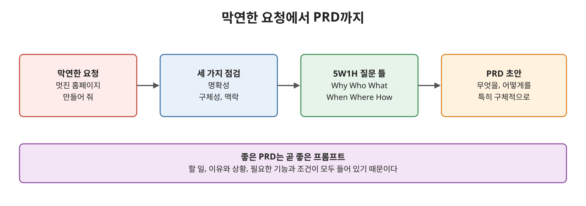

# 좋은 프롬프트의 조건과 5W1H 기획서

2장 첫 절은 같은 AI라도 프롬프트에 따라 결과가 크게 달라진다는 사실에서 출발한다. 잘 쓴 프롬프트 하나가 결과를 낫게 하고, 개발 시간을 줄이고, 수십 번의 수정을 없애 준다. 이 문서는 좋은 프롬프트의 세 조건, 막연한 요청이 왜 실패하는지, 5W1H로 제품 기획서(PRD)를 AI와 함께 쓰는 방법을 정리한다.

비유는 책이 직접 든 내비게이션이다. "어딘가 멋진 곳으로 데려가 줘"라고 하면 정확한 길을 못 얻지만, "타임스스퀘어에서 센트럴파크까지 가장 빠른 길"이라고 넣으면 가장 효율적인 경로가 나온다. 프롬프트는 목적지 입력이다.

---

## 1. 프롬프트가 중요한 이유

AI는 방대한 언어 데이터를 학습한 거대한 지식 저장소다. 그런데 이 지식과 소통하는 통로는 작은 프롬프트 창 하나뿐이다. 그러니 언어라는 제약 안에서 AI의 잠재력을 최대로 끌어내려면 분명하고 구체적인 프롬프트가 필수다. 잠자는 거인을 깨우는 첫 번째 주문이 잘 만든 프롬프트라는 것이 저자의 표현이다. 결과의 질은 프롬프트의 질에 달려 있다고 해도 과장이 아니다.

## 2. 좋은 프롬프트의 세 조건

좋은 프롬프트는 길거나 화려한 설명이 아니라 다음 세 기준을 만족하는 것이다.

| 조건 | 뜻 |
|---|---|
| 명확성(Clarity) | 모호한 말을 피하고 원하는 결과를 분명히 전한다 |
| 구체성(Specificity) | 결과물에 필요한 기능이나 조건을 자세히 밝힌다 |
| 맥락(Context) | 왜 필요하고 어떤 상황에서 쓰일지 설명해 AI가 더 정확히 답하게 한다 |

세 요소가 갖춰지면 AI는 훨씬 질 높은 결과를 낸다.



## 3. 모호한 프롬프트의 한계

책은 "나를 위한 멋진 개인 홈페이지를 만들어 줘" 같은 프롬프트를 나쁜 예로 든다. "멋진"이 너무 모호하기 때문이다. 세련된 디자인인지, 강력한 기능인지, 둘 다인지 알 수 없다. 이런 요청을 받으면 AI는 수백 가지 가능성 중 무엇을 고를지 몰라 스타일과 기능을 임의로 정해 버리고, 결과가 사용자의 기대와 다를 가능성이 높다.

1장에서 쓴 프롬프트(오늘 날짜와 시간, 검색창이 있는 시작 홈페이지)는 그보다는 낫다. 필요한 기능을 밝혔기 때문이다. 하지만 디자인, 검색 엔진, 다른 필요한 기능이 빠져 있다.

많은 사람이 프롬프트를 쓸 때 "더 구체적으로 쓰고 싶은데 무엇을 어떻게 물어야 할지 막막하다"고 느낀다. 정답이 하나가 아니라서 더 어렵다. 1장에서 우리는 이 문제를 이미 풀었다. 프롬프트에 구체성이 부족하니 Claude가 필요한 정보를 먼저 묻고 빈칸을 채우게 한 것이다. 질문에 답하며 "밝은 모드", "Google 검색" 같은 조건이 하나씩 정해졌다. 선택을 하나의 프롬프트로 합치면 이렇게 된다.

```text
I want to create my own homepage with a clean, light-mode design that
includes today's date and time, and a Google search bar.
```

하지만 앞으로 만들 앱은 개인 웹페이지보다 훨씬 복잡하고 다양하다. 매번 Claude가 친절히 선택지를 줄 것이라고 기대할 수 없다. 그래서 필요한 조건을 미리 정리해 처음부터 분명하게 전하는 일이 중요하다. 이제 질문은 "AI와 함께 더 나은 프롬프트를 어떻게 만들까"로 옮겨 간다. 명확성, 구체성, 맥락이 없는 채로 대화를 시작하면 다듬어지지 않은 프롬프트로 개발이 시작되고, 수정 단계에서도 큰 어려움이 따른다.

## 4. 제품 기획서(PRD)를 프롬프트로 쓰기

연구자는 연구에 앞서 연구 계획서를 쓰고, 건축가는 착공 전에 설계도를 그리고, 영화인은 촬영 전에 시나리오를 준비한다. 소프트웨어 팀도 코딩 전에 PRD(Product Requirements Document, 제품 요구사항 문서)를 쓴다.

바이브 코딩에서는 이 기획서가 매우 효과적인 프롬프트가 된다. 좋은 프롬프트는 할 일을 분명히 하고, 맥락을 주고, 구체적 요구를 담는다. 기획서는 무엇을 만들고, 왜 필요하고, 어떻게 동작해야 하는지를 체계적으로 정리한 문서이므로 목적이 근본적으로 같다. 책의 요약 상자도 이렇게 짝지어 놓았다.

| | PRD | 좋은 프롬프트 |
|---|---|---|
| 하는 일 | 무엇을 만들지 분명히 정의 | 해야 할 일을 구체적으로 지시 |
| 이유와 배경 | 프로젝트의 목적과 배경 제시 | 왜 필요한지 맥락 설명 |
| 구체 내용 | 요구사항과 구현 방법 명시 | 필요한 기능과 조건 상세화 |

## 5. 기획의 뼈대 5W1H

좋은 기획서의 내용은 분야마다 다르지만 공통 요소는 있다. 육하원칙, 곧 5W1H의 여섯 질문이다.

- Why: 왜 만드는가
- Who: 누구를 위한 것인가
- What: 무엇을 만들 것인가
- When: 언제 쓰이는가
- Where: 어디서 쓰이는가
- How: 어떻게 만들 것인가

Why는 목적을, Who는 대상 사용자를, What은 기능을 정한다. When과 Where는 사용 맥락을, How는 구현 방식을 정한다. 프롬프트를 만드는 첫걸음이 이 여섯 질문이다. 각 요소를 채우며 AI와 대화하면 막연한 아이디어가 구체적 기획서가 되고, 이것이 다시 분명한 프롬프트가 된다. 우리가 다루는 것은 프로그램, 웹페이지, 앱 같은 소프트웨어이므로 기능과 요구사항을 밝히는 PRD 구조를 따르는 것이 알맞다. 그러면 5W1H 중에서도 What과 How를 특히 강조해야 한다는 결론이 나온다.

## 6. 기본 질문 템플릿으로 PRD 초안 만들기

처음부터 완벽하게 쓰려 하기보다 AI와의 대화로 기획서를 조금씩 구체화하는 편이 효과적이다. 질문하고 AI의 되물음에 답하면서 점점 구체적이고 체계적인 형태로 키운다. 그래서 책은 5W1H 모든 요소를 담고, 구현 방식을 구체적으로 밝히고, AI에게 기능의 기술적 설명을 주는 범용 질문 템플릿(Template, 재사용하는 질문 틀)을 제안한다.

```text
I'm trying to build [what]. The main feature is [specific feature description].
It's for [who], and it's needed to [why/solve a specific problem]. Please write
a detailed PRD with technical guidance on how to implement it.
```

대괄호 안에 무엇을(what), 주요 기능, 누구를 위한 것인지(who), 왜 필요한지(why)를 채운다. 예를 들어 취업 시장에 나서려는 프리랜서 마케터가 포트폴리오 웹페이지를 만든다고 하자. 책의 예시는 이렇다. 채용 담당자가 30초 안에 역량을 파악하는 인상적인 레이아웃이 주요 기능이고, 프리랜서로 전환하려는 마케터가 경쟁력 있는 후보로 자신을 보이는 데 꼭 필요하다는 내용을 채우고, 구현 방법을 포함한 상세한 PRD를 써 달라고 한다.

이것을 Claude에 입력하면 '프리랜서 마케터를 위한 포트폴리오 웹사이트 PRD'가 나온다. 결과는 사용자마다 조금씩 다를 수 있다. 내용이 길면 절별로 요약해 달라고 하면 된다. 이후 할 일은 완성된 기획서를 읽고, 그대로 쓸지 고칠지 결정하는 것이다. 이 과정 자체가 고품질 프롬프트를 준비하는 핵심이다.

정리하면 이 절에서 두 가지를 확인했다. 첫째, 프롬프트가 AI의 잠재력을 여는 열쇠이고, 좋은 프롬프트를 만드는 과정 자체를 AI와 함께할 수 있다. 둘째, 5W1H 템플릿을 쓰면 누구나 체계적인 기획서를 쓸 수 있고, 그것이 곧 강력한 프롬프트가 된다. 다음 절에서는 이 원리를 취업용 포트폴리오 제작에 직접 적용한다.

## 7. 절 마무리와 복습 문제

원서는 핵심 낱말 네 개로 이 절을 닫는다. 프롬프트는 AI에 의도를 전하는 주된 방법이자 성능을 좌우하는 핵심 요소다. Why, Who, What, When, Where, How로 이뤄진 체계적 사고 틀이 5W1H다. 개발자가 쓰는 제품 기획 문서가 PRD다. 템플릿은 효과적인 프롬프트를 쓰도록 돕는, 재사용하는 질문 구조다.

복습 문제(정답은 09장)는 다음과 같다.

1. 좋은 프롬프트의 특징이 아닌 것을 고르시오: 명확성(원하는 결과를 구체적으로 전달), 구체성(필요한 기능과 조건을 상세히 지시), 창의성(결과가 놀랍도록 요구), 맥락 제공(왜 필요하고 어떤 상황에서 쓰일지 설명).
2. 빈칸을 채우시오. 프롬프트와 PRD는 모두 (__) 원칙에 기반하며, 이 원칙은 Why, Who, What, When, Where, How 여섯 질문으로 이뤄진다.
3. 소프트웨어 개발용 PRD에서 특히 강조해야 하는 두 질문은 무엇인가: Why와 Who, What과 How, When과 Where, Who와 Where.
4. 두 프롬프트 중 어느 것이 더 나은가, 그 이유는 무엇인가. 하나는 "나를 위한 멋진 개인 홈페이지를 만들어 줘"이고, 다른 하나는 "오늘 날짜와 시간, 그리고 검색창이 있는 내 홈페이지를 만들고 싶다"이다.

<br>
<br>
<br>

[Build with Claude Code](../)
