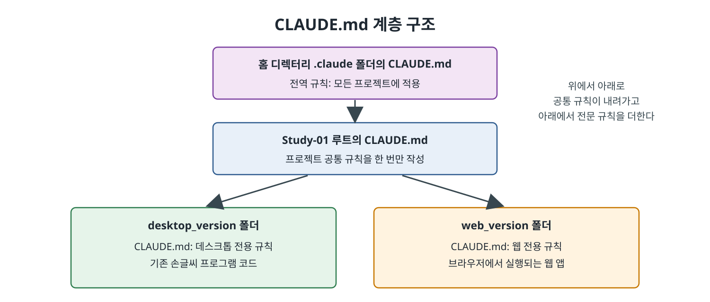

# CLAUDE.md와 계층 구조로 웹 버전 확장하기

Claude Code를 껐다 켤 때마다 프로젝트의 규칙과 기술 스택, 작업 방식을 처음부터 다시 설명해야 한다면 몹시 비효율적이다. 이 문제를 풀어 주는 것이 CLAUDE.md라는 설정 파일이다. 새로 입사한 동료에게 건네는 "업무 인수인계서"를 폴더에 미리 놓아 두는 셈이다.

이 문서에서는 CLAUDE.md를 /init 명령으로 만들고, 폴더마다 나눠 두는 계층 구조를 익힌 뒤, 앞에서 만든 손글씨 프로그램을 웹 버전으로 넓힌다. 명령 이름과 화면 문구는 책이 쓰인 시점 기준이다.



---

## 1. 설정 파일과 CLAUDE.md

설정 파일은 프로그램이 실행될 때 참고하는 규칙이나 환경 정보를 담은 문서다. 파이썬 프로젝트에서 필요한 라이브러리를 적은 requirements.txt가 대표 예다. 소스 코드를 건드리지 않고 설정 파일만 고쳐도 실행 환경이 바뀐다는 점이 특징이다.

CLAUDE.md는 프로젝트의 구조, 코딩 스타일, 핵심 명령 등을 적어 둔 파일이며 Claude Code가 실행될 때 자동으로 읽는다. 새 세션을 열어도 맥락을 다시 불러와 이전 대화를 이어 가듯 일할 수 있다. 하위 프로젝트가 여러 개면 프로젝트마다 따로 둘 수도 있다.

## 2. /init으로 CLAUDE.md 만들기

실습 준비는 간단하다. 탐색기에서 Study-01 폴더를 오른쪽 클릭해 터미널에서 열고 claude를 실행한다. 그다음 입력 칸에 아래 명령을 넣고 Enter를 누른다.

```text
/init
```

/init은 initialization(초기화)의 앞 네 글자에서 온 이름이다. Claude Code가 현재 폴더의 파이썬 파일에서 라이브러리, 클래스 구조, 함수를 분석해 체계적인 문서를 만들고 Study-01에 CLAUDE.md를 생성한다. 프로젝트 구조, 기술 스택, 핵심 명령이 자동으로 정리된다.

슬래시(/)로 시작하는 특별 명령은 Claude Code에 많다. 책은 프로젝트를 진행하며 차근차근 소개하고, 유용한 명령 미리보기는 부록에 있다고 안내한다.

## 3. CLAUDE.md의 구조와 관리

CLAUDE.md는 프로젝트를 시작할 때 Claude Code에 처음 전달되는 프롬프트이자 모든 프로젝트 정보를 담은 초기 설정 파일이다. 군더더기 설명은 토큰을 낭비하고 성능을 떨어뜨릴 수 있으므로 간결해야 한다. 정해진 형식은 없지만 Claude Code가 바로 이해하도록 구체적이고 명확하게 쓴다. 일반적인 구조는 아래와 같다.

```markdown
# 프로젝트 이름
## Project Overview   (한두 문장 요약)
## Commands           (설치, 실행, 테스트 명령)
## Tech Stack         (파이썬 버전, 라이브러리)
## Architecture       (핵심 클래스와 함수, 파일별 역할)
## Code Style         (코드와 주석, 오류 처리, 함수 이름 규칙)
## Development Notes  (현재 상태와 한계)
```

새 기능을 넣거나 중요한 설정을 바꿀 때는 CLAUDE.md에 내용을 덧붙인다. 가장 쉬운 방법은 대화 중에 Claude Code에게 직접 부탁하는 것이다.

- "이 코딩 규칙을 CLAUDE.md에 추가해 줘."
- "프로젝트 구조가 바뀌었으니 CLAUDE.md를 업데이트해 줘."

CLAUDE.md는 세션 시작마다 자동으로 불러온다. 파일이 너무 길면 쓸 수 있는 컨텍스트 윈도우(한 번에 기억하고 다룰 수 있는 대화 분량)를 많이 차지해 모든 지시를 일관되게 따르는 능력이 떨어질 수 있다.

### 두 종류의 위치

| 종류 | 위치 | 적용 범위 |
|---|---|---|
| 프로젝트별 CLAUDE.md | 현재 프로젝트 폴더(.claude 폴더가 있으면 그 안) | 그 프로젝트 안에서 계속 참조 |
| 전역 CLAUDE.md | 사용자 홈 디렉터리의 .claude 폴더(Windows는 C:\Users\사용자이름\.claude\CLAUDE.md) | 모든 프로젝트 |

macOS와 Linux에서 전역 파일은 홈 디렉터리 아래 .claude 폴더에 있다. 전역 파일은 Claude Code에게 만들어 달라고 부탁하거나, 위 경로에 직접 만들어 쓴다. 모든 프로젝트에 영향을 주므로 꼭 필요한 기본 규칙만 넣는다. 복습 문제의 정답대로 모든 프로젝트에 적용할 코딩 스타일 규칙이 전역 파일에 어울린다. 특정 프로젝트의 디렉터리 구조나 빌드 명령, API 목록은 프로젝트용 파일에 둔다.

## 4. 계층 구조로 웹 버전 만들기

프로젝트가 커지면 여러 버전을 동시에 관리해야 한다. 공통 규칙은 한곳에 두고 버전별 설정은 나누는 체계가 필요하고, 여기서 계층 구조와 CLAUDE.md가 빛난다.

컴퓨터에서 파일을 정리하는 기본 단위는 디렉터리(폴더)다. 폴더 안에는 파일뿐 아니라 하위 폴더도 들어가 나뭇가지 같은 계층이 된다. 맨 위 루트 폴더에서 하위 폴더가 뻗어 나간다. Claude Code는 시작할 때 현재 폴더와 하위 폴더 구조를 파악하고, 작업 중 필요하면 하위 폴더 내용을 살핀다.

이번에는 Study-01 아래에 desktop_version 폴더(데스크톱 전용 규칙)와 web_version 폴더(웹 전용 규칙)를 둔다. 루트 Study-01의 CLAUDE.md에는 프로젝트 공통 규칙을, 각 하위 폴더의 CLAUDE.md에는 버전별 규칙을 둔다. 아래 프롬프트로 한 번에 요청한다.

```text
I want to develop the handwriting recognition program as both a web version and a desktop version. Please create the web_version and desktop_version folders, and generate a CLAUDE.md file for each folder.
```

Claude Code가 디렉터리와 파일을 만들기 시작하고, 1번 Yes로 내용을 확인하며 진행하면 결과를 보여 준다. 2번 Yes and don't ask again을 고르면 비슷한 명령은 자동으로 진행된다. 탐색기에서 Study-01을 열면 web_version 폴더에 웹 애플리케이션이, desktop_version 폴더에 기존 데스크톱 코드가 정리돼 있고, 폴더마다 버전에 맞는 CLAUDE.md가 들어 있다.

이렇게 하면 공통 규칙은 루트에 한 번만 쓰고 서브 프로젝트에는 전문 규칙만 적어도 일관성이 유지된다. 전체 코딩 스타일을 표준화하고 체계적으로 관리하기도 쉽다. 단, 복습 문제에서 보듯 토큰 사용량이 자동으로 줄어드는 것은 이 구조의 장점이 아니다.

## 5. 웹 버전 실행하기와 localhost

이제 웹 버전을 완성한다. Claude Code에 아래 문장을 입력한다.

```text
Run the web version program in the browser.
```

웹 서버가 시작되면 http://localhost:포트번호 형식의 로컬 서버 주소가 나온다. 이 주소를 브라우저 주소창에 넣으면 손글씨 인식 프로그램이 브라우저에서 돌아간다. 라이브러리 설치 같은 동의를 구하면 1번 Yes를 고른다. 마우스로 숫자를 써서 정확히 인식되는지 확인한다. 실행 과정은 사람마다 다를 수 있고, 오류가 나면 터미널의 오류 메시지를 복사해 Claude Code에게 주고 해결을 맡긴다.

참고로 localhost는 네트워크에서 내 컴퓨터 자신을 가리키는 이름이다. 컴퓨터에는 여러 프로그램이 동시에 통신하도록 연결 통로가 여럿 있고, 통로마다 번호가 있는데 이를 포트라고 한다. http://localhost:8080이면 내 컴퓨터의 8080번 포트에서 돌아가는 프로그램에 접속한다는 뜻이다. 인터넷에 연결하지 않고도 웹 애플리케이션을 실행해 미리 볼 수 있어, 개발자는 테스트와 수정 확인에 이 방식을 쓴다.

## 6. 정리와 복습 문제

이 절에서 CLAUDE.md로 프로젝트를 체계적으로 관리하고 손글씨 프로그램을 데스크톱과 웹 버전으로 완성했다. CLAUDE.md가 세션이 바뀌어도 중요한 지시와 맥락을 유지해 준다는 점과, /init으로 자동 생성하는 방법, 폴더별 CLAUDE.md로 공통 규칙과 버전별 규칙을 나누는 방법을 배웠다. 다음 4장에서는 고급 프롬프트와 설정 파일 관리로 코드 품질과 작업 효율을 높인다. 핵심 세 가지는 다음과 같다.

- CLAUDE.md는 프로젝트의 구조, 규칙, 명령을 기록하고 Claude Code가 실행될 때 자동으로 읽는 설정 파일이다.
- /init은 현재 폴더를 분석해 CLAUDE.md를 자동 생성하는 초기화 명령이다.
- 계층 구조는 공통 규칙을 루트에 두고 하위 폴더마다 전문 규칙을 적용하는 관리 방식이다.

복습 문제 (정답은 [09장](../09. 복습 문제 정답/복습 문제와 정답.md))

1. CLAUDE.md의 주된 역할이 아닌 것은? (프로젝트 맥락 자동 복원, 코딩 규칙과 명령 저장, 이전 대화 전체 저장, 시작 시 자동 읽기)
2. CLAUDE.md를 자동 생성하는 명령은? (/start, /init, /setup)
3. 전역 CLAUDE.md에 쓰기에 알맞은 내용은? (특정 프로젝트의 디렉터리 구조, 모든 프로젝트에 적용할 코딩 스타일 규칙, 현재 프로젝트의 빌드 명령, 특정 프로젝트 전용 API 목록)
4. CLAUDE.md 계층 구조의 장점이 아닌 것은? (공통 규칙을 루트에 한 번만 작성, 서브 프로젝트별 전문 규칙, 토큰 사용량 자동 감소, 프로젝트 전체의 일관성 유지)

<br>
<br>
<br>

[Build with Claude Code](../)
