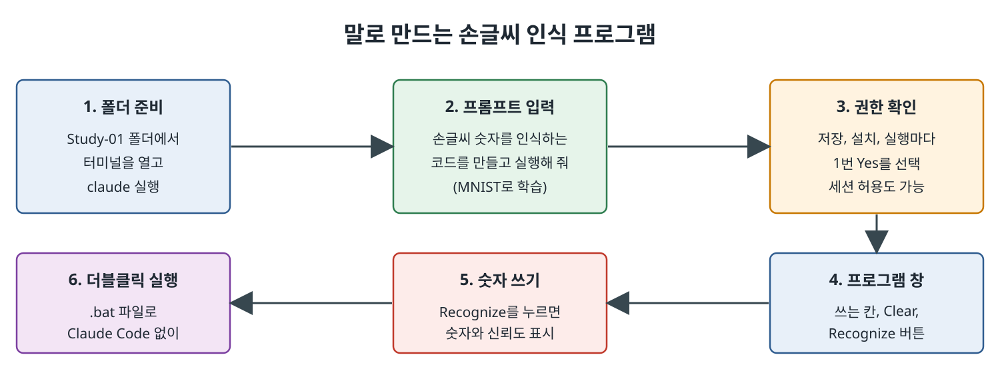

# 손글씨 인식 프로그램 만들기

설치를 마쳤으니 첫 작품을 만든다. 마우스로 숫자를 쓰면 AI가 무슨 숫자인지 맞히는 프로그램이다. 예전에는 TensorFlow, Keras, PyTorch 같은 프레임워크와 복잡한 신경망을 직접 다뤄야 했다. 지금은 만들고 싶은 기능을 말로 설명하면 Claude Code가 코드를 쓰고, 설치하고, 실행까지 한다.

요리로 치면 레시피를 외우는 대신 "카레 만들어 줘"라고 말하고 완성된 접시를 받는 경험이다. 중간에 "재료를 써도 될까요?"라는 확인이 계속 나오는데, 그때마다 허락하는 방법과 허락 범위를 고르는 방법도 이 문서에서 익힌다. 모델 이름과 화면 문구는 책이 쓰인 시점 기준이다.



---

## 1. 손글씨 인식과 MNIST

손글씨 인식은 광학 문자 인식(OCR, 인쇄된 글자를 디지털 글자로 바꾸는 기술)의 한 종류다. 다만 사람마다 글씨체가 크게 달라서 인쇄 글자보다 훨씬 어렵다.

이번 프로젝트는 MNIST 데이터셋을 쓴다. MNIST는 0부터 9까지 손으로 쓴 숫자 이미지 7만 장 묶음이다. 각 이미지는 28 곱하기 28 픽셀의 흑백이다. 1998년에 공개된 이후 컴퓨터 비전과 머신러닝의 표준 데이터로 쓰였고, 딥러닝 입문자가 가장 먼저 만나는 데이터로 유명하다. 사용자가 그린 숫자를 실시간으로 맞히는 AI가 이 데이터로 학습한다.

## 2. 프로젝트 폴더 준비와 실행

Claude Code는 지정한 작업 폴더 안에서만 일한다. 그래서 처음에 폴더를 정확히 고르는 일이 중요하다.

1. 바탕화면에 VibeCoding 폴더를 만들고, 그 안에 Study-01 폴더를 만든다.
2. 파일 탐색기에서 Study-01 안으로 들어가 빈 곳을 오른쪽 클릭한 뒤 터미널에서 열기(Open in Terminal)를 고른다. 또는 폴더 자체를 오른쪽 클릭해 같은 메뉴를 고른다. Windows 10 이하에서는 Shift 키를 누른 채 오른쪽 클릭한다.
3. 터미널에서 claude를 입력한다.
4. 이 폴더를 신뢰하느냐고 물으면 1번 Yes, I trust this folder를 고른다.

다른 방법도 있다. 작업 표시줄 검색창에서 powershell을 열고 cd 명령 뒤에 폴더 경로를 적어 이동한 뒤 claude를 실행한다. 경로는 파일 탐색기 주소창을 눌러 복사하면 쉽다.

```powershell
cd C:\Users\user\Desktop\VibeCoding\Study-01
```

복습 문제에는 폴더로 이동하는 방법이 아닌 것을 고르는 문제가 있다. Claude Code가 알아서 최적의 폴더를 고르는 일은 없다는 점이 핵심이다.

## 3. 프롬프트 한 줄로 프로그램 만들기

Study-01에서 실행한 Claude Code에 아래 프롬프트를 입력하면 작업 계획을 세우고 단계를 실행한다.

```text
Create and run code that recognizes numbers entered as handwriting.
```

진행 순서는 다음과 같다.

1. Claude Code가 파이썬 코드를 만들고 digit_recognition.py로 저장해도 되는지 묻는다. 1번 Yes를 고른다.
2. Study-01 폴더에 새 파이썬 파일이 생긴다. 같은 프롬프트라도 결과가 조금씩 다르므로 파일 이름과 출력을 확인하고 넘어간다.
3. 패키지 설치, 파일 생성과 수정, 코드 실행처럼 내 컴퓨터를 바꾸는 단계마다 Claude Code가 멈추고 확인을 구한다. 그때마다 1번 Yes를 고르면 계속 진행한다.
4. 잠시 기다리면 프로그램 창이 뜬다. 모양은 달라도 가운데 글씨를 쓰는 칸, 아래의 지우기(Clear) 버튼, 인식(Recognize) 버튼이 있다.
5. 흰 칸에 마우스로 0부터 9까지 숫자를 쓰고 Recognize를 누르면 인식한 숫자와 신뢰도 점수가 나온다. 창이 안 보이면 작업 표시줄에서 새로 열린 프로그램을 찾는다.

확인을 매번 받기가 번거로우면 2번 Yes, allow all edits during this session을 고른다. 이 세션 동안은 묻지 않고 코드를 실행한다.

## 4. Claude Code 없이 실행하기: 배치 파일

지금까지는 Claude Code 안에서 프로그램을 돌렸다. Claude Code 없이도 실행되게 하려면 배치 파일을 만든다. 배치 파일은 Windows 명령 여러 개를 모아 한 번에 실행하는 텍스트 파일이며 확장자는 .bat이다. 반복 작업을 자동화할 때 유용하다.

먼저 실행 중인 손글씨 프로그램을 닫고 Claude Code 터미널로 돌아와 아래 프롬프트를 입력한다.

```text
Make it so I can run the digit recognition program by clicking it in Windows Explorer.
```

완료 메시지가 나오면 Study-01 폴더에 .bat 파일이 생긴다. 파일 탐색기에서 더블클릭하면 명령 창이 열리고, AI 모델이 학습되고, 학습이 끝나면 손글씨 인식 창이 뜬다. 아무 일도 안 일어나면 .bat 파일을 직접 더블클릭한다. 복습 문제의 훈련 지표 설명대로, 학습 중 보이는 정확도(accuracy)는 높을수록, 손실(loss)은 낮을수록 성능이 좋다.

## 5. 파일 권한 선택지

파일을 저장할 때마다 나오는 질문에 어떻게 답하느냐가 이후 작업 방식을 정한다. 책은 다음 선택지를 소개한다.

| 선택지 | 의미 |
|---|---|
| Yes | 이번 변경 한 번만 허용하고 다음에 다시 묻는다 |
| No, and tell Claude what to do differently | 거절하고 대신 원하는 방향을 말해 준다 |
| Always allow in this project | 이 프로젝트의 파일 작업을 항상 허용한다 |

화면에 따라 "이 세션에서만 허용"이나 "다시 묻지 않기" 같은 항목도 나온다. 복습 문제는 이 중 권한 설정이 아닌 것으로 "수정을 절대 금지"를 고르게 한다. 참고(노트 작성자): 위 표는 책이 소개한 세 가지이고, 실제 메뉴 구성은 버전에 따라 달라질 수 있다.

## 6. 정리와 복습 문제

이 절에서 학습 코드를 직접 짜지 않고도 MNIST로 모델을 학습시켜 그래픽 화면이 있는 프로그램을 대화만으로 완성했다. 다음 절에서는 프로젝트 설정 파일로 맥락을 관리하며 웹 버전에 도전한다. 핵심 세 가지는 다음과 같다.

- 손글씨 인식은 손글씨 문자나 숫자를 자동으로 읽어 디지털 데이터로 바꾸는 AI 기술이다.
- MNIST는 0부터 9까지 손글씨 숫자 이미지 7만 장으로 된, 딥러닝과 컴퓨터 비전에서 가장 널리 쓰는 학습 자료다.
- 배치 파일은 여러 명령을 차례로 적어 두고 실행하면 자동으로 수행하는 Windows 텍스트 파일이다.

복습 문제 (정답은 [09장](../09. 복습 문제 정답/복습 문제와 정답.md))

1. Claude Code를 실행할 작업 폴더로 이동하는 방법이 아닌 것은? (탐색기 주소창에 powershell 입력, 터미널에서 cd로 이동, Claude Code가 최적 폴더를 자동 선택, 탐색기에서 폴더 경로를 복사해 터미널에 붙여넣기)
2. 손글씨 인식 프로그램의 훈련 중 볼 수 있는 지표를 바르게 설명한 것은? (정확도가 낮을수록 좋다, 손실이 높을수록 좋다, 정확도가 높고 손실이 낮을수록 좋다, 두 지표 모두 높을수록 좋다)
3. Claude Code의 권한 설정이 아닌 것은? (매번 확인, 이번 세션에서만 허용, 프로젝트에서 항상 허용, 수정을 절대 금지)

<br>
<br>
<br>

[Build with Claude Code](../)
