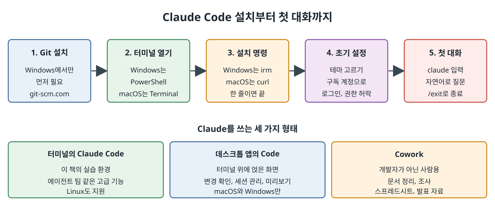

# 터미널과 Claude Code 설치

2장까지는 웹 브라우저의 Claude와 대화하며 바이브 코딩을 익혔다. 3장부터는 Claude Code로 넘어간다. Claude Code는 컴퓨터의 터미널 안에서 돌아가는 AI 코딩 도구다. 답만 보여 주는 데서 그치지 않고 파일을 직접 만들고 고치고 프로그램도 실행한다.

웹의 Claude가 "조언해 주는 컨설턴트"라면 Claude Code는 "내 책상 옆에서 같이 키보드를 잡는 동료"에 가깝다. 이 문서는 그 동료를 데려오는 과정, 곧 Git 설치, 터미널 열기, Claude Code 설치, 첫 로그인과 첫 대화, 그리고 데스크톱 앱과 Cowork까지의 선택지를 다룬다. 가격과 메뉴 이름, 화면 문구는 책이 쓰인 시점 기준이다.



---

## 1. 터미널과 Claude Code가 무엇인가

터미널은 마우스로 메뉴를 누르는 대신 글자 명령을 입력해 컴퓨터와 직접 대화하는 창이다. 프로그램 실행, 파일 관리, 시스템 설정을 모두 글자로 할 수 있다. Windows에서는 PowerShell이 터미널 역할을 한다.

웹 브라우저의 Claude는 대화형 챗봇이다. 반면 Claude Code는 터미널에서 실행되며 다음 일을 직접 한다.

- 프로젝트 폴더 안에서 파일을 만들고 수정한다.
- 프로그램을 실행해 결과를 확인한다.
- 다른 개발 도구와 자연스럽게 연결된다.

아이디어를 구상하고 초안을 잡을 때는 웹 Claude가 편하다. 실제 개발 환경에서 실행 가능한 결과물을 만들 때는 Claude Code가 강하다. 터미널은 웹보다 가볍고 빠르다는 점도 책에서 장점으로 꼽는다.

## 2. 실습 환경 준비

Claude Code는 Windows, macOS, Linux에 모두 설치된다. 설치 명령만 다르고 설치 후 사용법은 거의 같다.

### 2-1. Windows에서 Git 설치

Windows에서 Claude Code를 쓰려면 먼저 버전 관리 프로그램인 Git이 필요하다. 절차는 다음과 같다.

1. Git 공식 사이트(git-scm.com)의 Install 메뉴에서 Git for Windows/x64 Setup을 내려받는다.
2. 내려받은 설치 파일을 더블클릭하고 마법사를 따라 진행한다.
3. 설치가 끝나면 Finish를 누른다.

### 2-2. 터미널 열기

Windows 작업 표시줄의 검색창에 powershell을 입력하고 Enter를 누른다. 열린 창이 앞으로 쓸 터미널이다. 프롬프트(예: PS C:\Users\사용자이름>)는 현재 작업 폴더를 알려 준다. 창 오른쪽 위의 아래 화살표에서 설정, 색 구성표로 들어가면 배경과 글자 색을 바꿀 수 있다. 책은 인쇄 가독성을 위해 흰 배경에 검은 글자로 맞췄다.

### 2-3. Windows에서 Claude Code 설치

PowerShell에 아래 명령을 입력하면 설치된다. 설치가 끝나면 프롬프트에서 claude를 입력해 실행할 수 있다.

```powershell
irm https://claude.ai/install.ps1 | iex
```

### 2-4. macOS와 Linux에서 설치

macOS는 Command와 Space를 눌러 Spotlight 검색을 열고 Terminal을 입력해 터미널을 연다. 먼저 Git이 있는지 확인한다. 버전 번호가 나오면 설치된 것이다. macOS에는 보통 기본으로 들어 있고, 없으면 xcode-select --install 명령으로 설치를 시작한다. Git이 확인되면 아래 명령을 실행한다.

```bash
curl -fsSL https://claude.ai/install.sh | bash
```

설치 성공 메시지가 나오면 Command와 Q로 터미널을 닫고 다시 열어 claude를 입력한다. 터미널 배경색은 메뉴 막대의 Terminal, Preferences에서 바꾼다.

## 3. 처음 실행할 때의 초기 설정

처음 claude를 실행하면 순서대로 몇 가지를 고른다. 모두 방향키로 고르고 Enter로 확정한다.

1. 테마: 책은 가독성을 위해 3번 Light mode를 골랐다.
2. 로그인 방식: 1번 Claude account with subscription을 고른다.
3. 계정 연결: 웹 브라우저가 열리면 Approve 버튼을 누른다. 브라우저가 자동으로 열리지 않으면 명령 창에 나온 주소를 복사해 직접 접속한다.
4. 로그인 성공 메시지가 나오면 Enter, 이어서 보안 관련 안내를 읽고 Enter.
5. 파일 시스템 접근 허락: 1번 Yes, proceed를 고른다.

### 로그인 방식 세 가지

| 방식 | 비용 구조 | 책의 조언 |
|---|---|---|
| 구독 계정(Claude account with subscription) | 월 구독료만 내면 추가 요금이 없다 | 가장 권장 |
| Anthropic API 계정(Console) | 토큰 사용량만큼 과금된다 | 초보자는 예상 밖의 큰 비용이 나올 수 있고 사용량 추적도 번거롭다 |
| 서드파티 플랫폼 | 클라우드 업체를 거쳐 모델을 쓴다 | 이미 클라우드를 쓰는 회사용 선택지 |

3장부터의 실습은 유료 구독을 전제로 한다. Pro 요금제로도 Claude Code를 쓸 수 있지만, 원활한 학습을 위해 Max 요금제 이상을 권한다(책이 쓰인 시점 기준).

## 4. 첫 대화와 종료

입력 칸이 곧 프롬프트 창이다. 책은 첫 질문으로 아래 문장을 입력했다.

```text
Hello! Please describe what features you have.
```

Claude Code는 코딩, 개발 도구, 프로젝트 관리, 정보 검색 등 자신이 할 수 있는 일을 안내한다. 웹의 Claude와 대화하듯 자연어로 말하면 되고, 차이는 파일을 직접 만들고 고친다는 점이다.

종료는 두 방법이 있다. Ctrl과 C를 연속으로 두 번 누르거나 프롬프트에 /exit 명령을 입력한다. 그러면 일반 터미널 화면으로 돌아온다. 책의 복습 문제는 이 중 틀린 방법을 고르게 한다. 정답은 /quit 명령이다.

## 5. 터미널 말고도 쓸 수 있는 형태: 데스크톱 앱과 Cowork

Claude는 터미널의 Claude Code, 데스크톱 앱, Cowork 기능 같은 여러 형태로 쓴다. 환경마다 쓰는 법과 제공 기능이 다르다.

### Claude 데스크톱 앱의 Code

터미널 없이 쓰는 데스크톱 버전이 있다. claude.com/download에서 Windows용 설치 파일을 받아 실행하고, Get Started를 눌러 웹과 같은 계정으로 연결한다. 왼쪽 사이드바 위쪽의 Code(</>) 아이콘을 누르면 Code 화면이 열린다. 한 창에서 파일 변경을 눈으로 확인하고, 사이드바로 여러 세션을 관리하고, 앱 미리보기까지 할 수 있다.

### Cowork

사이드바의 Cowork 탭에는 개발자가 아닌 일반 사용자를 위한 기능이 있다. 대화만으로 문서를 정리하고, 자료를 조사하고, 스프레드시트나 발표 자료를 만든다.

### 이 책이 터미널을 고른 이유

데스크톱 앱이 있어도 책의 실습은 터미널의 Claude Code로 진행한다. 이유는 세 가지다.

- 기능 차이: 7장에서 다룰 AI 에이전트 팀 구성과 멀티 에이전트 조율 같은 고급 기능은 당시 터미널에서만 쓸 수 있었다.
- 원리 중심 학습: 데스크톱 버전은 터미널 실행 환경 위에 얹은 그래픽 화면이다. 터미널을 먼저 이해하면 데스크톱도 더 믿고 쓸 수 있다.
- 운영체제 호환: 데스크톱 버전은 macOS와 Windows만 지원하고 Linux는 지원하지 않는다.

두 버전과 Cowork는 따로 설치해 함께 쓸 수 있다. 다만 저자는 먼저 터미널 방식에 익숙해지기를 권한다.

## 6. 정리와 복습 문제

핵심 두 가지를 기억하면 된다. 터미널은 명령을 글자로 입력해 컴퓨터와 직접 대화하는 환경이고, Claude Code는 그 안에서 파일을 만들고 고치며 프로젝트를 관리하는 AI 코딩 도구다.

복습 문제 (정답은 [09장](../09. 복습 문제 정답/복습 문제와 정답.md))

1. Claude Code를 실행하려면 미리 설치해야 하는 프로그램은 무엇인가? (Python, Git, Node.js, Visual Studio Code 중 선택)
2. Claude Code를 종료하는 방법으로 틀린 것은? (터미널에서 /exit 입력, Ctrl+C 두 번, 터미널에서 /quit 입력, 터미널 창의 X 아이콘 클릭)
3. 월 구독료만 내고 추가 비용 없이 쓰는 Claude Code 로그인 방식은? (Anthropic Console 계정, 서드파티 플랫폼, 구독이 있는 Claude 계정, API 키 직접 입력)

<br>
<br>
<br>

[Build with Claude Code](../)
